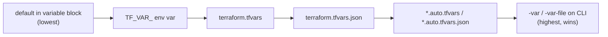

# 06 — Variables, Outputs and Locals

> **Exam domain(s):** Read, generate and modify configuration (input variables, locals, outputs); Implement and maintain state (outputs live in state)   **Source:** lesson 4, lectures 48–58, 65 and 83 (plus the sensitive-output demo from lesson 8, lecture 144)   **Time:** ~3 h (variable precedence is a classic exam question, so budget time for the labs)

## What you will learn

- Why hard-coding the same value in many places is a problem, and how an **input variable** fixes it.
- How to **declare** a variable (`variable` block) and **reference** it (`var.<name>`), and what `default`, `description`, `type`, `validation`, `sensitive`, `nullable` and `ephemeral` do.
- The standard file layout: `main.tf`, `variables.tf`, `terraform.tfvars`, `outputs.tf`.
- Every way to give a variable a value: interactive prompt, `default`, `terraform.tfvars`, `*.auto.tfvars`, `-var-file`, `-var`, and `TF_VAR_<name>` environment variables.
- The full **variable definition precedence** order, and how to predict which value wins in an exam scenario.
- How to set environment variables on Linux, macOS and Windows, and why a terminal opened earlier does not see them.
- The basic variable types (`string`, `number`, `bool`, `list`, `map`), how a wrong type shows up as an error, and how to read one element out of a list or map.
- **Local values** (`locals {}` / `local.<name>`), and exactly how they differ from variables.
- **Output values**: the `output` block, what ends up in state, and the `terraform output` command (`<name>`, `-json`, `-raw`).
- How sensitive variables and outputs behave (short reference; the full story lives in [Lesson 08](08-lifecycle-conditions-sensitive.md)).

## 🧠 Pre-concept

Think of a Terraform configuration as a **function** in a programming language.

| Terraform thing | Programming analogy | Purpose |
|---|---|---|
| **Input variable** (`variable`) | Function **parameter** | Lets the caller customise the configuration without editing the code |
| **Local value** (`locals`) | A **local variable** inside the function | Gives a name to an expression so you do not repeat it |
| **Output value** (`output`) | The function's **return value** | Hands results back to the user, or to other configurations and modules |

```text
   inputs                 the configuration                 outputs
 (variables)    --->   (resources + locals)     --->     (output blocks)

 vpn_ip = "..."         aws_security_group ...            "sg_id = sg-0abc..."
 env    = "prod"        local.common_tags ...             "public_ip = 203.0.113.10"
```

The big idea: **the code stays the same; only the values change.** The same `.tf` files can build dev, staging and prod just by feeding different values in.

> Terraform 1.12 note: two further things can feed values into a configuration (data sources, see [Lesson 05](05-resources-data-dependencies.md), and module inputs, see [Lesson 09](09-modules.md)). This chapter covers the three basic building blocks that every configuration uses.

---

## 1. The problem variables solve: repeated static values

In any larger code base, **the same hard-coded value repeated in many places** creates manual work and mistakes later.

The lecture's example:

- Your organisation has a VPN server.
- You must whitelist the VPN server's IP in a firewall for **5 ports**: 80, 443, 22, 21, 8080.
- The `cidr_ipv4` (the VPN IP) is the **repeated static value** in every rule.

With 5 rules this is annoying. Real organisations have **hundreds** of rules. If the VPN gets a new IP, you must edit every rule by hand, and any miss or typo is a production incident.

```text
BEFORE (hard-coded everywhere)             AFTER (central location)

 rule 1  cidr = 101.20.30.50/32             rule 1  cidr = var.vpn_ip ─┐
 rule 2  cidr = 101.20.30.50/32             rule 2  cidr = var.vpn_ip ─┤
 rule 3  cidr = 101.20.30.50/32             rule 3  cidr = var.vpn_ip ─┼─> vpn_ip = 101.20.30.50/32
 ...                                        ...                        │   (change it ONCE)
 rule N  cidr = 101.20.30.50/32             rule N  cidr = var.vpn_ip ─┘
```

New VPN IP? Change it in one place. On the next `terraform apply`, every rule that uses it is updated automatically.

### Benefits of variables

| Benefit | Why it matters |
|---|---|
| **Update important values in one central place** | No search-and-replace through the whole code base; saves time and avoids human error when editing 50-60 rules by hand |
| **No need to touch the core configuration file** | In production, every edit of the main `.tf` file carries risk. Changing only the variables file avoids that |
| **Reuse the same code for many environments** | dev/staging/prod differ only in their values (see `-var-file` below) |
| **Self-documenting inputs** | `type` and `description` tell the next engineer what a value is for |

🎯 **Exam focus:** A **repeated static value** is the textbook candidate for a variable. Variables are the **input** values to a configuration, and they let the same code be reused with different values.

---

## 2. Declaring and referencing a variable

You do two things:

1. **Declare** the variable (a `variable` block) and, somewhere, give it a value.
2. **Reference** it in resources with `var.<variable_name>`.

```hcl
# variables.tf  (the lecture calls the file "central-file.tf" while teaching; the real convention is variables.tf)
variable "vpn_ip" {
  default = "200.20.30.50/32"
}

variable "app_port" {
  default = "8080"
}
```

```hcl
# The resource no longer hard-codes anything
resource "aws_vpc_security_group_ingress_rule" "app_port" {
  security_group_id = aws_security_group.allow_tls.id
  cidr_ipv4         = var.vpn_ip       # "var" = it is a variable, "vpn_ip" = its name
  from_port         = var.app_port
  ip_protocol       = "tcp"
  to_port           = var.app_port
}
```

| Piece | Meaning |
|---|---|
| `variable "vpn_ip" { ... }` | **Declares** a variable named `vpn_ip` |
| `default = "..."` | The value used if nothing else supplies one |
| `var.vpn_ip` | **Reads** the variable's value at plan/apply time |
| `var.app_port` | Used for both `from_port` and `to_port`, so one change updates both |

⚠️ **Gotcha:** You **declare** with `variable "x"` but **reference** with `var.x`. Never write `variable.x` in a resource, and never write `vars.x`. This is a very common slip, and an easy exam point.

### The arguments of a `variable` block

All of them are optional.

| Argument | Purpose | Notes |
|---|---|---|
| `type` | Restricts the **data type** of the value | `string`, `number`, `bool`, `list(...)`, `map(...)`, `object(...)`, ... See section 7 and [Lesson 07](07-types-loops-functions.md). |
| `default` | The value used when nothing else provides one | If present, the variable is **optional**. If absent, the variable is **required**. |
| `description` | Human-readable explanation | Optional but strongly recommended. Shown in the prompt and in docs of modules. |
| `validation` | Custom rule that rejects bad values at plan time | Covered in [Lesson 08](08-lifecycle-conditions-sensitive.md). A quick preview is in section 8 below. |
| `sensitive` | Hide the value in CLI output | `sensitive = true`. Covered in [Lesson 08](08-lifecycle-conditions-sensitive.md). Preview in section 8. |
| `nullable` | Whether `null` is an acceptable value | `nullable = false` means passing `null` falls back to the default. Default is `true`. |
| `ephemeral` | Value is not stored in the state or plan file | Newer feature (Terraform 1.10+); see [Lesson 08](08-lifecycle-conditions-sensitive.md). |

A fully written variable looks like this:

```hcl
variable "vpn_ip" {
  type        = string
  description = "Public IP (as a /32 CIDR) of the company VPN server"
  default     = "200.20.30.50/32"
}
```

### Required versus optional variables

| Declaration | Behaviour when nobody supplies a value |
|---|---|
| `variable "ami" {}` (no `default`) | **Required.** Terraform **prompts** interactively. In automation (no terminal) it fails. |
| `variable "ami" { default = "ami-123" }` | **Optional.** The default is used. |

### Naming rules

- A variable name can contain letters, digits, underscores and hyphens, and must not start with a digit. The lecture uses `my-list` and `public-ip`; the convention (and what most teams use) is **snake_case**: `instance_type`, `vpn_ip`.
- Some names are **reserved** and cannot be used as variable names: `source`, `version`, `providers`, `count`, `for_each`, `lifecycle`, `depends_on`, `locals`.
- Variable names are **case-sensitive**: `Instance_Type` and `instance_type` are two different variables.

### Where variables can and cannot be used

Variables can be used almost anywhere in resource, data, output and locals expressions. A few places in the configuration are evaluated **before** variables exist, so they must be literal values: the `backend` block, `required_providers`, `required_version`, and a module's `source` and `version`. (Backends are in [Lesson 10](10-backends-locking-drift.md), modules in [Lesson 09](09-modules.md).)

---

## 3. Walkthrough: turning hard-coded values into variables (lecture 50)

### Starting point: hard-coded base code

A security group and three ingress rules (8080, 22, 21). The repeated value is `cidr_ipv4 = "101.20.30.50/32"` in all three:

```hcl
resource "aws_security_group" "allow_tls" {
  name        = "terraform-firewall"
  description = "Managed from Terraform"
}

resource "aws_vpc_security_group_ingress_rule" "app_port" {
  security_group_id = aws_security_group.allow_tls.id
  cidr_ipv4         = "101.20.30.50/32"
  from_port         = 8080
  ip_protocol       = "tcp"
  to_port           = 8080
}

resource "aws_vpc_security_group_ingress_rule" "ssh_port" {
  security_group_id = aws_security_group.allow_tls.id
  cidr_ipv4         = "101.20.30.50/32"
  from_port         = 22
  ip_protocol       = "tcp"
  to_port           = 22
}

resource "aws_vpc_security_group_ingress_rule" "ftp_port" {
  security_group_id = aws_security_group.allow_tls.id
  cidr_ipv4         = "101.20.30.50/32"
  from_port         = 21
  ip_protocol       = "tcp"
  to_port           = 21
}
```

**How to spot what should be a variable:** read the configuration and look for values that repeat. Here it is the CIDR block. Ports are also good candidates.

### Step 1: create the variable

```hcl
variable "vpn_ip" {
  default = "200.20.30.50/32"   # value copied from the original rules
}
```

### Step 2: reference it in the resources

Replace each `cidr_ipv4 = "101.20.30.50/32"` with `cidr_ipv4 = var.vpn_ip` in all three rules.

### Step 3: the "undeclared variable" error (a deliberate gotcha)

Running `terraform plan` before the file with the declaration was saved produced:

```text
Error: Reference to undeclared input variable
```

The cause was only that the file declaring `variable "vpn_ip"` had not been saved. Once it is saved the error goes away. This also shows that **the file name does not matter**: Terraform loads **all** `.tf` files in the directory and merges them. Only the declaration has to exist somewhere in the directory.

### Step 4: plan and apply

```bash
terraform plan                    # cidr_ipv4 shows the variable's value for every rule
terraform apply -auto-approve     # creates the security group + 3 rules
```

Verify in the AWS console (EC2 > Security Groups): the group `terraform-firewall` has inbound rules whose source is the VPN IP.

### Step 5: prove the central-change benefit

Change **only** the variable's default (the instructor changed it to a different `200...` address), then:

```bash
terraform apply -auto-approve
```

All rules are updated to the new CIDR; refreshing the console shows it. The main configuration file was never modified.

### Step 6: make the ports variables too

In production, even ports are usually variables. Final code:

```hcl
# variables.tf
variable "vpn_ip" {
  default     = "200.20.30.50/32"
  description = "This is a VPN Server Created in AWS"
}

variable "app_port" {
  default = "8080"
}

variable "ssh_port" {
  default = "22"
}

variable "ftp_port" {
  default = "21"
}
```

```hcl
# terraform-variables.tf (final)
resource "aws_security_group" "allow_tls" {
  name        = "terraform-firewall"
  description = "Managed from Terraform"
}

resource "aws_vpc_security_group_ingress_rule" "app_port" {
  security_group_id = aws_security_group.allow_tls.id
  cidr_ipv4         = var.vpn_ip
  from_port         = var.app_port
  ip_protocol       = "tcp"
  to_port           = var.app_port
}

resource "aws_vpc_security_group_ingress_rule" "ssh_port" {
  security_group_id = aws_security_group.allow_tls.id
  cidr_ipv4         = var.vpn_ip
  from_port         = var.ssh_port
  ip_protocol       = "tcp"
  to_port           = var.ssh_port
}

resource "aws_vpc_security_group_ingress_rule" "ftp_port" {
  security_group_id = aws_security_group.allow_tls.id
  cidr_ipv4         = var.vpn_ip
  from_port         = var.ftp_port
  ip_protocol       = "tcp"
  to_port           = var.ftp_port
}
```

After this refactor, `terraform plan` shows **"No changes"**: you changed how values are *sourced*, not the values themselves. That is the correct sign of a safe refactor. If the plan shows changes, you altered something else by accident.

> The ports are written as strings (`"8080"`) in the course repo. Terraform automatically converts a string that looks like a number to a number for arguments that expect numbers. Writing `default = 8080` with `type = number` is cleaner.

### Best practices stated in the lecture

| Practice | Detail |
|---|---|
| Keep the main config minimal-touch | The less you edit the main resource file, the safer production is |
| Make as many values variables as is sensible | Even ports; another engineer then only edits the variables file |
| Standard file name `variables.tf` | "Central location" was only a teaching name. Other names still *work*, but `variables.tf` is the convention everyone expects |
| Always add `description` | A new team member cannot guess what a variable is for from its name alone |

### Recommended file layout

```text
project/
├── main.tf             <- resources, written with var.<name> / local.<name>
├── providers.tf        <- terraform {} and provider blocks
├── variables.tf        <- DECLARES variables (name, type, description, default)
├── terraform.tfvars    <- GIVES values to those variables (auto-loaded)
├── locals.tf           <- local values (optional, can live in main.tf)
└── outputs.tf          <- output blocks
```

None of these names is enforced, except for the *special* ones that are loaded automatically (`terraform.tfvars`, `*.auto.tfvars`). The split is purely a readability convention.

🎯 **Exam focus:** `variables.tf` is the **conventional** name for the declarations file, but it is not mandatory. A variable reference to something not declared anywhere in the directory fails with *"Reference to undeclared input variable"*.

---

## 4. Variable definitions files (`.tfvars`)

### Concept: declare in one file, give values in another

HashiCorp recommends a **separate file ending in `.tfvars`** to hold variable **values**. Be careful with the wording: it holds variable *values*, not variable *declarations*.

| File | Role | Syntax |
|---|---|---|
| `variables.tf` | **Declares** variables (`variable "ami" {}`), no values required | HCL **blocks** |
| `terraform.tfvars` | **Assigns** values (`ami = "ami-..."`) | Plain `name = value` lines (no `variable` keyword, no braces) |

```hcl
# variables.tf  (declares only, no value)
variable "ami" {}
```

```hcl
# terraform.tfvars  (the value)
ami = "ami-0e670eb768a5fc3d4"
```

```hcl
# main.tf
resource "aws_instance" "myec2" {
  ami           = var.ami
  instance_type = "t2.micro"
}
```

A `.tfvars` file can also hold lists and maps, and can contain comments:

```hcl
# terraform.tfvars
instance_type = "t2.micro"
ports         = [22, 80, 443]
tags = {
  Team = "payments"
  Env  = "dev"
}
```

> The AMI in the lecture belonged to `ap-south-1` (Mumbai). **AMI IDs are region specific**: an ID that works in Mumbai does not exist in N. Virginia. That is a classic reason to keep per-region/per-environment values out of the code.

### Which files are loaded automatically?

```text
terraform.tfvars         -> auto-loaded
terraform.tfvars.json    -> auto-loaded
*.auto.tfvars            -> auto-loaded   (e.g. network.auto.tfvars)
*.auto.tfvars.json       -> auto-loaded
prod.tfvars, dev.tfvars  -> NOT auto-loaded, you must pass -var-file
```

| Filename | Auto-loaded? | How to use it otherwise |
|---|---|---|
| `terraform.tfvars` | Yes | n/a |
| `terraform.tfvars.json` | Yes | n/a |
| `anything.auto.tfvars` / `anything.auto.tfvars.json` | Yes | n/a |
| `prod.tfvars`, `dev.tfvars`, `custom.tfvars` | **No** | `terraform plan -var-file="prod.tfvars"` |

Naming the main file `terraform.tfvars` is **recommended**, not compulsory; you could use any name and always pass `-var-file`.

The JSON form is useful when values are generated by a script:

```json
{
  "instance_type": "t2.small",
  "ports": [22, 80]
}
```

### Multi-environment use

With several environments (dev, staging, prod) the same code is reused with different value files:

```text
main.tf + variables.tf        (static, never changes between environments)
dev.tfvars   : vpn_ip = <dev ip>,  instance_type = small
prod.tfvars  : vpn_ip = <prod ip>, instance_type = large
```

You select the environment at plan/apply time:

```bash
terraform plan -var-file="prod.tfvars"   # production values
terraform plan -var-file="dev.tfvars"    # dev-like infrastructure
```

The variables file stays static; only the chosen `.tfvars` file differs. (Isolating the *state* of each environment is a separate problem; see [Lesson 10](10-backends-locking-drift.md) for workspaces.)

### Experiments the instructor ran (all with `terraform plan`)

| # | Setup | Result |
|---|---|---|
| 1 | `variable "ami" {}` (no default) and `ami = "..."` in `terraform.tfvars` | Plan works; AMI ID is populated from the tfvars file. Terraform finds the value even though it is not in the variables file |
| 2 | `default = "ami-1234"` in the variable, `terraform.tfvars` emptied | Uses the **default** (`ami-1234`) |
| 3 | `default = "ami-1234"` **and** `ami = "ami-0e67..."` in `terraform.tfvars` | Uses the **tfvars** value. The default is ignored |
| 4 | No default; file renamed from `terraform.tfvars` to `prod.tfvars`; plain `terraform plan` | Terraform **prompts** for `var.ami` (the file is not auto-loaded) |
| 5 | Same as 4 but `terraform plan -var-file="prod.tfvars"` | Works: value is read from the named file |

Conclusions:

- The `default` is used **only if Terraform finds no value anywhere else**. An explicit `.tfvars` value overrides it.
- A file named exactly **`terraform.tfvars`** is loaded automatically.
- Any other name (`prod.tfvars`, `dev.tfvars`) must be passed explicitly with `-var-file`.

### Extra details worth knowing

- You can pass `-var-file` **several times**; files are read in the order given.
- In a `.tfvars` file, a name that is **not declared** by any `variable` block only produces a **warning** ("Value for undeclared variable"). On the command line, `-var "undeclared=1"` is an **error**. This lets one shared `.tfvars` file serve several configurations.
- `.tfvars` files only feed the **root module**. A child module gets its inputs from the arguments in its `module` block (see [Lesson 09](09-modules.md)).
- Because `.tfvars` files often hold secrets (passwords, tokens), many teams add `*.tfvars` to `.gitignore`; see [Lesson 10](10-backends-locking-drift.md) for the `.gitignore` list.

⚠️ **Gotcha:** Forgetting `-var-file` for a custom-named file leads to an unexpected prompt (or to a hard failure in a non-interactive pipeline).

🎯 **Exam focus:** `terraform.tfvars` and `*.auto.tfvars` load automatically; other names need `-var-file`. `.tfvars` = variable **values** ("variable definitions file"), `variables.tf` = variable **declarations**. The default is the lowest-priority fallback; a tfvars value beats it.

---

## 5. Ways to assign a value to a variable

### The rule: a variable that is used must end up with a value

If your configuration uses a variable, three things must be true:

1. A resource **references** it (`instance_type = var.instance_type`).
2. It is **declared** (`variable "instance_type" {}` in `variables.tf`).
3. A **value is supplied** from somewhere.

### The summary picture

```text
              +-------------------------------+
              |  variable "instance_type" {}  |
              +---------------+---------------+
                              | needs a value from ANY of:
   +-----------+--------------+-------------+--------------+----------------+
   | default   | terraform.   | -var / -var- | TF_VAR_      | interactive    |
   | in block  | tfvars       | file (CLI)   | instance_type| prompt (last)  |
   +-----------+--------------+--------------+--------------+----------------+
```

| # | Approach | Where it lives |
|---|---|---|
| 1 | Variable **default** | `default = ...` inside the `variable` block |
| 2 | **Variable definition file** | `terraform.tfvars`, `*.auto.tfvars`, or any file passed with `-var-file` |
| 3 | **Command line** | `-var "name=value"` |
| 4 | **Environment variable** | `TF_VAR_<name>` |
| 5 | **Interactive prompt** | Last resort when nothing else supplied a value |

### What happens when no value is given? Terraform prompts

```hcl
# variable-assignment.tf
resource "aws_instance" "myec2" {
  ami           = "ami-0e670eb768a5fc3d4"
  instance_type = var.instance_type
}
```

```hcl
# variables.tf
variable "instance_type" {}
```

```text
$ terraform plan
var.instance_type
  Enter a value: t2.micro
```

Terraform asks for the value on the CLI. Whatever you type is used **for that command only**. A subsequent `terraform apply` prompts **again**, because the typed value is not remembered anywhere.

> **In automation there is no keyboard.** With `-input=false` (or in a pipeline), a required variable with no value fails with *"No value for required variable"*. This is the same error text the lecture saw in the list demo (section 7).

### Approach 1: `default`

```hcl
variable "instancetype" {
  default = "t2.micro"
}
```

Used only when nothing else provides a value.

### Approach 2: definition file

```hcl
# terraform.tfvars
instancetype = "t2.large"
```

If both a default and a tfvars value exist, **tfvars wins** (already shown in section 4). To load a differently named file:

```bash
terraform plan -var-file="custom.tfvars"
```

### Approach 3: `-var` on the command line

```bash
terraform plan -var="instancetype=t2.small"
terraform plan -var "instance_type=m5.large"        # a space instead of = also works
```

No prompt appears, and the plan shows `instance_type = "m5.large"`. Use `-var` several times for several variables:

```bash
terraform apply -var "instance_type=m5.large" -var "region=us-east-1"
```

Complex values need HCL syntax and careful shell quoting (single quotes outside, double inside):

```bash
terraform plan -var 'ports=[22,80,443]'
terraform plan -var 'tags={ Team = "payments" }'
```

### Approach 4: environment variable (`TF_VAR_` prefix)

The environment variable name **must** be `TF_VAR_` followed by the **exact variable name**:

```text
variable name:     instance_type
environment var:   TF_VAR_instance_type
```

Without the exact `TF_VAR_` naming convention Terraform ignores the environment variable. Terraform reads these only when it starts, so setting one is how you inject values from a CI/CD pipeline without any file.

Complex types work too; the value is written in HCL syntax:

```bash
export TF_VAR_ports='[22,80,443]'
```

#### Windows demo (lecture 52)

1. Open Run and type `sysdm.cpl` (System Properties).
2. Advanced tab, then Environment Variables, then New.
3. Name `TF_VAR_instance_type`, value `t2.large`. Click OK twice.
4. In the **already open** command prompt run `terraform plan`: it **still prompts**.
5. Close the command prompt, open a **new** one, run `terraform plan`: no prompt, `instance_type` is `t2.large`.

**Why step 4 fails:** a process gets a *copy* of the environment when it starts. An already-open terminal does not see a variable created afterwards. Always open a new terminal.

Windows command-line alternative:

```bash
setx TF_VAR_instancetype m5.large
echo %TF_VAR_instancetype%
```

`setx` also only affects **new** terminals. (The course repo prints `echo %TF_VAR_instancetype` with a missing trailing `%`; the correct form has both `%`.)

#### Linux / macOS demo (lecture 53)

The setup in the video: a new EC2 instance with Amazon Linux, Terraform installed from the official page (`yum -y install terraform`), and running `terraform` to see the help page and confirm the install.

List environment variables currently set:

```bash
printenv
```

Demo code (`demo.tf`). The variable is declared in the same file as the resource, which works because Terraform merges all `.tf` files, but in production put it in `variables.tf`:

```hcl
provider "aws" {
  region     = "us-west-2"
  access_key = "my-access-key"     # placeholder; never hard-code real keys
  secret_key = "my-secret-key"     # placeholder
}

variable "instance_type" {}

resource "aws_instance" "myec2" {
  ami           = "ami-0e670eb768a5fc3d4"
  instance_type = var.instance_type
}
```

```bash
terraform init
terraform plan        # prompts: var.instance_type  Enter a value:   (Ctrl+C to cancel)
```

**First attempt: the wrong name (the instructive mistake):**

```bash
export instance_type=t2.large
echo $instance_type            # prints t2.large
terraform plan                 # STILL prompts for instance_type
```

The variable exists in the shell but does not follow the `TF_VAR_` convention, so Terraform does not read it.

**Correct approach:**

```bash
export TF_VAR_instance_type=m5.large
echo $TF_VAR_instance_type     # m5.large
terraform plan                 # no prompt for instance_type
```

After the prompt disappeared, the plan then failed with a **credentials error** because no valid access/secret keys were in the provider block. That was expected and not related to the variable; it actually confirmed that the variable had been resolved. Once keys were supplied, `terraform plan` worked and showed `instance_type = "m5.large"`. (An error about credentials means the variables were resolved. Do not confuse it with a variable problem.)

| Task | Command |
|---|---|
| Set variable for current shell session (Linux/macOS) | `export TF_VAR_instance_type=m5.large` |
| Show its value | `echo $TF_VAR_instance_type` |
| List all env vars | `printenv` |
| Remove it again | `unset TF_VAR_instance_type` |
| Windows (new terminals only) | `setx TF_VAR_instance_type m5.large` |
| Windows PowerShell, current session only | `$env:TF_VAR_instance_type = "m5.large"` |
| One-off for a single command (Linux/macOS) | `TF_VAR_instance_type=m5.large terraform plan` |

> `export` lasts only for the current shell session. To persist it, add the line to `~/.bashrc` or `~/.zshrc`. For AWS credentials, prefer the credential environment variables or an instance role rather than writing keys in the provider block (see [Lesson 02](02-providers.md)).

Reference configuration from the "approaches" lecture, with every source in place:

```hcl
# main.tf
provider "aws" {
  region = "us-west-2"
}

resource "aws_instance" "myec2" {
  ami           = "ami-082b5a644766e0e6f"
  instance_type = var.instancetype
}
```

```hcl
# variables.tf
variable "instancetype" {
  default = "t2.micro"
}
```

```hcl
# terraform.tfvars
instancetype = "t2.large"
```

### Gotchas

- Typing a value at the prompt does not persist; each `plan`/`apply` asks again.
- An environment variable without the exact `TF_VAR_` prefix is **silently ignored**.
- An environment variable created while a terminal is open is not visible in that terminal.
- Never put real access keys in `.tf` files (the lecture does it for demo only).
- If you set `TF_VAR_...` once and forget it, it will quietly change later results (see the precedence demo below). Use `printenv | grep TF_VAR` to check.

🎯 **Exam focus:** Know every source: `default`, `*.tfvars`, `-var`, `-var-file`, `TF_VAR_name`, prompt. The env var pattern is `TF_VAR_` + variable name. If no value is found, Terraform prompts interactively (and fails in non-interactive runs).

---

## 6. Variable definition precedence

### The question

When the **same** variable has **different** values in different places, which one does Terraform use?

```text
variable "instance_type" -> default      = t2.micro
terraform.tfvars         -> instance_type = t2.small
Environment variable     -> TF_VAR_instance_type = t2.large
```

### The rule

> Terraform loads variables in the following order, **with later sources taking precedence over earlier ones**.

| Order (low to high priority) | Source |
|---|---|
| 0 (implicit fallback) | `default` in the `variable` block, used only when nothing else supplies a value |
| 1 | Environment variables (`TF_VAR_name`) |
| 2 | `terraform.tfvars` file, if present |
| 3 | `terraform.tfvars.json` file, if present |
| 4 | Any `*.auto.tfvars` or `*.auto.tfvars.json` files (processed in **lexical/alphabetical** filename order) |
| 5 (highest) | Any `-var` and `-var-file` options on the command line (processed **in the order given**) |



The same thing as a "ladder" (higher rung wins):

```text
   HIGHEST   -var "x=..."  and  -var-file=...     (command line, last one given wins)
      ^      *.auto.tfvars / *.auto.tfvars.json   (alphabetical; later file wins)
      |      terraform.tfvars.json
      |      terraform.tfvars
      |      TF_VAR_x  (environment variable)
   LOWEST    default = ...   (only a fallback, "never overrides anything")
```

Memorise it: **env < terraform.tfvars < terraform.tfvars.json < \*.auto.tfvars(.json) < -var / -var-file**. And the prompt only happens if **none** of these provided a value.

> **Up to date (TF 1.12):** The order above is exactly what the current Terraform documentation lists. Two details the lecture only mentions in passing: (1) among several `*.auto.tfvars` files, the **alphabetically later** filename wins; (2) among several `-var` / `-var-file` options, the one **later on the command line** wins. In **HCP Terraform / Enterprise**, values set in the workspace's *Variables* tab are an additional source (see [Lesson 12](12-hcp-terraform.md)).

### Worked examples from the slides

| Env var | `terraform.tfvars` | `terraform.tfvars.json` | CLI `-var` | Result |
|---|---|---|---|---|
| 1 | 2 | 3 | 5 | **5** (CLI is last, wins) |
| `t2.micro` | `t2.large` | n/a | n/a | **`t2.large`** (tfvars beats env var) |
| `t2.micro` | `t2.large` | n/a | `m5.large` | **`m5.large`** (`-var` beats everything) |

### More practice scenarios (predict before reading the answer)

| Scenario | Value used |
|---|---|
| `default = "a"`, nothing else | `a` |
| `default = "a"`, `TF_VAR_x=b` | `b` (env beats default) |
| `TF_VAR_x=b`, `terraform.tfvars` has `c` | `c` (file beats env) |
| `terraform.tfvars` has `c`, `terraform.tfvars.json` has `d` | `d` (json file is later) |
| `terraform.tfvars` has `c`, `prod.tfvars` has `e` (not passed with `-var-file`) | `c` (`prod.tfvars` is **not** auto-loaded, so it is ignored) |
| `terraform.tfvars` has `c`, `team.auto.tfvars` has `f` | `f` (auto files beat `terraform.tfvars`) |
| `a.auto.tfvars` has `g`, `b.auto.tfvars` has `h` | `h` (alphabetically later wins) |
| `team.auto.tfvars` has `f`, run with `-var-file=prod.tfvars` (has `e`) | `e` (CLI beats auto files) |
| `-var-file=prod.tfvars` (has `e`) then `-var x=i` | `i` (later on the command line wins) |
| `-var x=i` then `-var-file=prod.tfvars` (has `e`) | `e` (again, the later option wins) |
| `default = "a"`, `terraform.tfvars` empty, nothing else | `a` |
| No default, nothing set anywhere, interactive | Terraform **prompts** |
| No default, nothing set anywhere, `-input=false` | **Error**: no value for required variable |

### Practical demo (instructor)

Base code:

```hcl
# variable-precedence.tf
resource "aws_instance" "myec2" {
  ami           = "ami-0e670eb768a5fc3d4"
  instance_type = var.instance_type
}
```

```hcl
# variables.tf
variable "instance_type" {
  default = "t2.micro"
}
```

Walk up the precedence ladder one rung at a time:

| Step | What was added | `terraform plan` shows |
|---|---|---|
| 1 | Only the default (`t2.micro`) | `t2.micro` |
| 2 | Environment variable `TF_VAR_instance_type=t2.small` (Windows; open a **new** command prompt afterwards) | `t2.small` (env overrides default) |
| 3 | `terraform.tfvars` with `instance_type = "t2.large"` | `t2.large` (tfvars overrides env) |
| 4 | `terraform plan -var "instance_type=m5.large"` | `m5.large` (CLI overrides all) |

```bash
terraform plan                                     # default, then env, then tfvars as you add each
terraform plan -var="instance_type=m5.large"       # the command to remember
```

Note on step 1: if you set the environment variable in an earlier lecture and it is still defined, your plan already shows that value instead of the default. When results surprise you, check what is set (`printenv` / System Properties).

### Real-world troubleshooting tip (CI/CD)

Sometimes in CI/CD (for example **Jenkins**) the value set in `terraform.tfvars` seems to have no effect during `apply`. Usually something **higher in precedence** is overriding it: a `-var` in the pipeline, an `*.auto.tfvars` file, or a `-var-file`. When a value is not what you expect, **walk the precedence list from the top** and look for a higher-priority source.

⚠️ **Gotcha:** `*.auto.tfvars` files silently override `terraform.tfvars`. A forgotten auto file can explain a "wrong" value. Likewise a stale `TF_VAR_` variable changes the baseline for every run in that terminal.

🎯 **Exam focus:** Expect a scenario question, "Which value will be used?" Apply the order mechanically. `-var` on the command line has the **highest** priority. An environment variable beats `default` but loses to every file and CLI option. The `default` is never "overriding" anything; it is only the fallback.

---

## 7. Variable types (the basics) and reading values

The formal explanation of **all** data types (including `set`, `object`, `tuple`, type conversion and complex nesting) is in [Lesson 07](07-types-loops-functions.md). Here you learn only what you need to declare variables correctly.

### What a data type is

A **data type** is the kind of value you give to an argument or variable. Different resource arguments expect different types, so you must know what each argument needs.

| Value | Data type |
|---|---|
| `"Hello World"` (also `"earth"`, `"KP Labs"`) | **string** (text) |
| `7575` | **number** |
| `true` / `false` | **bool** (boolean) |
| `["a", "b"]` | **list** (ordered collection) |
| `{ team = "payments" }` | **map** (key-value pairs) |

Other types (`set`, `object`, `tuple`, `null`) are covered in [Lesson 07](07-types-loops-functions.md). The concepts are the same as in Java or Python.

### Restricting a variable to a type (IAM username use case)

Requirement: usernames created in AWS through Terraform must be **numbers only** (for example an employee ID), not strings.

Base code:

```hcl
resource "aws_iam_user" "lb" {
  name = "loadbalancer"
}
```

Final code with a type restriction:

```hcl
variable "username" {
  type = number
}

resource "aws_iam_user" "lb" {
  name = var.username
}
```

Walkthrough:

1. `terraform apply` on the base code creates IAM user `loadbalancer`. It is destroyed again (`terraform destroy`) to start clean.
2. Add `variable "username" {}` with **no type** and use `name = var.username`. `terraform plan` prompts for a value. Entering `zeal` works, because there is no restriction.
3. Add `type = number`. Run `terraform plan` again and enter `zeal`.

```text
Error: Invalid value for input variable

  The given value is not suitable for var.username: a number is required.
```

A **string** is rejected where a **number** is required. Entering a numeric value such as `1234` passes. (A numeric-looking string such as `"1234"` is converted to a number automatically, so only non-numeric text is rejected.)

> **Write the type without quotes:** `type = string`, not `type = "string"`. The quoted form was required before Terraform 0.12, is deprecated, and is a classic cause of warnings in old tutorials.

### The type constraint forms you should know now

| `type =` | Accepts | Example value |
|---|---|---|
| `string` | text | `"t2.micro"` |
| `number` | whole or decimal numbers | `8080` |
| `bool` | `true` or `false` | `true` |
| `list(string)` | ordered list of strings | `["a", "b"]` |
| `list(number)` | ordered list of numbers | `[1, 2]` |
| `map(string)` | key = string-value pairs | `{ team = "payments" }` |
| `list` / `map` (bare) | same as `list(any)` / `map(any)` | any element type |
| `any` | anything | n/a |
| `set(...)`, `object({...})`, `tuple([...])` | see [Lesson 07](07-types-loops-functions.md) | n/a |

> **Up to date (TF 1.12):** The lecture uses bare `type = list` and `type = map`. They still work and mean `list(any)` and `map(any)`, but writing the element type explicitly (`list(string)`, `map(string)`) is the recommended practice, because it catches mistakes earlier.

If a variable has **no `type`**, any type is accepted. Adding `type` makes errors appear early and clearly.

### Where do I find which data type an argument needs? The docs

Terraform arguments differ: some want a string, others a list or map. In the AWS provider's `aws_instance` example:

```hcl
resource "aws_instance" "web" {
  ami           = "ami-0c101f26f147fa7fd"
  instance_type = "t3.micro"                         # string
  tags = {                                           # { } -> map
    Name = "HelloWorld"
  }
}
```

How do you know whether to use `{ }` or `[ ]`? Check the **Argument Reference** in the provider docs:

| Argument | Docs wording | Type to write |
|---|---|---|
| `instance_type` | plain text | string `"t3.micro"` |
| `tags` | "Map of tags to assign to the resource" | **map** `{ Name = "x" }` |
| `vpc_security_group_ids` | "List of security group IDs to associate with" | **list** `["sg-..."]` |

### Demo of a type error

```hcl
resource "aws_instance" "web" {
  ami                    = "ami-0c101f26f147fa7fd"
  instance_type          = "t3.micro"
  vpc_security_group_ids = "sg-06dc77ed59c310f03"      # string, but a list is required
}
```

```text
Error: Incorrect attribute value type
```

Fix by using square brackets:

```hcl
vpc_security_group_ids = ["sg-06dc77ed59c310f03"]    # list of one element
```

If you have not studied data types, "Incorrect attribute value type" looks cryptic; with them, you instantly check the docs and fix the brackets.

⚠️ **Gotcha:** "Incorrect attribute value type" nearly always means you used the wrong shape (string vs list vs map). Even a **single** value must be wrapped in `[ ]` if the argument is a list.

### Lists

A **list** stores a collection of values in one variable or argument. Written with square brackets and comma-separated values:

```hcl
["A", "B", "C"]
```

Use a list when an argument can take **multiple values**:

- `instance_type = "t3.micro"` has a single value (string).
- `vpc_security_group_ids = ["sg-1", "sg-2"]` can take many (list).

```hcl
variable "cities" {
  type    = list
  default = ["Mumbai", "Bangalore", "Delhi"]
}
```

Lists are **ordered** and **indexed from 0**.

#### List demo 1: a variable with and without a type

```hcl
variable "my-list" {
  type = list
}

output "variable_value" {
  value = var.my-list
}
```

First the lecture runs with **no `type`**, i.e. only `variable "my-list" {}`:

```bash
terraform plan                 # Enter a value: hello-world
terraform apply -auto-approve  # Enter a value: hello world
```

The output simply echoes whatever you gave (`variable_value = "hello world"`), because without a type any value is accepted.

Then `type = list` is added:

```bash
terraform apply -auto-approve
# Enter a value: hello
```

```text
Error: No value for required variable
```

The message is unhelpful, but the real cause is that `hello` is not a list. Provide square brackets:

```text
Enter a value: ["test", "hello"]
```

Outputs after apply:

```text
variable_value = [
  "test",
  "hello",
]
```

> **Up to date (TF 1.12):** The wording of the error differs between versions. When you type a wrongly shaped value at the prompt, read the **whole** message: it names the variable and the type problem. The root cause is always the same, a value that does not match the declared `type`.

#### List demo 2: security groups on an EC2 instance

```hcl
resource "aws_instance" "web" {
  ami                    = "ami-123"             # placeholder, we are only learning the concept
  instance_type          = "t3.micro"
  vpc_security_group_ids = ["sg-1234"]
}
```

Scenario: the account has two security groups (`default` and a newly created `test`) and the instance must use both, like selecting multiple groups in the EC2 console. How do you pass two IDs?

Attempt 1, comma-separated inside **one string** (does not work):

```hcl
vpc_security_group_ids = "sg-aaaa, sg-bbbb"
```

`terraform plan` returns an error. Correct: a list with two elements.

```hcl
vpc_security_group_ids = ["sg-aaaa", "sg-bbbb"]    # placeholders for real IDs
```

A single value still needs a list:

```hcl
vpc_security_group_ids = ["sg-aaaa"]      # OK, list with one element
vpc_security_group_ids = "sg-aaaa"        # ERROR: argument requires a list
```

#### Restricting the element type: `list(number)`

```hcl
variable "my-list" {
  type = list(number)       # only numbers allowed inside the list
}
```

| Input at prompt | Result |
|---|---|
| `hello` | Error (not a list) |
| `["hello"]` | Error (element is not a number) |
| `[1, 2]` | Accepted |

With plain `type = list` (no element type) any list is accepted. Typed collections give far more control.

| | string | list |
|---|---|---|
| Syntax | `"value"` | `["v1","v2"]` |
| Holds | one value | zero or more ordered values |
| `vpc_security_group_ids` | rejected | required |

Quotes and brackets are required for strings inside a list when typing at the prompt: `["a","b"]`.

### Maps

A **map** is a collection of **key-value pairs**. Lists hold only values; maps hold keys and values.

| Type | Holds | Example |
|---|---|---|
| list | values | `["a", "b"]` |
| map | key = value pairs | `{ team = "payments", location = "US" }` |

```hcl
variable "instance_tags" {
  type = map
  default = {
    name        = "app servers"
    environment = "development"
    team        = "payments"
  }
}
```

#### The most common practical use: tags

AWS tags are collections of key-value pairs (in the EC2 console, Tags: `team = dev`, `location = USA`). A list cannot represent that, so the `tags` argument of `aws_instance` is a **map**. The documentation says "Map of tags to assign to the resource."

```hcl
resource "aws_instance" "web" {
  ami           = "ami-0c101f26f147fa7fd"
  instance_type = "t3.micro"
  tags = {                   # curly braces = map
    Name = "HelloWorld"
  }
}
```

#### Map demo

```hcl
variable "my-map" {
  type = map
}

output "variable_value" {
  value = var.my-map
}
```

```bash
terraform apply
# Enter a value: ["a","b"]   -> Error: a map is required (you gave a list)
```

```bash
terraform apply -auto-approve
# Enter a value: { team = "payments" }
```

```text
variable_value = {
  "team" = "payments"
}
```

Multiple pairs, separated by commas:

```text
Enter a value: { team = "payments", location = "US" }
```

```text
variable_value = {
  "location" = "US"
  "team"     = "payments"
}
```

(Terraform prints map keys in **alphabetical** order.)

Final code with a default (no prompt appears):

```hcl
variable "my-map" {
  type = map
  default = {
    Name = "Alice"
    Team = "Payments"
  }
}

output "variable_value" {
  value = var.my-map
}
```

```text
variable_value = {
  "Name" = "Alice"
  "Team" = "Payments"
}
```

#### Map syntax notes

| Item | Rule |
|---|---|
| Outer braces | `{ ... }` |
| Pair | `key = value` (HCL also accepts `key : value`; the course uses `=`) |
| Separator | A comma on one line, or a newline between pairs |
| Keys | Usually identifiers or quoted strings |

Typed form: `map(string)` restricts the value type, similar to `list(number)`.

### Fetching one value from a list or map (lecture 58)

A common real-world and exam pattern: pick **one value** out of a list or map variable.

```hcl
provider "aws" {
  region = "us-west-2"
}

resource "aws_instance" "myec2" {
  ami           = "ami-082b5a644766e0e6f"
  instance_type = var.list[1]
}

variable "list" {
  type    = list
  default = ["m5.large", "m5.xlarge", "t2.medium"]
}

variable "types" {
  type = map
  default = {
    us-east-1  = "t2.micro"
    us-west-2  = "t2.nano"
    ap-south-1 = "t2.small"
  }
}
```

**From a map: use the key**

```hcl
instance_type = var.types["us-west-2"]     # plan shows "t2.nano"
instance_type = var.types["ap-south-1"]    # plan shows "t2.small"
```

Pattern: `var.<map_variable>["<key>"]`.

**From a list: use the position (index)**

Lists have no keys, only positions starting at **0**.

| Index | Value in `var.list` |
|---|---|
| `0` (first) | `m5.large` |
| `1` (second) | `m5.xlarge` |
| `2` (third) | `t2.medium` |

```hcl
instance_type = var.list[0]      # plan shows m5.large
instance_type = var.list[1]      # plan shows m5.xlarge
```

Pattern: `var.<list_variable>[<index>]`.

```text
var.list   = [ "m5.large", "m5.xlarge", "t2.medium" ]
                  [0]          [1]          [2]

var.types  = { us-east-1="t2.micro", us-west-2="t2.nano", ap-south-1="t2.small" }
                var.types["us-west-2"]  ->  "t2.nano"
```

| | List | Map |
|---|---|---|
| Declared with | `["a","b","c"]` | `{ k1 = "a", k2 = "b" }` |
| Pick an element by | position `var.list[1]` | key `var.types["us-west-2"]` |
| Starts at | `0` | n/a (key name) |

⚠️ **Gotcha:** List indexes start at 0, so `var.list[3]` on a 3-item list is an error ("Invalid index"). Map keys are strings and must be quoted in the lookup (`var.types["us-west-2"]`), especially when they contain dashes. A missing key gives "Invalid index"-style errors too; the `lookup()` function (with a default for missing keys) and `element()` (wraps around the list) are in [Lesson 07](07-types-loops-functions.md).

🎯 **Exam focus:** `type = number` makes `"zeal"` fail with "a number is required". `[ ]` = list, `{ }` = map. The docs wording ("List of ...", "Map of ...") tells you which to write. Reading from a list is `var.name[index]`, from a map is `var.name["key"]`; index 0 is the first element. Exam questions like "what instance type will be used?" test exactly this.

---

## 8. Quick preview: `sensitive` and `validation` on variables

Both topics are owned by [Lesson 08](08-lifecycle-conditions-sensitive.md). You only need to recognise them here.

### `validation`

A `validation` block rejects bad values at **plan** time, before any API call. This fixes the "plan passes but apply fails" problem (for example an S3 bucket name of 2 characters; AWS requires 3 to 63).

```hcl
variable "db_password" {
  type = string

  validation {
    condition     = length(var.db_password) >= 12
    error_message = "Length of Database Password must be equal to or greater than 12 characters"
  }
}
```

`condition` must evaluate to `true` for the value to pass; if it is `false`, `error_message` is shown. The value can come from **any** source (default, tfvars, `-var`, env var, prompt); validation applies to all of them.

### `sensitive`

```hcl
variable "db_password" {
  type      = string
  sensitive = true
}
```

With `sensitive = true`, plan and apply print `(sensitive value)` instead of the real value (see section 11 for outputs). This hides the value from **CLI output and logs only**; the value is still stored in plain text in the **state file**.

---

## 9. Local values (locals) — lecture 65

### The problem: repeated values

Resources in one project often share values (for example tags like `Team = payments`). Hard-coding the same value in many resources is poor practice: changing it later means editing every place.

Two ways to centralise common values:

1. **Variables** (already known): `var.tags`.
2. **Local values** ("locals"): defined in a `locals` block, referenced as `local.<name>`.

### Demo

Base code, two security groups with duplicated tag values:

```hcl
resource "aws_security_group" "sg_01" {
  name = "app_firewall"
  tags = {
    Name = "security-team"
  }
}

resource "aws_security_group" "sg_02" {
  name = "db_firewall"
  tags = {
    Name = "security-team"
  }
}
```

**Approach A, centralise with a variable:**

```hcl
variable "tags" {
  type = map
  default = {
    Team = "security-team"
  }
}
```

and in both resources `tags = var.tags`. After `terraform apply -auto-approve`, both security groups (`app_firewall`, `db_firewall`) have the tag `security-team`.

**Approach B, centralise with locals:**

```hcl
locals {
  default = {
    Team         = "security-teams"
    CreationDate = "date-${formatdate("DDMMYYYY", timestamp())}"
  }
}

resource "aws_security_group" "sg_01" {
  name = "app_firewall"
  tags = local.default
}

resource "aws_security_group" "sg_02" {
  name = "db_firewall"
  tags = local.default
}
```

Walkthrough (as shown in the video):

1. Replace `var.tags` with `local.default`. (The local's name `default` is arbitrary; it could be anything. Using `default` is legal but confusing, since `default` is also an argument name in variables; prefer something like `common_tags`.) With the same value, `terraform plan` shows **no changes**: the variable and the local hold the same data.
2. Change the value to `security-teams` (extra `s`). `plan` shows the tag changing; `apply` updates both groups. This proves locals really drive the tags.

### Why locals if variables already exist?

**Locals can hold expressions and function calls; variable defaults cannot** (a `default` must be a constant value).

Experiment from the lecture: put `CreationDate = "date-${formatdate("DD-MM-YY", timestamp())}"` (a function call) inside a variable's `default`. `terraform plan` fails with:

```text
Error: Function calls not allowed
```

Moving the same expression into a `locals` block works: `plan` shows only an added `CreationDate` tag. After `apply`, the security group shows a tag `CreationDate = date-<formatted date>`. Changing the format to `DDMMYYYY` (4-digit year) and re-applying shows the full year in the tag.

Locals can also combine values that only exist at run time:

```hcl
locals {
  # concatenate the ids of two groups of instances into one list
  instance_ids = concat(aws_instance.blue[*].id, aws_instance.green[*].id)

  # build a name from variables
  name_prefix = "${var.project}-${var.environment}"

  # reuse other locals
  full_name = "${local.name_prefix}-web"
}
```

### Locals and workspaces (a pattern you will meet in Lesson 10)

A local can hold a **map** that picks a value by key. [Lesson 10](10-backends-locking-drift.md) uses it with the built-in `terraform.workspace`:

```hcl
locals {
  instance_type = {
    default = "t2.nano"
    dev     = "t2.micro"
    prod    = "m5.large"
  }
}

resource "aws_instance" "myec2" {
  ami           = "ami-08a0d1e16fc3f61ea"
  instance_type = local.instance_type[terraform.workspace]
}
```

Reading `local.instance_type[...]` uses the same map-by-key syntax as `var.types["us-west-2"]` from section 7.

### Variables vs locals

| Aspect | Variables | Locals |
|--------|-----------|--------|
| Purpose | **Inputs** to a configuration | **Internal** named values to avoid repetition |
| Function calls / expressions | Not allowed in `default` | Allowed |
| Can be overridden from outside | **Yes**: `terraform.tfvars`, `-var`, `-var-file`, environment variables (`TF_VAR_x`) | **No**, you must edit the code |
| Block name | `variable` (singular, one per variable) | `locals` (plural, one block can define many) |
| Reference syntax | `var.name` | `local.name` (singular!) |
| Best for | Values that change per environment or are supplied by automation | Computed or shared values reused in many places |

Instructor guidance: **prefer variables whenever they work**, because they can be overridden in many places (especially useful in automation through environment variables). Use locals when you need function calls or expressions, or to avoid repeating the same expression.

### Naming gotcha

- "Local values" are often just called **locals**.
- Declare with **`locals`** (plural block name), reference with **`local.`** (singular). Write `local.default`, never `locals.default`.
- A single `locals` block can define many named values, and you can have several `locals` blocks in a module. Names must be unique within the module.
- Locals can refer to other locals, but **circular references** (`a` uses `b` and `b` uses `a`) are an error.
- Locals are visible only **inside the module** where they are defined.

🎯 **Exam focus:** Locals = named expressions; they can use functions and other references; they **cannot** be overridden by tfvars, CLI or environment variables. Variables can be overridden, but their defaults cannot contain function calls (`Function calls not allowed`). Remember `locals {}` to define and `local.name` to use. Locals reduce repetition of an expression across resources.

---

## 10. Output values

### What output values do

Output values **make information about your infrastructure available on the command line**, and can also expose it to other Terraform configurations.

```text
 User --(Terraform code: create EC2 + output its public IP)--> Terraform
 Terraform --creates EC2--> AWS
 Terraform <--reads attributes (public_ip)-- AWS
 User <--prints "public-ip = 203.0.113.10"-- Terraform
```

Without outputs, after creating an Elastic IP the CLI does not show you the IP. You would log in to the console (correct region > Elastic IPs) and copy it manually, which is slow.

### Syntax

```hcl
provider "aws" {
  region = "us-east-1"
}

resource "aws_eip" "lb" {
  domain = "vpc"
}

output "public-ip" {
  value = aws_eip.lb.public_ip
}
```

| Part | Meaning |
|---|---|
| `output "public-ip"` | Declares an output named `public-ip` (any name you like) |
| `value` | The expression whose result is printed: here the `public_ip` attribute of the EIP, found in the docs' **Attribute Reference** (`public_dns` is another available attribute) |

The arguments of an `output` block:

| Argument | Required? | Purpose |
|---|---|---|
| `value` | **Yes** | The expression to publish |
| `description` | No | What the output is for (documentation, especially for modules) |
| `sensitive` | No | `true` hides the value in CLI output |
| `depends_on` | No | Explicit dependencies for the value (rarely needed; see [Lesson 05](05-resources-data-dependencies.md)) |
| `precondition` | No | Check before the output is produced (see [Lesson 08](08-lifecycle-conditions-sensitive.md)) |
| `ephemeral` | No | In **child modules only**: the output is not stored in state (Terraform 1.10+; see [Lesson 08](08-lifecycle-conditions-sensitive.md)) |

```hcl
output "public_ip" {
  description = "Public IPv4 address of the load balancer EIP"
  value       = aws_eip.lb.public_ip
}
```

### Demo

First apply the plain EIP (resource only, no output). The CLI prints nothing about the IP. Then add the `output` block and run apply again:

```bash
terraform apply -auto-approve
```

Expected end of the run:

```text
Apply complete! Resources: 0 added, 0 changed, 0 destroyed.

Outputs:

public-ip = "203.0.113.10"
```

Nothing is created or changed in AWS. Only the outputs are added to the state and printed.

### Customising the output value

The `value` can be **any expression**. Three variants shown in the video:

```hcl
# 1. Just the IP
output "public-ip" {
  value = aws_eip.lb.public_ip
}
```

```hcl
# 2. A formatted URL using string interpolation
output "public-ip" {
  value = "https://${aws_eip.lb.public_ip}:8080"
}
```

Output: `public-ip = "https://203.0.113.10:8080"`, a ready-to-copy URL (useful when an application runs on a specific port).

```hcl
# 3. The whole resource: all attributes
output "public-ip" {
  value = aws_eip.lb
}
```

Output: every attribute of the EIP (`id`, `public_ip`, `public_dns`, `allocation_id`, `domain`, and so on) is printed as an object.

| Variant | `value` | What you get |
|---|---|---|
| 1 | `aws_eip.lb.public_ip` | Only the IP |
| 2 | `"https://${aws_eip.lb.public_ip}:8080"` | A custom string built with interpolation |
| 3 | `aws_eip.lb` | All attributes of the resource |

Clean up with `terraform destroy -auto-approve` (an unattached Elastic IP can cost money).

### Outputs live in the state file

Open `terraform.tfstate`: there is an `outputs` section. The name `public-ip` is the output name you gave, and its `value` holds the data.

```json
"outputs": {
  "public-ip": {
    "value": "203.0.113.10",
    "type": "string"
  }
}
```

(Structure illustrative; the exact JSON varies.)

### Why outputs matter beyond the CLI: sharing between projects

```text
 Project A (e.g. Git repo 1)           Project B (e.g. Git repo 2)
 creates Elastic IP                    needs the actual public IP
 output "public-ip" ----state----->    reads Project A's outputs
```

Project B can read Project A's output values from A's state file, provided it has access to that state. This is the `terraform_remote_state` data source, shown in [Lesson 10](10-backends-locking-drift.md). The networking team's `output "eip_addr" { value = aws_eip.lb.public_ip }` is exactly what the security team reads. Outputs are also how a **child module returns values to its caller** ([Lesson 09](09-modules.md)).

### Outputs also show up in plans

Adding, changing or removing an `output` shows up in the plan under its own heading, even when no resource changes:

```text
Changes to Outputs:
  + public-ip = "203.0.113.10"
```

### Name tips

- Output names may contain hyphens (as in `public-ip`), but the convention is underscores, as with resource names.
- Outputs are only evaluated and stored during `apply`. If you add an `output` block to existing, already-applied infrastructure, it shows up after the next `apply` (which makes no infrastructure changes if nothing else differs).

---

## 11. The `terraform output` command (lecture 83)

### What it does

`terraform output` reads the **output values** stored in the **state file** and prints them. You do **not** need to re-run `terraform apply` to see them again.

```bash
terraform output <output_name>
```

### The demo configuration

Three IAM users and two outputs that use the **splat expression** (`[*]`) to collect an attribute from every user:

```hcl
resource "aws_iam_user" "lb" {
  name  = "demo-user-${count.index}"
  count = 3
}

output "iam_names" {
  value = aws_iam_user.lb[*].name      # splat: list of all names
}

output "iam_arn" {
  value = aws_iam_user.lb[*].arn       # splat: list of all ARNs
}
```

- `count = 3` creates three instances of the resource (`aws_iam_user.lb[0]`, `[1]`, `[2]`). `count` and the splat `[*]` are explained in [Lesson 07](07-types-loops-functions.md).
- `aws_iam_user.lb[*].name` returns a **list** of the `name` attribute from all three instances.
- `output "<name>" { value = ... }` publishes a value after apply and stores it in the state.

### Three ways to see output values later

Imagine that days after the apply you want the list of IAM ARNs again.

| Approach | How | Comment |
|----------|-----|---------|
| 1. Run `terraform apply` again | Even with "no changes", output values are printed at the end | Works, but it is a heavyweight operation (refreshes state, makes API calls) just to read a value |
| 2. Inspect `terraform.tfstate` | Open the file, look at the `outputs` section | Works, but manual; the file is JSON and you must **never edit it by hand** |
| 3. `terraform output <name>` | `terraform output iam_arn`, `terraform output iam_names` | **Clean, fast, purpose-built** |

### Demo walkthrough

1. `terraform apply` shows 3 IAM users to be created. Type `yes`.
2. At the end of the apply the output block lists `iam_arn` and `iam_names` with their values.
3. Later, run:

```bash
terraform output iam_arn
terraform output iam_names
```

Both immediately return the stored lists, with no changes and no confirmation.

### All the forms of `terraform output`

| Command | What it prints |
|---|---|
| `terraform output` | **All** outputs of the root module as `name = value` lines |
| `terraform output iam_names` | Only the value of `iam_names` (no `name =` prefix) |
| `terraform output -json` | **All** outputs as one JSON document (name, value, type, sensitive) |
| `terraform output -json iam_names` | Only that output, as JSON |
| `terraform output -raw public_ip` | The raw value of **one string/number/bool** output, with **no quotes and no trailing newline** |

Examples:

```text
$ terraform output
iam_arn = [
  "arn:aws:iam::123456789012:user/demo-user-0",
  "arn:aws:iam::123456789012:user/demo-user-1",
  "arn:aws:iam::123456789012:user/demo-user-2",
]
iam_names = [
  "demo-user-0",
  "demo-user-1",
  "demo-user-2",
]

$ terraform output iam_names
[
  "demo-user-0",
  "demo-user-1",
  "demo-user-2",
]
```

```bash
# -json is for scripts and tools such as jq
terraform output -json iam_names | jq -r '.[]'

# -raw is for dropping a single value into a shell command
ssh ec2-user@$(terraform output -raw public_ip)
```

```text
$ terraform output public_ip
"203.0.113.10"

$ terraform output -raw public_ip
203.0.113.10
```

`-raw` only works for primitive values (string, number, bool). For a list or map use `-json`.

### Sensitive outputs

An output that contains sensitive data must itself be marked `sensitive = true`. If an output expression includes a sensitive value (for example a sensitive variable, or an attribute the provider marks sensitive) and the output is **not** marked sensitive, Terraform refuses:

```text
Error: Output refers to sensitive values
```

The fix:

```hcl
variable "db_password" {
  type      = string
  sensitive = true
}

output "pass" {
  value     = var.db_password
  sensitive = true
}
```

```text
Outputs:

pass = <sensitive>
```

How the sensitive output looks in each command:

| Command | Shows the real value? |
|---|---|
| `terraform apply` (end-of-run "Outputs:") | No, `pass = <sensitive>` |
| `terraform output` (all outputs) | No, `<sensitive>` |
| `terraform output pass` (by name) | **Yes**, plain text |
| `terraform output -json` / `-raw pass` | **Yes**, plain text |
| `terraform.tfstate` file (`outputs` section) | **Yes**, plain text |

> **Key rule:** `sensitive` protects the **CLI display and logs**. It does **not** encrypt or redact anything in the state file. Anyone who can read the state, or who runs `terraform output -json`, can read the value. So the state file itself must be protected: remote backend with encryption, restricted access, never in Git. Full discussion, plus the newer ephemeral values and write-only arguments that keep secrets out of state, is in [Lesson 08](08-lifecycle-conditions-sensitive.md). Why a hidden output is still useful: other projects or teams can read it from the state (the `terraform_remote_state` mechanism).

> **Up to date (TF 1.12):** Ephemeral values cannot be assigned to a normal root-module output. Terraform fails with an error saying the output is not declared as returning an ephemeral value. This is by design; see [Lesson 08](08-lifecycle-conditions-sensitive.md).

### Gotchas

- `terraform output` reads the **state**. If there is no state yet, or the state has no outputs, you get a warning that the state "has no outputs defined" (nothing is printed). The state must exist, either as a local file or in a remote backend.
- It does **not** create, change or refresh infrastructure. It only reads what the last `apply` stored.
- An output you just added to the code is **not** in the state until an `apply` has run.
- `terraform output` shows **root module** outputs only. A child module's outputs reach you only if the root module re-exports them with its own `output` block (see [Lesson 09](09-modules.md)).

🎯 **Exam focus:** `terraform output <name>` extracts the value of a specific output variable **from the state file**. Syntax of the block: `output "<name>" { value = <expression> }`. Outputs are printed after `terraform apply`, stored in state, and can pass data between configurations and modules. The attribute names you can output come from the resource's **Attribute Reference**. The splat expression `resource[*].attr` returns a list of that attribute for all `count` instances.

---

## 🧪 Labs

### Lab 1: Variable precedence ladder (free, no AWS needed)

This lab needs **no cloud account and costs nothing**. It uses only a variable and an output, so you can see the precedence rule directly in the output value.

**Setup**

```bash
mkdir tf-precedence-lab && cd tf-precedence-lab
```

Create `main.tf`:

```hcl
variable "instance_type" {
  type        = string
  description = "Used to demonstrate variable precedence"
  default     = "t2.micro"
}

output "instance_type" {
  value = var.instance_type
}
```

Run `terraform init` once (nothing to download, this just prepares the directory).

**Step 1: the default**

```bash
terraform apply -auto-approve
```

```text
Outputs:

instance_type = "t2.micro"
```

**Step 2: environment variable beats default**

```bash
export TF_VAR_instance_type=t2.small       # Windows cmd: set TF_VAR_instance_type=t2.small  (current window)
terraform apply -auto-approve
```

```text
instance_type = "t2.small"
```

**Step 3: `terraform.tfvars` beats the env var**

```bash
echo 'instance_type = "t2.large"' > terraform.tfvars
terraform apply -auto-approve
```

```text
instance_type = "t2.large"
```

**Step 4: `terraform.tfvars.json` beats `terraform.tfvars`**

```bash
echo '{ "instance_type": "t2.xlarge" }' > terraform.tfvars.json
terraform apply -auto-approve
```

```text
instance_type = "t2.xlarge"
```

**Step 5: `*.auto.tfvars` beats both, and the later filename wins**

```bash
echo 'instance_type = "t3.medium"' > a.auto.tfvars
terraform apply -auto-approve                      # -> t3.medium

echo 'instance_type = "t3.large"' > b.auto.tfvars
terraform apply -auto-approve                      # -> t3.large  (b is alphabetically after a)
```

**Step 6: `-var-file` beats everything auto-loaded**

```bash
echo 'instance_type = "m5.large"' > prod.tfvars
terraform apply -auto-approve                      # -> t3.large  (prod.tfvars NOT auto-loaded)
terraform apply -auto-approve -var-file=prod.tfvars   # -> m5.large
```

**Step 7: `-var` beats everything, and the later option on the command line wins**

```bash
terraform apply -auto-approve -var "instance_type=m5.xlarge"                          # -> m5.xlarge
terraform apply -auto-approve -var-file=prod.tfvars -var "instance_type=c5.large"     # -> c5.large
terraform apply -auto-approve -var "instance_type=c5.large" -var-file=prod.tfvars     # -> m5.large
```

**Step 8: the interactive prompt**

Make the variable required and remove every other source:

```bash
unset TF_VAR_instance_type                         # Windows: close the terminal
rm terraform.tfvars terraform.tfvars.json a.auto.tfvars b.auto.tfvars prod.tfvars
```

Edit `main.tf` and delete the line `default = "t2.micro"`, then:

```bash
terraform apply -auto-approve
```

```text
var.instance_type
  Used to demonstrate variable precedence

  Enter a value: t2.nano
```

Run it again and you are prompted **again**: typed values are not remembered. Finally check the non-interactive behaviour:

```bash
terraform apply -auto-approve -input=false
```

```text
Error: No value for required variable
```

**Cleanup:** there are no real resources, but you can run `terraform destroy -auto-approve` and delete the folder. Keep an eye out for a leftover `TF_VAR_` variable in your shell (`printenv | grep TF_VAR`).

**What you proved:** `default < TF_VAR_ env < terraform.tfvars < terraform.tfvars.json < *.auto.tfvars (alphabetical) < -var-file / -var (in command-line order)`.

### Lab 2: Refactor a security group to variables and `.tfvars` (AWS, free)

Security groups and their rules cost nothing, but destroy them at the end.

**Step 1.** Create a folder with `providers.tf`, `main.tf`:

```hcl
# providers.tf
provider "aws" {
  region = "us-east-1"
}
```

```hcl
# main.tf (hard-coded on purpose)
resource "aws_security_group" "allow_tls" {
  name        = "terraform-firewall"
  description = "Managed from Terraform"
}

resource "aws_vpc_security_group_ingress_rule" "app_port" {
  security_group_id = aws_security_group.allow_tls.id
  cidr_ipv4         = "101.20.30.50/32"
  from_port         = 8080
  ip_protocol       = "tcp"
  to_port           = 8080
}

resource "aws_vpc_security_group_ingress_rule" "ssh_port" {
  security_group_id = aws_security_group.allow_tls.id
  cidr_ipv4         = "101.20.30.50/32"
  from_port         = 22
  ip_protocol       = "tcp"
  to_port           = 22
}
```

```bash
terraform init
terraform apply -auto-approve
```

**Step 2.** Add `variables.tf` and `terraform.tfvars`:

```hcl
# variables.tf
variable "vpn_ip" {
  type        = string
  description = "Public IP of the VPN server as a /32 CIDR"
}

variable "app_port" {
  type        = number
  description = "Application port"
}

variable "ssh_port" {
  type        = number
  description = "SSH port"
  default     = 22
}
```

```hcl
# terraform.tfvars
vpn_ip   = "101.20.30.50/32"
app_port = 8080
```

**Step 3.** Edit `main.tf` to use `var.vpn_ip`, `var.app_port`, `var.ssh_port` instead of the literals.

**Step 4.** `terraform plan`. Expected: **No changes. Your infrastructure matches the configuration.** This proves the refactor only changed where the values come from.

**Step 5.** Change `vpn_ip` in `terraform.tfvars` only, then `terraform plan`: the two rule resources show `cidr_ipv4` being updated (`~ update in-place`). Apply, and check in the console.

**Step 6.** Create `dev.tfvars` with a different `vpn_ip` and run `terraform plan -var-file=dev.tfvars`. Then run plain `terraform plan` and compare. Then try `terraform plan -var "app_port=9090"` to see `-var` win.

**Step 7.** Break it on purpose: rename `variables.tf` to `variables.txt` and run `terraform plan`. You get *"Reference to undeclared input variable"*. Rename it back.

**Cleanup:** `terraform destroy -auto-approve`.

### Lab 3: Outputs, `terraform output`, and a sensitive output (AWS IAM, free)

IAM users are free, but destroy them at the end.

```hcl
# main.tf
provider "aws" {
  region = "us-east-1"
}

variable "db_password" {
  type      = string
  sensitive = true
  default   = "super-secret-demo-value"    # demo only; never commit real secrets
}

resource "aws_iam_user" "lb" {
  name  = "demo-user-${count.index}"
  count = 3
}

output "iam_names" {
  value = aws_iam_user.lb[*].name
}

output "iam_arn" {
  value = aws_iam_user.lb[*].arn
}

output "db_password" {
  value     = var.db_password
  sensitive = true
}
```

1. `terraform init` then `terraform apply -auto-approve`. At the end you should see `iam_arn` and `iam_names` lists and `db_password = <sensitive>`.
2. Run, one by one, and compare the output: `terraform output`, `terraform output iam_names`, `terraform output -json`, `terraform output db_password`, `terraform output -raw db_password`.
3. Open `terraform.tfstate` in a text editor (read only!) and find the `outputs` section. Note that `db_password` appears in **plain text**.
4. Remove `sensitive = true` from the **output** only and run `terraform plan`. You get *"Output refers to sensitive values"*. Put it back.
5. Add `description = "..."` to one output and run `terraform apply -auto-approve` (0 resources changed).

**Cleanup:** `terraform destroy -auto-approve`.

---

## 🎯 Exam focus (summary)

- **Reference syntax:** variables are `var.<name>`, locals are `local.<name>` (singular), declared with `variable "name" {}` and `locals {}`. Outputs have no reference syntax in the same module; they are for the CLI and for other configurations.
- **Declaration vs value:** `variables.tf` (declarations) is not the same as `terraform.tfvars` (values). Plain `name = value` lines in a tfvars file; `variable` blocks in `.tf` files.
- **Auto-loaded files:** `terraform.tfvars`, `terraform.tfvars.json`, `*.auto.tfvars`, `*.auto.tfvars.json`. Other names such as `prod.tfvars` need `-var-file`.
- **Precedence (later wins):** `default` (fallback) < env var `TF_VAR_x` < `terraform.tfvars` < `terraform.tfvars.json` < `*.auto.tfvars(.json)` < `-var` / `-var-file`. Within the CLI, the later option wins; among auto files, the alphabetically later file wins.
- **Environment variables:** exact name `TF_VAR_<variable_name>`; no prefix = ignored; open a new terminal after setting it on Windows.
- **No value anywhere:** Terraform prompts; the typed value is not remembered; in automation it errors.
- **Defaults:** the default is only a fallback; it cannot contain function calls (`Function calls not allowed`). Locals can.
- **Types:** `type = number` rejects `"zeal"`; `list(number)` rejects non-numbers; `tags` is a map; `vpc_security_group_ids` is a list even for one item. "Incorrect attribute value type" means the wrong shape.
- **Indexing:** `var.list[0]` is the first item; `var.map["key"]` picks by key.
- **Locals cannot be overridden** by tfvars/CLI/env; variables can. Prefer variables when overriding is useful.
- **Outputs:** `output "name" { value = ... }`; printed after apply; stored in state; read later with `terraform output <name>` without changing anything; `-json` for machines, `-raw` for one primitive value.
- **Sensitive:** hides values in CLI output and logs only. The state file still contains the plain text. An output referencing a sensitive value must also be `sensitive = true`.
- **Plan vs apply:** variable `validation` runs at plan time, but provider-side validation is incomplete, so a passing plan does not guarantee a passing apply.
- **Common traps:** `variable.x` instead of `var.x`; `locals.x` instead of `local.x`; `export instance_type=...` without `TF_VAR_`; a forgotten `*.auto.tfvars` overriding `terraform.tfvars`; thinking `sensitive` encrypts state.

## Key takeaways

- **Avoid repeated static values.** Put each value in a variable once and reference it with `var.<name>`; then changing the value never requires touching the resource code.
- **File conventions:** declare variables in `variables.tf`; give values in `terraform.tfvars` (auto-loaded). Add a `description` (and a `type`) to every variable.
- **`.tfvars` holds values, `variables.tf` holds declarations.** Different names such as `prod.tfvars` need `-var-file="prod.tfvars"`.
- **Ways to set a value:** `default`, tfvars files, `-var`, `-var-file`, `TF_VAR_<name>` environment variable, and (if nothing else) an interactive prompt that is not remembered.
- **Precedence (later wins):** default < env var < `terraform.tfvars` < `terraform.tfvars.json` < `*.auto.tfvars(.json)` < `-var` / `-var-file`.
- **Data types decide syntax:** string `"..."`, number `123`, list `[ ... ]`, map `{ k = v }`. Read the docs for each argument's expected type; wrap even a single list item in `[ ]`.
- **Locals** name an expression for reuse; they can call functions and cannot be overridden. **Variables** are overridable inputs, but their defaults must be constants.
- **Outputs** publish values after apply, are saved in state, and are read with `terraform output`. They are how modules and other projects get data out of a configuration.
- **`sensitive = true` is cosmetic** for CLI and logs; secrets still sit in state in plain text.
- Repo typos to avoid copying from the course material: `variable "username {` (missing closing quote), `instance_type = "t2.micro` (missing quote), `echo TF_VAR_instancetype` (missing `$`), `echo %TF_VAR_instancetype` (missing trailing `%`).

## Quick commands / syntax cheat-sheet

```hcl
# Declare (variables.tf)
variable "name" {
  type        = string            # string | number | bool | list(string) | map(string) | ...
  description = "What it is for"
  default     = "value"           # omit to make it required
  sensitive   = false             # true hides it in CLI output
  nullable    = true
  validation {
    condition     = length(var.name) > 3
    error_message = "Name must be longer than 3 characters."
  }
}

# Reference
#   var.name       var.list[0]       var.map["key"]

# Locals
locals {
  common_tags = { Team = "payments" }
  full_name   = "${var.project}-${var.env}"
}
# Reference: local.common_tags

# Output
output "ip" {
  description = "Public IP"
  value       = aws_eip.lb.public_ip
  sensitive   = false
}
```

```bash
# Values from files
terraform plan                               # auto-loads terraform.tfvars, *.auto.tfvars
terraform plan  -var-file="prod.tfvars"      # any other file name

# Values from the command line
terraform apply -var "instance_type=m5.large"
terraform apply -var 'ports=[22,80]'         # complex values: HCL syntax, mind the quoting

# Values from the environment
export TF_VAR_instance_type=m5.large         # Linux/macOS
setx TF_VAR_instance_type m5.large           # Windows (new terminals only)
printenv | grep TF_VAR                       # what is currently set?

# Outputs
terraform output                             # all outputs
terraform output ip                          # one output
terraform output -json                       # JSON for scripts
terraform output -raw ip                     # one primitive value, no quotes/newline
```

| Source | Precedence (1 = lowest) |
|---|---|
| `default` (fallback) | 0 |
| `TF_VAR_name` | 1 |
| `terraform.tfvars` | 2 |
| `terraform.tfvars.json` | 3 |
| `*.auto.tfvars` / `*.auto.tfvars.json` (alphabetical) | 4 |
| `-var` / `-var-file` (in the order given) | 5 |

## ❓ Quiz

**1.** A variable has `default = "ami-1234"`, and `terraform.tfvars` sets `ami = "ami-0e67aaaa"`. Which value is used?
A) `ami-1234` B) `ami-0e67aaaa` C) Terraform prompts D) Terraform errors because of the conflict

**2.** You create `prod.tfvars` containing `instance_type = "m5.large"` and run `terraform plan`. The variable has no default. What happens?
A) `m5.large` is used B) Terraform prompts for the value C) Terraform ignores the variable and plans with an empty string D) Terraform fails with a syntax error

**3.** How do you reference a variable named `vpn_ip` inside a resource?
A) `variable.vpn_ip` B) `vars.vpn_ip` C) `var.vpn_ip` D) `$vpn_ip`

**4.** On Linux you run `export instance_type=t2.large` and then `terraform plan`. Terraform still prompts for `instance_type`. Why?
A) `export` does not work with Terraform B) The environment variable must be named `TF_VAR_instance_type` C) The variable must be defined in `terraform.tfvars` D) You must also run `terraform init`

**5.** The environment variable is `TF_VAR_instance_type=t2.micro`, `terraform.tfvars` has `instance_type = "t2.large"`, and you run `terraform apply -var="instance_type=m5.large"`. Which value is used?
A) `t2.micro` B) `t2.large` C) `m5.large` D) The prompt appears

**6.** Put these in order from **lowest** to **highest** precedence: (a) `-var`, (b) `terraform.tfvars`, (c) `TF_VAR_x`, (d) `*.auto.tfvars`, (e) `terraform.tfvars.json`.

**7.** `a.auto.tfvars` sets `x = "one"` and `b.auto.tfvars` sets `x = "two"`. Nothing else sets `x`. Which value does Terraform use?

**8.** What is the effect of `type = number` on a variable if the user supplies `zeal`?
A) `zeal` is converted to 0 B) Terraform prompts again C) Terraform fails: "a number is required" D) It works, since types are only documentation

**9.** `vpc_security_group_ids = "sg-0abc123"` fails with "Incorrect attribute value type". What is the fix?

**10.** Given `variable "list" { default = ["m5.large", "m5.xlarge", "t2.medium"] }`, what does `var.list[1]` return?
A) `m5.large` B) `m5.xlarge` C) `t2.medium` D) An error

**11.** Why does this fail with *"Function calls not allowed"*, and how do you fix it?

```hcl
variable "created" {
  default = formatdate("DD-MM-YY", timestamp())
}
```

**12.** Which statement about locals is TRUE?
A) A value in a `locals` block can be overridden with `-var` B) You reference a local with `locals.name` C) A local can contain a function call and cannot be overridden from outside D) A local must be declared in `variables.tf`

**13.** Three weeks after `terraform apply`, you need the ARNs of the IAM users that were output. What is the cleanest way?
A) Run `terraform apply` again B) Open `terraform.tfstate` and read the file C) `terraform output iam_arn` D) `terraform plan -refresh-only`

**14.** An output refers to a sensitive variable but the output block does not set `sensitive`. What happens?
A) The value prints as plain text B) The value prints as `<sensitive>` automatically C) Terraform errors with "Output refers to sensitive values" D) The output is silently skipped

**15.** You mark an output `sensitive = true`. Where can the real value still be read?
A) Nowhere B) Only in the Terraform source code C) In the state file (`outputs` section) and via `terraform output -json` or `terraform output <name>` D) Only in HCP Terraform

**16.** Which command prints the value of a single string output with no quotes and no trailing newline, suitable for `$(...)`?
A) `terraform output name` B) `terraform output -json name` C) `terraform output -raw name` D) `terraform show name`

### Answers

1. **B.** The tfvars value beats the `default`; the default is only a fallback.
2. **B.** `prod.tfvars` is not auto-loaded (only `terraform.tfvars`, `terraform.tfvars.json`, `*.auto.tfvars(.json)` are). With no value anywhere, Terraform prompts. To use the file: `terraform plan -var-file="prod.tfvars"`.
3. **C.** `var.vpn_ip`. `variable "vpn_ip" {}` is only the declaration form.
4. **B.** The prefix `TF_VAR_` is mandatory. Without it Terraform ignores the shell variable.
5. **C.** `-var` has the highest precedence (CLI beats tfvars beats env var).
6. Lowest to highest: **(c) `TF_VAR_x`, (b) `terraform.tfvars`, (e) `terraform.tfvars.json`, (d) `*.auto.tfvars`, (a) `-var`.** The default sits below all of them.
7. **`two`.** Multiple `*.auto.tfvars` files are processed in alphabetical (lexical) order and later ones win.
8. **C.** Terraform errors with "Invalid value for input variable ... a number is required". A string that looks like a number (`"1234"`) would be converted; `zeal` cannot be.
9. Wrap it in a list: `vpc_security_group_ids = ["sg-0abc123"]`. The argument expects a list, even for one item. Check the Argument Reference ("List of ...") to know the expected type.
10. **B.** Lists are zero-indexed: `[0]` is `m5.large`, `[1]` is `m5.xlarge`, `[2]` is `t2.medium`.
11. A variable's `default` must be a constant; function calls are not allowed there. Move the expression into `locals { created = formatdate("DD-MM-YY", timestamp()) }` and use `local.created`. (Locals may contain expressions and function calls.)
12. **C.** A is wrong (locals cannot be overridden), B is wrong (`local.name`, singular), D is wrong (locals can live in any `.tf` file).
13. **C.** `terraform output iam_arn` reads from state without changing anything. A works but is heavy (refresh plus API calls); B works but is manual and error-prone; D is a different operation (it only syncs state with reality).
14. **C.** Terraform requires root-module outputs containing sensitive data to be explicitly marked `sensitive = true`.
15. **C.** `sensitive` only masks CLI display and logs. The state stores it in plain text, and by-name `terraform output` and `-json` show it. Protect the state (encrypted remote backend, restricted access, never in Git).
16. **C.** `-raw` prints one string/number/bool without quotes or a trailing newline. `-json` prints JSON (strings still quoted).

## Glossary

| Term | Meaning |
|---|---|
| **Input variable** | A declared parameter of a configuration or module, referenced as `var.<name>` |
| **Variable definitions file (`.tfvars`)** | File of `name = value` lines that supplies variable values |
| **Auto-loaded file** | `terraform.tfvars`, `terraform.tfvars.json`, `*.auto.tfvars`, `*.auto.tfvars.json` |
| **Precedence** | The order that decides which source wins when a variable is set in several places |
| **`TF_VAR_<name>`** | Environment variable that sets the variable `<name>` |
| **Type constraint** | The `type = ...` argument that restricts accepted values |
| **List** | Ordered collection written `[ ... ]`, zero-indexed |
| **Map** | Collection of `key = value` pairs written `{ ... }` |
| **Local value (local)** | A named expression inside `locals {}`, referenced as `local.<name>` |
| **Output value** | A value published with an `output` block, stored in state, read with `terraform output` |
| **Sensitive** | Marker that hides a value in CLI output and logs; does not protect the state file |
| **Splat expression** | `resource[*].attr`, a list of an attribute from every `count` instance |
