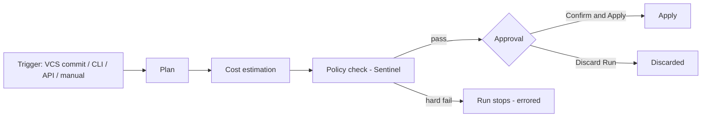
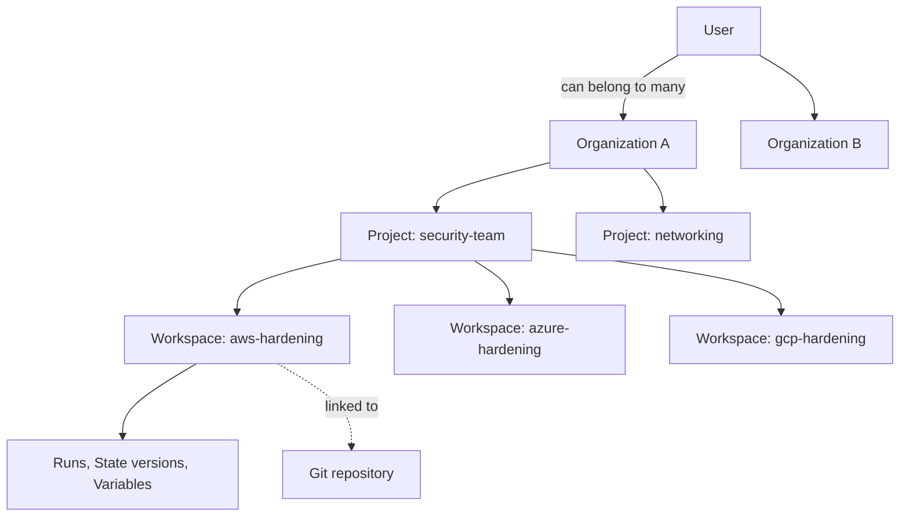
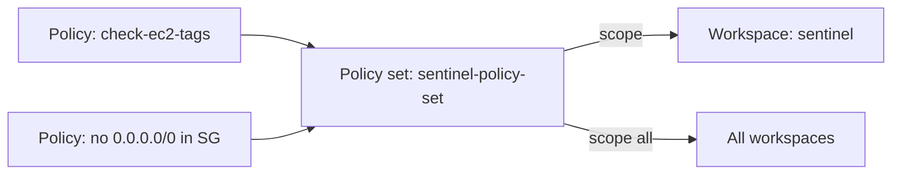
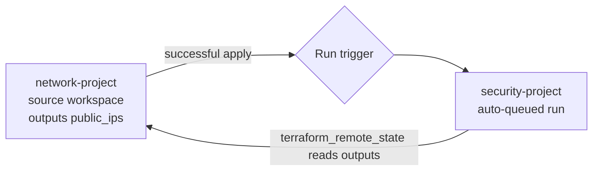

# 12 — HCP Terraform and Terraform Enterprise

> **Exam domain(s):** HCP Terraform capabilities (Terraform Cloud / Enterprise features: workspaces, runs, policy, private registry, teams, health assessments, state)   **Source:** lesson 9, lectures 150–166 (plus lesson 7, lectures 138–139 for the `terraform_remote_state` contrast)   **Time:** ~3 h (mostly concepts; the labs need a free HCP Terraform account, a GitHub account and an AWS account)

## What you will learn

- What HCP Terraform is, how it differs from running the CLI on your laptop, and why it used to be called Terraform Cloud.
- How the plans/tiers differ (Essentials, Standard, Premium, Terraform Enterprise) and which features sit in which tier. You need the direction of the tiers, not the dollar values.
- The structure: **Organization > Project > Workspace > Run**, and how an HCP workspace differs from a local directory and from a CLI workspace.
- The three workflows: **VCS-driven**, **CLI-driven** and **API-driven**, and how to run each one.
- The `cloud` block, `terraform login`, and the order **cloud block, login, init, plan/apply**.
- How runs move through **plan, cost estimation, policy check, apply**.
- **Sentinel** policy as code: policies, policy sets, scope and the three enforcement modes (and what Sentinel cannot do).
- **Terraform Enterprise** and **air-gapped** installs.
- The **private registry** for modules and providers.
- **Teams, the owners team and permission levels** (Read, Plan, Write, Admin, Custom).
- **Health assessments**: drift detection and continuous validation.
- **Run triggers**, remote state sharing, and the more secure `tfe_outputs` data source.
- How to **migrate local state** to HCP Terraform (`-migrate-state`, `-ignore-remote-version`) and how to **choose the Terraform version** per workspace.

> **Naming and volatility note.** Terraform Cloud was renamed **HCP Terraform** (HCP = HashiCorp Cloud Platform). After IBM acquired HashiCorp you may also see "IBM HCP Terraform" or "HashiCorp, an IBM company". Old blogs saying "Terraform Cloud" mean the same product. Plan names, prices, limits and UI labels in the course were quoted at recording time and change often. Those are marked **(as stated in the lecture)** below. Verify them on the current HashiCorp pages. The concepts are what the exam tests.

---

## 🧠 Pre-concept: why does HCP Terraform exist?

So far in this course you ran Terraform from your terminal: `terraform plan`, `apply`, `destroy` (see [03 — Core workflow](03-core-workflow.md)). That is how most people use Terraform day to day, and it is the skill to master first. But picture a company with 40 engineers:

- Whose laptop holds the state file? (See [04 — State basics](04-state-basics.md) and [10 — Backends, locking, drift](10-backends-locking-drift.md).)
- Everybody has a different Terraform version installed.
- Where are the AWS keys kept? Does every engineer have production keys on their laptop?
- Who approved the apply that deleted the database? Nobody saved the terminal output.
- How do you stop someone launching 50 oversized servers, or an EC2 instance without tags?

**HCP Terraform** is HashiCorp's **managed (SaaS) platform** that solves these problems around the Terraform CLI:

| Problem on a laptop | HCP Terraform answer |
|---|---|
| State scattered or in Git | Secure, versioned, locked remote state per workspace |
| Different Terraform versions | A version assigned to each workspace |
| Secrets in shell history / `.tfvars` | Sensitive workspace variables |
| No audit trail | Run history: plan output, apply output, who triggered, who approved |
| No guardrails | Policy as code (Sentinel) and cost estimation |
| Sharing modules | Private registry |
| Everyone is an admin | Teams and permissions |

The lecture's official summary: HCP Terraform **manages runs in a consistent and reliable environment**, with access control, a **private registry** for sharing modules, **policy controls** and more. It is most useful in **larger environments with many people collaborating**: teams can run plan and apply from the GUI, and the CLI is optional.

> Analogy: the Terraform CLI is a power drill in your own garage. HCP Terraform is the managed workshop: shared tools, a sign-in sheet, a supervisor who must approve big jobs, and a record of everything built.

### HCP vs HCP Terraform vs Terraform Enterprise

| Name | What it is |
|---|---|
| **HCP (HashiCorp Cloud Platform)** | The umbrella platform. HashiCorp has several products (Terraform, Vault, Boundary, Consul, Nomad) and each is available on HCP and **billed separately**. |
| **HCP Terraform** | The hosted, SaaS Terraform service (formerly Terraform Cloud). Hosted at **`app.terraform.io`**. |
| **Terraform Enterprise (TFE)** | The **self-managed** version you install in your own infrastructure. It is the only one that supports **air-gapped** installation and comes with premium support and customization. |

🎯 **Exam focus:** HCP Terraform = formerly Terraform Cloud. Same product. Hosted URL `app.terraform.io`.

---

## 1. The run pipeline (lecture 150)

Every action in a workspace is a **run**. A run goes through stages you can see on the run page:

```text
 Trigger          Plan            Cost estimation     Policy check        Apply
(VCS/CLI/API) -> terraform plan -> projected $/month -> Sentinel policies -> confirm & apply
                                                      (pass / fail)        (manual or auto)
```



- **Cost estimation** and **policy check** only appear on paid tiers (the free plan shows plan then apply).
- After a successful plan (and passing policy), the run waits for you to choose **Confirm & Apply** or **Discard Run**. This waiting point is where a human approval happens (or you can configure auto-apply).
- Every run is recorded no matter who triggered it.

🎯 **Exam focus:** the stage order is **plan, cost estimation, policy check, apply**.

### What the instructor showed in the overview demo

The demo organization had workspaces such as `network-project`, `security-project` and `demo-ec2`. Each shows a run status, and one was deliberately left **errored** to show failure.

**Inside a workspace** (`network-project`):

1. **Terraform version** and a **list of runs** ("43 minutes ago", "a day ago"). Every run is recorded.
2. **Run history is retained.** On a laptop CLI, plan/apply output is **not saved**, so after a few days you cannot see what it looked like. HCP Terraform keeps the plan output, apply output, **who triggered the run and who approved the apply**.
3. **State is stored by the platform.** In the **States** tab you can open the latest and older state versions and see what changed.
4. **Variables tab.** Create Terraform variables and **environment variables** (AWS access keys, DB passwords) per workspace and mark them **sensitive**. This keeps secrets out of `.tf` files, which is much safer in large organizations.
5. **Version control.** The workspace is connected to a GitHub repository holding `main.tf`. The VCS trigger can be **branch-based**, **tag-based** and so on.
6. **A workflow demo.** The instructor edited a value in GitHub and committed. HCP Terraform detected the commit and started a run whose source was *git*. (He triggered it manually in the demo, but it can be automated.) The run showed:
   - Plan finished: "1 to change".
   - **Cost estimation** finished: $0.00 per month.
   - **Policy checks passed**.
   - Apply pending: **Confirm & Apply** or **Discard run**. He confirmed, the run was queued, then applied.

**The `demo-ec2` workspace (the failure case)** was connected to a repo with a simple `ec2.tf` creating a `t2.small` instance:

| Stage | Result |
|---|---|
| Plan | Shows what will be created |
| Cost estimation | The instance costs about **$17 per month** if run 24x7 (as stated in the lecture) |
| Sentinel policy | **Failed.** The policy is "EC2 must have tags" and the resource had no tags |

The point: a security team can write any rule, for example "if the instance type is `t2.small` (about $17/month) fail the run and force `t2.micro`, which is free tier". Developers who launch oversized instances are caught at the cost-estimation stage.

**Workspace Settings** showed locking, notifications, **access** (add teams and permissions per workspace) and **version control** (change the repository or provider, such as GitHub). When a connected repository is updated, HCP Terraform can run plan, cost estimation and Sentinel checks automatically, and a team member then runs apply manually. The exact workflow varies by organization.

### Local CLI vs HCP Terraform

| Aspect | Local CLI | HCP Terraform |
|---|---|---|
| Interface | Terminal | Web UI (plus CLI and API) |
| Plan/apply history | Not saved by default | Saved per run, with who triggered and approved |
| State | Local `terraform.tfstate` by default | Stored and versioned by the platform |
| Secrets | Shell env, `.tfvars`, prompts | Sensitive workspace variables |
| Collaboration | Ad hoc | Teams, permissions, approvals |
| Policy and cost checks | None | Sentinel policies, cost estimation (paid tiers) |
| Where the code lives | Local folder | VCS repo (or local folder in CLI-driven mode) |

🎯 **Exam focus:** HCP Terraform stores run history, state, variables, and can enforce policy. Cloud credentials belong in workspace variables marked sensitive, not in `.tf` files.

---

## 2. Pricing and tiers (lecture 151)

*(All plan names, prices and feature placement are **as stated in the lecture** and change frequently.)*

### Is it free?

HCP Terraform is **not entirely free**. Depending on usage and required features there are several plans. Naming changed after IBM acquired HashiCorp. **Billing is per month and per resource** (the instructor flags this as an important point).

### Plans (as stated in the lecture)

| Plan | Position |
|---|---|
| **Essentials** | Fewest features. The instructor's demo account was on this, billed pay as you go |
| **Standard** | More features |
| **Premium** | Most expensive, most features |
| **Terraform Enterprise** | Self-managed product. Premium support and customization such as **air-gap installation** |

### Payment models (as stated in the lecture)

| Model | Description |
|---|---|
| **Pay as you go** | On-demand, usage-based billing with **no long-term commitment**. You get starter **credits** to try features, which makes testing easy |
| **Flex** | Single-year or multi-year plans with preferred pricing |
| **Enterprise self-managed** | Fully customizable, for maximum control |

With pay as you go, the more resources you manage, the more you pay. Other HashiCorp products are priced differently. For example, Vault was quoted at **$0.62 per cluster per hour**.

### Feature comparison

The pricing page has a comparison table with sub-tabs: visibility and optimization, policy and security, governance/risk/compliance, integrations and API. The instructor's simplified table:

| Feature | Essentials | Standard | Premium | Enterprise |
|---|---|---|---|---|
| Audit logging / audit trail | No | Yes | Yes | Yes |
| Drift detection | No | Yes | Yes | Yes |
| Continuous validation | No | Yes | Yes | Yes |
| Policy as code (Sentinel) | No | Yes | Yes | Yes |
| Air-gap installation | No | No | No | **Yes** |

The "No" for Essentials on audit logging, drift detection and continuous validation is stated explicitly in lectures 151 and 163. The other cells follow the lecture's general statement that these features need a higher tier. Check the live pricing page for exact details.

Other tier statements scattered through the lectures:

- **Team management** and giving teams access to groups of workspaces via **projects** need the **Standard** edition (lecture 153).
- **Health assessments** are in **Standard and Premium** (and Enterprise per the pricing page) (lecture 163).
- The **free plan** has a **resource limit of 500** (lecture 154, as stated).
- **Sentinel** is a **paid** feature. A trial of the "**Team & Governance**" plan enables policies, policy sets and cost estimation (lecture 158).
- **Billing is at the organization level** (lecture 153). Each organization can have its own plan.

### Quick tier table

| Capability | Where it appears |
|---|---|
| Workspaces, VCS runs, remote state, variables, private registry | Free tier (500 resource limit as stated) |
| Sentinel policy, cost estimation, policy sets | Paid (trial of Team & Governance) |
| Teams beyond `owners`, project-level access by team | Standard and above |
| Audit logging, drift detection, continuous validation | Standard, Premium, Enterprise |
| Air-gapped installation | **Terraform Enterprise only** |

> **Up to date (TF 1.12):** HashiCorp has re-packaged the plans several times (older names: Free, Team, Team & Governance, Business). The older "Team & Governance" trial named in the lecture may now appear under a different plan name. Treat any plan name as temporary. The stable exam ideas are: (1) a free tier exists but has limits, (2) governance features (policy, drift, audit) cost more, (3) **air-gap = Terraform Enterprise**.

🎯 **Exam focus:**

- Pricing is per resource, per month. Billing is at the **organization** level.
- **Air-gapped installation is Terraform Enterprise only.**
- Audit logging, drift detection and continuous validation are **not** in the lowest tier.
- Do not memorize dollar values. Know that a higher tier means more governance features.

---

## 3. Creating an account (lecture 152)

Conceptual and UI only:

1. Search "HCP Terraform". The hosted service is at **`app.terraform.io`**.
2. Choose **Create a free account**.
3. Enter a **username**, an **email address** (the username must differ from the email) and a **password**, then **Create account**.
   - Instructor's trick: use a `+` alias in the email (for example `name+tag@example.com`) to get a fresh account without a new mailbox. Whether plus-addressing works depends on your mail provider.
4. A **verification email** is sent. Click the link to confirm.
5. HCP Terraform asks you to **create your first organization** (next section).

A free account is enough for most practicals here. Sentinel, policies, teams and health assessments need a paid or trial plan.

---

## 4. Base structure: organization, project, workspace (lectures 153–154)

### The hierarchy

```text
Account / User
  |
  +-- Organization  (billing, teams, users, private registry live here)
        |
        +-- Project  (group of workspaces; used for ownership and access)
              |
              +-- Workspace  (code link + variables + state + runs)
                     |
                     +-- Run  (plan -> cost -> policy -> apply)
```



### Organization

- A **shared space for one or more teams to collaborate on workspaces**.
- You can have **multiple organizations** (lecture examples: `kplabs-org`, `xyz-company-org`). The first thing HCP Terraform asks at sign-up is the organization name.
- **Billing is managed at the organization level.** Each organization can have its own plan.
- One user can belong to **multiple organizations**.
- The **private registry**, **teams** and **users** live at the organization level.

### Workspace

On your laptop you have a **folder** (for example `kplabs-terraform`) containing `.tf` files, variable definitions and so on. In HCP Terraform the equivalent is a **workspace**: a set of related things needed for one project to run.

- **One folder corresponds to one workspace.** A different project gets a different workspace.
- **Code is not uploaded file by file.** In the VCS workflow you **link the workspace to a Git repository**, and the workspace fetches the files from there and then runs plan, apply, destroy.
- Supported VCS providers: **GitHub, GitLab, Bitbucket, Azure DevOps**.
- Workspace tabs include **Runs**, **States**, **Variables** and **Settings** (version control, general, access and so on).

**Workspace vs local directory** (comparison from the HashiCorp docs, shown in the lecture):

| Component | Local CLI (directory) | HCP Terraform (workspace) |
|---|---|---|
| Terraform configuration | On disk in the folder | In a linked **VCS repository** (or uploaded by the CLI) |
| Variable values | `.tfvars` files, env vars, CLI flags | Stored **in the workspace** |
| State | `terraform.tfstate` in the same folder | Stored and managed by HCP Terraform, per workspace |
| Credentials and secrets | Shell environment or prompts | Stored as **sensitive variables** |

⚠️ **Gotcha: two different things are called "workspace".** A **CLI workspace** (`terraform workspace new dev`, see [10 — Backends, locking, drift](10-backends-locking-drift.md)) is just another named state file inside the same working directory and backend. An **HCP Terraform workspace** is a whole project environment with its own state, variables, runs and permissions. The lecture says an HCP workspace is closer to a **directory** than to a CLI workspace. If a question mixes them, look for words like "variables, runs, team access": that is the HCP one.

### Project

- Projects **organize workspaces into groups**. Example: a `security-team` project containing `aws-hardening`, `azure-hardening` and `gcp-hardening` workspaces.
- Each workspace belongs to exactly one project. A **Default Project** exists automatically.
- Benefits:
  - Reflects the team ownership structure in larger organizations.
  - With the **Standard** edition (not the free tier) you can **give teams access to a group of workspaces via a project**.
- **Team management** is a higher-tier feature and essential for large organizations. If you work alone or on a few projects you do not need that complexity.

### Practical: creating an organization, project and workspace (lecture 154)

1. After sign-up, **create the organization**, for example `example-kplabs-org` (the name is yours to choose, and it must be unique across HCP Terraform).
2. The new organization shows menus for **Projects, Workspaces, Registry** and **Settings**. A **Default Project** exists already.
3. **Create a project**, for example `Terraform Learning`. (The instructor notes the UI occasionally glitches. A page refresh fixes it.)
4. **Create a workspace**. When created from the top-level Workspaces tab you choose which **project** it belongs to.
5. Three workflow choices appear when creating a workspace: **Version control workflow**, **CLI-driven workflow**, **API-driven workflow** (next section).
6. **Registry** menu: large enterprises have their own modules and providers. HCP Terraform provides a **private registry** so you do not have to build one.
7. **Settings**: general settings, **plan and billing** (the free plan shows a resource limit of 500, as stated in the lecture), **users** (invite team members) and more.

🎯 **Exam focus:**

- Hierarchy: **Organization > Project > Workspace**.
- **Billing is per organization.**
- A workspace links to VCS (GitHub, GitLab, Bitbucket, Azure DevOps) to fetch code.
- State, variables and credentials all live inside the workspace.

---

## 5. The three workflows

When you create a workspace, you choose how runs are started.

| Workflow | Where the code lives | Where runs execute | Typical use |
|---|---|---|---|
| **Version control (VCS)** | Git repository linked to the workspace | HCP Terraform | Most common in organizations. "Best for those that need traceability and transparency" |
| **CLI-driven** | Local working directory | HCP Terraform (remote operation), triggered from your local CLI | "Best for those comfortable with Terraform CLI". You do not want to commit to Git but still want remote runs, state and variables |
| **API-driven** | Anywhere. Uploaded via the API | HCP Terraform | Custom automation and integrations |

Comparison, side by side:

| | VCS-driven | CLI-driven | API-driven |
|---|---|---|---|
| Code from | Git repository | Local directory | Uploaded through the API |
| Trigger | Commit, PR, tag, manual run | CLI commands | API calls |
| Best for | Traceability, teams | CLI users who do not want to commit to Git | Custom automation |
| Execution | HCP Terraform | HCP Terraform | HCP Terraform |
| Needs a Git commit | Yes | No | No |
| Variables/credentials | Workspace | Workspace | Workspace |
| State | Workspace | Workspace | Workspace |

> Important: in **all three** workflows the run executes **remotely** in HCP Terraform and uses the **workspace's** variables and state. Only the source of the code and the trigger differ.

> **Up to date (TF 1.12):** a workspace also has an **execution mode**: *Remote* (default, runs on HCP Terraform's infrastructure), *Local* (HCP Terraform is used only to store state, and plans run on your own machine) and *Agent* (runs on a self-hosted agent in your network, useful when HCP Terraform cannot reach private infrastructure). This is beyond the lecture but is useful context for scenario questions.

---

## 6. VCS-driven workflow: core practical (lecture 155)

### Goal

See the whole **VCS-driven workflow** end to end: a workspace linked to a GitHub repo fetches the code, uses its own variables, credentials and state, and runs plan and apply remotely.

### Files

`ec2.tf` (placed in the GitHub repository):

```hcl
resource "aws_instance" "myec2" {
  ami           = "ami-00c39f71452c08778"
  instance_type = "t2.micro"
}
```

> ⚠️ **Gotcha:** the AMI ID is **region-specific**. The instructor deploys to **us-east-1**, so use an AMI valid in the region you choose. There is no `provider` block here. The region comes from the `AWS_REGION` environment variable in the workspace.

Environment variables to add in the workspace:

```text
AWS_ACCESS_KEY_ID
AWS_SECRET_ACCESS_KEY
AWS_REGION
```

These names come from the AWS provider documentation (see [02 — Providers](02-providers.md) for AWS authentication methods).

### 🧪 Lab 1: a VCS-driven run

> **Cost:** if you click **Confirm & Apply** you create a real `t2.micro` EC2 instance. The instructor **discarded** the run. Destroy anything you apply.

1. **Create a GitHub repository.** Example: `kplabs-terraform-learning` (public, for simplicity). Sign up for GitHub if you have no account.
2. **Add `ec2.tf`** (code above) to the repository and **commit**.
3. In HCP Terraform open the organization and **create a workspace** in your project (for example `Terraform Learning`).
4. Choose the **Version Control workflow**, then the provider **GitHub** (`github.com`). Authorize if prompted.
5. **Pick the repository.** If the repo is not listed, type its full name as `<github-user>/<repo-name>` and press enter. Optionally add a description. Ignore Advanced options. Click **Create**.
6. **Configure AWS credentials.** HCP Terraform runs on its own infrastructure, so it needs credentials to deploy into your AWS account. The AWS provider documentation lists ways to supply them:
   - In code: **not good practice**.
   - **Environment variables**: the **better option**, used here.
7. In AWS, create a dedicated IAM user for the demo (the instructor used the name `HCP-Terraform` with `AdministratorAccess` for simplicity, which is **not least privilege**; see [00 — Prerequisites](00-prerequisites.md) for IAM users and access keys), and generate an access key and secret key.
8. In the workspace **Variables** tab choose **Add variable**, then **Environment variable**:

   | Key | Value | Sensitive |
   |---|---|---|
   | `AWS_ACCESS_KEY_ID` | `<your-access-key-id>` | marked sensitive |
   | `AWS_SECRET_ACCESS_KEY` | `<your-secret-access-key>` | marked sensitive |
   | `AWS_REGION` | `us-east-1` | no |

   Never paste real keys into notes or Git. After saving, the UI hides sensitive values. They are **write-only**.
9. Open the workspace and start a run: **New run**, then **Start**.
10. Watch the stages:
    - **Fetch** the code from the repo (the run shows `ec2.tf`).
    - **Plan** runs. The output shows `instance_type = t2.micro`, the AMI and so on.
    - **Apply** waits for confirmation.
11. Click **Confirm & Apply** to create the resource, or **Discard Run** to throw it away. The instructor discarded it ("apply not required") since the goal was only to understand the workflow.
12. Cleanup if you applied: in the workspace choose **Settings**, then **Destruction and Deletion**, then **Queue destroy plan**, confirm and apply. Then delete the workspace.

### Flow diagram

```text
 GitHub repo  --(commit / manual New Run)-->  HCP Terraform workspace
 (ec2.tf)                                      |  uses workspace variables
                                               |  (AWS_* env vars, sensitive)
                                               v
                                          Plan  -->  [Confirm & Apply | Discard Run]
                                               |
                                               v
                                    AWS (us-east-1) resources
                                    + state stored in workspace
```

🎯 **Exam focus:**

- Cloud credentials go into the workspace as **environment variables, marked sensitive**.
- A VCS workspace pulls code from Git. You do not upload files.
- After plan you can **Confirm & Apply** or **Discard Run**.
- **Sensitive** variables are write-only in the UI.

> **Up to date (TF 1.12):** two newer options are worth knowing about. **Variable sets** let you define variables (such as the AWS credentials) once and attach them to many workspaces or projects. **Dynamic provider credentials** (OIDC) let a workspace get short-lived AWS credentials without any stored access keys. Both are generally preferred over pasting long-lived keys into every workspace.

---

## 7. CLI-driven workflow (lectures 156–157)

### Why a CLI-driven workflow?

With the VCS workflow you must commit to a Git repo. What if you do not want to commit, but still want the **operation to run remotely** in HCP Terraform? **Answer: the CLI-driven workflow.**

- The **working directory stays on your laptop** and is **linked to an HCP Terraform workspace**.
- You run `terraform plan` / `apply` / `destroy` in your local terminal.
- **Execution happens remotely** in HCP Terraform. Output is **streamed back** to your terminal.
- You do not manually upload `.tf` files. The Terraform CLI uploads the configuration automatically.

```text
   Local laptop                         HCP Terraform
 +--------------------+  link via   +---------------------------+
 | working directory  |  cloud {}   | Workspace "remote-op..."  |
 |   *.tf files       | ----------> |  - runs plan/apply        |
 |   terraform plan   |  (stream    |  - stores state           |
 +--------------------+   output)   |  - holds env variables    |
                                    +---------------------------+
```

### The `cloud` block

You **link** a local directory to a workspace using a `cloud` block inside the `terraform` block:

```hcl
terraform {
  cloud {
    organization = "mykplabs-org"

    workspaces {
      name = "remote-operation"
    }
  }
}
```

| Argument | Meaning |
|---|---|
| `organization` | The HCP Terraform organization that owns the workspace |
| `workspaces { name = ... }` | The workspace to link to. **This is what "linking" means** |

The lecture pairs it with a simple resource (reconstructed: a security group named `allow_tls`):

```hcl
# (reconstructed) the lecture mentions a security group "allow_tls"
resource "aws_security_group" "allow_tls" {
  name        = "allow_tls"
  description = "Allow TLS inbound traffic"
}
```

The course repo's `iam.tf` for the same demo hardcodes credentials in the provider block. That is bad practice, so only use placeholders, and prefer workspace variables:

```hcl
provider "aws" {
  region     = "us-west-2"
  access_key = "YOUR-ACCESS-KEY"
  secret_key = "YOUR-SECRET-KEY"
}

resource "aws_iam_user" "lb" {
  name = "loadbalancer"
  path = "/system/"
}
```

> **Up to date (TF 1.12):** the `cloud` block is the current, recommended way to connect to HCP Terraform (it appeared in Terraform 1.1). It replaced the older `backend "remote"` block, which still works but is the legacy way. Notes beyond the lecture:
> - Instead of `name` you can use `tags = ["app", "prod"]` inside `workspaces` to map one configuration to several workspaces (then `terraform workspace select` chooses between them). `name` and `tags` are mutually exclusive.
> - `hostname` defaults to `app.terraform.io`. Set it only for Terraform Enterprise.
> - The organization and workspace can also come from environment variables `TF_CLOUD_ORGANIZATION` and `TF_WORKSPACE`.
> - The `cloud` block cannot be combined with a `backend` block in the same configuration.

### The four-step process (lecture 157)

| Step | Action |
|---|---|
| 1 | Set up the **cloud integration**: add the `cloud` block with the **organization** and **workspace** |
| 2 | Run **`terraform login`** to authenticate and obtain an API token |
| 3 | Run **`terraform init`** to initialize |
| 4 | Run **`terraform plan` / `apply`** from the local CLI (the run executes in HCP Terraform) |

🎯 **Exam focus:** memorize the order **cloud block, `terraform login`, `terraform init`, plan/apply**.

### 🧪 Lab 2: CLI-driven run with `time_sleep`

The demo resource simply waits 10 seconds on apply, so it is free and safe (reconstructed, as the instructor described it):

```hcl
# (reconstructed)
resource "time_sleep" "wait_10_seconds" {
  create_duration = "10s"
}
```

The instructor first ran it **locally** (`terraform init`, `terraform apply -auto-approve`) to confirm it works, then removed the earlier local files (state, `.terraform`) to keep the directory clean.

1. **Create the workspace.** In HCP Terraform select the project, choose the **CLI-driven workflow** and name it `cli-driven-workflow`. HCP Terraform then displays **example code** (the `cloud` block with your organization and workspace pre-filled). Copy it into a `.tf` file in your local directory:

   ```hcl
   terraform {
     cloud {
       organization = "<your-org>"

       workspaces {
         name = "cli-driven-workflow"
       }
     }
   }
   ```

2. **Log in:**

   ```bash
   terraform login
   ```

   - It warns that the token will be **stored in plain text** in a file whose path it prints (on Linux/macOS this is `~/.terraform.d/credentials.tfrc.json`). Type `yes`.
   - A browser opens at the HCP Terraform **token generation** page. (The instructor copied the link into a different browser that was logged in to his practice account.)
   - Click **Generate token**. Optionally set an **expiration** (for example 1 hour for a demo), copy the token and paste it into the terminal. **The pasted token is not echoed**, which is normal.
   - Success output: `Retrieved token for user ...` and a "Welcome to HCP Terraform!" banner. Never share or commit this token.

3. **Initialize:**

   ```bash
   terraform init
   ```

   The output now says it is **initializing HCP Terraform**.

4. **Plan:**

   ```bash
   terraform plan
   ```

   The output states clearly that it is running in HCP Terraform and prints a **run URL**. In the workspace's **Runs** page you see a run **triggered via the CLI**, with the same `time_sleep` plan you saw in the terminal.

5. **Verify remote execution** by comparing versions: the streamed output showed Terraform **1.9.7** while `terraform version` on the laptop showed **1.9.1**. Different versions prove the plan ran in HCP Terraform, not locally.

6. **Apply and destroy** (these also run remotely):

   ```bash
   terraform apply -auto-approve
   terraform destroy -auto-approve
   ```

   Each creates its own run record you can see in the UI.

> **Up to date (TF 1.12):** instead of the interactive browser flow you can set the token in an environment variable named `TF_TOKEN_app_terraform_io` (dots in the hostname become underscores), which is how CI systems authenticate. A `terraform logout` command removes the stored token.

### Demo: the first remote run fails (lecture 156)

The instructor's folder contained `cli-workflow.tf` with the `cloud` block (workspace `remote-operation`) and the security group.

1. `terraform plan` printed that the run is in HCP Terraform and gave a run URL. The version in the output was **1.9.7** (it even offered an upgrade) while the laptop had **1.9.1**.
2. **The first run errored.** The cause was **provider credentials**. The AWS keys worked on the laptop, but they were **not configured in the workspace**. This is the key lesson: remote runs use **workspace variables**, not your laptop's environment.
3. Fix: add or update `AWS_ACCESS_KEY_ID` and `AWS_SECRET_ACCESS_KEY` in the workspace variables, then **Save variable**.
4. Re-run `terraform plan`. It succeeds ("security group is being planned to create"). Open the printed run URL in a browser to see the same run in the UI.
5. `terraform apply -auto-approve` gives a separate run URL. Confirm `AWS_REGION = us-east-1` in the variables, then check the AWS console (N. Virginia, Security Groups) for `allow_tls`.
6. `terraform destroy -auto-approve` also runs remotely and removes the security group.

### VCS vs CLI-driven summary

| Aspect | VCS-driven | CLI-driven |
|---|---|---|
| Trigger | Git commit/PR/tag (or manual New Run) | `terraform plan/apply` in your terminal |
| Code location | Git repo | Local directory |
| Execution | Remote (HCP Terraform) | **Remote (HCP Terraform)**, streamed to your terminal |
| Needs a Git commit | Yes | No |
| Variables/credentials | Workspace | **Workspace** (your local env is not used for remote runs) |
| State | Workspace | Workspace |

⚠️ **Gotcha:** a remote run **does not use your laptop's AWS credentials**. It fails with provider authentication errors until the workspace has the variables.

⚠️ **Gotcha:** the Terraform version in the streamed output (remote) can differ from `terraform version` (local). That is a handy way to tell where a run executed.

🎯 **Exam focus:**

- CLI-driven workflow: **local files, remote execution**. Linked through the `cloud` block (or the older `remote` backend).
- `terraform login` generates and stores an **API token**, saved in **plain text** in a local credentials file.
- The `cloud` block needs `organization` and a `workspaces` block (with `name`, or `tags` for several workspaces).
- When you create a workspace with the CLI-driven workflow, the UI hands you the starter code.

---

## 8. Sentinel: policy as code (lecture 158)

### What is Sentinel?

- A **policy-as-code framework** integrated with **HashiCorp Enterprise products**.
- It lets you add **logic-based policy decisions**. Depending on the logic, a Terraform **apply can run or be blocked**.
- It runs **after plan (and cost estimation) and before apply**.
- Sentinel policies are a **paid feature**. On the free plan you cannot use them.

Structure:

```text
Policy  ("block EC2 without tags")
   |  attached to
   v
Policy set
   |  associated with (scope: all workspaces OR specific workspaces)
   v
HCP Terraform workspace(s)
```



The Terraform documentation hosts **example policies** per cloud platform. Examples named in the lecture: **disallow the `0.0.0.0/0` CIDR in security groups** and **mandatory tags on taggable AWS resources**.

### The demo policy

```text
import "tfplan"

main = rule {
  all tfplan.resources.aws_instance as _, instances {
    all instances as _, r {
      (length(r.applied.tags) else 0) > 0
    }
  }
}
```

(The course repo tags this block as `sh`. It is really the Sentinel language, not a shell script.)

How to read it:

| Line | Meaning |
|---|---|
| `import "tfplan"` | Imports the plan data (the planned state of the run) so the policy can inspect it |
| `main = rule { ... }` | `main` is the entry-point rule. The policy passes only if it evaluates to true |
| `all tfplan.resources.aws_instance as _, instances` | Iterate over every `aws_instance` resource definition in the plan |
| `all instances as _, r` | Iterate over each instance of that resource |
| `(length(r.applied.tags) else 0) > 0` | The planned `tags` must have length greater than 0. `else 0` supplies 0 if tags are missing. So **no tags = fail** |

> **Up to date (TF 1.12):** `tfplan` is the legacy v1 import. Current HashiCorp docs use `tfplan/v2`, with a slightly different structure (`plan.resource_changes` and so on). You do not need to write Sentinel for the exam. You need to know what it is for.

The EC2 code used to test the policy:

```hcl
provider "aws" {
  region = "us-west-2"
}

resource "aws_instance" "myec2" {
  ami           = "ami-082b5a644766e0e6f"
  instance_type = "t2.micro"

  tags = {
    Name = "HelloWorld"
  }
}
```

In the demo the instance first had **no tags** (so the policy fails), then the **`tags` block was added** (so it passes). The repo shows the fixed version.

### Enforcement modes

| Mode | Behavior |
|---|---|
| **hard mandatory** | A failure **blocks the run and cannot be overridden** |
| **soft mandatory** | A failure blocks the run, but an authorized user **can override** |
| **advisory** | **Logging only**. A failure does not block the run |

> **Up to date (TF 1.12):** HCP Terraform also supports **Open Policy Agent (OPA)** as an alternative policy framework (policies written in Rego, with the same idea of policy sets and enforcement levels). It is not in this lecture, but the exam may mention OPA next to Sentinel.

### 🧪 Lab 3: Sentinel demo (needs a paid plan or a trial)

1. **New workspace** (VCS workflow, GitHub, the same repository as before). Name: `sentinel`.
2. **Plan and billing:** the free plan does not show policy features. The instructor started a **trial** of the **Team and Governance** plan (as stated in the lecture). After a refresh, new menu items appear: **Cost estimation, Policies, Policy sets**.
3. **Create a policy set:** connection type **No VCS**, name `sentinel-policy-set`. **Scope of policies:** all workspaces, or specific workspaces. Choose the workspace `sentinel` and click **Add workspace**.
4. **Create a policy:** name `check-ec2-tags`, paste the policy code, set **enforcement mode = hard mandatory**, attach it to `sentinel-policy-set`, then **Create policy**.
5. **Set variables in the `sentinel` workspace:** AWS access key and secret key (secret marked sensitive), plus the region, as in Lab 1.
6. **Start a new run.** With the paid plan you see two extra stages:
   - **Cost estimation:** finished, about **8.3 USD per month** for a `t2.micro` (as stated in the lecture).
   - **Policy check:** **hard failed**, because the EC2 instance has no tags. **Apply cannot run and cannot be overridden.**
7. **Fix the code.** In GitHub edit `ec2.tf`, add `tags = { Name = "HelloWorld" }` and commit. HCP Terraform **automatically starts a new run** (VCS trigger).
8. This time the **policy check passes** and **Confirm & Apply** is offered.
9. **Cleanup:** workspace **Settings**, then **Destruction and Deletion**, then **Delete from HCP Terraform**. Type the workspace name (`sentinel`) to confirm. If you applied, destroy the resources first.

### Limits of Sentinel (instructor's guidance)

- Sentinel only checks resources **created through Terraform**. If someone **manually creates an EC2 instance** in the AWS console, Sentinel does not block it.
- For production you need policy checks at **two levels**: at the IaC level (Sentinel) **and** at the cloud level (for example **AWS Config** rules on running resources).
- Instructor's personal remark: in the heavy-Terraform organizations he has worked with, he has not seen Sentinel (or HCP Terraform / Enterprise) widely used. Even the free Terraform CLI runs production-grade environments at scale. This is an opinion, not exam content.

🎯 **Exam focus:**

- Sentinel = **policy as code**, a **paid-tier** feature, runs **after plan/cost estimation and before apply**.
- Policy goes into a **policy set**, which is scoped to **workspaces**.
- Three enforcement levels: **advisory, soft mandatory, hard mandatory**.
- Sentinel cannot catch resources created outside Terraform.

---

## 9. Terraform Enterprise and air-gapped environments (lecture 159)

### What is an air gap?

An **air gap** is a **network security measure** that physically isolates a secure computer network from unsecured networks, meaning the public internet.

```text
 Normal environment                     Air-gapped environment

 [Server] [Server] [Server]             [Server] [Server] [Server]
     \       |       /                      \       |       /
      [Internet gateway] <--> Internet       [Internal router]   (no gateway,
                                              no path to Internet or other
                                              unsecured networks)
```

### Where air-gapped systems are used

- **Military** and **government** networks.
- **Financial systems** such as **stock exchanges**.
- **Industrial control systems**, for example **oil and gas fields**.

Challenge with no internet: how do you download OS patches, antivirus and IPS updates? These networks are critical, so the risk of internet exposure is judged too high.

### Terraform Enterprise and air gaps

**Terraform Enterprise** (self-managed) can be installed in two ways:

1. **Online** installation: needs internet connectivity, straightforward.
2. **Air-gapped** installation: everything must be **prepared offline**. The installer asks you to **provide a path to, or upload, the air-gap bundle**.

An air-gapped install is **only possible with Terraform Enterprise**. From lecture 151, it is **not available** in the HCP-managed plans (Essentials, Standard, Premium).

🎯 **Exam focus:**

- Air gap = no internet / physically isolated. Terraform Enterprise supports an **air-gapped install** using an **offline bundle**.
- Typical air-gap users: military, government, financial, industrial control (oil/gas).

---

## 10. The private registry (lecture 160)

### Revision: the public registry

On `registry.terraform.io` you browse providers and modules. For a module you see multiple **versions**, the **source code** (from GitHub), a README with inputs, outputs, dependencies and resources, **download counts** and a **provisioning instructions** snippet. (Modules in general: [09 — Modules](09-modules.md).)

### Private registry

- Enterprises will not publish all their modules and providers on the public registry. They want them **private**, usable only by workspaces within their organization.
- The **HCP Terraform private registry** works like the public registry and helps you **share Terraform providers and modules across your organization**.
- You do not need to build your own registry because it is part of HCP Terraform. It is reachable from the **Registry** menu, which shows **Modules** and **Providers**.

### Demo: a private module

The demo organization had a module named `private-module`, shown with a **private** badge ("only available in this registry"). The module is very simple: it **generates a random pet name**, with inputs for **word count** and **separator**.

The module page is auto-generated from the code and shows the README and usage instructions, inputs, outputs, dependencies, resources, versions (for example 1.0.3), the **source** (the GitHub repository) and **download metrics** (week, month, year, all time).

### Using a private module

The **usage instructions** on the module page give the exact source string to copy. Consumers specify the **private registry source**, the **version** and any variables:

```hcl
# (reconstructed; the exact source string is shown in the registry's usage instructions)
module "private_module" {
  source  = "app.terraform.io/<your-org>/private-module/<provider>"
  version = "1.0.3"

  word_count = 4     # the demo used a count of four
}
```

Private registry sources have the form `<HOSTNAME>/<ORGANIZATION>/<MODULE NAME>/<PROVIDER>`, and the host is `app.terraform.io` for HCP Terraform. Always copy the exact string from the registry's usage panel.

In the demo, a workspace named `module-consumer` is linked to a Git repo that calls this module. Its last run **applied** and the output was a four-word name. Only the **source** needs to be correct. Otherwise this is the same as using a public module.

### Using a private module outside HCP Terraform

If you paste the same module block into a local folder and run `terraform init` with **no credentials**, you get an **unauthorized** error. To use a private module from the CLI you must **configure an API token** (for example with `terraform login`):

```bash
terraform init   # -> Error: unauthorized (no API token configured)
```

### Publishing a new version

- The module is linked to a GitHub repo (`demo-module`). The instructor changed an output (renamed `id` to `name`) and committed.
- In the registry you **publish a new version**. The latest was **1.0.3**, so he published **1.0.4**. It shows "new version pending", then after a refresh version **1.0.4** is available.
- **Publishing a new module:** connect a **Git provider**, choose the **repository** and select the **publishing type**: **tag-based** or **branch-based**. In the demo the module's publishing type was branch-based.

> **Up to date (TF 1.12):** the registry requires a certain repository naming convention for modules (`terraform-<PROVIDER>-<NAME>`), and tag-based publishing expects semantic version tags such as `v1.0.4`. The general module publishing rules are in [09 — Modules](09-modules.md). Version constraints on the `version` argument work as described there.

🎯 **Exam focus:**

- **Private registry** = share **modules and providers** privately across the organization, part of HCP Terraform.
- Calling a private module: use the **private registry source** (copy it from the usage instructions) plus `version`.
- Outside HCP Terraform you need an **API token** (`terraform login`), or `init` fails as **unauthorized**.
- Modules are published from **Git** (tag-based or branch-based). A new version is published to the registry.

---

## 11. Teams and permissions (lectures 161–162)

### Inviting users

- HCP Terraform is designed so the **whole team can collaborate** on multiple projects.
- **Settings, then Users** (or Teams): **invite a user** by **email address** and choose the **team** to add them to.
- The invitee receives an **email invitation** ("you have been invited by X to join <organization> on HCP Terraform") and accepts it.

### Teams

- **Teams** are **groups of HCP Terraform users** within an organization.
- You can have multiple teams, each with a different composition based on requirements.
- **By default every organization has an `owners` team**, the default team, with the **highest access**. (The demo organization's `owners` team had 32 members.)
- With a free plan you effectively only have the `owners` team. **Creating additional teams requires a higher plan** (as stated in the lecture).

```text
Organization
  |-- Team: owners       (default, full access)
  |-- Team: developers   (higher plan)
  |-- Team: security     (higher plan)
          \--> each team has users, and is granted permissions on projects/workspaces
```

### Principle: avoid the owners team

The **owners team has all permissions** in the organization. When inviting a new user, **do not add them to the owners team** unless they truly need that level of access. Instead, create teams such as **developers** and **security** and invite users into those. This is the **principle of least privilege**.

The instructor notes lecture 162 is **theoretical**: some features are paid, so you cannot try them without paying. Still, the exam has questions on them.

### Organization-level permissions when creating a team

| Area | What you can set |
|---|---|
| **Project-level permissions** | Access across projects |
| **Workspace-level permissions** | Access across workspaces |
| **Policies** | Permission to manage policies |
| **Private registry** | Permission to manage the registry |

When you invite a new user (on a higher-tier plan) you choose the team, so they join it automatically when they accept.

### Workspace-level team access

In **workspace Settings, then Team access, then Add team**, choose the team and the permission level. Example: workspace `dev-webapp`, team `developers`.

**Permission levels: Read, Plan, Write, Admin, Custom.**

| Level | Meaning (extra context, per HashiCorp docs) |
|---|---|
| **Read** | View runs, state outputs, variables (non-sensitive) and configuration |
| **Plan** | Read, plus queue plans (speculative or real) but not apply |
| **Write** | Plan, plus apply runs, lock/unlock, manage variables and state versions |
| **Admin** | Write, plus workspace settings, team access, VCS settings and deletion |
| **Custom** | Pick individual permissions |

**Custom** permission granularity shown in the lecture:

| Permission | Options |
|---|---|
| **Runs** | for example **read, plan, and apply** |
| **Variables** | **No access, read, read and write** |
| **State** | **No access, read outputs only, read, read and write** |
| Other controls | **Sentinel mocks**, **run tasks**, and so on |

```text
User --member of--> Team --granted on--> Project / Workspace
                       (Read | Plan | Write | Admin | Custom)
                       Custom -> runs / variables / state / sentinel mocks / run tasks
```

🎯 **Exam focus:**

- The **owners** team is the default team with the **highest** privileges. Put people in the **least-privileged** team they need.
- Workspace permission levels: **Read, Plan, Write, Admin, Custom**.
- State access options: **none, read outputs only, read, read-write**. "Outputs only" is the basis for safer cross-workspace sharing (see `tfe_outputs` below).
- Team access is workspace-scoped or **project-scoped** (project-wide access on higher tiers).
- Multiple teams need a **higher-tier plan**.

---

## 12. Health assessments (lecture 163)

*(Paid: available in Standard and Premium editions as stated in the lecture, and in Enterprise per the pricing page. You cannot test it on the free tier.)*

HCP Terraform can run **automatic health assessments in a workspace**. The aim is to check whether **real infrastructure matches** what your Terraform configuration requires. There are **two types**:

| Evaluation | Question it answers |
|---|---|
| **Drift detection** | Does the real-world infrastructure still match the Terraform configuration? |
| **Continuous validation** | Do **custom conditions** in the workspace configuration **continue to pass after** Terraform provisions the resources? |

### Drift detection

- **Configuration drift** is one of the most common problems in larger enterprises. (Drift in general and how to reconcile it: [10 — Backends, locking, drift](10-backends-locking-drift.md) and [04 — State basics](04-state-basics.md).)
- Typical cause: someone **manually changes infrastructure**. Example: a security group was built with five inbound rules through Terraform, and someone later **adds a sixth rule by hand** in the console to fix a connectivity problem. The change is **not in the Terraform config**.
- Drift detection **detects** that difference.

### Continuous validation

- It checks that **conditions you define keep holding after provisioning**. The slide example checks an **HTTPS certificate** and the **website response**.
- The logic is **the same as the Terraform `check` block**, which works even in the **free Terraform CLI** (see [08 — Lifecycle, conditions, sensitive](08-lifecycle-conditions-sensitive.md)). Reconstructed example (a `data "http"` source and a status code of 200):

```hcl
# (reconstructed)
check "website_health" {
  data "http" "kplabs" {
    url = "https://kplabs.in"
  }

  assert {
    condition     = data.http.kplabs.status_code == 200
    error_message = "KPLABS returned an unhealthy status code"
  }
}
```

- Without HCP Terraform you could script it, for example with **cron** every two to three minutes, and alert on failure.
- The benefit of HCP Terraform is a **UI** for creating and viewing assessments.

### Instructor's practical remark

Many organizations **without HCP Terraform** achieve drift detection themselves: scheduled `terraform plan` runs that flag unexpected planned changes (for example after manual console changes), plus `check` blocks, plus a cron script integrated with Slack. The exam tests **what drift detection and continuous validation are**.

> **Up to date (TF 1.12):** a failing `check` block never blocks an apply in plain Terraform, it only produces a warning. In HCP Terraform with continuous validation the failures are surfaced in the workspace health view and can trigger notifications. Health assessments can also be configured to run on a schedule (roughly daily) per workspace.

🎯 **Exam focus:**

- Health assessments = **drift detection + continuous validation**.
- Drift: real infrastructure **differs from config** (often manual changes).
- Continuous validation: **custom conditions** (`check` blocks in practice) still pass after provisioning.
- Both need a **paid** tier (Standard or above).

---

## 13. Run triggers and cross-workspace outputs (lecture 164)

### Prerequisite: `terraform_remote_state`

You must understand the **`terraform_remote_state` data source** (full coverage and lab in [10 — Backends, locking, drift](10-backends-locking-drift.md)). Run triggers were added to address one of its challenges.

**Scenario:**

- The **networking team** manages the organization's **public IP addresses**. In their `public-ip` project they publish the IPs as **output values**, and the state lives in an **S3 bucket**.
- The **security team** has a `firewall-rules` project that must **whitelist** those IPs. Instead of hardcoding IPs they use `terraform_remote_state` to read the networking team's outputs.

S3-backed form (reconstructed in outline):

```hcl
# (reconstructed) Security team project, S3 remote state
data "terraform_remote_state" "eip" {
  backend = "s3"
  config = {
    bucket = "<bucket-name>"
    key    = "network/eip.tfstate"   # the state file name, if not terraform.tfstate
    region = "us-east-1"
  }
}

# then used as: data.terraform_remote_state.eip.outputs.<output_name>
```

### The problem

The infrastructure is decoupled, but the **process is manual**. If the networking team adds a new public IP:

- The security team does not know unless told (Slack, email, or sitting next to them).
- Until the security team runs `terraform apply`, the new IP **is not whitelisted** (it stays blocked).

We want: **as soon as the networking project changes, the security project runs automatically**, with no communication needed.

### The solution: run triggers

If you need to **update a workspace every time a source workspace changes**, use **run triggers**.

```text
 network-project  --(apply completes)-->  runs automatically queued in
 (source workspace)                       security-project (downstream workspace)
```



On the **network-project** page you see: "Runs will automatically be queued in the following workspace: security-project."

### Two configuration requirements

| # | Where | Setting |
|---|---|---|
| 1 | **Source workspace** (`network-project`), Settings, **Remote state sharing** | Choose whether to share state with the **entire organization** or **only specific approved workspaces** (here: `security-project`). The `terraform_remote_state` data source **relies on state sharing** to read workspace outputs |
| 2 | **Downstream workspace** (`security-project`), Settings, **Run triggers** | Add the **connected (source) workspace** (`network-project`). The demo also showed an **auto-apply** stage. You can disconnect a trigger to stop automatic runs |

### 🧪 Lab 4: run triggers (two workspaces, free tier friendly)

Both workspaces live in the organization `org-kplabs` (use your own). Each is a VCS-driven workspace on its own GitHub repo. No cloud resources are created, so there is no cost.

`network-project/main.tf` (reconstructed): a list of IPs plus an output that publishes it:

```hcl
# (reconstructed) network-project/main.tf
locals {
  public_ips = ["8.8.8.8", "1.1.1.1"]
}

output "public_ips" {
  value = local.public_ips
}
```

`security-project/main.tf` (reconstructed): reads the outputs through the **remote** backend (an HCP Terraform workspace) and re-publishes them:

```hcl
# (reconstructed) security-project/main.tf
data "terraform_remote_state" "network" {
  backend = "remote"

  config = {
    organization = "org-kplabs"
    workspaces = {
      name = "network-project"
    }
  }
}

output "network_public_ips" {
  value = data.terraform_remote_state.network.outputs.public_ips
}
```

Steps:

1. Apply both workspaces. Both show the outputs `8.8.8.8` and `1.1.1.1`. (`security-project` shows `network_public_ips` with the same values.)
2. In `network-project` Settings, open **Remote state sharing** and share with `security-project` (or the whole organization).
3. In `security-project` Settings, open **Run triggers** and add `network-project` as the source workspace.
4. Edit `network-project`'s `main.tf` in GitHub: add a third IP, `2.2.2.2`, and **commit**.
5. A new run starts in `network-project`. Review the plan and **Confirm & Apply** (the demo comment was "Added new Public IP").
6. After the apply finishes, the outputs include `2.2.2.2`.
7. Refresh `security-project`. A run appears: **"workspace network-project triggered a run ... via run trigger"**. Click **see details** to see plan and apply completed.
8. The `security-project` outputs (`network_public_ips`) now include `2.2.2.2`. Nobody ran anything by hand.
9. To stop automatic runs, **disconnect** the trigger in the downstream workspace.

⚠️ **Gotcha:** **Remote state sharing** must be enabled on the source workspace, or the data source fails (usually with a permission error).

⚠️ **Gotcha:** a run trigger starts a run in the downstream workspace after the **source workspace's apply finishes**. The downstream workspace must have its configuration in place. Downstream runs can use **auto-apply** or wait for approval.

### Recommended in production: `tfe_outputs`

HashiCorp recommends the **`tfe_outputs`** data source (from the `tfe` provider) in HCP Terraform / Terraform Enterprise instead of `terraform_remote_state`. Reconstructed usage (the lecture refers to `tfe_outputs.foo.values.bar`):

```hcl
# (reconstructed)
data "tfe_outputs" "foo" {
  organization = "org-kplabs"
  workspace    = "network-project"
}

# usage:
#   data.tfe_outputs.foo.values.bar
```

**Why it is better:** it is considered **more secure** because it **does not require full access to the workspace state**, only to the **outputs**. For plain (non-HCP) Terraform keep using `terraform_remote_state`.

Contrast with `terraform_remote_state` (lesson 7, lectures 138–139):

| | `terraform_remote_state` | `tfe_outputs` |
|---|---|---|
| Works with | Any backend (S3, Consul, `remote`, `cloud` ...) | HCP Terraform / Terraform Enterprise workspaces only |
| Reads | Outputs, but needs **access to the entire state** (which can hold secrets) | **Outputs only** |
| Provider needed | Built in | `tfe` provider |
| Reference | `data.terraform_remote_state.NAME.outputs.X` | `data.tfe_outputs.NAME.values.X` |
| Use when | Plain Terraform / S3 backend | Inside HCP Terraform / TFE |

> **Up to date (TF 1.12):** `tfe_outputs` returns values flagged sensitive by default, and the provider also exposes a `nonsensitive_values` attribute. This is detail beyond the lecture. The exam idea is only "outputs only, more secure".

🎯 **Exam focus:**

- Run triggers: **"update workspace B whenever workspace A changes"**. They solve the manual hand-off problem of `terraform_remote_state`.
- Two setup items: **remote state sharing** (source) and the **run trigger connection** (downstream).
- **`tfe_outputs`** is the more secure, production-recommended way (outputs only) in HCP Terraform / TFE.

---

## 14. Migrating state to HCP Terraform (lecture 165)

### Why store state in HCP Terraform?

- It gives **secure remote state storage**, which also eases **collaboration**. (Other remote backends such as S3 or Consul also allow this. See [10 — Backends, locking, drift](10-backends-locking-drift.md).)
- On top of that, HCP Terraform:
  - **Retains historical state versions**, so you can analyze how infrastructure changed over time (even a year back).
  - Lets you **roll back** to a state version (as stated in the lecture).
  - Keeps state **secured** at rest.

In the UI demo, `network-project`'s **States** tab showed one state version per run. The latest had outputs `8.8.8.8, 1.1.1.1, 2.2.2.2` while an earlier one had only `8.8.8.8, 1.1.1.1`, showing exactly when the third IP was added.

You can store state in HCP Terraform **even if you run via the CLI** and do not use VCS or any other feature.

### The migration process

| Step | Action |
|---|---|
| 1 | Add the **`cloud` block** with `organization` and `workspaces` (state is workspace-specific, so say which workspace) |
| 2 | Run **`terraform login`** to authenticate |
| 3 | Run **`terraform init`**. Terraform asks whether to **migrate the existing state** to the HCP Terraform workspace. Answer `yes` |

```hcl
terraform {
  cloud {
    organization = "<your-org>"

    workspaces {
      name = "test-workspace"
    }
  }
}
```

If the **Terraform version** on your laptop differs from the one in the HCP Terraform workspace, `init` can fail. If you are sure it will not affect your code, use:

```bash
terraform init -ignore-remote-version
```

### 🧪 Lab 5: migrate local state

No cost: `random_string` creates nothing in AWS (it needs the `random` provider, see [02 — Providers](02-providers.md)).

1. **Start with local state.** A simple resource (reconstructed):

   ```hcl
   # (reconstructed)
   resource "random_string" "demo" {
     length = 16
   }
   ```

   Run `terraform init` and `terraform apply -auto-approve`. A local **`terraform.tfstate`** is created containing the `result`.

2. **Back up the state first:**

   ```bash
   cp terraform.tfstate terraform.tfstate.mybackup
   ```

3. **Create a workspace** in HCP Terraform (Default Project): **CLI-driven workflow**, name `test-workspace`. Copy the example `cloud` block into the configuration (organization and workspace).

4. **`terraform login`**: type `yes`, **Generate token**, paste it, press enter. Output: *Welcome to HCP Terraform!*

5. **`terraform init`** and the version mismatch error:

   ```text
   Error: ... local Terraform version 1.10.1 does not meet the version requirement
   for the remote workspace, which is 1.14.0 ...
   ```

   (The numbers are as quoted in the transcript. The instructor also noted the workspace version showing as 1.14.2. The point is the **mismatch**.) Options: change the **workspace Terraform version** (see the next section) or add `-ignore-remote-version` (only if you are 100% sure nothing will break).

6. **`terraform init -ignore-remote-version`**. Terraform says that, as part of migrating to HCP Terraform, it can **optionally copy the current workspace state**, and asks **"Should Terraform migrate your existing state?"** Type `yes`. Initialization succeeds.

7. **Verify:** in the workspace's **States** tab a new state version appears, containing the `random_string` `result`.

8. **Afterwards:** the local `terraform.tfstate` is now **empty**, and a **`terraform.tfstate.backup`** exists.

9. Clean up: run `terraform destroy` (it runs remotely) and delete the workspace.

### Important pointers

- **Always back up** your existing `terraform.tfstate` before migrating. State is the most important artifact. Ideally keep one extra backup beyond `terraform.tfstate.backup`.
- In **automated/CI-CD** environments where no human can type `yes`, use:

  ```bash
  terraform init -migrate-state
  ```

  The instructor called this out explicitly as **important for the exam**. (Extra context: `-force-copy` additionally suppresses the confirmation prompt. The lecture only names `-migrate-state`.)

> **Up to date (TF 1.12):** the same `-migrate-state` flag is used when you change between any two backends (for example local to S3), not only for HCP Terraform. See [10 — Backends, locking, drift](10-backends-locking-drift.md). Compare with `-reconfigure`, which switches backend configuration **without** migrating state.

🎯 **Exam focus:**

- Migration steps: **add `cloud` block, `terraform login`, `terraform init`** (answer `yes` to migrate).
- `-migrate-state` = migrate state non-interactively (CI/CD). `-ignore-remote-version` = bypass the remote Terraform version check.
- HCP Terraform keeps **historical state versions**. You can view and roll back.
- Back up local state first. After migration the local state file is emptied.

---

## 15. Choosing the Terraform version (lecture 166)

- A common misconception is that HCP Terraform **always uses the latest** Terraform version. It does not.
- **Each workspace has an assigned Terraform version** used for **all remote operations** in that workspace.
- Different workspaces in the same organization can use **different versions**.
- Useful for **legacy code** that only works on an older version: pin that workspace to an older version and use a newer one elsewhere.

Walkthrough:

1. Open a workspace (for example `network-project`), then **Settings, then General**, and scroll to **Terraform Version**.
2. The default option is the **latest** version, but you can pick a specific version from the list. The list goes a long way back (the instructor mentioned versions as old as **0.8.8**).
3. For **production**, **do not use "latest"**. Use a **version your code has been tested against**.

Link to earlier labs:

- In Lab 2 the **remote version (1.9.7)** differed from the **local version (1.9.1)**, which proved remote execution.
- In Lab 5 a version mismatch made `init` fail. The fix was either aligning the workspace version or using `-ignore-remote-version`.

🎯 **Exam focus:**

- **Terraform version is set per workspace** and is not necessarily the latest.
- Pin the version for production. Use older versions for legacy configurations.

---

## 🎯 Exam focus (summary)

What the exam typically asks, and the usual traps:

- **Naming:** HCP Terraform = Terraform Cloud (renamed). Hosted at `app.terraform.io`. Terraform Enterprise = self-hosted.
- **Structure:** organization (billing, teams, registry) > project > workspace. An HCP workspace holds config source, variables, state, credentials and run history. Do not confuse it with a CLI workspace.
- **Workflows:** VCS, CLI, API. Execution is always remote. Credentials come from workspace variables, not from your laptop.
- **CLI-driven setup order:** `cloud` block, `terraform login`, `terraform init`, `terraform plan/apply`.
- **Run stages:** plan, cost estimation, policy check, apply (confirm or discard).
- **Sentinel:** policy as code, paid, policy to policy set to workspaces, three enforcement levels (advisory, soft mandatory, hard mandatory), cannot see resources created outside Terraform. OPA is the other supported framework.
- **Terraform Enterprise:** the only one with air-gapped installation (offline bundle).
- **Private registry:** modules and providers, organization-only, Git-published (tag or branch), needs an API token outside HCP Terraform.
- **Teams:** `owners` is the default team with all permissions. Use least privilege. Permission levels Read, Plan, Write, Admin, Custom. State access can be "outputs only".
- **Health assessments:** drift detection and continuous validation, paid tier, `check` block logic.
- **Run triggers:** chain workspaces after an apply. Need remote state sharing (source) and the run-trigger link (downstream). `tfe_outputs` is the secure, outputs-only data source.
- **State migration:** `cloud` block, login, init answers `yes`. `-migrate-state` for automation, `-ignore-remote-version` for version mismatch. Back up first.
- **Version:** per workspace, not always the latest, pin for production.
- **Do not memorize prices or limits.** Know the relative tiers.

---

## Key takeaways

1. **HCP Terraform = Terraform Cloud** (renamed). It adds a GUI, collaboration, remote runs, state storage, policy and cost features on top of the CLI.
2. Structure: **Organization (billing) > Project > Workspace**. A workspace is the HCP equivalent of a **working directory**, bundling code link, variables, state and credentials.
3. Three workflows: **VCS**, **CLI-driven**, **API-driven**. In VCS mode code comes from Git. In CLI-driven mode it comes from your local folder, but **execution is remote** in both.
4. Remote runs use **workspace variables** for credentials (mark them **sensitive**), not your laptop's environment.
5. CLI-driven setup: **`cloud` block, `terraform login`, `terraform init`, `plan/apply`**.
6. Run stages: **plan, cost estimation, policy check, apply** (confirm or discard).
7. **Sentinel** is policy as code (paid). It uses policies, **policy sets** and workspace scope, with **advisory / soft mandatory / hard mandatory** enforcement. It cannot see resources created outside Terraform.
8. **Terraform Enterprise** is the self-managed product and the only one with **air-gapped installation**.
9. The **private registry** shares modules and providers inside an organization. Use the private source with a version. Outside HCP you need an **API token**.
10. **Owners** team = all permissions, so avoid putting people there. Workspace permissions: **Read, Plan, Write, Admin, Custom**.
11. **Health assessments** = **drift detection** and **continuous validation** (paid tiers).
12. **Run triggers** chain workspaces (A applies, then B runs). They need **remote state sharing** and a **run trigger connection**. **`tfe_outputs`** is the more secure data source.
13. **State migration:** add the `cloud` block, run `terraform login`, then `terraform init`. Use `-migrate-state` for automation and `-ignore-remote-version` for mismatched versions. Back up state first.
14. **Terraform version is per workspace.** It is not always the latest, so pin it in production.
15. Pricing and plan details are volatile. Know the **concepts and relative tiers**, not exact prices.

---

## Quick commands and syntax cheat-sheet

```bash
# Authenticate the CLI to HCP Terraform (generates/stores an API token)
terraform login

# Initialize; with a cloud block this links the directory to the HCP workspace
terraform init

# If local and workspace Terraform versions differ (use only if sure)
terraform init -ignore-remote-version

# Migrate existing local state to HCP Terraform without prompts (CI/CD)
terraform init -migrate-state

# Remote operations, run in HCP Terraform and streamed to the terminal
terraform plan
terraform apply -auto-approve
terraform destroy -auto-approve

# Compare local version vs remote (the one in the streamed output)
terraform version
```

```hcl
# Link directory <-> HCP Terraform workspace (CLI-driven / state migration)
terraform {
  cloud {
    organization = "<org-name>"
    workspaces {
      name = "<workspace-name>"
    }
  }
}

# Calling a private registry module (copy the exact source from the registry)
module "private_module" {
  source  = "app.terraform.io/<org>/<module>/<provider>"
  version = "1.0.4"
}

# Secure cross-workspace output reading (outputs only)
data "tfe_outputs" "foo" {
  organization = "<org>"
  workspace    = "<source-workspace>"
}
```

Environment variables to set in the workspace for AWS:

```text
AWS_ACCESS_KEY_ID        (sensitive)
AWS_SECRET_ACCESS_KEY    (sensitive)
AWS_REGION
```

---

## ❓ Quiz

1. What is the relationship between HCP Terraform and Terraform Cloud?
2. Which of these is the correct order of a run in HCP Terraform?
   A. plan, policy check, cost estimation, apply
   B. plan, cost estimation, policy check, apply
   C. cost estimation, plan, apply, policy check
   D. policy check, plan, apply, cost estimation
3. You run `terraform plan` in a CLI-driven workspace. It fails with "No valid credential sources found" for the AWS provider, even though `aws sts get-caller-identity` works in your terminal. Why?
4. Put these in order for the CLI-driven workflow: `terraform init`, add the `cloud` block, `terraform plan`, `terraform login`.
5. How can you tell from the output that a `terraform plan` ran in HCP Terraform and not on your laptop?
6. A policy fails and an authorized user is able to override it so the run can continue. Which Sentinel enforcement mode is this? What would the other two modes do?
7. A teammate launches an EC2 instance by hand in the AWS console without tags. Your Sentinel policy requires tags. Does Sentinel stop it? What would you add?
8. Which product supports an air-gapped installation: Essentials, Standard, Premium or Terraform Enterprise?
9. You run `terraform init` in a folder that has no credentials configured, and the configuration calls a module from your organization's private registry. What error do you see, and how do you fix it?
10. A new engineer joins and needs to start plans but must not apply anything. Which team and which workspace permission level do you pick?
11. What are the two kinds of health assessment in HCP Terraform, and which Terraform language feature is continuous validation equivalent to?
12. The security workspace should re-run automatically whenever the network workspace applies. What do you configure, and where? (Two settings.)
13. Why does HashiCorp recommend `tfe_outputs` over `terraform_remote_state` inside HCP Terraform?
14. You add a `cloud` block to a project that has a local `terraform.tfstate`, run `terraform login`, then `terraform init`. What question does Terraform ask, and what flag would you use in a CI pipeline where nobody can answer it?
15. `terraform init` fails with a message that the local version does not meet the requirement for the remote workspace. Name two ways to resolve it.
16. A company says: "Our HCP Terraform workspace always runs the newest Terraform release." True or false?

### Answers

1. They are the same product. Terraform Cloud was renamed HCP Terraform (HCP = HashiCorp Cloud Platform).
2. **B.** Plan, cost estimation, policy check, apply. The others reverse stages. Policy is evaluated on the plan, so it cannot come before it.
3. Remote runs use the **workspace's variables**, not your laptop's environment. Add `AWS_ACCESS_KEY_ID`, `AWS_SECRET_ACCESS_KEY` (sensitive) and `AWS_REGION` as environment variables in the workspace.
4. Add the `cloud` block, `terraform login`, `terraform init`, `terraform plan`. (`login` and the block can be swapped, but `init` must come after both.)
5. The output says it is running in HCP Terraform and prints a **run URL**. The Terraform version shown can also differ from `terraform version` locally (the demo showed 1.9.7 remote vs 1.9.1 local).
6. **Soft mandatory.** Hard mandatory blocks the run and cannot be overridden. Advisory only logs the failure and does not block.
7. No. Sentinel only evaluates resources planned through Terraform. Add a cloud-level control such as **AWS Config** rules (policy at two levels).
8. **Terraform Enterprise**, the self-managed product, installed from an offline air-gap bundle. The managed HCP plans do not support it.
9. `Error: unauthorized`. A private registry needs an **API token**. Run `terraform login` (or configure a token) so the CLI can authenticate to `app.terraform.io`.
10. Put them in a custom team such as `developers` (not `owners`) and give that team **Plan** permission on the workspace. Read could not queue plans. Write and Admin would let them apply.
11. **Drift detection** (does real infrastructure still match the config?) and **continuous validation** (do custom conditions still hold after provisioning?). Continuous validation is the same logic as the Terraform **`check` block**. Both need Standard or a higher tier.
12. A **run trigger** on the downstream (security) workspace pointing at the network workspace, plus **remote state sharing** enabled on the source (network) workspace so the `terraform_remote_state` data source can read its outputs.
13. It reads **outputs only** and does not need full access to the workspace state, which can contain secrets. That is more secure. `terraform_remote_state` needs access to the entire state.
14. "Should Terraform migrate your existing state?" You answer `yes`. In CI use `terraform init -migrate-state` to avoid the prompt. Back up the state before migrating.
15. Change the **workspace's Terraform version** (Settings, General) to match, or install a matching local version, or use `terraform init -ignore-remote-version` if you are sure it will not break anything.
16. **False.** Each workspace has its own assigned Terraform version, which can be pinned to older or newer releases. The default is latest, but you should pin a tested version for production.

---

## Glossary

| Term | Meaning |
|---|---|
| **HCP (HashiCorp Cloud Platform)** | HashiCorp's managed-services platform (now also "IBM HCP") hosting Terraform, Vault, Consul, Nomad, Boundary |
| **HCP Terraform** | Hosted Terraform service (formerly Terraform Cloud) at `app.terraform.io` |
| **Terraform Enterprise** | Self-managed, private installation of the platform. Supports air-gapped installs and premium support |
| **Organization** | Top-level shared space for teams and workspaces. Billing is managed here |
| **Project** | Grouping of workspaces, used for ownership and access control |
| **Workspace** | Unit holding configuration source, variables, state, credentials and run history |
| **Run** | One plan/apply cycle in a workspace: plan, cost estimation, policy check, apply |
| **VCS-driven workflow** | Workspace linked to Git (GitHub, GitLab, Bitbucket, Azure DevOps). Commits trigger runs |
| **CLI-driven workflow** | Local directory linked to a workspace via a `cloud` block. Commands run locally and execute remotely |
| **API-driven workflow** | Runs triggered and managed through the HCP Terraform API |
| **`cloud` block** | `terraform { cloud { organization, workspaces } }`: connects a configuration to HCP Terraform |
| **`terraform login`** | CLI command that obtains and stores an HCP Terraform API token |
| **API token** | Credential used by the CLI/API to authenticate to HCP Terraform (stored in plain text locally) |
| **Sensitive variable** | Workspace variable whose value is hidden after saving. Used for secrets |
| **Environment variable (workspace)** | Variable injected into the run environment, for example `AWS_ACCESS_KEY_ID` |
| **Cost estimation** | Run stage showing the projected monthly cost of planned resources (paid tiers) |
| **Sentinel** | HashiCorp policy-as-code framework used to allow or block runs |
| **Policy / policy set** | A rule written in Sentinel. A policy set is a group of policies attached to workspaces |
| **Enforcement mode** | advisory (log only), soft mandatory (overridable), hard mandatory (not overridable) |
| **Air gap** | Physical or network isolation from the internet and unsecured networks |
| **Air-gap bundle** | Offline package used to install Terraform Enterprise without internet |
| **Private registry** | HCP Terraform's private store of modules and providers for an organization |
| **Team** | Group of users in an organization with a set of permissions |
| **Owners team** | Default team with all permissions in an organization |
| **Permission levels** | Read, Plan, Write, Admin, Custom (workspace level) |
| **Health assessment** | Automatic workspace evaluation: drift detection and continuous validation |
| **Drift detection** | Detecting differences between real infrastructure and the Terraform configuration/state |
| **Continuous validation** | Ongoing checks that custom conditions (for example `check` blocks) still hold after provisioning |
| **Run trigger** | Setting that automatically queues a run in one workspace after another (source) workspace applies |
| **Remote state sharing** | Workspace setting controlling which workspaces may read its state outputs |
| **`terraform_remote_state`** | Data source that reads output values from another configuration's state |
| **`tfe_outputs`** | `tfe` provider data source that reads another workspace's outputs, more securely |
| **State migration** | Moving a local `terraform.tfstate` into an HCP Terraform workspace via `terraform init` |
| **`-migrate-state`** | `terraform init` flag to migrate state non-interactively |
| **`-ignore-remote-version`** | `terraform init` flag that ignores a Terraform version mismatch with the remote workspace |
