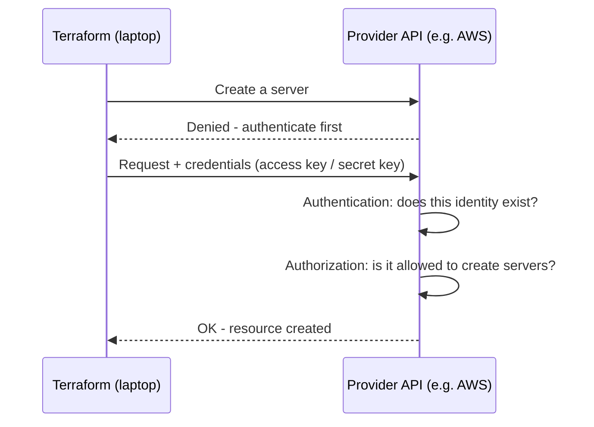
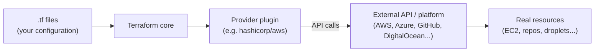
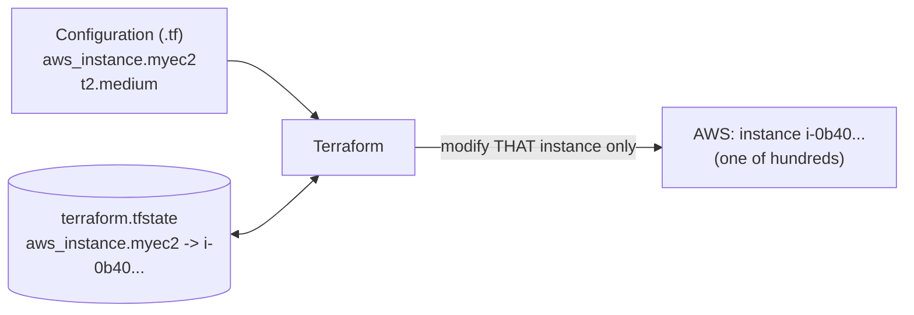
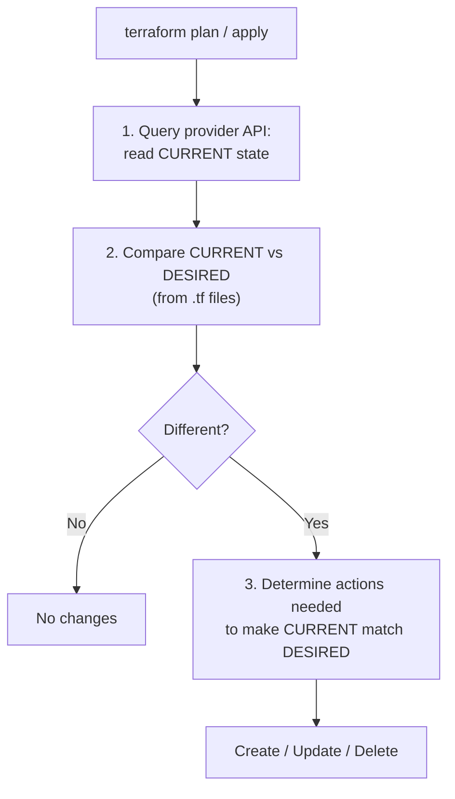
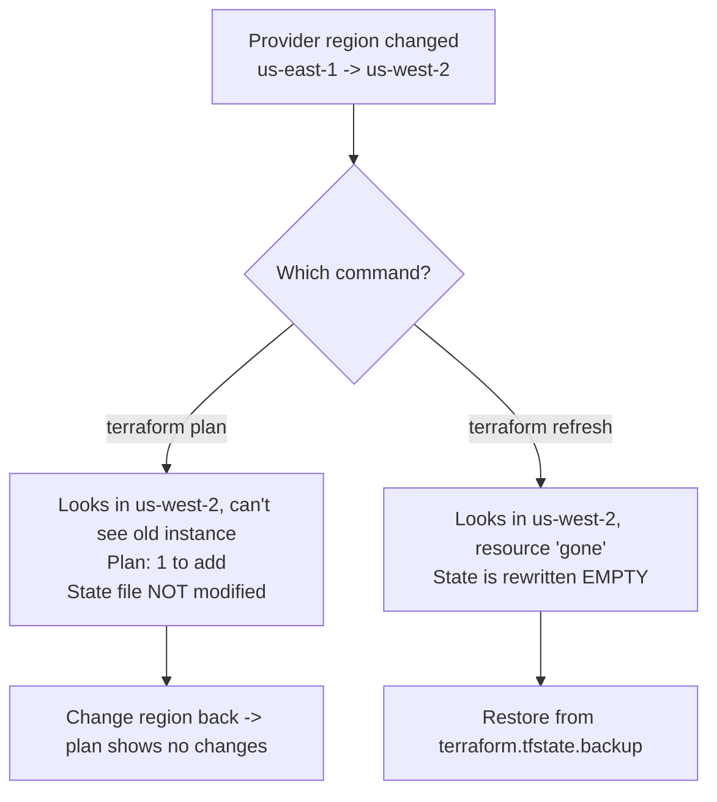
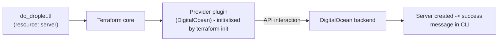

# Session 3 - Deploying Infrastructure with Terraform (Hands-On Foundations)

HashiCorp Certified Terraform Associate - study notes (course by Zeal Vora / KPLabs)
Source material: lecture transcripts 23-37 (`session3/`) and the instructor's repo folder `Section 1 - Deploying Infrastructure with Terraform/`.

---

## Session overview

Session 3 is where you stop reading about Terraform and start using it. The session moves through five themes:

1. **Authentication and authorization (lectures 23-24)** - why Terraform needs credentials, the difference between "who are you" and "what may you do", and creating an AWS IAM user with access keys.
2. **First real resources (lectures 25, 28-30)** - launching an EC2 instance, understanding the `provider` and `resource` blocks, how provider plugins are downloaded by `terraform init`, provider tiers/namespaces, and repeating the same workflow for a completely different provider (GitHub).
3. **Cleaning up and credentials hygiene (lectures 31-32)** - `terraform destroy` (all or `-target`), and how to stop hard-coding AWS keys by using the AWS CLI's shared credentials files.
4. **State (lectures 33-36)** - what the state file is, desired state vs current state (reconciliation), why defaults are not "desired", and `terraform refresh`.
5. **Provider versioning (lecture 37)** - version constraints, the dependency lock file `.terraform.lock.hcl`, and `terraform init -upgrade`.

The "core loop" you will use for the rest of the course is introduced here:

```
write .tf  ->  terraform init  ->  terraform plan  ->  terraform apply  ->  (change code)  ->  plan/apply  ->  terraform destroy
```

> Note on numbering: the transcript folder jumps from lecture 25 to 28 (lectures 26 and 27 are not in the supplied material - most likely documentation/code lectures that the repo's `Readme.md` folds into the "Launch First Virtual Machine" page). These notes keep the original lecture numbers.

---

## Table of contents

1. [Lecture to repo-file mapping](#lecture-to-repo-file-mapping)
2. [Lecture 23 - Authentication and Authorization](#lecture-23---authentication-and-authorization)
3. [Lecture 24 - Create User for AWS Account](#lecture-24---create-user-for-aws-account)
4. [Lecture 25 - Launch First Virtual Machine through Terraform](#lecture-25---launch-first-virtual-machine-through-terraform)
5. [Lecture 28 - Resource and Providers](#lecture-28---resource-and-providers)
6. [Lecture 29 - Provider Tiers](#lecture-29---provider-tiers)
7. [Lecture 30 - Create GitHub Repository through Terraform](#lecture-30---create-github-repository-through-terraform)
8. [Lecture 31 - Terraform Destroy](#lecture-31---terraform-destroy)
9. [Lecture 32 - AWS Provider: Authentication Configuration](#lecture-32---aws-provider-authentication-configuration)
10. [Lecture 33 - Overview of Terraform State File](#lecture-33---overview-of-terraform-state-file)
11. [Lecture 34 - Desired State vs Current State](#lecture-34---desired-state-vs-current-state)
12. [Lecture 35 - More Clarity: Desired State and Current State](#lecture-35---more-clarity-desired-state-and-current-state)
13. [Lecture 36 - Terraform Refresh](#lecture-36---terraform-refresh)
14. [Lecture 37 - Terraform Provider Versioning](#lecture-37---terraform-provider-versioning)
15. [Terraform workflow commands cheat-sheet](#terraform-workflow-commands-cheat-sheet)
16. [Key takeaways](#key-takeaways)
17. [Quick revision Q&A](#quick-revision-qa)
18. [Glossary](#glossary)

---

## Lecture to repo-file mapping

The repo's `Readme.md` ("Video-Document Mapper") lists 11 documents that correspond to lectures 25 and 28-37. All files live in `Section 1 - Deploying Infrastructure with Terraform/`.

| Lecture | Title | Repo file(s) | What the file contains |
|---|---|---|---|
| 23 | Authentication and Authorization | (none - concept + console demo) | - |
| 24 | Create User for AWS Account | (none - console demo) | - |
| 25 | Launch First Virtual Machine through Terraform | `first-ec2.md` | `first_ec2.tf` (provider + `aws_instance`), links to registry docs, `init/plan/apply` |
| 28 | Resource and Providers | `resource-providers.md`, `resp01.md` | duplicate-resource-name experiment, `provider azurerm {}`; `resp01.md` also shows the Azure provider and a DigitalOcean `required_providers` snippet |
| 29 | Provider Tiers | `provider-tiers.md` (and DigitalOcean part of `resp01.md`) | `required_providers` block for `digitalocean/digitalocean`, `version = "~> 2.0"` |
| 30 | Create GitHub Repository through Terraform | `github.md` | `required_providers` (integrations/github), `provider "github"`, `github_repository` |
| 31 | Terraform Destroy | `destroy.md` | `terraform destroy`, `terraform destroy -target aws_instance.myec2` |
| 32 | AWS Provider - Authentication Configuration | `aws-provider-auth.md` | `aws-provider-config.tf` (`aws_iam_user`), `terraform apply -auto-approve`, `terraform destroy -auto-approve`, `aws configure` |
| 33 | Overview of Terraform State File | `state-file.md` | base `aws_instance` code, `terraform apply`, `terraform destroy` |
| 34 | Desired State vs Current State | `desired-current-state.md` | same code; manual change t2.micro -> t2.small; `terraform plan`; empty the file then `apply` |
| 35 | More Clarity - Desired State and Current State | `clarity-state-file.md` | same base code; `terraform apply` / `terraform destroy` |
| 36 | Terraform Refresh | `refresh.tf` | provider + `aws_instance` (note: the `Readme.md` links this as a `.tf` file, not `.md`) |
| 37 | Terraform Provider Versioning | `provider-versioning.md` | version constraint examples + `provider.versioning.tf` |
| (extra) | - | `example.tf` | Not listed in the Readme mapper. A registry-style example: `data "aws_ami"` (Ubuntu 20.04, owner Canonical) feeding an `aws_instance`. Not discussed in the Session 3 transcripts; see the "extra context" note under Lecture 25. |

> Security reminder for the whole session: the repo files contain only placeholders (`PUT-YOUR-ACCESS-KEY-HERE`, `PUT-YOUR-SECRET-KEY-HERE`, `YOUR-ACCESS-KEY`, `your-token-here`). That is exactly how it should be. **Never commit real AWS access keys, secret keys or GitHub tokens to Git.** Lecture 32 shows how to avoid hard-coding them at all. These notes also use placeholders only.

---

## Lecture 23 - Authentication and Authorization

**Repo file:** none (concept lecture with AWS IAM and GitHub token-settings screens).

### 1. Why this matters

Before Terraform can create anything it must prove who it is to the target platform. Terraform runs on your laptop; the resource lives at a provider (AWS, GitHub, ...). When Terraform asks AWS to create a server, AWS **denies the request and asks Terraform to authenticate first** - exactly like logging into the AWS console before you can launch a server.



### 2. Authentication vs authorization

| | Authentication (AuthN) | Authorization (AuthZ) |
|---|---|---|
| Question answered | **Who are you?** | **What are you allowed to do?** |
| Verified by provider | Does the identity exist, and are the credentials valid? | Does that identity hold permissions for the requested action? |
| Typical form | Username/password, access key + secret key, token | Policies / roles / permission scopes |
| Instructor's example | Logging in as user "Alice" - is Alice a real user? | Alice exists but may have admin, read-only, or no access at all |

Instructor's demo: in the AWS console go to **IAM**, create a user (e.g. `Alice`), and note the permission choices (administrator access, access to a specific service, read-only...). "All of this is part of authorization."

Key learning: **Terraform needs access credentials *with the relevant permissions* to create and manage the environment.** Valid credentials alone are not enough - if the user lacks the permission, the call fails at the authorization stage.

### 3. Credential type depends on the provider

| Provider | What Terraform needs (as per the lecture) | Where you get it |
|---|---|---|
| AWS | Access key + secret key | IAM user -> Security credentials |
| GitHub | Personal access token | GitHub -> Settings -> Developer settings |
| Kubernetes | e.g. a kubeconfig file or credentials config | cluster admin |
| Azure / GCP | provider-specific (not detailed in this lecture) | - |

The instructor opened the provider documentation (AWS: "Authentication and Configuration" section; GitHub: "Authentication" section) to show that each provider documents exactly what it requires. **Always read the Authentication section of a provider's docs first.**

### 4. Least privilege (the GitHub token example)

Do not hand Terraform credentials that can do everything. If tomorrow you only want Terraform to manage GitHub repositories, you should not give it a token that can delete *all* your repositories. When creating a GitHub token you can specify:

- all repositories vs only selected repositories;
- per-feature access on those repositories (e.g. "Discussions: read and write", "Pull requests: no access").

Rule of thumb from the lecture: **the credentials should have only as much permission as what you want to create and manage through Terraform.** (The following lecture nonetheless attaches AdministratorAccess "for simplicity" in a learning account - fine for a demo, not for production.)

### Exam tips / things to remember

- Authentication = verifying identity; authorization = verifying permissions. Know which stage fails in which scenario (unknown user -> authN failure; known user without permission -> authZ failure).
- Credential type is provider-specific: AWS keys, GitHub token, Kubernetes kubeconfig, etc.
- Principle of least privilege applies to the credentials you give Terraform.

---

## Lecture 24 - Create User for AWS Account

**Repo file:** none (AWS console demo).

Goal: generate the **access key and secret key** that the AWS provider will use in the upcoming practicals. Assumption: you already have an AWS account.

### Step-by-step (as shown)

1. AWS Management Console -> open the **IAM** service.
2. **Users** -> **Add/Create user**.
3. User name: `Terraform` (any name works).
4. Permissions: attach the **AdministratorAccess** policy ("the simplistic one" - fine for a personal learning account).
5. Click **Next**, then **Create user**.
6. Click the new user -> **Security credentials** tab -> **Create access key**.
7. Choose the **CLI** use case (tick the acknowledgement checkbox) -> **Next** -> create.
8. You now see an **Access key** and a **Secret access key**. Copy both and keep them somewhere safe on your workstation (the instructor pasted them into a local text file) - the secret key is shown only once and you will need them in the next lectures.

Side remark in the lecture: AWS recently introduced dark mode, but not for all services, so some console pages look dark and others light.

### Gotchas

- The secret key is only displayed at creation time. If you lose it you must create a new key.
- A local text file is only a stop-gap for the course; the long-term safe place is the AWS CLI's credential store (Lecture 32) or a secrets manager (extra context).
- AdministratorAccess is convenient but over-privileged (violates the least-privilege idea from Lecture 23). (extra context) In real environments create a narrower policy.
- **Never commit these keys to Git or paste them in a Q&A forum.** The instructor explicitly mentions in Lecture 32 that leaked keys pasted into the Q&A had to be removed and deactivated.

### Exam tips

- The AWS provider authenticates with an access key / secret key pair (among other methods covered in Lecture 32).

---

## Lecture 25 - Launch First Virtual Machine through Terraform

**Repo file:** `first-ec2.md`
**Docs referenced:** https://registry.terraform.io/ and https://registry.terraform.io/providers/hashicorp/aws/latest/docs

### 1. Vocabulary: "virtual machine" is provider-specific

Different providers use different names: in AWS the VM is an **EC2 instance** (Elastic Compute Cloud); in DigitalOcean it is a **droplet**. The concept (a virtual server) is the same; the Terraform resource type changes.

### 2. What you must decide when creating a VM

| Decision | Meaning | In Terraform |
|---|---|---|
| **Region** | Where the resource is created (US, Asia, Europe, ...). Each region has a code, e.g. `us-east-1` (N. Virginia), `ap-southeast-1` (Singapore). | `region` argument in the `provider` block |
| **Configuration** | OS, CPU, memory, storage... | `ami` (the OS image) and `instance_type` (CPU + memory) arguments in the resource |

### 3. First do it manually (to understand what we are automating)

The instructor first launched an instance by hand in the console (Name: "manual EC2"):

- **AMI (Amazon Machine Image)** - the operating system image (Amazon Linux, Ubuntu, Windows, macOS...). He chose Amazon Linux.
- **Instance type** - combination of CPU and memory. The **free-tier-eligible** type has 1 vCPU and 1 GiB RAM (`t2.micro`); at the other extreme, `c3.8xlarge` has 32 vCPU / 60 GiB and is expensive.
- **Key pair** - how you log in; skipped ("proceed without a key pair").
- Launch -> state moves from *pending* to *running*.

Aim of the lecture: create the same thing, but with Terraform.

### 4. Project set-up

- Create a folder (instructor: `kplabs-terraform`) and open it in Visual Studio Code.
- Create a file `first_ec2.tf`. The file name is free; **the extension must be `.tf`**.
- Terraform commands must be run **from inside that folder** (a common beginner slip - open the terminal in the right directory).

### 5. The code (`first_ec2.tf`)

```hcl
provider "aws" {
  region     = "us-east-1"
  access_key = "PUT-YOUR-ACCESS-KEY-HERE"
  secret_key = "PUT-YOUR-SECRET-KEY-HERE"
}

resource "aws_instance" "myec2" {
    ami = "ami-00c39f71452c08778"
    instance_type = "t2.micro"
}
```

Line-by-line:

| Line | Meaning |
|---|---|
| `provider "aws" { ... }` | Declares that this configuration uses the **AWS provider**. The label (`"aws"`) changes with the provider ("github", "azurerm", ...). The instructor copied this block from the AWS provider docs ("Authentication" -> basic usage). |
| `region = "us-east-1"` | Region in which resources are created. Each region has a code; N. Virginia is `us-east-1`. |
| `access_key` / `secret_key` | The credentials generated in Lecture 24. **Placeholders here - never put real values in files you commit.** (Lecture 32 removes them.) |
| `resource "aws_instance" "myec2"` | Declares a resource. `aws_instance` = **resource type** (an EC2 instance, fixed by the provider). `myec2` = **local name** (your choice). |
| `ami = "ami-..."` | The OS image. **AMI IDs differ per region** for the same OS (instructor showed the Singapore ID ended `...9F57` while N. Virginia's ended `...8778`). If you use a region other than `us-east-1`, replace the AMI ID. |
| `instance_type = "t2.micro"` | CPU/memory size; free-tier eligible. |

Where did `aws_instance` come from? In the AWS provider docs, the left-hand menu lists services (EC2, ...). Under EC2 there are many resources (e.g. `aws_key_pair` for key pairs, `aws_instance` for instances). Each resource page contains **Example Usage** (copy-paste starting point) and **Argument Reference** (every option: networking, IP address, firewall, advanced details...). You only need the mandatory ones to start.

### 6. Commands and expected output

```bash
terraform init     # download the provider plugin
terraform plan     # preview
terraform apply    # create (asks for confirmation)
```

| Command | What happens in the demo |
|---|---|
| `terraform init` | Downloads the AWS provider plugin into the working directory (takes a minute or two because the plugin is large). Must be run the first time you add a provider. |
| `terraform plan` | Shows "Terraform will create a new aws_instance" with the AMI and instance type. **Does not create anything** - it only shows intent. Summary line: `Plan: 1 to add, 0 to change, 0 to destroy.` |
| `terraform apply` | Shows the plan again and waits for you to type `yes`. Instance created in about 37 seconds; verify in the EC2 console (N. Virginia) - 1 running t2.micro. |

### 7. Changing a resource: adding a tag

Add a `tags` block (copied from the docs example) to give the instance a name:

```hcl
resource "aws_instance" "myec2" {
    ami           = "ami-00c39f71452c08778"
    instance_type = "t2.micro"

    tags = {
      Name = "my first EC2"
    }
}
```

- `terraform plan` now reports **1 to change** (an in-place update of tags).
- `terraform apply` -> `yes` -> the console shows the new name.
- Remove the `tags` block and run `terraform apply` directly (the instructor deliberately skips `plan` to show another approach) -> apply prints the plan, asks for `yes`, and removes the tag; the Name disappears in the console.

Instructor's comment: `terraform plan` is an important command to run in production to see what will change; `terraform apply` also computes and shows the plan first and waits for your approval, which is why running plan separately is optional but a good habit.

### 8. Provider vs resource - the lasting insight

Today's resource is a VM; tomorrow it may be a database. The **resource block changes, but the provider block stays the same** as long as you work with the same platform (AWS), because the provider holds the authentication and region.

```
        +--------------------+
        |  first_ec2.tf      |
        |  provider "aws"    |  <- stays the same (auth + region)
        |  resource  ...     |  <- changes with what you build
        +--------------------+
```

### 9. Extra context: `example.tf` in the repo

The repo also contains `example.tf` (not in the Readme table and not discussed in the Session 3 transcripts). It is a registry-style example which looks up the latest Ubuntu AMI with a **data source** instead of hard-coding an AMI ID:

```hcl
data "aws_ami" "ubuntu" {
  most_recent = true

  filter {
    name   = "name"
    values = ["ubuntu/images/hvm-ssd/ubuntu-focal-20.04-amd64-server-*"]
  }

  filter {
    name   = "virtualization-type"
    values = ["hvm"]
  }

  owners = ["099720109477"] # Canonical
}

resource "aws_instance" "web" {
  ami           = data.aws_ami.ubuntu.id
  instance_type = "t3.micro"

  tags = {
    Name = "HelloWorld"
  }
}
```

(extra context) `data "aws_ami"` *reads* an existing AMI (most recent Ubuntu 20.04 published by Canonical's account); `data.aws_ami.ubuntu.id` feeds that ID into the instance. This sidesteps the "AMI IDs differ per region" gotcha. Data sources are covered later in the course; treat this as a preview only.

### Gotchas

- Run commands from the folder containing the `.tf` file.
- AMI IDs are region-specific - changing `region` usually requires changing `ami`.
- `terraform plan` never changes infrastructure; `terraform apply` does.
- File extension must be `.tf`; the file name is arbitrary.
- Keep the resource local name (`myec2`) consistent whenever you reference it; the pair `aws_instance.myec2` is the identifier (see Lecture 28 and 31).
- Hard-coded keys are for the first demos only; see Lecture 32.

### Exam tips

- Workflow: `init` -> `plan` -> `apply`.
- `terraform init` downloads provider plugins; run it whenever you add a new provider.
- `terraform plan` = dry-run preview; `terraform apply` = actually do it (prompts for `yes` unless `-auto-approve`).
- Terraform files end in `.tf`; any file name works.
- The provider block keeps the same shape across resource types for one provider.

---

## Lecture 28 - Resource and Providers

**Repo files:** `resource-providers.md`, `resp01.md`
**Docs:** https://registry.terraform.io

### 1. Providers: the plugin that talks to an API

- A major reason for Terraform's adoption is its support for **many providers**: AWS, Azure, GCP, Alibaba, Kubernetes, etc. The Terraform Registry (registry.terraform.io) lists **3000+** providers (the instructor recalls roughly 700 a year earlier - the exact number will differ today).
- **Definition to memorise:** *a provider is a plugin that lets Terraform manage an external API.*



### 2. `terraform init` downloads provider plugins

Whenever you add a provider block to a `.tf` file, the first command to run is `terraform init`:

- It downloads the plugins for the providers referenced in the configuration.
- They are placed in a hidden **`.terraform`** directory inside the working folder.
- Navigating in the demo: `.terraform/providers/registry.terraform.io/hashicorp/aws/<version>/<os_arch>/` - that is the downloaded plugin. The AWS plugin is about **300 MB**.

Everything in the folder besides your `.tf` file was created automatically by Terraform (`.terraform/`, later the state file and the lock file).

### 3. Demo: adding a second provider (Azure)

Add a bare provider block to `first_ec2.tf`:

```hcl
provider azurerm {}
```

and run `terraform init` again. Terraform installs the Azure provider (about **184 MB**) next to the AWS plugin under `.terraform/providers/...`.

Takeaways:

- That one line is enough for Terraform to *download* the plugin. To actually create Azure resources you must also supply Azure credentials.
- **Whenever you define a new provider, run `terraform init` again.**
- One working folder can hold plugins for multiple providers (here AWS + Azure), so a single configuration can define resources from both clouds.

`resp01.md` in the repo shows exactly this:

```hcl
provider "azurerm" {}
```
then
```bash
terraform init
```

and also the DigitalOcean variant (covered in Lecture 29):

```hcl
terraform {
  required_providers {
    digitalocean = {
      source = "digitalocean/digitalocean"
      version = "2.5.0"
    }
  }
}

provider "digitalocean" {}
```
then `terraform init`.

### 4. The resource block

A **resource block describes one or more infrastructure objects** associated with a provider.

```hcl
resource "aws_instance" "myec2" {
    ami           = "ami-00c39f71452c08778"
    instance_type = "t2.micro"
}
```

```
resource  "aws_instance"   "myec2"   { ...arguments... }
   |            |             |
 keyword   RESOURCE TYPE   LOCAL NAME
           (fixed; defined  (your choice;
            by provider)     unique per type)
```

Examples of resource types: `aws_instance` (EC2), `aws_alb` (load balancer), `aws_iam_user` (IAM user), `digitalocean_droplet`, `github_repository`.

| Part | Can you change it? | Notes |
|---|---|---|
| Resource type (`aws_instance`) | **No** - defined in provider docs | Prefix identifies the provider (`aws_`, `azurerm_`, `github_`, `digitalocean_`) |
| Local name (`myec2`) | **Yes** - any name | Used to refer to the resource inside the configuration |

**The combination of resource type + local name is the resource's identifier and must be unique** within the module.

### 5. Demo: duplicate local names fail

`resource-providers.md` contains the experiment: two blocks both named `aws_instance.myec2`:

```hcl
provider "aws" {
  region     = "us-east-1"
  access_key = "PUT-YOUR-ACCESS-KEY-HERE"
  secret_key = "PUT-YOUR-SECRET-KEY-HERE"
}

resource "aws_instance" "myec2" {
    ami = "ami-00c39f71452c08778"
    instance_type = "t2.micro"
}

resource "aws_instance" "myec2" {
    ami = "ami-123"
    instance_type = "t3.micro"
}

provider azurerm {}
```

- Run `terraform plan` -> **Error**: the resource `myec2` was already declared; resource names must be unique per type.
- Rename the second one to `web` (`aws_instance.web`) -> `terraform plan` works and wants to add two instances. (The instructor then removed the second block since he did not want an extra EC2.)
- Two instances can have the same *type* but must have *different local names* (different configurations such as a different AMI/OS belong to separate blocks).

### 6. Resources only work with their own provider

A resource type belongs to a specific provider's plugin. `aws_instance` can only be handled by the AWS plugin; having the Azure plugin installed does not help. Likewise an Azure resource such as the Kubernetes Fleet Manager (`azurerm_kubernetes_fleet_manager`) can only be managed by the Azure provider plugin. A single working folder may have several providers, so you can define resources for each.

### 7. "Do I have to relearn Terraform for every provider?"

**No.** Core concepts and the standard syntax are identical across providers. This course focuses on *Terraform core*; AWS is used only as the demo platform. (Lecture 30 proves the point with GitHub.) What does differ per provider: the credentials, the resource types and their arguments - found in each provider's docs.

### 8. Provider bugs

Even officially-maintained (HashiCorp) providers can have bugs or inconsistencies between expected and actual behaviour. They are rare (the AWS provider shows ~18 million downloads a week/ ~64 million a month in the lecture's screenshot), but if you hit one, go to the provider's GitHub repository (linked on its Registry page): browse open **issues** and **pull requests**, raise a new issue if needed, or wait for a fix in a new release.

### Gotchas

- Duplicate `type.name` pair -> error. Remember: *unique per type*.
- A provider block like `provider azurerm {}` is enough to download the plugin but not to authenticate.
- Provider plugins are large (hundreds of MB), so `init` can take a minute or two.
- The `.terraform` directory is generated; do not hand-edit it (extra context: and it is normally excluded from Git).

### Exam tips

- "A provider is a plugin that lets Terraform manage an external API."
- Provider plugins are installed by `terraform init` into the `.terraform` directory.
- Resource identifier = `<resource_type>.<local_name>` and must be unique.
- You can use multiple providers in one configuration/folder.
- Core Terraform syntax is provider-agnostic.

---

## Lecture 29 - Provider Tiers

**Repo files:** `provider-tiers.md` (also the DigitalOcean part of `resp01.md`)
**Docs:** https://registry.terraform.io/providers/digitalocean/digitalocean/latest/docs

### 1. The three tiers

The Terraform Registry marks each provider with a tier:

| Tier | Owned and maintained by | Namespace (examples from the lecture) | Production guidance |
|---|---|---|---|
| **Official** | **HashiCorp** | `hashicorp` (e.g. `hashicorp/aws`, `hashicorp/azurerm`, Active Directory) | Preferred. Official providers cover most popular technologies: clouds, Kubernetes, Active Directory, other HashiCorp products. |
| **Partner** | A technology company with a **direct partnership** with HashiCorp | Company-specific, e.g. `oracle/oci`, MongoDB (Atlas), Alibaba Cloud, `digitalocean/digitalocean` | Also quite stable; fine to use. |
| **Community** | **Individual contributors** | Contributor-specific names (e.g. a 1Password provider has its own namespace) | Avoid if possible - bugs may exist and individual maintainers may not have time to fix them. |

(The Registry UI offers filters for official / partner / community.)

### 2. Provider namespaces

Namespaces organise providers. In the registry URL the namespace is the path segment after `providers/`:

```
https://registry.terraform.io/providers/hashicorp/aws        -> namespace "hashicorp", provider "aws"
https://registry.terraform.io/providers/hashicorp/azurerm    -> namespace "hashicorp", provider "azurerm"
https://registry.terraform.io/providers/digitalocean/digitalocean  -> namespace "digitalocean"
```

Official providers always use the `hashicorp` namespace. Partners and community providers use their own namespaces.

### 3. `required_providers` and `source`

Terraform needs **explicit source information for any provider not maintained by HashiCorp**, declared in the `required_providers` nested block (inside the `terraform {}` block). Address format: `namespace/type` (optionally with a hostname in front for non-default registries - extra context).

#### Demo (what happens when you skip it)

1. Add `provider "digitalocean" {}` only, then `terraform init`.
2. Terraform **fails to query available providers** because it looks for `registry.terraform.io/hashicorp/digitalocean` - it assumes the default `hashicorp` namespace, which doesn't contain DigitalOcean.
3. Trying to fix it by writing `digitalocean/digitalocean` in the provider block also errors - the source cannot go in the provider block.
4. Solution: copy the "Use provider" snippet from the registry (the `required_providers` block) and `init` succeeds.

#### Repo code (`provider-tiers.md`)

```hcl
provider "aws" {
  region     = "us-east-1"
  access_key = "PUT-YOUR-ACCESS-KEY-HERE"
  secret_key = "PUT-YOUR-SECRET-KEY-HERE"
}

resource "aws_instance" "myec2" {
    ami = "ami-00c39f71452c08778"
    instance_type = "t2.micro"
}

terraform {
  required_providers {
    digitalocean = {
      source = "digitalocean/digitalocean"
      version = "~> 2.0"
    }
  }
}
```

| Piece | Meaning |
|---|---|
| `terraform { ... }` | Terraform settings block (not a resource). |
| `required_providers { ... }` | Lists the providers this configuration needs. |
| `digitalocean = { ... }` | The **local name** for the provider (what you then use in `provider "digitalocean"`). |
| `source = "digitalocean/digitalocean"` | `namespace/type` - where Terraform downloads it from (`registry.terraform.io/digitalocean/digitalocean`). |
| `version = "~> 2.0"` | Version constraint: any 2.x release (see Lecture 37). |

(The `aws` provider block with a placeholder key sitting in the same file is just the existing demo file; the DigitalOcean provider is "Partner" tier.)

### 4. Is `required_providers` always needed?

- For HashiCorp-maintained providers (e.g. AWS) the plain `provider "aws" {...}` block is sufficient - `required_providers` is **optional** unless you want to customise (pin versions, change source, etc.). The AWS docs' example usage actually includes a `required_providers` block.
- For **non-HashiCorp** (partner/community) providers it is **essential**.

### Gotchas

- `terraform init` error "failed to query available providers ... hashicorp/<name>" almost always means a non-HashiCorp provider is missing its `source` in `required_providers`.
- Provider *local name* in `required_providers` should match the provider block label.
- Don't confuse the three tiers: Official = HashiCorp; Partner = technology company partnered with HashiCorp; Community = individuals.

### Exam tips

- Three tiers: **official, partner, community**. Namespace of official providers: `hashicorp`.
- For production, prefer official, then partner; avoid community where possible.
- Non-HashiCorp providers require `required_providers` with `source`.
- Provider source address = `[hostname/]namespace/type`; default hostname is `registry.terraform.io` (extra context).

---

## Lecture 30 - Create GitHub Repository through Terraform

**Repo file:** `github.md`
**Docs:** https://registry.terraform.io/providers/integrations/github/latest/docs

### 1. Purpose

Prove that once you know the Terraform workflow for one provider, you can use any provider: **define the provider -> supply credentials -> pick a resource from the docs -> init/plan/apply.** The target: create a GitHub repository with Terraform.

### 2. Provider facts

- The GitHub provider is **Partner tier**, namespace `integrations` -> source `integrations/github` (about 500,000 downloads/week in the lecture). Because it is not a HashiCorp-namespace provider, `required_providers` with the source is needed.
- Authentication: a **token** (AWS needed access/secret keys; the provider docs tell you what it requires).

### 3. Getting a token (as shown)

Prerequisite: a GitHub account.

1. GitHub -> **Settings** -> **Developer settings** -> **Personal access tokens** -> **Fine-grained tokens** -> Generate new token.
2. Token name: `Terraform`; keep defaults for the rest.
3. Repository access: **All repositories** (for simplicity).
4. Repository permissions: **Administration** (covers repository creation/deletion, settings, teams and collaborators) -> **Read and write**.
5. Generate token and copy it (it is long). It is displayed once.

> Security reminder: the token goes in the demo file only to keep the first video simple. Treat it like a password: never commit it, revoke it when finished, and prefer environment variables or a secrets approach (extra context: the GitHub provider can read `GITHUB_TOKEN` from the environment).

### 4. The code (`github.tf` / `github.md`)

```hcl
terraform {
  required_providers {
    github = {
      source  = "integrations/github"
      version = "~> 5.0"
    }
  }
}

provider "github" {
  token = "your-token-here"
}

resource "github_repository" "example" {
  name        = "example"
  description = "My awesome codebase"

  visibility = "public"

}
```

| Block / argument | Explanation |
|---|---|
| `required_providers { github = { ... } }` | Declares the provider and where to download it (`integrations/github`), constrained to the 5.x series (`~> 5.0`). |
| `provider "github" { token = ... }` | Provider configuration; the token is the authentication credential. Placeholder shown - use your own, never commit it. |
| `resource "github_repository" "example"` | Resource type `github_repository` (from the provider docs, "Resources" section), local name `example`. |
| `name = "example"` | The repository name that appears on GitHub. |
| `description` | Repository description. |
| `visibility = "public"` | `public` or `private` (same choice as in the GitHub UI when creating a repo). |

The instructor put this in a **second file `github.tf`** in the same folder as `first_ec2.tf`. Terraform reads **all `.tf` files in the working directory** as one configuration - which is why Lecture 31's `destroy` sees both the EC2 instance and the repository.

### 5. Commands and results

```bash
terraform init     # downloads integrations/github plugin
terraform plan     # Plan: 1 to add  (the github_repository "example")
terraform apply    # type yes -> repository created; verify on GitHub
```

(Because the folder also had the EC2 resource from before, the instructor's plan only showed 1 to add: the EC2 instance already existed and the repo was new.) The repository `example` appeared in the GitHub account.

### 6. Pre-requisite to writing good Terraform

If you are asked to write Terraform for Azure you must know how to create a VM in Azure manually through its console. **Terraform skill = Terraform core + understanding of the platform you manage.**

### Gotchas

- Without `required_providers`/`source` the init fails (GitHub is not in the `hashicorp` namespace).
- Token permissions must allow the action (Administration read/write for creating repos) - an authorization failure otherwise.
- Remember the repo is real: `terraform destroy` (Lecture 31) removes it.

### Exam tips

- Same workflow for every provider: configure provider -> add resources -> `init` -> `plan` -> `apply`.
- Multiple `.tf` files in one directory are merged into one configuration.
- The GitHub provider is partner tier; its source is `integrations/github`.

---

## Lecture 31 - Terraform Destroy

**Repo file:** `destroy.md`

```bash
terraform destroy
terraform destroy -target aws_instance.myec2
```

### 1. Why destroy?

Cloud resources left running cost money. AWS offers a free tier for the first year; after that you are charged. **Best practice: once testing is done, terminate the resources you created.** At this point in the course the folder holds two resources: an EC2 instance (`aws_instance.myec2`) and a GitHub repository (`github_repository.example`).

### 2. Approach 1 - destroy everything: `terraform destroy`

Destroys **all resources managed by the configuration in the current folder** (both `.tf` files are in the same directory, so both are included).

Demo: running `terraform destroy` lists 2 resources to destroy (the GitHub repository and the EC2 instance) and asks for confirmation. The instructor typed **`no`** to cancel - nothing was destroyed (`yes` would have destroyed all).

### 3. Approach 2 - destroy one resource: `-target`

If you want to remove only the server but keep the GitHub repo, plain `destroy` is wrong. Use `-target` with `resource_type.local_name`:

```bash
terraform destroy -target aws_instance.myec2
```

| Part | Meaning |
|---|---|
| `-target` | Focus the operation on a subset of resources |
| `aws_instance` | resource **type** |
| `.` | separator |
| `myec2` | resource **local name** |

Demo: the plan shows **1 to destroy** (the EC2 instance). The instance was confirmed running in the N. Virginia console first; after `yes`, the destroy took about **2.5 minutes**; the console then shows state **terminated** (refresh the page if it still says running). The GitHub repository remains.

### 4. Approach 3 - delete (or comment out) the code

Important: destroying a resource does **not** remove its code. Because the code for `aws_instance.myec2` is still in the `.tf` file, **Terraform assumes you want that resource to exist** - a `terraform plan` now says **1 to add** and would recreate the EC2 instance.

To keep it gone, either **remove** the lines or **comment them out** (`#` or `/* ... */`). With the block commented out, `terraform plan` does nothing for EC2 - it's no longer part of the desired state.

The reverse also works: comment out the `github_repository` block while the repo still exists in real life and `terraform plan` shows it will **destroy** the repository (the resource is in state but no longer in code). This ties directly into Lecture 34 (desired vs current state).

```
Code present, resource missing   -> plan: ADD
Code removed, resource exists    -> plan: DESTROY
Code matches resource            -> plan: no changes
```

### Gotchas

- `terraform destroy` with no arguments destroys **everything in that directory's configuration** - read the list before typing `yes`.
- `-target` is for exceptional situations; relying on it day to day can leave the configuration and real infrastructure inconsistent (extra context: Terraform even prints a warning that targeting is not for routine use).
- After a targeted destroy the code is still present, so the next `plan`/`apply` will recreate the resource.
- The state file is *not* deleted by `destroy` (see Lecture 33).

### Exam tips

- `terraform destroy` -> destroys all resources managed by that working directory.
- `terraform destroy -target <type>.<name>` -> destroys a specific resource.
- Removing/commenting a resource block from code and running `apply` also destroys that resource.
- `-target` combines resource **type** and **local name**.

---

## Lecture 32 - AWS Provider: Authentication Configuration

**Repo file:** `aws-provider-auth.md`
**AWS doc referenced:** https://docs.aws.amazon.com/cli/latest/userguide/getting-started-install.html

### 1. The problem with hard-coded keys

So far the provider block contained `access_key` and `secret_key` - simple, and it works, but it is **not secure**:

- Developers commit hard-coded keys to Git; if the repo is public the credentials are compromised.
- Even in a private repo, any collaborator can read the keys, and **if something bad happens the blame lands on you**, because your credentials were used.
- Students paste whole files, keys included, into the course Q&A. The instructor has had to delete such questions and coordinate deactivation and regeneration of keys.

**Target:** a provider block with no secrets that still works:

```hcl
provider "aws" {
  region = "us-east-1"
}
```

The instructor deliberately used key-based auth in the earliest videos "so that we understand the disadvantages"; this lecture was added later but placed early so you start writing secure code. Later videos may still show keys - simply remove them since the AWS CLI is configured on your machine.

### 2. Authentication options for the AWS provider

| Method | How it works | Pros / cons (from the lecture) |
|---|---|---|
| **Static credentials in the provider block** (`access_key`, `secret_key`) | Keys written in the `.tf` file | Simple but insecure; do not use beyond the first demos |
| **Shared config/credentials files, explicit paths** (`shared_config_files`, `shared_credentials_files` arguments) | Keys live in separate files; provider block points to their location | Code has no secrets, but each team member may keep the files in a different place, so you'd need to standardise paths |
| **Shared files at default location (recommended)** | Provider block has *only* region; Terraform automatically reads `~/.aws/config` and `~/.aws/credentials` | Looks clean, works across the team with no path standardisation; keys never enter the repo |
| **Environment variables** | Export access key/secret key variables in the shell | Also works (mentioned) |
| **Assume an IAM role** (`role_arn`, session...) | Provider assumes a role | Useful; not detailed in the course |

Default locations when `shared_config_files` / `shared_credentials_files` are not set:

| OS | Config file | Credentials file |
|---|---|---|
| Linux / macOS | `$HOME/.aws/config` | `$HOME/.aws/credentials` |
| Windows | `%USERPROFILE%\.aws\config` | `%USERPROFILE%\.aws\credentials` |

(extra context: the standard AWS environment variables are `AWS_ACCESS_KEY_ID`, `AWS_SECRET_ACCESS_KEY`, `AWS_DEFAULT_REGION`; the lecture only says "environment variables like access key, secret key".)

### 3. Why install the AWS CLI

The **AWS CLI** manages AWS from the command line (e.g. create an EC2 instance with a command rather than the console). When you configure it with an access key and secret key, it stores them in exactly the same default files that Terraform's AWS provider reads. So:

1. Install the CLI.
2. Run `aws configure` once.
3. Terraform finds the credentials automatically.

Bonus: it fits single sign-on setups (Okta, AWS SSO) too, which is why using the AWS CLI to store credentials is recommended whenever you work with AWS.

### 4. Demo walkthrough

**Test file `aws-provider-config.tf`** (from the repo):

```hcl
provider "aws" {
  region     = "us-east-1"
}

resource "aws_iam_user" "demouser" {
    name = "kplabs-demo-user"
}
```

(In the video the file initially still had `access_key`/`secret_key` in the provider block; the repo version is the final secret-free form.)

| Block | Meaning |
|---|---|
| `provider "aws" { region = ... }` | No credentials any more - Terraform will search the default shared files |
| `resource "aws_iam_user" "demouser"` | Creates an IAM user |
| `name = "kplabs-demo-user"` | The user's name in IAM |

Steps:

1. **Baseline test with keys in the block:** `terraform apply -auto-approve` -> the IAM user `kplabs-demo-user` is created (check IAM -> Users). Then `terraform destroy -auto-approve` to remove it.
2. **Remove the `access_key` / `secret_key` lines**; paste them temporarily into a scratch text file so they aren't lost.
3. `terraform plan` -> **Error: no valid credential sources for AWS Provider found.**
4. **Install the AWS CLI** (macOS: GUI `.pkg` installer; Windows: `.msi`; Linux supported too - follow the AWS CLI install guide). Open a *new* terminal and type `aws` - help text confirms it is installed.
5. Run:

```bash
aws configure
```

It prompts for: AWS Access Key ID, AWS Secret Access Key, default region name (optional), default output format (optional). The CLI writes `~/.aws/config` and `~/.aws/credentials` (on Windows under `C:\Users\<you>\.aws\`).
6. `terraform plan` -> now works with no error.
7. `terraform apply -auto-approve` -> IAM user created successfully, with no secrets in code. You can now commit the code publicly - the credentials are in your home directory, not the repo.

### 5. Commands used (from the repo)

```bash
terraform apply -auto-approve
terraform destroy -auto-approve
aws configure
```

`-auto-approve` skips the interactive `yes` confirmation - handy for demos, but be careful with it on real infrastructure.

### Gotchas

- Error `no valid credential sources for AWS Provider found` means Terraform found no credentials in the block, env vars, or shared files.
- Open a fresh terminal after installing the CLI so the `aws` command is on the PATH.
- Credentials files are in your home directory - never copy them into the project folder or commit them (extra context: also keep `*.tfstate` and `.tfvars` with secrets out of Git).
- Don't paste Terraform code containing keys into forums; if you leak a key, deactivate it in IAM immediately and create a new one.
- The AWS CLI is not required for Terraform to run in general - it's a recommended way to store the credentials; the same files can be created by other means.

### Exam tips

- Never hard-code credentials in the provider block in real projects.
- Default shared credentials file location: `~/.aws/credentials` (Linux/macOS), `%USERPROFILE%\.aws\credentials` (Windows); config file next to it.
- `aws configure` writes those files; Terraform's AWS provider reads them automatically.
- Other AWS provider auth methods: environment variables, shared files with explicit paths, assumed IAM role.
- `-auto-approve` bypasses the confirmation prompt.

---

## Lecture 33 - Overview of Terraform State File

**Repo file:** `state-file.md`

```hcl
resource "aws_instance" "myec2" {
    ami = "ami-0fa3fe0fa7920f68e"
    instance_type = "t2.micro"
}
```
```bash
terraform apply

terraform destroy
```

(The instructor's folder had a provider block with the region/credentials configured; the repo snippet shows just the resource.)

### 1. Analogy: the state file is Terraform's database

Think of a demo web application with a database. When users sign up, their email/password go into the database. If the database is lost, users must re-register. So you secure it, back it up, make it highly available.

Terraform's **state file** is the same kind of thing: *a database in which Terraform stores information about the infrastructure it manages* and keeps track of the resources created by your configuration. After creating an EC2 instance, Terraform records the instance ID, security group, instance type, and so on.

### 2. Why Terraform needs it

A month later you change `t2.micro` to `t2.medium`. In production there may be hundreds of EC2 instances; how does Terraform know *which* one to modify? It looks up the resource's ID in the state file.



### 3. Demo walkthrough

1. Start from a clean slate: no EC2 instances running in the console, and the state file deleted from the folder (so we see it created from scratch).
2. `terraform apply` -> `yes` -> instance created. A new file **`terraform.tfstate`** appears in the folder.
3. In the console, the instance ID ends in `...b40`. Open `terraform.tfstate` and search (Ctrl+F) for `b40` - the ID is recorded in the state file.
4. Change `instance_type` to `t2.medium` and run `terraform plan`: Terraform locates the instance it created earlier (by that ID) and plans an in-place resize of **only that instance**.
5. **Lose the state:** rename `terraform.tfstate` to something else, then run `terraform plan`. Terraform has no idea it ever created an instance and plans to **create a brand-new EC2 instance**. (This is how duplicate/orphaned infrastructure happens.)
6. Rename the file back to `terraform.tfstate` -> `terraform plan` again finds the existing instance and only wants to change its type.
7. `terraform destroy` -> `yes` (about 1 min 34 s). Instance state: terminated.
8. After destroy, the state file is **not deleted**; it still exists but contains no resources (an "empty" state). You may also see **`terraform.tfstate.backup`**, Terraform's automatic fail-safe copy of the previous state. In production you must still keep proper, separate backups.

### 4. Facts to remember

| Fact | Detail |
|---|---|
| Default file name | `terraform.tfstate` (in the working directory) |
| Format | **JSON** |
| Should you edit it manually? | **No - never.** A mistake can corrupt it and Terraform will no longer work. If you must, back it up first; safe modifications are done through CLI commands (covered in later lectures). |
| If it is lost | Terraform loses track of what it created and will try to create everything again |
| After `destroy` | The file remains but holds no resources |
| Backup | `terraform.tfstate.backup` is created automatically as a fail-safe |

(Terminology note: the transcript text renders the file as "terraform.tf state" / "terraform state"; the actual file is `terraform.tfstate`.)

### Gotchas

- Losing/renaming/deleting the state file -> Terraform creates duplicates because it believes nothing exists.
- Do not hand-edit JSON state.
- State can contain sensitive data (attribute values) (extra context) - do not commit it to Git. (Remote backends/state security come later in the course.)
- A "destroyed" environment still leaves `terraform.tfstate` and `.backup` files in the folder.

### Exam tips

- State maps your configuration to real-world resources (stores IDs and attributes); it is how Terraform knows what to change.
- Default local state file: `terraform.tfstate`, JSON format.
- Never manually edit state; use `terraform state` subcommands (extra context - introduced later).
- Terraform does not auto-delete the state file on destroy.

---

## Lecture 34 - Desired State vs Current State

**Repo file:** `desired-current-state.md`

The instructor's cue: "all eyes on the board" - this is a very important, exam-relevant topic.

### 1. Definitions

| Term | Meaning | Where it lives |
|---|---|---|
| **Desired state** | What you *want* the infrastructure to look like | Your Terraform configuration (`.tf` files) |
| **Current state** | What *actually exists* in the real world right now | The provider's real infrastructure (Terraform learns it through API calls; recorded in the state file) |

Example desired state: an EC2 instance, `ami-123`, `t2.micro`.

Desired and current can diverge. Example: **Bob** manually changes the instance type from `t2.micro` to `t2.medium` in the AWS console - outside Terraform. Desired = `t2.micro`, current = `t2.medium`. In larger organisations this is quite common.

### 2. The reconciliation process



**Terraform always prioritises the desired state** ("Terraform loves the desired state") and will change the real infrastructure to match it - even reverting a manual change.

### 3. Four situations (memorise)

| Desired state | Current state | Terraform action |
|---|---|---|
| Exists | Does **not** exist | **Create** |
| Exists | Exists, but a property differs (e.g. instance type) | **Update** (in place, or replace if the property cannot be changed in place - extra context) |
| Does **not** exist (removed from code) | Exists | **Delete** (destroy) |
| Exists | Exists and matches | **Nothing** ("No changes") |

### 4. Demo walkthrough (code from the repo)

```hcl
resource "aws_instance" "myec2" {
    ami = "ami-0fa3fe0fa7920f68e"
    instance_type = "t2.micro"
}
```

1. Clean up leftover empty state files from earlier demos (safe in this test environment). `terraform apply` -> `yes` -> new instance, `t2.micro`.
2. Desired = current, so `terraform plan` says **No changes** - it first checks the current state of the real infrastructure, finds no modification.
3. **Simulate Bob's manual change** in the console: *stop* the instance (an instance type can only be changed while stopped), choose Actions -> Instance settings -> Change instance type -> `t2.small` (the lecture mentions t2.medium conceptually; the demo used a cheap alternative, `t2.small`, which may cost a little), then *start* the instance again.
4. `terraform plan` -> Terraform reads the real instance, sees `t2.small` vs desired `t2.micro`, and proposes an **update in place** to revert it to `t2.micro`.
5. `terraform apply` -> `yes`. Terraform stops the instance, changes the type back to `t2.micro`, and starts it again (about 1 minute). The console shows it running as `t2.micro`.
6. **Delete scenario:** cut (empty) the contents of the `.tf` file (desired state is now empty) while the instance still exists. `terraform plan` shows it will **destroy** the instance. Notably, **you don't need to run `terraform destroy`** - a plain `terraform apply` also destroys it because the empty desired state must be matched. After apply the instance is terminated.

This is the sequence listed in `desired-current-state.md`:

```bash
terraform apply
# Manually modify instance type from t2.micro to t2.small.
# Verify if terraform shows changes between desired and current state.
terraform plan
# Remove the contents of the ec2.tf file so that Desired state is empty.
terraform apply
```

### 5. Mental model

```
   YOUR CODE (.tf)  ----> DESIRED state  --+
                                           |  compare  ->  actions
   REAL WORLD (AWS) ----> CURRENT state  --+
         ^                                        |
         |______________ apply ___________________|   (make real world == desired)
```

### Gotchas

- Manual console changes are *not permanent* if the attribute is in your Terraform config - the next `apply` will undo them.
- Changing the instance type on EC2 requires the instance to be stopped; Terraform handles this automatically (stop -> modify -> start), causing a brief outage (the apply took about a minute).
- An empty configuration means "I want nothing", and `apply` will delete everything tracked in state.
- Recall from Lecture 31: removing code is a way to destroy resources.

### Exam tips

- Desired state = configuration; current state = real-world infrastructure.
- Terraform reconciles by changing the current state to match the desired state.
- Create / update / delete / no-op scenarios (table above).
- `terraform apply` can destroy things when resources have been removed from the configuration.
- `terraform plan` reads the current infrastructure before comparing.

---

## Lecture 35 - More Clarity: Desired State and Current State

**Repo file:** `clarity-state-file.md`

```hcl
resource "aws_instance" "myec2" {
    ami = "ami-0fa3fe0fa7920f68e"
    instance_type = "t2.micro"
}
```
```bash
terraform apply

terraform destroy
```

### 1. Defaults are assigned by the provider, not by you

When you create a VM with only the mandatory settings (here AMI and instance type), the cloud (AWS, but also Azure, GCP, ...) fills in many other settings with **default values**:

| Setting | Default seen in the demo |
|---|---|
| Root storage | an **8 GB SSD** volume |
| Firewall | the **default security group** (with inbound and outbound rules) |
| Others (subnet, etc.) | assigned by AWS, shown in plan as `(known after apply)` |

In `terraform plan` you'll see many attributes marked **`(known after apply)`** - the firewall, subnet ID, security group IDs, etc. Terraform's create request to the AWS API doesn't contain them, so AWS picks defaults, and Terraform only learns the values after the resource exists.

### 2. The key point: defaults are NOT part of your desired state

**Only what you write in the configuration is the desired state.** Values AWS added by default (8 GB disk, default security group) are not desired state. So if somebody changes them manually, Terraform will **not** revert them.

### 3. Demo walkthrough

1. `terraform plan` -> many `known after apply` attributes. `terraform apply` -> `yes`.
2. In the EC2 console open the instance: *Storage* tab shows an 8 GB SSD; *Security* shows the default security group and its rules - even though you never specified them. If you want a different disk size or firewall you can set them explicitly in the config and Terraform will use your values with priority.
3. Manually change the instance's security group from `default` to another existing group (e.g. `launch-wizard-10`) and save.
4. Run `terraform plan` -> Terraform refreshes/checks the real infrastructure and reports **No changes**. It did not try to revert the security group, because the security group was never in the desired state.

### 4. Production best practice

Explicitly define in your configuration **all** attributes you care about, leaving as few defaults as possible. Then, if someone changes any of them manually, the next `plan` detects current != desired and reverts it.

| Attribute defined in code? | Manual change made | Next `plan` |
|---|---|---|
| Yes (desired) | Yes | Detects drift and proposes to revert |
| No (default from AWS) | Yes | **No changes** - Terraform doesn't care |

### Gotchas

- Students often assume that "8 GB disk" or "default firewall" is part of the desired state. It isn't.
- `(known after apply)` doesn't mean "missing" - it means the provider will decide/compute it.
- Be explicit for security-relevant settings (security groups, storage, encryption...) (extra context) so drift is detected.

### Exam tips

- Provider-assigned defaults are not desired state; manual changes to them are not reverted.
- Only attributes defined in configuration participate in the desired-vs-current comparison.
- "Known after apply" = value determined by the provider at creation time.

---

## Lecture 36 - Terraform Refresh

**Repo file:** `refresh.tf` (note: the repo's `Readme.md` mapper links to this as a `.tf` file)

```hcl
provider "aws" {
  region     = "us-east-1"
  access_key = "PUT-YOUR-ACCESS-KEY-HERE"
  secret_key = "PUT-YOUR-SECRET-KEY-HERE"
}

resource "aws_instance" "myec2" {
    ami = "ami-00c39f71452c08778"
    instance_type = "t2.micro"
}
```

(Placeholders only. After Lecture 32 you can remove the key lines.)

### 1. What refresh does

Real infrastructure can be modified outside Terraform, and Terraform cannot stop that. To revert such drift, Terraform first has to *know* about it. **Refresh** = Terraform scans the real-world infrastructure and **updates the state file** to reflect reality; the (updated) state is then compared with your desired configuration.

### 2. You rarely run it manually

`terraform plan` and `terraform apply` **automatically perform the refresh step** first. In the plan output you see "Refreshing state..." lines before the diff. Example: after the instance is created, a second `terraform plan` shows refresh first, then "No changes".

### 3. Why manual `terraform refresh` can be dangerous (demo)



Walkthrough:

1. `terraform apply -auto-approve` creates the instance in `us-east-1`; `terraform plan` -> refresh -> **no changes**.
2. Change the provider region to `us-west-2` and run `terraform plan`: shows **1 to add** (Terraform can't find the old instance in the new region). **The state file remains populated** - plan does not modify state. Changing the region back to `us-east-1` -> plan shows no changes.
3. Change the region to `us-west-2` again and this time run **`terraform refresh`**. It can't find the infrastructure in that region and **wipes the resources from the state file**: `terraform.tfstate` is now empty.
4. Recovery: copy the contents of `terraform.tfstate.backup` into the state file, set the region back to `us-east-1`, run `terraform plan` -> **no changes**. Backup saved the day.

Lesson: running refresh explicitly can erase your state. Hence production remote backends such as S3 enable **versioning** so you can roll back a damaged state file.

### 4. Deprecation and the replacement

- The standalone `terraform refresh` command is **deprecated** in newer Terraform versions.
- Use the **`-refresh-only`** option with `plan` / `apply` instead (extra context: `terraform plan -refresh-only` shows what refresh would change in state without changing it, and `terraform apply -refresh-only` lets you review and approve the state update). You will rarely use it, but the exam may mention it.
- (extra context) `-refresh=false` skips the refresh step during plan/apply.

### 5. Clean up

The instructor reminds you to destroy every resource you create in practicals.

### Gotchas

- Changing the provider `region` makes Terraform "lose" resources (they are in the old region) - the plan will want to recreate them.
- `terraform plan` does not alter the state file; the old `terraform refresh` did.
- Always keep a backup of state; `terraform.tfstate.backup` is only a short-term safety net.

### Exam tips

- Refresh reconciles the **state file** with real infrastructure (reads reality; does not change infrastructure).
- `plan` and `apply` refresh automatically.
- `terraform refresh` is **deprecated**; use `-refresh-only` with plan/apply.
- Manually running refresh can remove entries from state (as the region demo shows).

---

## Lecture 37 - Terraform Provider Versioning

**Repo file:** `provider-versioning.md`

### 1. Architecture recap



You run `terraform apply`; Terraform uses the initialised provider plugin to talk to the platform's API.

### 2. Plugins are versioned separately from Terraform

Terraform core and provider plugins are **released independently, with their own version numbers**. A DigitalOcean provider can go from v1 to v2 regardless of the Terraform CLI version.

Analogy: upgrading from Windows 7 straight to Windows 10 can break existing programs. Likewise, in production, jumping to a new provider release unexpectedly can break working code.

**If you don't specify a version, `terraform init` uses the most recent provider plugin.** Therefore, in production, pin/constrain provider versions in `required_providers`.

### 3. Version constraint operators

| Constraint | Meaning | Lecture example |
|---|---|---|
| `>= 1.0` | 1.0 or newer (never 0.8, 0.9 ...) | - |
| `<= 1.0` | 1.0 or older (never 1.1, 1.2 ...) | `<= 2.60` -> installed 2.60.0 |
| `~> 2.0` ("tilde" / pessimistic) | Any version in the **2.x** range (2.1, 2.2, 2.20, 2.25 ...) - the right-most number may increment | `~> 3.0` -> 3.27.0 selected at the time; `~> 2.0` -> 2.70.0 |
| `>= 2.10, <= 2.30` | A range: between 2.10 and 2.30 (not 2.8/2.9, not 2.31/2.32) | selected 2.30.0 (highest in range) |
| `= 3.27.0` (or just `"3.27.0"`) | Exactly that version | Registry's "Use Provider" snippet gives an exact version |

Terraform picks the **newest version that satisfies** the constraint.

Repo list (`provider-versioning.md`):

```
version    = "2.7"
version    = ">= 2.8"
version    = "<= 2.8"
version    = ">=2.10,<=2.30"
```

### 4. Repo base configuration

```hcl
provider "aws" {
  region     = "us-west-2"
  access_key = "YOUR-ACCESS-KEY"
  secret_key = "YOUR-SECRET-KEY"
  version    = ">=2.10,<=2.30"
}

resource "aws_instance" "myec2" {
   ami = "ami-082b5a644766e0e6f"
   instance_type = "t2.micro"
}
```

> Note (extra context): this repo file puts `version` inside the `provider` block, which is the old (pre-0.13) style and is deprecated in modern Terraform. The lecture video itself uses the recommended location: the `required_providers` block inside `terraform {}`. The equivalent modern form is:

```hcl
terraform {
  required_providers {
    aws = {
      source  = "hashicorp/aws"
      version = ">= 2.10, <= 2.30"
    }
  }
}

provider "aws" {
  region = "us-west-2"
}
```

(Also: keys are placeholders; remove them in favour of Lecture 32's approach.)

### 5. Demo walkthrough (folder `provider-versioning`, file `provider_version.tf`, no resources - just the `terraform` and `provider` blocks)

The lecture's starting config:

```hcl
terraform {
  required_providers {
    aws = {
      source  = "hashicorp/aws"
      version = "~> 3.0"
    }
  }
}
```

1. **`~> 3.0`** (any 3.x). `terraform init` installs **3.27.0**. A later 3.30 could be installed in future, which is why unrestricted usage is risky: code that works with 3.27 might break with 3.30.
2. `init` also creates **`.terraform.lock.hcl`** (the dependency lock file). Opening it shows the provider address (`registry.terraform.io/hashicorp/aws`), the selected **version 3.27.0**, and the **constraints** used (`~> 3.0`) plus checksums (hashes).
3. **Lock file blocks change:** edit the constraint to `~> 2.0` and run `terraform init` -> **Error**: the locked provider 3.27.0 does not match the configured constraint of 2.0 ("could not retrieve the list of available versions"). The lock file keeps you on the recorded version.
4. **Delete the lock file** (`.terraform.lock.hcl`) and `terraform init` -> installs the newest 2.x: **2.70.0**.
5. Try `<= 2.60`: delete the lock file, `init` -> installs **2.60.0**. Output notes "Terraform has created a lock file `.terraform.lock.hcl` to record the provider selections it made".
6. Try `>= 2.10, <= 2.30`: delete lock file, `init` -> installs **2.30.0** (the highest satisfying version).
7. **Moving up officially:** set the constraint to `~> 3.0` again. Because the lock file exists, `init` is blocked. Instead use:

```bash
terraform init -upgrade
```

   This finds the newest version allowed by the constraints (3.27.0 at the time) and **updates the lock file** accordingly (lock file shows 3.27.0 again).

### 6. Dependency lock file - key facts

- `.terraform.lock.hcl` **locks the provider versions** selected during `terraform init`.
- If a provider already has a selection recorded in the lock file, Terraform **always re-selects that version** on `init`, even if a newer version exists. Example: locked at 2.70.0 - even if 3.0 is out, `init` won't upgrade.
- Override with **`terraform init -upgrade`**.
- This lock file is a **newer feature**: older Terraform versions (0.11, 0.12) don't have it. (extra context: introduced in Terraform 0.14.)
- (extra context) Commit the lock file to version control so teammates and CI use the same provider versions; do **not** commit state or credentials.

### 7. Do I have to move to a new provider version?

"It depends." If you need a **new service** that the platform released after your provider version was published, only newer provider versions will support it, so you must upgrade. But always **test properly**: organisations have directly switched to a newer provider version and seen unexpected breakage.

### Gotchas

- No version specified = latest on first init, then frozen by the lock file.
- Changing the constraint without removing the lock file or using `-upgrade` gives an error when the locked version doesn't satisfy the new constraint.
- `~> 3.0` means >= 3.0 and < 4.0 (right-most digit can float); don't confuse with `<=`.
- Terraform core version and provider versions are independent.

### Exam tips

- Providers have their own version numbers, independent of Terraform's.
- Pin provider versions in the `required_providers` block for production.
- Operators: `=`, `>=`, `<=`, `~>`, ranges with a comma.
- `.terraform.lock.hcl` records selected versions; `terraform init -upgrade` updates them within constraints.
- Without a version constraint, the latest provider is installed on init.

---

## Terraform workflow commands cheat-sheet

| Command | What it does | Notes from Session 3 |
|---|---|---|
| `terraform init` | Initialises the working directory; **downloads provider plugins** into `.terraform/`; creates `.terraform.lock.hcl` | Run first, and again whenever you add a new provider |
| `terraform init -upgrade` | Re-selects the newest provider versions allowed by constraints; updates the lock file | Needed to override the lock file |
| `terraform plan` | Refreshes state, compares desired vs current, shows what would be added/changed/destroyed. **Makes no changes** | Summary `Plan: X to add, Y to change, Z to destroy` |
| `terraform apply` | Shows the plan, asks `yes`, then makes the changes. Also removes resources deleted from code | Updates `terraform.tfstate` |
| `terraform apply -auto-approve` | Same, no confirmation prompt | Used in Lectures 32 and 36 |
| `terraform destroy` | Destroys **all** resources managed by the current folder's configuration | Prompts for `yes` |
| `terraform destroy -auto-approve` | Same, without prompt | Lecture 32 |
| `terraform destroy -target <type>.<name>` | Destroys only the specified resource | e.g. `-target aws_instance.myec2` |
| `terraform refresh` | Updates state file from the real infrastructure | **Deprecated**; dangerous (can empty state); plan/apply already refresh |
| `terraform plan -refresh-only` / `terraform apply -refresh-only` | The modern replacement for refresh | (Lecture 36) |
| `aws configure` | (AWS CLI, not Terraform) Stores access key, secret key, region in `~/.aws/credentials` and `~/.aws/config` | Lecture 32 |

Files and folders Terraform creates:

| Item | Purpose |
|---|---|
| `*.tf` | Your configuration (desired state). All `.tf` files in the folder are read together |
| `.terraform/` | Downloaded provider plugins (hundreds of MB) |
| `.terraform.lock.hcl` | Dependency lock file - records provider versions |
| `terraform.tfstate` | Local state (JSON) - Terraform's database of managed resources |
| `terraform.tfstate.backup` | Backup of the previous state |

Typical lifecycle:

```
write code -> init -> plan -> apply -> change code -> plan -> apply -> destroy
```

---

## Key takeaways

1. Terraform must **authenticate** (prove identity) and be **authorized** (hold the right permissions) with every provider. Credential types vary: AWS = access/secret keys, GitHub = token, Kubernetes = kubeconfig.
2. Give Terraform only the permissions it needs (least privilege).
3. Basic workflow: **init -> plan -> apply -> destroy**. `plan` is a preview; `apply` makes changes.
4. A **provider** is a plugin that lets Terraform manage an external API; `terraform init` downloads it into `.terraform/`. Add a provider -> run `init` again.
5. A **resource block** has a fixed **resource type** and a free **local name**; the pair must be unique. A resource type only works with its own provider.
6. Provider tiers: **official** (HashiCorp, namespace `hashicorp`), **partner** (technology companies), **community** (individuals - avoid in production). Non-HashiCorp providers need `required_providers` with `source`.
7. Core Terraform syntax is the same for every provider; you needn't relearn Terraform per cloud.
8. `terraform destroy` removes everything in the folder's configuration; `-target type.name` removes one. Removing/commenting out code also destroys the resource on the next apply; destroying without removing code makes the next plan re-create it.
9. **Don't hard-code credentials.** Configure the AWS CLI (`aws configure`) and let Terraform read `~/.aws/credentials`; never commit keys/tokens.
10. The **state file** (`terraform.tfstate`, JSON) is Terraform's database mapping config to real resources. Never edit manually, never lose it, keep backups. It stays after `destroy`.
11. **Desired state** = your configuration; **current state** = real world. Terraform changes the real world to match the desired state (create / update / delete / no-op).
12. Provider-assigned **defaults** (8 GB disk, default security group) are not desired state; manual changes to them are not reverted. Specify what matters explicitly.
13. **Refresh** syncs state with reality and happens automatically in plan/apply. The standalone `terraform refresh` is deprecated and risky; use `-refresh-only`.
14. Provider plugins are versioned independently of Terraform. Pin versions with constraints (`>=`, `<=`, `~>`, ranges); the lock file `.terraform.lock.hcl` freezes them; `terraform init -upgrade` moves forward.

---

## Quick revision Q&A

**1. What is the difference between authentication and authorization?**
Authentication verifies *who* you are (does the user exist, are the credentials valid). Authorization verifies *what* that identity is allowed to do (admin, read-only, no access).

**2. What credentials does the AWS provider use, and what does the GitHub provider use?**
AWS: access key + secret key (or other supported methods such as shared credential files, environment variables, an assumed IAM role). GitHub: a personal access token.

**3. What is a Terraform provider?**
A plugin that lets Terraform manage an external API (AWS, Azure, GitHub, DigitalOcean, Kubernetes...).

**4. What does `terraform init` do and where does it put the files?**
It downloads the provider plugins referenced in the configuration into the hidden `.terraform` directory in the working folder (and creates the dependency lock file). Run it the first time and whenever a new provider is added.

**5. Name the parts of `resource "aws_instance" "myec2" {}`.**
`resource` keyword; `aws_instance` = resource type (fixed, defined by the provider); `myec2` = local name (your choice). Type + local name must be unique.

**6. What happens if two resources of the same type share the same local name?**
Terraform errors: the resource was already declared; names must be unique per type.

**7. Name the provider tiers and their namespaces.**
Official (owned by HashiCorp, namespace `hashicorp`), Partner (technology companies with a direct HashiCorp partnership, own namespace e.g. `digitalocean`, `oracle`, `integrations` for GitHub), Community (individual contributors, own namespaces).

**8. Why does `provider "digitalocean" {}` alone fail on `terraform init`?**
Without a `source`, Terraform assumes the `hashicorp` namespace (`hashicorp/digitalocean`), which doesn't exist. Non-HashiCorp providers need a `required_providers` block with `source = "digitalocean/digitalocean"`.

**9. How do you destroy only one resource?**
`terraform destroy -target <resource_type>.<local_name>`, e.g. `terraform destroy -target aws_instance.myec2`.

**10. After destroying a resource with `-target`, a plan shows 1 to add. Why?**
The resource's code is still in the `.tf` file, so it is still part of the desired state. Remove or comment out the code to stop it being recreated.

**11. How can you avoid hard-coding AWS keys in the provider block?**
Install the AWS CLI and run `aws configure`. It writes `~/.aws/credentials` and `~/.aws/config` (or `%USERPROFILE%\.aws\...` on Windows), which Terraform's AWS provider reads by default; the provider block then needs only `region`. (Environment variables, explicit shared file paths and role assumption are alternatives.)

**12. What is the state file, what is its default name/format, and what happens if you lose it?**
Terraform's database mapping your configuration to real resources (IDs, attributes). Default `terraform.tfstate`, JSON. If lost, Terraform doesn't know what it created and will try to create everything again (duplicates). Never edit it manually.

**13. Does `terraform destroy` delete the state file?**
No. The file remains but contains no resources; a `terraform.tfstate.backup` may also exist.

**14. Define desired state and current state. Which does Terraform prioritise?**
Desired = what's in your configuration. Current = what actually exists. Terraform always changes the current state to match the desired state (even reverting manual changes).

**15. What does Terraform do when (a) desired exists but current doesn't, (b) both exist but differ, (c) desired removed but current exists, (d) both match?**
(a) create, (b) update, (c) delete, (d) nothing.

**16. If AWS auto-assigns an 8 GB disk and a default security group, and someone manually changes the security group, will `terraform plan` revert it?**
No. Those values were not specified in the configuration, so they are not part of the desired state. Define attributes explicitly if you want Terraform to enforce them.

**17. What does `terraform refresh` do, and what's its status?**
It updates the state file from the real infrastructure. `plan`/`apply` do this automatically. The command is deprecated (use `-refresh-only`) and running it manually can be dangerous - e.g. after changing the provider region it emptied the state.

**18. What are the version constraint operators, and what does `~> 2.0` mean?**
`=`, `>=`, `<=`, `~>`, and comma-separated ranges. `~> 2.0` = any 2.x version. A range like `>= 2.10, <= 2.30` selects the newest version within it (2.30.0).

**19. What is `.terraform.lock.hcl` and how do you override it?**
The dependency lock file recording the provider versions chosen at `init`; Terraform re-selects the locked version even if newer ones exist. Override with `terraform init -upgrade` (or delete the file).

**20. Are provider versions tied to the Terraform version?**
No. Providers are released separately with their own version numbers. Without a constraint, `init` installs the newest provider.

---

## Glossary

| Term | Definition |
|---|---|
| **Access key / secret key** | AWS credential pair used for programmatic (CLI/API/Terraform) access of an IAM user |
| **AMI (Amazon Machine Image)** | The OS image used to launch an EC2 instance; IDs differ per region |
| **Authentication** | Verifying who a user/identity is |
| **Authorization** | Verifying what an authenticated identity is allowed to do |
| **`-auto-approve`** | Flag that skips the interactive `yes` confirmation in `apply` / `destroy` |
| **AWS CLI** | Command-line tool for AWS; `aws configure` stores credentials in `~/.aws/` |
| **Community provider** | Provider owned/maintained by individual contributors |
| **Current state** | What actually exists in the real infrastructure |
| **Dependency lock file** | `.terraform.lock.hcl`; records the exact provider versions (and hashes) chosen during `init` |
| **Desired state** | The infrastructure described in your Terraform configuration |
| **Drift** | (extra context) Difference between desired and current state caused by manual/outside changes |
| **EC2** | Elastic Compute Cloud - AWS virtual machine service |
| **Droplet** | DigitalOcean's name for a virtual machine |
| **IAM** | AWS Identity and Access Management - users, roles and policies |
| **Instance type** | Combination of CPU and memory for a VM, e.g. `t2.micro` |
| **Known after apply** | Plan-output marker for values that the provider determines only when the resource is created |
| **Local name** | The second label of a resource block (`myec2`), chosen by you; unique per resource type |
| **Namespace** | The organisational prefix of a provider in the Registry (`hashicorp`, `digitalocean`, `integrations`...) |
| **Official provider** | Provider owned and maintained by HashiCorp (`hashicorp` namespace) |
| **Partner provider** | Provider maintained by a technology company in partnership with HashiCorp |
| **Provider** | Plugin that lets Terraform manage an external API |
| **Reconciliation** | Process of reading current state, comparing with desired state and deciding the actions to make them match |
| **Refresh** | Updating the state file to reflect the real-world infrastructure |
| **`-refresh-only`** | Option on plan/apply that only reconciles state with reality (replaces `terraform refresh`) |
| **Region** | A geographic location of a cloud provider, e.g. `us-east-1` (N. Virginia) |
| **`required_providers`** | Block inside `terraform {}` declaring provider sources and version constraints |
| **Resource** | An infrastructure object (VM, user, repository) declared with a `resource` block |
| **Resource type** | The first label of a resource block (`aws_instance`), defined by the provider |
| **State file** | `terraform.tfstate` - JSON database of the resources Terraform manages |
| **`-target`** | Flag restricting an operation to specific resources, e.g. `aws_instance.myec2` |
| **Terraform Registry** | registry.terraform.io - public index of providers and modules |
| **Tilde constraint (`~>`)** | Version constraint allowing the right-most number to increase, e.g. `~> 2.0` = any 2.x |
| **Token (GitHub)** | Personal access token used by the GitHub provider to authenticate |
