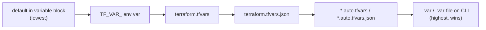
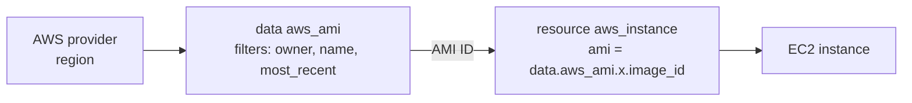

# Lesson 4 — Read, Generate & Modify Configurations (Lectures 38–104)

Detailed notes for Session 4, built from the lecture transcripts and the instructor's repo (`Section 2 - Read, Generate, Modify Configurations`). The session is split into six parts.

## Table of contents

- **Part 1 — Course format, AWS scope, security groups, Elastic IP, attributes and outputs**
    - 38. Overview of Course Lecture Format
    - 39. Learning Scope - AWS Services for Terraform Course
    - 40. Basics of Firewalls in AWS
    - 41. Security Group Practical
    - 42. Creating Firewall Rules using Terraform
    - 43. Dealing with Documentation Code Updates
    - 44. Creating Elastic IP with Terraform
    - 45. Basic of Attributes
    - 46. Cross Resource Attribute References (NEW)
    - 47. Cross Resource Attribute References - Practical (NEW)
    - 48. Output Values
- **Part 2 — Variables, tfvars, Assignment Approaches, Precedence and Data Types (List / Map)**
    - 49. Overview of Terraform Variables
    - 50. Terraform Variables - Practical
    - 51. Variable Definitions File (TFVARS)
    - 52. Approaches for Variable Assignment
    - 53. Setting Environment Variable in Linux
    - 54. Variable Definition Precedence
    - 55. Data Types in Terraform
    - 56. Data Type - List
    - 57. Data Type - Map (New)
    - 58. Fetching Data from Maps and List in Variable
- **Part 3 — count, Conditionals, Functions, Locals and Data Sources**
    - 59. The Count Meta-Argument
    - 60. Count Index
    - 61. Conditional Expressions
    - 62. Terraform Functions
    - 63. Challenge - Analyzing Terraform Code Containing Functions
    - 64. Solution - Analyzing Terraform Code Containing Functions
    - 65. Local Values
    - 66. Overview of Data Sources
    - 67. Data Sources - Documentation Reference
    - 68. Data Sources - Format
    - 69. Use-Case: Fetching Latest OS Image Using Data Sources
    - 70. Practical - Fetching Latest OS Image Using Data Sources
- **Part 4 — Debugging, Formatting, Load Order, Dynamic Blocks, Validate, Replace/Taint, Splat, Graph and Saved Plans**
    - 71. Overview of Debugging in Terraform
    - 72. Debugging Terraform - Practical
    - 73. Terraform Troubleshooting Model
    - 74. Reporting Terraform Bugs
    - 75. Terraform Format
    - 76. Load Order & Semantics
    - 77. Dynamic Blocks
    - 78. Validating Terraform Configuration Files
    - 79. Tainting Resources
    - 80. Splat Expressions
    - 81. Terraform Graph
    - 82. Saving Terraform Plan to File
- **Part 5 — Outputs, Settings, Targeting, Large Infrastructure, Zipmap, Comments, Lifecycle & Dependencies**
    - 83. Terraform Output
    - 84. Terraform Settings
    - 85. Resource Targeting in Terraform
    - 86. Dealing with Larger Infrastructure
    - 87. Zipmap Function
    - 88. Comments in Terraform
    - 89. Resource Behavior and Meta Arguments
    - 90. Meta-Argument - LifeCycle
    - 91. Lifecycle Meta-Argument - Create Before Destroy
    - 92. Lifecycle Meta-Argument - Prevent Destroy
    - 93. Lifecycle Meta-Argument - Ignore Changes
    - 94. Challenges with Count Meta-Argument
    - 95. Resource Dependency
    - 96. Implicit vs Explicit Dependencies
- **Part 6 — Sets, for_each, Objects, Input Validation, Pre/Postconditions and Moved Blocks**
    - 97. Data Type - SET
    - 98. for_each in Terraform
    - 99. Data Type - Object
    - 100. Overview of Input Variable Validation
    - 101. Practical - Input Variable Validation
    - 102. Overview of Preconditions and Postconditions
    - 104. Moved Blocks

---

## Part 1 — Course format, AWS scope, security groups, Elastic IP, attributes and outputs

This part opens Section 2 of the course (the "Read, Generate, Modify Configurations" domain). Up to now the learner has created a few servers and learned the basic workflow. Before the course goes deep into Terraform features, these lectures do four things:

1. Set the **ground rules** of the course (one folder per practical, where the code lives, always destroy).
2. Explain **which AWS services the course uses** and why (EC2, security group, IAM users, Elastic IP) so you can focus on Terraform, not on AWS.
3. Teach the **AWS basics** needed for the demos (ports, firewalls, security groups), then build them in Terraform and learn how to cope with documentation changes.
4. Introduce three core Terraform ideas that appear in almost every configuration: **attributes**, **cross-resource attribute references (with string interpolation)** and **output values**.

### Table of contents

| Lecture | Title | Theme |
|---|---|---|
| 38 | Overview of Course Lecture Format | Folder-per-practical, GitHub repo, always destroy |
| 39 | Learning Scope - AWS Services for Terraform Course | Why AWS, the four services used |
| 40 | Basics of Firewalls in AWS | Ports, firewalls, security groups (theory + demo) |
| 41 | Security Group Practical | Creating an SG in the AWS console |
| 42 | Creating Firewall Rules using Terraform | `aws_security_group` + ingress/egress rule resources |
| 43 | Dealing with Documentation Code Updates | Old inline-rule SG vs new separate-rule SG, provider-version docs |
| 44 | Creating Elastic IP with Terraform | `aws_eip` |
| 45 | Basic of Attributes | Attributes in the state file |
| 46 | Cross Resource Attribute References (NEW) | Referencing one resource's attribute in another (theory) |
| 47 | Cross Resource Attribute References - Practical (NEW) | Hands-on, failure, fix with string interpolation |
| 48 | Output Values | `output` blocks |

No lecture number in the range 38-48 is missing from the folder (all eleven transcripts are present).

### Lecture to repo-file mapping

Repo folder: `Section 2 - Read, Generate, Modify Congiruations/` (the folder name really contains the typo "Congiruations").

| Lecture | Repo file(s) | Notes |
|---|---|---|
| 38 | none (concept lecture) | The repo `Readme.md` is the "Video-Document Mapper" described in this lecture |
| 39 | none (concept lecture) | |
| 40 | none (console demo) | |
| 41 | none (console demo) | |
| 42 | `firewall.md` (contains `firewall.tf`) | |
| 43 | `doc-code-changes.md` (contains `old-approach-firewall.tf`) | The "new approach" is `firewall.md` |
| 44 | `eip.md` (contains `eip.tf`) | |
| 45 | `attributes.md` (contains `attributes.tf`) | |
| 46 | `cross-reference-attributes.md` | Same file as 47 (demo of finished code) |
| 47 | `cross-reference-attributes.md` | Also `reference.md` / `reference.tf` are an older variant of the same idea |
| 48 | `output-values.md` (contains `output-values.tf`) | |

> **Repo vs transcript differences worth knowing** (the instructor builds things live, so small differences are normal):
> - Lecture 46 shows a security group named "attribute firewall" and a rule on port 80; the repo file `cross-reference-attributes.md` (and lecture 47) use the name `attribute-sg` and port 443. Use the repo file as the reference.
> - The repo has a pre-existing, older example (`reference.md`) written with `vpc = true` and inline `ingress` blocks. The current style uses `domain = "vpc"` (see lectures 44 and 47).

---

### 38. Overview of Course Lecture Format

This lecture contains no Terraform code. It explains how the course is organised so that you study and practise efficiently.

#### The three rules of the course

| # | Rule | Why |
|---|---|---|
| 1 | Use a **separate folder for each practical** | Stay systematic and easily revisit an older practical |
| 2 | Find the source code in the **instructor's GitHub repository**, organised by exam domain/section | Every section has a `Readme.md` that maps video names to code pages |
| 3 | **Always destroy resources after a practical** (`terraform destroy`) | Forgotten resources are billed at the end of the month |

#### Rule 1: one folder per practical

The instructor's example: three lectures named "Create First EC2 Instance", "Tainting Resource" and "Conditional Expression". Each gets its own folder:

```text
terraform-practicals/
├── create-first-ec2-instance/   <- .tf files for lecture 1
├── tainting-resource/           <- .tf files for lecture 2
└── conditional-expression/      <- .tf files for lecture 3
```

(The folder names are just examples; use any name that clearly ties to the lecture.) On the instructor's machine there are folders such as `dynamic block`, `data sources`, `count parameter`, `conditional expression`. To review conditional expressions tomorrow, open that one folder and all necessary `.tf` files are there.

Practical consequences (extra context, consistent with the lecture):

- A folder is a **working directory** with its own `.terraform/` plugins folder and its own `terraform.tfstate`. Because each practical has its own state, destroying one practical never touches another.
- Mixing two practicals in one folder would make Terraform try to create *both* sets of resources on every `apply` (Terraform reads all `*.tf` files in the folder).
- Later in lecture 43 the instructor temporarily renames a file to `.bak` so Terraform ignores it. That works because Terraform only loads files ending in `.tf` / `.tf.json`.

#### Rule 2: where the code lives

```text
GitHub: "Terraform Beginner to Advance" repository
 └── Section folder per exam domain
      e.g. "Read, Generate and Modify configuration"
       └── Readme.md   <- "Video-Document Mapper": table of video name -> code page
            └── e.g. "Output Values" -> output-values.md (exact .tf used in the video)
```

- Early in the course, links to the practical code were placed directly after each lecture. As the course progresses, they are **not** added after every lecture; you go to the GitHub repo, open the section, open `Readme.md`, and click the lecture name.
- Some practicals have several files (for example `varsdemo.tf` and `variables.tf`). Both are on the same page; copy each one.

#### Rule 3: always destroy

```sh
terraform destroy            # prompts for confirmation
terraform destroy -auto-approve   # used in most demos to skip the prompt
```

- Do your trial and error, finish the practical, then destroy **before** starting the next practical.
- If you forget, you pay at the end of the month for whatever is still running.
- Destroy is easy precisely because of the one-folder-per-practical habit: running it in that folder removes exactly what that practical created.

#### Exam tips

- The exam does not test the course layout, but the habit matters: a clean working directory per configuration is the normal Terraform workflow (one root module = one directory).
- `terraform destroy` acts only on resources tracked in the **current directory's state**.

---

### 39. Learning Scope - AWS Services for Terraform Course

This lecture clears up a common confusion: "Is this a Terraform course or an AWS course?"

#### Key message

- AWS has 200+ services, but the course **does not** aim to teach AWS services or deep AWS-Terraform integrations.
- The primary aim: **master the core concepts of Terraform** so you can pass the certification with a good score.
- Terraform is an Infrastructure as Code tool, so to learn it you must create *some* infrastructure. There are hundreds of providers (AWS, Azure, GCP, ...); AWS is used simply because it is one of the most popular clouds.
- Only **very basic AWS services** are used, and these exist in every cloud, so the knowledge transfers.

#### The four AWS building blocks used throughout the course

| # | Generic concept | AWS service | Typical use in the course |
|---|---|---|---|
| 1 | Virtual machine | EC2 | A server for demos (`aws_instance`) |
| 2 | Firewall | Security Group | Demonstrating many Terraform features with rules (`aws_security_group`, rule resources) |
| 3 | Users | IAM users | Creating users to show loops, count, for_each, etc. |
| 4 | Public IP address | Elastic IP | Creating EIPs, then using functions/expressions on that code (`aws_eip`) |

Occasionally, for a video or two, another AWS service may appear for a specific use case, but these four are the primary ones.

#### Why the course also teaches the AWS basics

The course has 100,000+ students from different backgrounds: AWS professionals, Azure/GCP experts, and college students with little cloud knowledge. To put everyone on the same page, the course includes **one video or two per AWS feature** that explains what it is (for example, firewall basics and a console practical).

Typical sequence for the firewall topic:

```text
Lecture 40: Basics of firewalls (theory + demo)
Lecture 41: Security group in the AWS console (practical)
Lecture 42: Firewall rules with Terraform   <- the real Terraform lecture
```

If you already know AWS firewalls/security groups, **skip the first two videos (mark them complete) and jump to the third** (create firewall rules with Terraform).

Note: "Security Group is nothing but a virtual firewall in AWS" (the instructor repeats this several times; it is the one definition to remember).

#### Exam tips

- The Terraform Associate exam is **provider-agnostic**. It tests Terraform concepts (state, variables, modules, workflow), not AWS knowledge. AWS is only the vehicle for examples.
- What carries over to any cloud: resources, attributes, references, outputs, and the idea of a "virtual firewall" for network rules.

---

### 40. Basics of Firewalls in AWS

A theory-plus-demo lecture. Goal: understand **ports**, then **firewalls**, then the AWS firewall called a **security group**. This is required background for the Terraform security group lectures that follow.

#### Ports

A port is an **endpoint of communication used to identify a given application or process** in an operating system (Windows, Linux, ...).

```text
 Users on the internet                 Server  1.2.3.4
 ---------------------                 -------------------------------
                                       |  SSH daemon     -> port 22  |
   client ---- 1.2.3.4:22 -----------> |                             |
   client ---- 1.2.3.4:80 -----------> |  NGINX/Apache   -> port 80  |
                                       -------------------------------
```

- When a program that serves clients starts (SSH, NGINX, Apache, vsftpd ...) it **opens (binds to) a port**.
- A client connects using `server-IP:port`.

| Software | Default port in the demo |
|---|---|
| SSH | 22 |
| HTTP web server (NGINX/Apache) | 80 |
| vsftpd (FTP) | 21 |
| HTTPS (mentioned in lecture 41) | 443 |

#### Demo: seeing ports on a server

The demo server is an EC2 instance named `website-ec2` running NGINX.

1. Browse to the instance's public IP: you get the "Welcome to NGINX" page.
2. SSH in and switch to root, then list listening ports:

```sh
netstat -ntlp
```

Flags (extra context): `-n` numeric addresses/ports, `-t` TCP, `-l` listening sockets only, `-p` show the owning process.

Expected result: a listener on port **80** (nginx) and port **22** (sshd).

3. Browser: `http://<public-ip>:80` works (browsers add `:80` automatically for http). `http://<public-ip>:22` fails with "site cannot be reached" because port 22 is SSH, which is not a web server.
4. Install and start `vsftpd`; re-run `netstat -ntlp` and a new listener on port **21** appears. The service's config file decides which port it binds to.

#### What a firewall is

A firewall is a **network security system that controls incoming and outgoing network traffic** to a server, according to a set of rules.

Scenario: the server runs SSH (22) and HTTP (80). You want the world to reach the website but **not** SSH. The firewall is the "middleman":

```text
 User ---> [ FIREWALL ] ---> Server
              Rule 1: DENY  port 22
              Rule 2: ALLOW port 80
```

A request to port 22 reaches the firewall first, matches the deny rule, and is blocked.

In AWS the firewall is the **Security Group**: a virtual firewall for an instance that controls inbound and outbound traffic.

#### Demo: security group rules in action

The demo instance's security group initially has one inbound rule: **All traffic allowed from 0.0.0.0/0** ("0.0.0.0 means everyone"). That is why both the website (80) and SSH (22) work.

| Step | Change to the inbound rules | Result |
|---|---|---|
| 1 | Remove the allow-all rule, save | Website stops loading (no traffic allowed). If the page still loads, it is the browser cache; try another browser |
| 2 | Add a rule: port 80, source 0.0.0.0/0, save | Website loads immediately |
| 3 | (implied) SSH / browser-based connect | Blocked, because only 80 is allowed |

The concept is identical across providers: the instructor also shows DigitalOcean's firewall page with the same ideas (choose a port, choose which source IPs may use it).

#### Inbound vs outbound

| Direction | Terraform / CloudFormation term | Controls |
|---|---|---|
| **Inbound** | **ingress** | Who can connect **to** the server (incoming connections) |
| **Outbound** | **egress** | Which remote systems the server can connect **to** |

Example for outbound: should the EC2 instance be able to reach every server on the internet, or only one specific server? That is decided by outbound rules.

#### Exam tips

- Memorise: **Security Group = virtual firewall in AWS**, **ingress = inbound**, **egress = outbound**.
- `0.0.0.0/0` means "all IPv4 addresses on the internet".
- (Extra context) Security groups are *allow-lists*: there is no explicit deny rule. A connection is blocked simply because no rule allows it. The lecture's "deny 22" diagram is the generic firewall concept.

---

### 41. Security Group Practical

A console-only walkthrough (no Terraform) of how to create a security group from scratch and attach it to an EC2 instance.

#### Step-by-step

1. **Launch an EC2 instance** named `demo-firewall-ec2` with defaults. When you create an instance, the wizard has a **Firewall (security groups)** section where you can pick SSH (22), HTTPS (443), etc. By default a security group is auto-created for the instance and shows inbound and outbound rules.
2. To create one **from scratch**: EC2 console > Network & Security > **Security Groups** > Create security group.
   - Name: `myfirst.sg`
   - Description: `Firewall`
3. **Outbound rule**: All traffic, destination `0.0.0.0/0`. (Important to ensure the instance can reach out.)
4. **Inbound rule**: add a rule.
   - Type presets (for example **SSH**) auto-fill the port. **Custom TCP** lets you enter any port (for example 21).
   - Port **22**, source `0.0.0.0/0`, description "Allow ALL Traffic To SSH Port".
   - Source can be one specific IP (for example `10.3.x.x/32`) or a range, depending on the use case.
5. Create the security group.
6. **Attach it to the instance**: instance > Security tab > Change security groups > remove the auto-created group > add `myfirst.sg` (remember to click **Add security group**, then Save).

> Production note from the instructor: do **not** open SSH (22) to the whole internet. Allow it only from your office network or, better, only from a VPN.

#### Demo: allowing ping (ICMP)

Copy the instance's public IP and try:

```sh
ping <public-ip>
```

It fails ("Request timed out") because the firewall has no rule for ping.

| Attempt | What was done | Result |
|---|---|---|
| 1 | Added ICMP rule in the **outbound** tab, source 0.0.0.0/0 | Still times out. **Mistake**: wrong direction |
| 2 | Deleted that outbound rule, added ICMP in the **inbound** tab from 0.0.0.0/0 | Ping works |

Why: the ping request comes **from the internet to the server**, which is inbound traffic. ICMP is the protocol used for ping. The same logic applies to port 80: if a website runs, allow port 80 inbound so everyone can open it.

```text
  Rule direction guide
  --------------------
  Someone connects TO my server   -> INBOUND  (ingress) rule
  My server connects OUT to others -> OUTBOUND (egress) rule
```

#### Exam tips

- Not tested directly, but it builds the intuition used in the Terraform lectures that follow: the rule fields are **protocol/port range, source (CIDR) and description**.
- Common gotcha: putting a rule in the wrong direction (ICMP outbound instead of inbound).

---

### 42. Creating Firewall Rules using Terraform

The first real Terraform lecture of this part.

#### Requirement

Create a security group named **`terraform-firewall`** with:

- **Inbound**: allow port **80** from `0.0.0.0/0` (the internet).
- **Outbound**: allow **all** traffic.

```text
           +-------------- terraform-firewall (SG) --------------+
 Internet  |  INBOUND : TCP 80   from 0.0.0.0/0                  |  Instance
 --------> |  OUTBOUND: ALL      to   0.0.0.0/0                  | ---------->
           +-----------------------------------------------------+
```

#### How to find the right Terraform code

1. AWS has hundreds of services, and each has its own Terraform resource type. Google "terraform security group" (or "Elastic IP terraform aws") to land on the provider documentation page, here `aws_security_group`: https://registry.terraform.io/providers/hashicorp/aws/latest/docs/resources/security_group
2. Copy a documentation example into a new file.
3. To understand each argument, use either the **documentation** (it says required vs optional) or the **console** (the fields in the "Create security group" form: name, description, VPC ... map to arguments). If you know how to create the resource in the console, you can write it in Terraform.

#### Step 1: the security group itself

The docs example is trimmed down to what is needed. `description` and `vpc_id` are optional (without `vpc_id` the default VPC is used); tags are removed for simplicity.

```hcl
provider "aws" {
  region = "us-east-1"
}

resource "aws_security_group" "allow_tls" {
  name        = "terraform-firewall"
  description = "Managed from Terraform"
}
```

| Part | Meaning |
|---|---|
| `provider "aws"` | Configures the AWS provider; `region` is where resources are created |
| `resource "aws_security_group" "allow_tls"` | Resource **type** `aws_security_group`, local **name** `allow_tls` (only used inside Terraform) |
| `name` | The name AWS shows for the group (`terraform-firewall`) |
| `description` | Free text, optional |

Run:

```sh
terraform init            # only if there is no .terraform folder
terraform plan            # Plan: 1 to add
terraform apply -auto-approve
```

Check the console (EC2 > Security Groups, same region): a group `terraform-firewall` exists but has **no inbound and no outbound rules**. A security group with no rules is of little use, so rules come next.

> Observation from the lecture: in the console, the new `terraform-firewall` group shows no inbound rules and no outbound rules until the rule resources are applied.

#### Step 2: the rules are separate resources

Key idea: the security group and its rules are **two different resource types** in the current provider. The rule resources have their own documentation pages (search for `aws_vpc_security_group_ingress_rule`, "Manages an inbound (ingress) rule for a VPC security group").

- `ingress` = inbound, `egress` = outbound (same naming in CloudFormation, with `SecurityGroupIngress` / `SecurityGroupEgress`).

Full configuration (`firewall.tf`, exactly as in the repo):

```hcl
provider "aws" {
  region     = "us-east-1"
}

resource "aws_security_group" "allow_tls" {
  name        = "terraform-firewall"
  description = "Managed from Terraform"
}

resource "aws_vpc_security_group_ingress_rule" "allow_tls_ipv6" {
  security_group_id = aws_security_group.allow_tls.id
  cidr_ipv4         = "0.0.0.0/0"
  from_port         = 80
  ip_protocol       = "tcp"
  to_port           = 80
}

resource "aws_vpc_security_group_egress_rule" "allow_all_traffic_ipv4" {
  security_group_id = aws_security_group.allow_tls.id
  cidr_ipv4         = "0.0.0.0/0"
  ip_protocol       = "-1" # semantically equivalent to all ports
}
```

(The local name `allow_tls_ipv6` is a leftover from the docs example; the rule is actually IPv4. Local names are arbitrary labels. The instructor notes the longer name is fine.)

#### Argument reference

| Argument | Rule | Meaning |
|---|---|---|
| `security_group_id` | both | Which security group gets the rule. Value `aws_security_group.allow_tls.id` references the group above (explained in lectures 46-47) |
| `cidr_ipv4` | both | Source (ingress) or destination (egress) IPv4 range. `0.0.0.0/0` = everyone |
| `from_port` | ingress | Start of the port range |
| `to_port` | ingress | End of the port range |
| `ip_protocol` | both | `tcp`, `udp`, `icmp`, ... or **`-1` = all protocols** |

Notes on `ip_protocol = "-1"`: the docs comment says it is "semantically equivalent to all ports". The egress rule therefore allows all protocols, all ports, to 0.0.0.0/0 and needs no `from_port`/`to_port`. If you do not use `-1`, you specify ports manually as in the ingress rule.

#### Apply and verify

```sh
terraform plan             # Plan: 2 to add  (the ingress rule and the egress rule)
terraform apply -auto-approve
```

Console result:

- Inbound: one rule, port 80, source 0.0.0.0/0.
- Outbound: one rule, all traffic, all protocols, all ports, destination 0.0.0.0/0.

#### from_port and to_port: port ranges

Why two port fields? A customer may want a **range** (for example 80 to 100). Creating 21 separate rules for 80, 81, 82 ... is impractical, so AWS supports a port range (the console has a "port range" option, for example `80 - 100`).

Demo: change `to_port` to 100 (leave `from_port = 80`), then:

```sh
terraform apply -auto-approve
```

The console now shows port range **80 - 100**. (The instructor cancels the manual console edit so no manual changes are made. Everything is done via Terraform.)

```hcl
resource "aws_vpc_security_group_ingress_rule" "allow_tls_ipv6" {
  security_group_id = aws_security_group.allow_tls.id
  cidr_ipv4         = "0.0.0.0/0"
  from_port         = 80
  ip_protocol       = "tcp"
  to_port           = 100      # range 80-100
}
```

To open a **single** port, set both to the same value (as in the final code: 80 and 80).

#### The `security_group_id` argument: demonstration of the link

Because the group and rule are separate, the rule needs to know which group to attach to. `aws_security_group.allow_tls.id` means "resource type `aws_security_group`, local name `allow_tls`, attribute `id`".

The instructor demonstrates the effect of changing this link: hard-code the **default** security group's ID into `security_group_id` (use your own ID; a placeholder is shown here):

```hcl
security_group_id = "sg-0123456789abcdef0"   # placeholder: ID of the default SG
```

```sh
terraform plan             # 1 to add, 1 to destroy (the rule is replaced)
terraform apply -auto-approve
```

Result: the rule disappears from `terraform-firewall` (it now has no inbound rule, but still the outbound rule) and appears in the default security group with range 80-100. This proves that the rule is added to whichever group `security_group_id` points to. (Fuller treatment of references comes in lectures 46-47.)

#### Gotchas

- The security group resource only creates the container. Without rule resources it has no rules in this setup.
- A **plan** showing "1 to add, 1 to destroy" for a rule when changing `security_group_id` means Terraform replaces the rule (a rule cannot be moved between groups in place).
- Documentation can change (next lecture): the examples shown today may differ in your docs version.

#### Exam tips

- Resource address format is `<resource_type>.<local_name>`, attributes are read as `<resource_type>.<local_name>.<attribute>`.
- Terraform itself is provider-agnostic; knowing which arguments are required vs optional comes from the **provider documentation**, which is permitted/expected knowledge in daily use. For the exam, know the *concept* of arguments vs attributes.
- Required vs optional is shown in the documentation's Argument Reference.

---

### 43. Dealing with Documentation Code Updates

#### The problem

HashiCorp occasionally changes provider documentation (example code) when new provider versions release. The same outcome can often be achieved in more than one way, and legacy code you meet at work may not match today's example. This lecture shows how to cope.

#### Two ways to define a security group with rules

| | **New (recommended) approach** | **Old approach** |
|---|---|---|
| Resource types | `aws_security_group` + `aws_vpc_security_group_ingress_rule` + `aws_vpc_security_group_egress_rule` | Only `aws_security_group` |
| Where rules live | In separate rule resources linked by `security_group_id` | Inline `ingress { }` and `egress { }` blocks inside the SG |
| Shown in current docs example? | Yes | No (older docs only) |
| Still works with new provider? | Yes | **Yes** (demonstrated) |

New approach: the code from lecture 42 (`firewall.md`).

Old approach (`old-approach-firewall.tf` from the repo `doc-code-changes.md`):

```hcl
provider "aws" {
  region     = "us-east-1"
}

resource "aws_security_group" "old_approach" {
  name        = "allow_tls"
  description = "Allow TLS inbound traffic"


  ingress {
    description      = "TLS from VPC"
    from_port        = 443
    to_port          = 443
    protocol         = "tcp"
    cidr_blocks      = ["10.77.32.50/32"]
  }

  egress {
    from_port        = 0
    to_port          = 0
    protocol         = "-1"
    cidr_blocks      = ["0.0.0.0/0"]
    ipv6_cidr_blocks = ["::/0"]
  }

}
```

Notice the argument naming differences between the two styles:

| Concept | Old inline block | New rule resource |
|---|---|---|
| Protocol | `protocol` | `ip_protocol` |
| IPv4 source/destination | `cidr_blocks = ["..."]` (a list) | `cidr_ipv4 = "..."` (a single string) |
| IPv6 | `ipv6_cidr_blocks` | `cidr_ipv6` (extra context) |
| Group link | implicit (inside the group) | `security_group_id = ...id` |

#### Demo

1. Rename the new-approach file to `firewall.tf.bak` so Terraform ignores it (only `*.tf` files are loaded).
2. Save the old-approach file as a `.tf` file.
3. Run:

```sh
terraform init      # downloads the newest provider at the time (5.38 in the video)
terraform plan      # works
terraform apply -auto-approve
```

Result: security group `allow_tls` is created with an inbound HTTPS rule (443 from 10.77.32.50/32) and an outbound rule. **The old approach still works with the newer provider.**

#### Switching documentation to an older provider version

On every Registry resource page there is a **provider version selector**.

- Latest at the time of the video: 5.38.0. Selecting an older version (for example 5.31.0) shows the older example usage, with inline `ingress`/`egress`.
- The URL changes only slightly (the version segment, for example `.../providers/hashicorp/aws/latest/docs/...` becomes one containing the version such as `5.29.0`). Remember that the page URL carries the version.

```text
.../providers/hashicorp/aws/latest/docs/resources/security_group
.../providers/hashicorp/aws/<older-version>/docs/resources/security_group
```

Use this when you inherit legacy code (for example written by someone who left the company) and cannot match it to the current docs.

#### Key points from the lecture

1. A newer recommended approach does **not** mean the older one stops working.
2. Organisations may keep the approach that suits them. Large enterprises find it hard to upgrade a big code base; if everything works they stick to a specific Terraform and provider version for **stability** (instructor's analogy: staying on Windows 10 if everything works rather than moving to Windows 11 without need).
3. In the docs, switch to the older provider version to see the examples that match your legacy code.
4. For this course: when HashiCorp changes the example code, the instructor re-records videos, but it takes time, so you may still see older-style code in some videos. It will still work.
5. You do not need to memorise resource syntax; everything is taken from the documentation (the instructor says even after years he cannot create a resource without the docs).

#### Gotchas

- Mixing styles for the same security group (inline rules **and** separate rule resources) is a known problem area in the AWS provider (extra context: it can cause rules to conflict or be overwritten). Pick one style per group.
- Pinning provider versions (done in later lectures with `required_providers`) is how you keep behaviour stable.

#### Exam tips

- Know that **provider version** and **Terraform version** can be constrained to keep behaviour stable; documentation is versioned per provider version.
- A resource can often be configured in several valid ways; both old and new syntax may work.

---

### 44. Creating Elastic IP with Terraform

#### Why this lecture

The Elastic IP (EIP) resource is tiny and will be used in a lot of later videos, so it gets its own lecture.

#### What an Elastic IP is

An Elastic IP is a **static IPv4 address** in AWS that you create and can associate with an EC2 instance.

```text
  allocate EIP  ->  you get a public IP (e.g. 203.0.113.10)
                          |
                          |  (optional) associate
                          v
                    EC2 instance reachable at that IP
```

Console: EC2 > Elastic IPs > **Allocate Elastic IP address** > choose region > Allocate. Type is "public IP". Association with an instance is a separate, optional step.

#### Terraform code (`eip.tf` from the repo)

```hcl
resource "aws_eip" "lb" {
  domain   = "vpc"
}
```

How it was derived: the docs example for `aws_eip` has two arguments, `instance` and `domain`. `instance` is **optional** (association is not needed here), so it is removed. A provider block is added for the region:

```hcl
provider "aws" {
  region = "us-east-1"
}
```

| Part | Meaning |
|---|---|
| `aws_eip` | Resource type for an Elastic IP |
| `lb` | Local name (from the docs example) |
| `domain = "vpc"` | The EIP is for use in a VPC (the current argument; the older provider used `vpc = true`, see `reference.md`) |

#### Commands

```sh
terraform plan                    # Plan: 1 to add
terraform apply -auto-approve
terraform destroy -auto-approve
```

Verification:

- AWS console, region N. Virginia (us-east-1): one Elastic IP is listed (the demo showed an address such as `100.24.x.x`).
- The same address is stored in the **state file** (`terraform.tfstate`). This is the lead-in to the next lecture on attributes.

#### Important: do not leave EIPs idle

An unused Elastic IP **costs money**. After the practical:

1. `terraform destroy -auto-approve`
2. Check the console and refresh: the EIP must be gone (in the demo the instructor had also manually allocated one in the console and released it by hand).

#### Exam tips

- `terraform destroy` removes what the state tracks; a resource created manually in the console (outside Terraform) is not touched by it.
- Optional vs required arguments are visible in the docs; remove optional ones to keep demos minimal.

---

### 45. Basic of Attributes

#### Definition

Every resource has a set of **attributes**. Attributes are the **fields of a resource that hold the values that end up in the state file** after the resource is created.

```text
 aws_instance created by Terraform
        |
        v   terraform.tfstate -> resource -> "attributes": {
        |        "id":          "i-0abc123..."
        |        "public_ip":   "203.0.113.25"
        |        "private_ip":  "10.0.1.15"
        |        "private_dns": "ip-10-0-1-15.ec2.internal"
        |        ... many more
        v    }
```

The values are known (or "computed") only after the resource exists in the cloud.

#### Arguments vs attributes

| | Argument | Attribute |
|---|---|---|
| Who sets it | **You**, in the resource block | The provider/API, often after creation |
| Docs section | "Argument Reference" | "Attribute Reference" |
| Example (`aws_eip`) | `domain = "vpc"` | `public_ip`, `id`, `public_dns` ... |
| Example (`aws_instance`) | `ami`, `instance_type` | `id`, `arn`, `public_ip`, `private_ip`, `instance_state` |

(Extra context: some arguments you set also appear as attributes in state.) Each resource documentation page lists both. For `aws_instance` the attribute reference includes `arn`, `id`, `instance_state`, and so on; each attribute has a description.

#### Demo (`attributes.tf` from the repo)

```hcl
provider "aws"{
    region = "us-east-1"
}

resource "aws_eip" "lb" {
  domain   = "vpc"
}

resource "aws_instance" "web" {
  ami           = "ami-0440d3b780d96b29d"
  instance_type = "t2.micro"
}
```

(The AMI ID is region-specific and course-supplied; use a valid AMI for your region.)

```sh
terraform init               # already done in the demo
terraform apply -auto-approve
```

Both resources are created. Then:

1. Open `terraform.tfstate`.
2. First resource: `"type": "aws_eip"`, `"name": "lb"`. Scroll to its `attributes` section. The attribute **`public_ip`** holds the Elastic IP, so you can read it from the state **without opening the AWS console**.
3. Second resource: `aws_instance` with its own `attributes` block. Compare against the console:
   - `id` in state ends with the same suffix as the instance ID in the console (the demo shows an instance ID ending `...8f6`).
   - `public_ip` in state matches the public IP in the console (demo ends with `...238.56`).

```sh
terraform destroy -auto-approve    # always clean up
```

#### Why this matters

Attributes are used **extensively** in production code. They are what you reference when one resource needs a value from another (lectures 46-47) and what you print with `output` blocks (lecture 48). Reading the Attribute Reference in the docs to find the right attribute name is the normal workflow.

#### Exam tips

- Attributes are stored in **state**. The state file is the source of truth of what Terraform knows about a resource.
- Do not confuse **Argument Reference** (inputs you supply) with **Attribute Reference** (values you can read).
- State files can contain sensitive data in attributes, so protect them (extra context: relevant for later state lectures).

---

### 46. Cross Resource Attribute References (NEW)

Prerequisite: lecture 45 (attributes). The instructor stresses that in most production Terraform you write, this is used constantly.

#### The challenge

In one configuration you often define many resources (1, 2, 15, 20 ...). Resource 2 may depend on a value that only exists **after** resource 1 is created.

Scenario:

```text
   aws_eip (Elastic IP)  ----- public IP is known only AFTER creation
          |
          |  we want: security group rule that allows port 443 from THIS IP
          v
   aws_security_group + rule  (cidr_ipv4 = the EIP)
```

Bad idea: create the EIP first, copy its IP by hand, and paste it into the security group code. That is manual, not scalable, and not "the right way". What we want: once the EIP is created, its `public_ip` is **automatically** taken into the rule.

#### The solution: cross-resource attribute reference

Terraform lets you reference the attribute of one resource inside another resource.

**Syntax**

```text
<resource_type>.<local_resource_name>.<attribute>
```

Example for our case:

```text
aws_eip.lb.public_ip
        |  |    |
        |  |    +-- attribute (from Attribute Reference in the docs)
        |  +------- local name given in the resource block
        +---------- resource type
```

Finding the attribute: open the `aws_eip` docs > **Attribute Reference** > `public_ip` ("Contains the public IP address").

#### The reference file (`cross-reference-attributes.tf`)

```hcl
resource "aws_eip" "lb" {
  domain   = "vpc"
}

resource "aws_security_group" "example" {
  name        = "attribute-sg"
}

resource "aws_vpc_security_group_ingress_rule" "example" {
  security_group_id = aws_security_group.example.id

  cidr_ipv4   = "${aws_eip.lb.public_ip}/32"
  from_port   = 443
  ip_protocol = "tcp"
  to_port     = 443
}
```

(The lecture 46 demo uses a slightly different file: group name "attribute firewall" and port 80. The repo version above, port 443 and group `attribute-sg`, is the one built in lecture 47.)

#### Two cross-references in this one file

| Where | Reference | What it provides |
|---|---|---|
| `security_group_id` | `aws_security_group.example.id` | The ID of the group (only known after the group is created) |
| `cidr_ipv4` | `aws_eip.lb.public_ip` (inside `"${...}/32"`) | The EIP's address (only known after the EIP is created) |

The instructor poses this as a quiz: "Can you spot the second cross-reference?" The answer is `security_group_id`. The rule needs the group's ID, which does not exist until the group is created; the `id` attribute is documented in the `aws_security_group` Attribute Reference.

#### Demo: automatic ordering

Starting from an empty folder (no state), run:

```sh
terraform apply -auto-approve
```

Observed creation order in the output:

```text
aws_eip.lb                                  creating... -> creation complete
aws_security_group.example                  creating... -> creation complete
aws_vpc_security_group_ingress_rule.example creating... -> creation complete
```

- The EIP is created first, then the security group, then the ingress rule.
- In the console, the EIP (ends `...238.140` in the demo) matches the source of the rule on the port in the security group.

#### Implicit dependency

Terraform detects that the rule **depends** on the EIP and on the security group because it references their attributes. It therefore creates them first. If it tried the rule first, it would fail because the `id` / `public_ip` values would not exist yet. This is called an **implicit dependency** (covered formally later in the course in the "Implicit vs Explicit Dependencies" lecture).

```text
  aws_eip.lb ───────────────┐
                            ├──> aws_vpc_security_group_ingress_rule.example
  aws_security_group.example ┘
```

#### Exam tips

- Know the reference syntax `TYPE.NAME.ATTRIBUTE` by heart.
- Referencing an attribute creates an **implicit dependency**; Terraform builds the dependency graph automatically and orders creation accordingly (and destruction in reverse).
- Values from the Attribute Reference are *known after apply*; in plan output they show as `(known after apply)`.

---

### 47. Cross Resource Attribute References - Practical (NEW)

A hands-on build of the lecture 46 workflow, and a very instructive failure.

#### Goal

Whitelist the Elastic IP in a security group rule on port 443. Three resources: EIP, security group, security group rule.

#### Build steps

1. Copy each resource example from its docs page into a new file `cross-reference-attributes.tf`. Doc pages used: `aws_eip`, `aws_security_group`, `aws_vpc_security_group_ingress_rule`.
2. EIP: remove the optional `instance` argument.
3. Security group: trim to the minimum ("three liner") and name it `attribute-sg`.
4. Ingress rule: keep `security_group_id` as a reference, set the port to **443**.
5. **Local-name mismatch**: the SG in the docs is named `example` in one page and `allow_tls` in another. The reference must use the local name you actually chose. Either rename the resource or change the reference. The instructor changes the reference to match the SG's local name.
6. For `cidr_ipv4`, find which attribute stores the public IPv4 of an EIP: `public_ip`. Reference: `aws_eip.lb.public_ip`.

First (naive) version of the rule:

```hcl
resource "aws_vpc_security_group_ingress_rule" "example" {
  security_group_id = aws_security_group.example.id

  cidr_ipv4   = aws_eip.lb.public_ip      # <-- will FAIL on apply
  from_port   = 443
  ip_protocol = "tcp"
  to_port     = 443
}
```

#### Experiment: plan succeeds, apply fails

```sh
terraform plan                  # Plan: 3 to add   <- looks fine
terraform apply -auto-approve
```

Result:

| Resource | Outcome |
|---|---|
| `aws_eip.lb` | Created |
| `aws_security_group.example` | Created |
| `aws_vpc_security_group_ingress_rule.example` | **Failed** |

Error (summarised): `Invalid Attribute Value` ... `attribute cidr_ipv4 value must be a valid IPv4 CIDR block that represents a network address`, and it prints the value it received (a bare IP like `35.x.x.x`) on the exact failing line.

Verification in the console: the EIP exists, the security group `attribute-sg` exists, but it has **no rule**. You now have "half" the infrastructure.

#### Diagnosis

Even pasting the literal IP manually still fails, and so does the AWS console if you type a bare IP into a rule: the console says a CIDR block must be specified (it suggests `/32`). A security group rule needs a **CIDR block**, not a bare address.

| Notation | Meaning |
|---|---|
| `203.0.113.10/32` | Exactly one IP address |
| `10.77.0.0/16` | A whole range (65,536 addresses) |
| `0.0.0.0/0` | Every IPv4 address |

So the value we need is `<computed EIP> + "/32"`. Writing `aws_eip.lb.public_ip/32` directly is not valid HCL. The `/32` must be appended to the computed value as a string.

#### Fix: string interpolation

```hcl
cidr_ipv4 = "${aws_eip.lb.public_ip}/32"
```

How `"${ ... }"` works:

- Inside a quoted string, `${ expression }` is a **placeholder**.
- Terraform first **evaluates** the expression (here, reads the EIP's `public_ip`), converts it to text, **substitutes** it into the string, then passes the final string (for example `203.0.113.10/32`) to the argument.
- Anything in `${}` is computed by Terraform before the value is used.

Final working rule (matches the repo file):

```hcl
resource "aws_vpc_security_group_ingress_rule" "example" {
  security_group_id = aws_security_group.example.id

  cidr_ipv4   = "${aws_eip.lb.public_ip}/32"
  from_port   = 443
  ip_protocol = "tcp"
  to_port     = 443
}
```

```sh
terraform apply -auto-approve    # now succeeds (the EIP and SG already exist; only the rule is created)
```

In the console: the inbound rule's source is the EIP followed by /32.

#### Re-run from scratch to prove a clean first apply

Because the first run created things in two attempts, the instructor destroys and re-applies:

```sh
terraform destroy -auto-approve
terraform apply -auto-approve      # everything created in one go
```

Reasoning: running `apply` a few times until it works does not harm infrastructure, but good practice (and the expected standard for production code) is that the **whole configuration is created successfully in one run**.

#### When is interpolation needed?

Interpolation is required when you are **combining** a computed value with other text (here the `/32`). It is not always required:

```hcl
security_group_id = aws_security_group.example.id        # whole value is the reference: no ${} needed
cidr_ipv4         = "${aws_eip.lb.public_ip}/32"          # reference + literal text: use interpolation
```

(Extra context: in Terraform 0.12+ a lone expression like `aws_eip.lb.public_ip` needs no quotes or `${}`; wrapping a lone reference as `"${...}"` is an old style and not recommended.)

#### The older variant in the repo (`reference.tf` / `reference.md`)

The repo also contains an older example combining an instance, an EIP association, and a security group with inline `ingress`:

```hcl
provider "aws" {
  region     = "us-west-2"
  access_key = "PUT-YOUR-ACCESS-KEY-HERE"
  secret_key = "PUT-YOUR-SECRET-KEY-HERE"
}

resource "aws_instance" "myec2" {
   ami = "ami-082b5a644766e0e6f"
   instance_type = "t2.micro"
}

resource "aws_eip" "lb" {
  domain = "vpc"
}

resource "aws_eip_association" "eip_assoc" {
  instance_id   = aws_instance.myec2.id
  allocation_id = aws_eip.lb.id
}

resource "aws_security_group" "allow_tls" {
  name        = "kplabs-security-group"

  ingress {
    from_port   = 443
    to_port     = 443
    protocol    = "tcp"
    cidr_blocks = ["${aws_eip.lb.public_ip}/32"]

#    cidr_blocks = [aws_eip.lb.public_ip/32]   # invalid: not a valid expression
  }
}
```

Points worth noting:

- **Never hard-code credentials** (`access_key` / `secret_key`) in `.tf` files. The placeholders above stand for values that should come from environment variables or a credentials profile.
- `aws_eip_association` ties an EIP (`allocation_id = aws_eip.lb.id`) to an instance (`instance_id = aws_instance.myec2.id`): two more cross-resource references.
- The commented-out line shows the same mistake we saw: appending `/32` outside a string is not valid.
- The repo's `reference.md` says that in some provider versions you may need to add `vpc_id = <your default VPC ID>` to `aws_security_group` (it shows a screenshot-described error), and that the older `vpc = true` was replaced by `domain = "vpc"`.

#### Key lessons

| Lesson | Detail |
|---|---|
| `plan` success does not guarantee `apply` success | The plan does not know computed values (like the EIP) and cannot validate them against the cloud API |
| Partial apply leaves half the infrastructure | Resources created before the failure stay (state records them); fix and re-apply |
| Rules need a CIDR, not a bare IP | Use `/32` for a single IPv4 address |
| Use `${}` to embed expression results in strings | Terraform evaluates, substitutes, then passes the result |

#### Exam tips

- Plan success != apply success. Expect questions about what happens when a resource fails mid-apply: successfully created resources remain tracked in state; the next `apply` resumes.
- String interpolation syntax: `"${...}"`; expressions inside are evaluated.
- Cross-resource references create implicit dependencies, so no `depends_on` is needed in this example.

---

### 48. Output Values

#### What output values do

Output values **make information about your infrastructure available on the command line**, and can also expose it to other Terraform configurations.

```text
 User --(Terraform code: create EC2 + output its public IP)--> Terraform
 Terraform --creates EC2--> AWS
 Terraform <--reads attributes (public_ip)-- AWS
 User <--prints "public-ip = 203.0.113.10"-- Terraform
```

Without outputs, after creating an EIP the CLI does not show you the IP; you would log in to the console (correct region > Elastic IPs) and copy it manually, which is slow.

#### Code (`output-values.tf` from the repo)

```hcl
provider "aws" {
  region = "us-east-1"
}

resource "aws_eip" "lb" {
  domain   = "vpc"
}

output "public-ip" {
  value = aws_eip.lb.public_ip
}
```

| Part | Meaning |
|---|---|
| `output "public-ip"` | Declares an output named `public-ip` (any name you like) |
| `value` | The expression whose result is printed: here the `public_ip` attribute of the EIP, found in the docs' Attribute Reference (`public_dns` is another available attribute) |

#### Demo

First apply the plain EIP (resource only, no output). The CLI prints nothing about the IP. Then add the `output` block and run apply again:

```sh
terraform apply -auto-approve
```

Expected output at the end of the run:

```text
Apply complete! Resources: 0 added, 0 changed, 0 destroyed.

Outputs:

public-ip = "203.0.113.10"
```

Note: nothing is created or changed in AWS. Only the outputs are added to the state and printed.

#### Customising the output value

The `value` can be any expression. Three variants shown in the video (from `output-values.md`):

```hcl
# 1. Just the IP
output "public-ip" {
  value = aws_eip.lb.public_ip
}
```

```hcl
# 2. A formatted URL using string interpolation
output "public-ip" {
  value = "https://${aws_eip.lb.public_ip}:8080"
}
```

Output: `public-ip = "https://203.0.113.10:8080"`, a ready-to-copy URL (useful when an application runs on a specific port).

```hcl
# 3. The whole resource: all attributes
output "public-ip" {
  value = aws_eip.lb
}
```

Output: every attribute of the EIP (id, `public_ip`, `public_dns`, `allocation_id`, `domain`, and so on) is printed as an object.

| Variant | `value` | What you get |
|---|---|---|
| 1 | `aws_eip.lb.public_ip` | Only the IP |
| 2 | `"https://${aws_eip.lb.public_ip}:8080"` | A custom string built with interpolation |
| 3 | `aws_eip.lb` | All attributes of the resource |

Cleanup:

```sh
terraform destroy -auto-approve
```

#### Outputs in the state file

Open `terraform.tfstate`: there is an `outputs` section. The name `public-ip` is the output name you gave, and its `value` holds the data.

```json
"outputs": {
  "public-ip": {
    "value": "203.0.113.10",
    "type": "string"
  }
}
```

(Structure illustrative; the exact JSON varies.)

#### Why outputs matter beyond the CLI: sharing between projects

```text
 Project A (e.g. Git repo 1)           Project B (e.g. Git repo 2)
 creates Elastic IP                    needs the actual public IP
 output "public-ip" ----state----->    reads Project A's outputs
```

Project B can read Project A's output values from A's state file (provided it has access to that state). The instructor says this architecture is covered later in the course (extra context: this is the `terraform_remote_state` data source). So outputs are not merely cosmetic; they are a way to expose information between configurations.

#### Gotchas

- Output names may contain hyphens (as in `public-ip`) but it is conventional (extra context) to use underscores, as with resource names.
- Outputs appear after `apply`. You can also re-display them anytime (covered later in "Terraform Output", lecture 83).
- Output values are recorded in state, so a sensitive value in an output is stored in plain text in the state (extra context: use `sensitive = true` to hide it in CLI output, but it is still in state).

#### Exam tips

- `output` block syntax: `output "<name>" { value = <expression> }`.
- Outputs are printed after `terraform apply` and stored in the state.
- Outputs can be used to pass data between configurations/modules.
- The attribute names you can output come from the resource's **Attribute Reference**.

---

### Part 1 — Key takeaways

- The course uses **one folder per practical**, code lives in the GitHub repo sectioned by exam domain (use each section's `Readme.md` to find the page), and you must **always destroy** after a practical to avoid charges.
- AWS is only a **vehicle**. The four services used are EC2 (VM), Security Group (firewall), IAM users and Elastic IP (public IP). The exam is provider-agnostic.
- **Port** = endpoint identifying a process; **firewall** = rules that allow/deny traffic; **Security Group** = AWS's virtual firewall. **Ingress = inbound**, **egress = outbound**. A rule for ping (ICMP) or a website (port 80) coming from the internet must be **inbound**.
- In the current AWS provider a security group is created with `aws_security_group`, and its rules with **separate** `aws_vpc_security_group_ingress_rule` / `aws_vpc_security_group_egress_rule` resources linked by `security_group_id`. `ip_protocol = "-1"` means all protocols/ports; `from_port`/`to_port` define a port range.
- The **older inline `ingress`/`egress` style still works** with new providers. Documentation changes with provider versions; use the version selector in the Registry to see docs matching legacy code. Organisations often freeze Terraform/provider versions for stability.
- `aws_eip` with `domain = "vpc"` creates a static public IPv4. Unused EIPs cost money, so destroy them.
- **Attributes** are the resource fields (id, `public_ip`, `private_ip`, ...) whose values are stored in the **state file**. They are listed in each resource's **Attribute Reference**; arguments are in the **Argument Reference**.
- **Cross-resource reference** syntax is `TYPE.LOCAL_NAME.ATTRIBUTE`. It creates an **implicit dependency**, so Terraform orders creation automatically (EIP, then SG, then rule).
- A security group rule's `cidr_ipv4` needs a **CIDR** (`x.x.x.x/32` for one host). Combine computed values with text using **string interpolation** `"${...}/32"`.
- **`terraform plan` succeeding does not guarantee `apply` will**; partial applies leave real resources behind and the next apply continues.
- **`output` blocks** print chosen attribute values (or a whole resource, or a custom interpolated string) after apply, are stored in state, and let other Terraform projects consume the data.

---

### Part 1 — Quick revision Q&A

**Q1. Why does the course use a separate folder for each practical?**
A. To stay organised, easily revisit older practicals, keep each practical's `.terraform` directory and state separate, and make `terraform destroy` simple (it only affects that folder's resources).

**Q2. What are the four main AWS services used in the course, and what generic cloud concept does each represent?**
A. EC2 (virtual machine), Security Group (firewall), IAM users (users/identities), Elastic IP (public IP address).

**Q3. What is the purpose of a security group, and what do ingress and egress mean?**
A. A security group is AWS's virtual firewall controlling traffic to and from an instance. Ingress = inbound (who can connect to the server); egress = outbound (what the server can connect to).

**Q4. In the console demo, ping to the EC2 instance did not work after adding an ICMP rule. What was wrong?**
A. The ICMP rule had been added to the outbound tab. Ping requests come from the internet to the server, so the rule must be inbound.

**Q5. In the current AWS provider, how do you create a security group allowing TCP 80 from anywhere and all outbound traffic?**
A. Create `aws_security_group`, then an `aws_vpc_security_group_ingress_rule` (`security_group_id = aws_security_group.<name>.id`, `cidr_ipv4 = "0.0.0.0/0"`, `from_port = 80`, `to_port = 80`, `ip_protocol = "tcp"`) and an `aws_vpc_security_group_egress_rule` (`cidr_ipv4 = "0.0.0.0/0"`, `ip_protocol = "-1"`).

**Q6. What does `ip_protocol = "-1"` mean?**
A. All protocols (and so all ports). With it you do not specify `from_port`/`to_port`.

**Q7. Does the older inline `ingress { }`/`egress { }` style of `aws_security_group` still work with a newer provider? How do you see docs for an older provider version?**
A. Yes, it still works (demonstrated with provider 5.38). In the Terraform Registry page of the resource, use the provider-version selector (the version appears in the URL) to view older documentation and examples.

**Q8. What is an attribute in Terraform, and where do you find the list for a resource?**
A. An attribute is a resource field holding a value (such as `id`, `public_ip`, `private_ip`) that is stored in the state file after creation. Each resource's docs have an "Attribute Reference" section (distinct from "Argument Reference", which lists inputs you set).

**Q9. What is the syntax for referencing an attribute of another resource, and what does it do besides supplying the value?**
A. `<resource_type>.<local_name>.<attribute>`, for example `aws_eip.lb.public_ip`. It also creates an implicit dependency so Terraform creates the referenced resource first.

**Q10. Why did `cidr_ipv4 = aws_eip.lb.public_ip` fail on apply even though `terraform plan` showed 3 to add? How was it fixed?**
A. The plan can't validate computed values, and the rule requires a CIDR block, not a bare IP. Apply created the EIP and security group but failed on the rule. Fix: `cidr_ipv4 = "${aws_eip.lb.public_ip}/32"` using string interpolation, which evaluates the reference and appends `/32`.

**Q11. What is string interpolation?**
A. The `${ ... }` placeholder inside a quoted string. Terraform evaluates the expression, converts the result to text, substitutes it into the string and then passes the final string to the argument.

**Q12. What does an `output` block do, and what are three ways its `value` was written for the EIP?**
A. It prints chosen information on the CLI after apply (and stores it in state, making it usable by other configurations). Values: `aws_eip.lb.public_ip` (just the IP), `"https://${aws_eip.lb.public_ip}:8080"` (a custom URL string), and `aws_eip.lb` (all attributes of the resource).

---

## Part 2 — Variables, tfvars, Assignment Approaches, Precedence and Data Types (List / Map)

This part covers one of the most heavily tested areas of the Terraform Associate exam: **input variables**. You start with the problem variables solve (repeated static values), then learn how to declare them, where to put their values (`default`, `terraform.tfvars`, `-var`, `-var-file`, `TF_VAR_*` environment variables, interactive prompt), which source wins when several are set (**precedence**), and finally the **data types** (`string`, `number`, `list`, `map`) that decide how a value must be written. The part ends with how to pull one element out of a list or map (`var.list[1]`, `var.types["us-west-2"]`).

Lectures 49 to 58 are all present in the transcript folder (no gaps in this range).

### Table of contents

| Lecture | Title | Main idea |
|---|---|---|
| 49 | Overview of Terraform Variables | Why repeated static values are bad; `var.<name>` and a central place for values |
| 50 | Terraform Variables - Practical | Building `variables.tf` from scratch; `default`, `description`, naming convention |
| 51 | Variable Definitions File (TFVARS) | `terraform.tfvars`, `prod.tfvars`, `-var-file`, default vs tfvars |
| 52 | Approaches for Variable Assignment | Prompt, `default`, tfvars, `-var`, `TF_VAR_` env var (Windows demo) |
| 53 | Setting Environment Variable in Linux | `export TF_VAR_...` on Linux/Mac, `printenv`, naming-convention mistake |
| 54 | Variable Definition Precedence | Order in which sources are loaded; later wins |
| 55 | Data Types in Terraform | string, number, others; restricting with `type`; reading the docs for the right type |
| 56 | Data Type - List | `[ ]`, `list(number)`, `vpc_security_group_ids` |
| 57 | Data Type - Map (New) | `{ key = value }`, tags, default map |
| 58 | Fetching Data from Maps and List in Variable | `var.types["us-west-2"]`, `var.list[1]` |

### Lecture to repo-file mapping

Repo folder: `Section 2 - Read, Generate, Modify Congiruations/` (the folder name really is spelled "Congiruations" in the repo).

| Lecture | Repo file(s) | Notes |
|---|---|---|
| 49 | `varsdemo.tf`, `variables.tf` | Demo uses a security group with `var.vpn_ip` in three ingress rules |
| 50 | `terraform-variables.md` (also `variables.tf`) | Base code (hard-coded) and final code (variables) |
| 51 | `tfvars.md` | `variable-definition-file.tf`, `variables.tf`, `terraform.tfvars` |
| 52 | `approach-to-variable-assignment.md`, `variable-assignment.md` | Two repo files cover this lecture |
| 53 | `env-variable-assignment.md` | `demo.tf` on Linux, `export`, `echo`, `printenv` |
| 54 | `variable-precedence.md` | `variable-precedence.tf` + `variables.tf` |
| 55 | `data-types.md` | IAM user `loadbalancer`, `type = number`, `aws_instance` example |
| 56 | `list-data-type.md` | `type = list`, `list(number)`, `vpc_security_group_ids` |
| 57 | `map-data-type.md` | `type = map`, default map |
| 58 | `fetch-values-variables.tf` | `var.list[1]` and `var.types[...]` |

Small errors exist in the repo files and are called out where they appear (for example a missing closing quote in `variable "username {` and `echo TF_VAR_instancetype` missing the `$`). Do not copy those literally.

---

### 49. Overview of Terraform Variables

#### The problem: repeated static values

In any larger code base, **the same hard-coded value repeated in many places** creates manual work and mistakes later. The lecture example:

- Your organisation has a VPN server.
- You must whitelist the VPN server's IP in a firewall for **5 ports**: 80, 443, 22, 21, 8080.
- The `cidr_ipv4` (the VPN IP) is the **repeated static value** in every rule.

With 5 rules this is annoying; real organisations have **hundreds** of rules. If the VPN gets a new IP you must edit every rule by hand, and any miss or typo is a production incident.

```
BEFORE (hard-coded everywhere)             AFTER (central location)

 rule 1  cidr = 101.20.30.50/32             rule 1  cidr = fetch-from-central-location ─┐
 rule 2  cidr = 101.20.30.50/32             rule 2  cidr = fetch-from-central-location ─┤
 rule 3  cidr = 101.20.30.50/32             rule 3  cidr = fetch-from-central-location ─┼─> vpn_ip = 101.20.30.50/32
 ...                                        ...                                         │   (change it ONCE)
 rule N  cidr = 101.20.30.50/32             rule N  cidr = fetch-from-central-location ─┘
```

New VPN IP? Change it in one place. On the next `terraform apply`, every rule that uses it is updated automatically.

#### What a Terraform input variable is

Terraform **input variables** pass values **from outside the resource configuration** into it. You do two things:

1. **Define** the variable and (somewhere) give it a value.
2. **Reference** it in the resource with `var.<variable_name>`.

```hcl
# The "central place" (the lecture calls it central-file.tf; best-practice name is variables.tf)
variable "vpn_ip" {
  default = "200.20.30.50/32"
}

variable "app_port" {
  default = "8080"
}
```

```hcl
# The resource: it no longer hard-codes anything
resource "aws_vpc_security_group_ingress_rule" "app_port" {
  security_group_id = aws_security_group.allow_tls.id
  cidr_ipv4         = var.vpn_ip       # "var" = it is a variable, "vpn_ip" = its name
  from_port         = var.app_port
  ip_protocol       = "tcp"
  to_port           = var.app_port
}
```

| Piece | Meaning |
|---|---|
| `variable "vpn_ip" { ... }` | Declares a variable named `vpn_ip` |
| `default = "..."` | The value used if nothing else supplies one |
| `var.vpn_ip` | Reads the variable's value at plan/apply time |
| `var.app_port` | Used for both `from_port` and `to_port` here, so one change updates both |

#### Demo walkthrough (instructor's pre-built code)

The demo file (repo: `varsdemo.tf`) creates an `aws_security_group` plus ingress rules, where each rule uses `var.vpn_ip`. A second file holds the variable definitions.

```hcl
# varsdemo.tf (repo)
resource "aws_security_group" "var_demo" {
  name        = "kplabs-variables"

  ingress {
    from_port   = 443
    to_port     = 443
    protocol    = "tcp"
    cidr_blocks = [var.vpn_ip]
  }

  ingress {
    from_port   = 80
    to_port     = 80
    protocol    = "tcp"
    cidr_blocks = [var.vpn_ip]
  }

  ingress {
    from_port   = 53
    to_port     = 53
    protocol    = "tcp"
    cidr_blocks = [var.vpn_ip]
  }
}
```

```hcl
# variables.tf (repo)
variable "vpn_ip" {
  default = "116.50.30.50/32"
}
```

Steps shown in the video:

1. Run `terraform plan`. For the ingress rule resource, `cidr_ipv4` is **automatically populated from the variable**, and `from_port` shows `8080` taken from `var.app_port`.
2. Change the variable's value (the instructor changed the port default to `22` for demonstration) and plan again. The plan immediately reflects the new value. The resource block was never touched.

Note the `cidr_blocks = [var.vpn_ip]` form: `cidr_blocks` expects a **list**, so the variable is wrapped in `[ ]` (see Lecture 55/56 on data types).

#### Benefits of variables (revision pointers from the lecture)

| Benefit | Why it matters |
|---|---|
| **Update important values in one central place** | No search-and-replace through the whole code base; saves time and avoids human error when editing 50-60 rules by hand |
| **No need to touch the core configuration file** | In production, every edit of the main `.tf` file carries risk of mistakes; changing only the variable file avoids that |

#### Exam tips

- Repeated static value = candidate for a variable. Reference with `var.<name>` (never `variable.<name>`; that form is only used in the declaration).
- Variables are *input* values to a configuration; they let the same code be reused with different values.
- The configuration file with resources does not need to change when the value changes.

---

### 50. Terraform Variables - Practical

#### Starting point (hard-coded base code)

Repo file `terraform-variables.md` gives the base file `terraform-variables.tf`. It creates a security group and three ingress rules (8080, 22, 21). The repeated value is `cidr_ipv4 = "101.20.30.50/32"` in all three.

```hcl
resource "aws_security_group" "allow_tls" {
  name        = "terraform-firewall"
  description = "Managed from Terraform"
}

resource "aws_vpc_security_group_ingress_rule" "app_port" {
  security_group_id = aws_security_group.allow_tls.id
  cidr_ipv4         = "101.20.30.50/32"
  from_port         = 8080
  ip_protocol       = "tcp"
  to_port           = 8080
}

resource "aws_vpc_security_group_ingress_rule" "ssh_port" {
  security_group_id = aws_security_group.allow_tls.id
  cidr_ipv4         = "101.20.30.50/32"
  from_port         = 22
  ip_protocol       = "tcp"
  to_port           = 22
}

resource "aws_vpc_security_group_ingress_rule" "ftp_port" {
  security_group_id = aws_security_group.allow_tls.id
  cidr_ipv4         = "101.20.30.50/32"
  from_port         = 21
  ip_protocol       = "tcp"
  to_port           = 21
}
```

**How to spot what should be a variable:** read the configuration and look for values that repeat. Here it is the CIDR block.

#### Step 1: create the variable (first in a "central location" file)

The instructor first creates `central-location.tf` (just a teaching name) with:

```hcl
variable "vpn_ip" {
  default = "200.20.30.50/32"   # value copied from the original rules
}
```

#### Step 2: reference it in the resources

Replace each `cidr_ipv4 = "101.20.30.50/32"` with `cidr_ipv4 = var.vpn_ip` in all three rules.

#### Step 3: observe the "undeclared variable" error (a deliberate gotcha)

Running `terraform plan` before the variable file was saved produced:

```
Error: Reference to undeclared input variable
```

Cause: the file declaring `variable "vpn_ip"` had not been saved. Terraform loads **all** `.tf` files in the directory, so once the variable file is saved the error disappears. This also shows that the *file name* does not matter, only that the declaration exists in the directory.

#### Step 4: plan and apply

```bash
terraform plan                    # cidr_ipv4 shows the variable's value for every rule
terraform apply -auto-approve     # creates the security group + 3 rules
```

Verify in the AWS console: security group `terraform-firewall` has inbound rules whose source is the VPN IP.

#### Step 5: prove the central-change benefit

Change only the variable's default (the instructor changed it to a `200...` address), then:

```bash
terraform apply -auto-approve
```

All rules are updated to the new CIDR, and refreshing the console shows it. The main configuration file was not modified.

#### Step 6: make the ports variables too

In production, even ports are usually variables. Final code from the repo:

```hcl
# variables.tf
variable "vpn_ip" {
  default     = "200.20.30.50/32"
  description = "This is a VPN Server Created in AWS"
}

variable "app_port" {
  default = "8080"
}

variable "ssh_port" {
  default = "22"
}

variable "ftp_port" {
  default = "21"
}
```

```hcl
# terraform-variables.tf (final)
resource "aws_security_group" "allow_tls" {
  name        = "terraform-firewall"
  description = "Managed from Terraform"
}

resource "aws_vpc_security_group_ingress_rule" "app_port" {
  security_group_id = aws_security_group.allow_tls.id
  cidr_ipv4         = var.vpn_ip
  from_port         = var.app_port
  ip_protocol       = "tcp"
  to_port           = var.app_port
}

resource "aws_vpc_security_group_ingress_rule" "ssh_port" {
  security_group_id = aws_security_group.allow_tls.id
  cidr_ipv4         = var.vpn_ip
  from_port         = var.ssh_port
  ip_protocol       = "tcp"
  to_port           = var.ssh_port
}

resource "aws_vpc_security_group_ingress_rule" "ftp_port" {
  security_group_id = aws_security_group.allow_tls.id
  cidr_ipv4         = var.vpn_ip
  from_port         = var.ftp_port
  ip_protocol       = "tcp"
  to_port           = var.ftp_port
}
```

After this refactor, `terraform plan` shows **"No changes"**: you changed how values are *sourced*, not the values themselves. That is the correct sign of a safe refactor.

(Extra context: the ports are written as strings `"8080"` in the repo. Terraform automatically converts a string that looks like a number to a number for arguments that expect numbers. Writing `default = 8080` and `type = number` is cleaner.)

#### Best practices stated in the lecture

| Practice | Detail |
|---|---|
| Keep the main config minimal-touch | The less you edit the main resource file, the safer production is |
| Make as many values variables as is sensible | Even ports; another engineer then only edits the variables file |
| Standard file name `variables.tf` | "Central location" was only a teaching name. Another organisation might call it something else, which creates confusion. Other names still *work*, but `variables.tf` is the convention |
| Always add `description` | A new team member cannot guess what a variable is for from its name alone |

#### Variable arguments (documentation tour)

The docs list the arguments allowed inside a `variable` block. Covered now: `default` and `description`. Mentioned but deferred to later lectures: `type`, `validation`, `sensitive`, `nullable`.

| Argument | Purpose |
|---|---|
| `default` | Value used when nothing else provides one |
| `description` | Human-readable explanation of the variable |
| `type` | Restrict the data type (Lectures 55-57) |
| `validation` | Custom rules (later in the course) |
| `sensitive` | Hide the value in CLI output (later) |
| `nullable` | Whether `null` is allowed (later) |

#### Gotchas

- A reference to a variable that is not declared anywhere in the directory fails with an "undeclared input variable" error.
- Changing a hard-coded value to a variable with the same value should produce a no-op plan. If it does not, you changed something else.

#### Exam tips

- Naming convention for the variable declarations file: `variables.tf` (not mandatory, but standard).
- `description` is optional but strongly recommended for readability.
- Variables are referenced as `var.<name>`.

---

### 51. Variable Definitions File (TFVARS)

#### Concept: declare in one file, give values in another

In a production code base, HashiCorp recommends a **separate file ending in `.tfvars`** to hold variable **values**. Be careful with the wording: it holds variable *values*, not variable *declarations*.

Recommended folder structure:

```
project/
├── main configuration file (e.g. main.tf)     <- resources, use var.<name>
├── variables.tf                               <- DEFINES variables (name, type, description)
└── terraform.tfvars                           <- GIVES values to those variables
```

| File | Role |
|---|---|
| `variables.tf` | Defines variables (`variable "ami" {}`), no values required |
| `terraform.tfvars` | Assigns values (`ami = "ami-..."`) |

#### Multi-environment use

With several environments (dev, staging, prod) the same code is reused with different value files:

```
main.tf + variables.tf        (static, never changes between environments)
dev.tfvars   : vpn_ip = <dev ip>,  instance_type = small
prod.tfvars  : vpn_ip = <prod ip>, instance_type = large
```

You select the environment at plan time:

```bash
terraform plan -var-file="prod.tfvars"   # production values
terraform plan -var-file="dev.tfvars"    # dev-like infrastructure
```

The variables file stays static; only the chosen `.tfvars` file differs.

#### Practical walkthrough (repo: `tfvars.md`)

Base code (hard-coded AMI; the AMI is region specific, the lecture's was for `ap-south-1`, Mumbai):

```hcl
resource "aws_instance" "myec2" {
  ami           = "ami-0e670eb768a5fc3d4"
  instance_type = "t2.micro"
}
```

Final code:

```hcl
# variable-definition-file.tf
resource "aws_instance" "myec2" {
  ami           = var.ami
  instance_type = "t2.micro"
}
```

```hcl
# variables.tf  (declares only, no value)
variable "ami" {}
```

```hcl
# terraform.tfvars  (the value)
ami = "ami-0e670eb768a5fc3d4"
```

Note the different syntax: in `variables.tf` you use a `variable "ami" {}` block; in `.tfvars` you write plain `name = value` assignments (no `variable` keyword, no block).

Commands from the video:

```bash
terraform plan
terraform apply
terraform plan -var-file="prod.tfvars"
```

#### Experiments the instructor ran (all with `terraform plan`)

| # | Setup | Result |
|---|---|---|
| 1 | `variable "ami" {}` (no default) and `ami = "..."` in `terraform.tfvars` | Plan works; AMI ID is populated from the tfvars file. Terraform finds the value even though it is not in the variables file |
| 2 | `default = "ami-1234"` in the variable, `terraform.tfvars` emptied | Uses the **default** (`ami-1234`) |
| 3 | `default = "ami-1234"` **and** `ami = "ami-0e67..."` in `terraform.tfvars` | Uses the **tfvars** value. The default is ignored |
| 4 | No default; file renamed from `terraform.tfvars` to `prod.tfvars`; plain `terraform plan` | Terraform **prompts** for `var.ami` (the file is not auto-loaded) |
| 5 | Same as 4 but `terraform plan -var-file="prod.tfvars"` | Works: value is read from the named file |

Key conclusions:

- The `default` is used **only if Terraform finds no value anywhere else**. An explicit `.tfvars` value overrides it.
- If the file is named exactly **`terraform.tfvars`**, Terraform **loads it automatically**.
- Any other name (e.g. `prod.tfvars`, `dev.tfvars`) must be passed explicitly with `-var-file`.
- Naming the file `terraform.tfvars` is **recommended**, not compulsory.

```
terraform.tfvars         -> auto-loaded
terraform.tfvars.json    -> auto-loaded (extra context, covered in precedence lecture)
*.auto.tfvars            -> auto-loaded (extra context)
prod.tfvars, dev.tfvars  -> NOT auto-loaded, use -var-file
```

(Extra context: `*.auto.tfvars` and `*.auto.tfvars.json` are also auto-loaded. This appears in the precedence list in Lecture 54.)

#### Gotchas

- Region-specific values (such as AMI IDs) are a prime reason to separate values per environment/region: the AMI that works in Mumbai does not exist in N. Virginia.
- Forgetting `-var-file` for a custom-named file leads to a prompt (or a failure in non-interactive pipelines).

#### Exam tips

- `terraform.tfvars` (and `*.auto.tfvars`) load automatically; other names need `-var-file`.
- `.tfvars` = variable **values** ("variable definitions file"). `variables.tf` = variable **declarations**.
- Default value is the lowest-priority fallback; a tfvars value beats it.

---

### 52. Approaches for Variable Assignment

#### Rule: a variable used in config must end up with a value

If your configuration uses a variable, **three things** must be true:

1. The resource references it (`instance_type = var.instance_type`).
2. It is declared (`variable "instance_type" {}` in `variables.tf`).
3. **A value is supplied** from somewhere.

#### What happens when no value is given? Terraform prompts

Repo files: `variable-assignment.md` (and `approach-to-variable-assignment.md`).

```hcl
# variable-assignment.tf
resource "aws_instance" "myec2" {
   ami           = "ami-0e670eb768a5fc3d4"
   instance_type = var.instance_type
}
```

(The repo's version has a typo, `instance_type = "t2.micro` without a closing quote, in the base snippet. Use `var.instance_type` as above.)

```hcl
# variables.tf
variable "instance_type" {}
```

```
$ terraform plan
var.instance_type
  Enter a value: t2.micro
```

Terraform asks for the value on the CLI. Whatever you type is used **for that command only**. A subsequent `terraform apply` prompts again, because the typed value is not remembered.

#### The four ways to set a value (as listed in the lecture)

| # | Approach | Where |
|---|---|---|
| 1 | Variable defaults | `default = ...` inside the `variable` block |
| 2 | Variable definition file | `terraform.tfvars` (or `-var-file`) |
| 3 | Command line | `-var "name=value"` |
| 4 | Environment variables | `TF_VAR_<name>` |

(Plus the interactive prompt as the last resort when nothing is set.)

##### 1. Default in the variable

```hcl
variable "instancetype" {
  default = "t2.micro"
}
```

Used when nothing else provides a value.

##### 2. Variable definition file

```hcl
# terraform.tfvars
instancetype = "t2.large"
```

If both a default and a tfvars value exist, **tfvars wins** (already shown in Lecture 51).

##### 3. Command line with `-var`

```bash
terraform plan -var="instancetype=t2.small"        # repo
terraform plan -var "instance_type=m5.large"       # lecture demo (variable name instance_type)
```

No prompt appears, and plan shows `instance_type = "m5.large"`.

Load a differently named file:

```bash
terraform plan -var-file="custom.tfvars"
```

##### 4. Environment variable (`TF_VAR_` prefix)

The environment variable name **must** be `TF_VAR_` followed by the **exact variable name**:

```
variable name:     instance_type
environment var:   TF_VAR_instance_type
```

Without the exact `TF_VAR_` naming convention Terraform ignores it.

**Windows demo (this lecture):**

1. Open Run and type `sysdm.cpl` (System Properties).
2. Advanced tab, then Environment Variables, then New.
3. Name `TF_VAR_instance_type`, value `t2.large`. Click OK twice.
4. In the **already open** command prompt run `terraform plan`: it **still prompts**.
5. Close the command prompt and open a **new** one, then `terraform plan`: no prompt, `instance_type` is `t2.large`.

**Why step 4 fails:** a process gets a copy of the environment when it starts. An already-open terminal does not see a variable created afterwards. Always open a new terminal.

Windows CLI alternative from the repo:

```bash
setx TF_VAR_instancetype m5.large
echo %TF_VAR_instancetype%
```

(The repo shows `echo %TF_VAR_instancetype` with a missing trailing `%`. `setx` also only affects *new* terminals.)

Linux/Mac equivalent (details in Lecture 53):

```bash
export TF_VAR_instancetype=t2.nano
echo $TF_VAR_instancetype      # repo writes "echo TF_VAR_instancetype"; the leading $ is required to print the value
```

#### Reference config used for approaches (repo: `approach-to-variable-assignment.md`)

```hcl
provider "aws" {
  region     = "us-west-2"
  access_key = "YOUR-ACCESS-KEY"     # placeholder; do not hard-code real credentials
  secret_key = "YOUR-SECRET-KEY"
}

resource "aws_instance" "myec2" {
   ami           = "ami-082b5a644766e0e6f"
   instance_type = var.instancetype
}
```

```hcl
# variables.tf
variable "instancetype" {
  default = "t2.micro"
}
```

```hcl
# terraform.tfvars
instancetype = "t2.large"
```

#### Summary diagram

```
              +-------------------------------+
              |  variable "instance_type" {}  |
              +---------------+---------------+
                              | needs a value from ANY of:
   +-----------+--------------+-------------+--------------+----------------+
   | default   | terraform.   | -var / -var- | TF_VAR_      | interactive    |
   | in block  | tfvars       | file (CLI)   | instance_type| prompt (last)  |
   +-----------+--------------+--------------+--------------+----------------+
```

#### Gotchas

- Typing a value at the prompt does not persist; each `plan`/`apply` asks again.
- Environment variable without the exact `TF_VAR_` prefix is silently ignored.
- Environment variable created while a terminal is open is not visible in that terminal.
- Never put real access keys in `.tf` files (the lecture does so for demo only). Use placeholders, environment variables or IAM roles (extra context).

#### Exam tips

- Know all the sources: `default`, `*.tfvars`, `-var`, `-var-file`, `TF_VAR_name`, prompt.
- Syntax of env var is `TF_VAR_` + variable name, case-sensitive for the name part.
- If no value is found, Terraform prompts interactively (and fails in non-interactive runs).

---

### 53. Setting Environment Variable in Linux

The same mechanism as Lecture 52, demonstrated on Linux (Mac is similar).

#### Setup used in the demo

- A new EC2 instance with Amazon Linux.
- Terraform installed from the official install page (select Linux, Amazon Linux; the final command is `yum -y install terraform`).
- Running `terraform` prints the help page, confirming the install.

Documentation referred to (repo): `https://developer.hashicorp.com/terraform/tutorials/aws-get-started/install-cli`

#### Listing environment variables

```bash
printenv
```

Shows all environment variables currently set (Linux/Mac; Windows uses a different command).

#### Demo code (`demo.tf`)

```bash
nano demo.tf
```

```hcl
provider "aws" {
  region     = "us-west-2"
  access_key = "my-access-key"     # placeholder
  secret_key = "my-secret-key"     # placeholder
}

variable "instance_type" {}

resource "aws_instance" "myec2" {
   ami           = "ami-0e670eb768a5fc3d4"
   instance_type = var.instance_type
}
```

Here the variable is declared in the same file as the resource. This works (Terraform merges all `.tf` files), but in production, put it in `variables.tf`.

Then:

```bash
terraform init
terraform plan        # prompts: var.instance_type  Enter a value:   (Ctrl+C to cancel)
```

#### First attempt: wrong name (the instructive mistake)

```bash
export instance_type=t2.large
echo $instance_type            # prints t2.large
terraform plan                 # STILL prompts for instance_type
```

Why: the variable exists in the shell, but it does not follow the `TF_VAR_` naming convention, so Terraform does not read it.

#### Correct approach

```bash
export TF_VAR_instance_type=m5.large
echo $TF_VAR_instance_type     # m5.large
terraform plan                 # no prompt for instance_type
```

(The transcript audio garbles the name as "TF_VR_"; the repo file correctly has `TF_VAR_`.)

After the prompt disappeared, the plan then failed with a **credentials error** because no valid access/secret keys were in the provider block. That was expected and not related to the variable; it actually confirmed the variable prompt was gone. Once the keys were added to the provider block, `terraform plan` worked and showed `instance_type = "m5.large"`.

Tip from the video: use `cat demo.tf` to double-check file contents when troubleshooting.

#### Command summary

| Task | Command |
|---|---|
| Set variable for current shell session | `export TF_VAR_instance_type=m5.large` |
| Show its value | `echo $TF_VAR_instance_type` |
| List all env vars | `printenv` |
| Windows (new terminals only) | `setx TF_VAR_instance_type m5.large` |

(Extra context: `export` only lasts for the current shell session. To persist, add it to `~/.bashrc` or `~/.zshrc`. In a real setup, prefer env vars or an instance role for AWS credentials rather than writing keys in the provider block.)

#### Gotchas

- `export instance_type=...` looks right but is ignored: **the `TF_VAR_` prefix is mandatory**.
- An error about credentials means variables were resolved; do not confuse it with a variable problem.

#### Exam tips

- Environment variable pattern: `TF_VAR_<variable_name>`.
- Works the same on Linux, Mac and Windows; only the way you set it differs.
- Environment variables have **lower** precedence than tfvars files and `-var` (next lecture).

---

### 54. Variable Definition Precedence

#### The question

When the *same* variable has *different* values in different places, which one does Terraform use? Example:

```
variable "instance_type" -> default      = t2.micro
terraform.tfvars         -> instance_type = t2.small
Environment variable     -> TF_VAR_instance_type = t2.large
```

#### The rule (important for the exam)

> Terraform loads variables in the following order, **with later sources taking precedence over earlier ones**.

| Order (low to high priority) | Source |
|---|---|
| 0 (implicit fallback) | `default` in the `variable` block, used only when nothing else supplies a value |
| 1 | Environment variables (`TF_VAR_name`) |
| 2 | `terraform.tfvars` file, if present |
| 3 | `terraform.tfvars.json` file, if present |
| 4 | Any `*.auto.tfvars` or `*.auto.tfvars.json` files |
| 5 (highest) | Any `-var` and `-var-file` options on the command line |



(Extra context: according to the Terraform docs, multiple `*.auto.tfvars` files are processed in lexical (alphabetical) filename order, and `-var`/`-var-file` options are processed in the order given on the command line. Also, when running in Terraform Cloud/Enterprise, workspace variables slot in as well; not part of this lecture.)

#### Worked examples from the slides

| Env var | `terraform.tfvars` | `terraform.tfvars.json` | CLI `-var` | Result |
|---|---|---|---|---|
| 1 | 2 | 3 | 5 | **5** (CLI is last, wins) |
| `t2.micro` | `t2.large` | n/a | n/a | **`t2.large`** (tfvars beats env var) |
| `t2.micro` | `t2.large` | n/a | `m5.large` | **`m5.large`** (`-var` beats everything) |

#### Practical demo (repo: `variable-precedence.md`)

Base code:

```hcl
# variable-precedence.tf
resource "aws_instance" "myec2" {
   ami           = "ami-0e670eb768a5fc3d4"
   instance_type = var.instance_type
}
```

```hcl
# variables.tf
variable "instance_type" {
    default = "t2.micro"
}
```

Walk up the precedence ladder one rung at a time:

| Step | What was added | `terraform plan` shows |
|---|---|---|
| 1 | Only the default (`t2.micro`) | `t2.micro` |
| 2 | Environment variable `TF_VAR_instance_type=t2.small` (Windows; open a **new** command prompt afterwards) | `t2.small` (env overrides default) |
| 3 | `terraform.tfvars` with `instance_type = "t2.large"` | `t2.large` (tfvars overrides env) |
| 4 | `terraform plan -var "instance_type=m5.large"` | `m5.large` (CLI overrides all) |

Commands:

```bash
terraform plan                                     # default, then env, then tfvars as you add each
terraform plan -var="instance_type=m5.large"       # repo command to remember
```

Note on step 1: if you had set the environment variable in an earlier lecture and it is still defined, your plan will already show that value instead of the default. Always check what is set (`printenv` / System Properties) when results surprise you.

#### Real-world troubleshooting tip from the lecture

Sometimes in CI/CD (for example **Jenkins**) the value set in `terraform.tfvars` seems to have no effect during `apply`. Usually, something **higher in precedence** (such as a `-var` option in the pipeline, an `*.auto.tfvars` file, or a `-var-file`) is overriding it. When a value is not what you expect, walk the precedence list from the top and look for a higher-priority source.

#### Gotchas

- `*.auto.tfvars` files silently override `terraform.tfvars`; a forgotten auto file can explain a "wrong" value.
- Not setting the env var in the current terminal session (or setting a stale one) changes the baseline.
- The `default` is never "overriding" anything; it is only the fallback.

#### Exam tips

- Memorise: **env < terraform.tfvars < terraform.tfvars.json < *.auto.tfvars(.json) < -var / -var-file**. Later wins.
- `-var` on the command line has the highest priority.
- Environment variable beats `default`, but loses to every file and CLI option.
- Expect a scenario question: "Which value will be used?" Apply the order mechanically.

---

### 55. Data Types in Terraform

#### What a data type is

A **data type** is the kind of value you give to an argument or variable. Different resource arguments expect different types, so you must know what each argument needs.

| Value | Data type |
|---|---|
| `"Hello World"` (also `"earth"`, `"KP Labs"`) | **string** (text, a sequence of Unicode characters) |
| `7575` | **number** |

Other types exist: **bool** (boolean), **list**, **set**, **map**, **null**, and more. Each gets its own lecture later; the concept is the same as in Java/Python, so it transfers.

#### Restricting a variable to a type: the IAM username use case

Requirement: usernames created in AWS through Terraform must be **numbers only** (for example an employee ID), not strings.

Repo file `data-types.md`.

Base code:

```hcl
resource "aws_iam_user" "lb" {
  name = "loadbalancer"
}
```

Final code with a type restriction:

```hcl
variable "username" {
  type = number
}

resource "aws_iam_user" "lb" {
  name = var.username
}
```

(The repo text shows `variable "username {` with a missing closing quote; the correct form is `variable "username" {`.)

##### Walkthrough

1. `terraform apply` on the base code creates IAM user `loadbalancer` (visible in the AWS console). It is destroyed again (`terraform destroy`) to start clean.
2. Add `variable "username" {}` with no type and use `name = var.username`. `terraform plan` prompts for a value. Entering `zeal` works: a user named "zeal" is planned, because there is no restriction.
3. Add `type = number`. Run `terraform plan` again and enter `zeal`.

Result:

```
Error: Invalid value for input variable

  The given value is not suitable for var.username: a number is required.
```

So a **string** is rejected where a **number** is required. Entering a numeric value such as `1234` passes.

(Extra context: a numeric-looking string such as `"1234"` is automatically converted to a number, so only non-numeric text is rejected.)

#### Where do I find which data type an argument needs? The docs

Terraform arguments differ: some want a string, others a list or map. Reading the `aws_instance` example usage in the AWS provider docs:

```hcl
resource "aws_instance" "web" {
  ami           = "ami-0c101f26f147fa7fd"
  instance_type = "t3.micro"                         # string
  tags = {                                           # { } -> map
    Name = "HelloWorld"
  }
}
```

How do you know whether to use `{ }` or `[ ]`? **Check the Argument Reference** in the docs:

| Argument | Docs wording | Type to write |
|---|---|---|
| `instance_type` | plain text | string `"t3.micro"` |
| `tags` | "Map of tags to assign to the resource" | **map** `{ Name = "x" }` |
| `vpc_security_group_ids` | "List of security group IDs to associate with" | **list** `["sg-..."]` |

#### Demo of a type error

```hcl
resource "aws_instance" "web" {
  ami           = "ami-0c101f26f147fa7fd"
  instance_type = "t3.micro"
  vpc_security_group_ids = "sg-06dc77ed59c310f03"      # string, but a list is required
}
```

```
Error: Incorrect attribute value type
```

Fix by using square brackets:

```hcl
resource "aws_instance" "web" {
  ami                    = "ami-0c101f26f147fa7fd"
  instance_type          = "t3.micro"
  vpc_security_group_ids = ["sg-06dc77ed59c310f03"]    # list of one element
}
```

`terraform plan` now works.

Why this matters: if you have not studied data types, "Incorrect attribute value type" looks cryptic; with them, you instantly check the docs and fix the brackets.

#### Comparison of the two basic types

| Type | Example | `type =` | Notes |
|---|---|---|---|
| string | `"hello"`, `"t2.micro"` | `string` | Text |
| number | `7575` | `number` | Numeric |
| bool | `true` / `false` | `bool` | Mentioned in the lecture's chart |
| list | `["a","b"]` | `list` | Next lecture |
| map | `{ k = "v" }` | `map` | Lecture 57 |
| set, null, others | | | Covered later in course |

#### Gotchas

- "Incorrect attribute value type" nearly always means you used the wrong shape (string vs list vs map). Look at the argument's documented type.
- Even a single value must be wrapped in `[ ]` if the argument is a list.
- If a variable has no `type`, any type is accepted; adding `type` makes errors appear early and clear.

#### Exam tips

- Know the core types: string, number, bool, list, set, map, object/tuple (later), null.
- `type = number` makes `"zeal"` fail with "a number is required".
- `[ ]` = list, `{ }` = map (also used for objects). The docs tell you which an argument expects.

---

### 56. Data Type - List

#### Concept

A **list** stores a **collection of values** in a single variable or argument. It is written with square brackets and comma-separated values:

```hcl
["A", "B", "C"]
```

Use a list when an argument can take **multiple values**. Contrast:

- `instance_type = "t3.micro"` has a single value (string).
- `vpc_security_group_ids = ["sg-1", "sg-2"]` can take many (list).

Example variable from the slide (a list with a default):

```hcl
variable "cities" {                # name is illustrative
  type    = list
  default = ["Mumbai", "Bangalore", "Delhi"]
}
```

Docs examples: `volume_tags` expects a **map**; `vpc_security_group_ids` expects a **list**.

Lists are **ordered** and **indexed from 0** (see Lecture 58).

#### Demo 1: variable with no type (repo: `list-data-type.md`)

```hcl
variable "my-list" {
  type = list
}

output "variable_value" {
  value = var.my-list
}
```

The lecture first runs with **no `type`**, i.e. only `variable "my-list" {}`:

```bash
terraform plan                 # Enter a value: hello-world
terraform apply -auto-approve  # Enter a value: hello world
```

Output simply echoes whatever you gave (`variable_value = "hello world"`), because without a type any value is accepted.

Then `type = list` is added:

```bash
terraform apply -auto-approve
# Enter a value: hello
```

```
Error: No value for required variable
```

The message is unhelpful, but the real cause is that `hello` is not a list. Provide square brackets:

```
Enter a value: ["test", "hello"]
```

Outputs after apply:

```
variable_value = [
  "test",
  "hello",
]
```

#### Demo 2: realistic example, security groups on an EC2 instance

```hcl
resource "aws_instance" "web" {
  ami                    = "ami-123"             # random placeholder, we are only learning the concept
  instance_type          = "t3.micro"
  vpc_security_group_ids = ["sg-1234"]
}
```

Scenario: the account has two security groups (`default` and a newly created `test`) and the instance must use both, like selecting multiple groups in the EC2 console. How do you pass two IDs?

Attempt 1, comma-separated inside one string (does not work):

```hcl
vpc_security_group_ids = "sg-aaaa, sg-bbbb"
```

`terraform plan` returns an error. Correct: a list with two elements.

```hcl
vpc_security_group_ids = ["sg-aaaa", "sg-bbbb"]    # placeholders for real IDs
```

`terraform plan` works and shows two groups attached.

#### A single value still needs a list

```hcl
vpc_security_group_ids = ["sg-aaaa"]      # OK, list with one element
vpc_security_group_ids = "sg-aaaa"        # ERROR: argument requires a list
```

You cannot "simplify" a one-item list into a plain string if the argument is typed as a list.

#### Restricting the element type: `list(number)`

You can say what **kind of values** the list may contain:

```hcl
variable "my-list" {
  type = list(number)       # only numbers allowed inside the list
}
```

Test:

| Input at prompt | Result |
|---|---|
| `hello` | Error (not a list) |
| `["hello"]` | Error (element is not a number) |
| `[1, 2]` | Accepted |

With plain `type = list` (no element type) any list is accepted. Typed collections give far more control.

(Extra context: `list(string)`, `list(number)`, `list(bool)` are the normal forms. Newer Terraform versions warn that bare `list` means `list(any)`; writing the element type explicitly is best practice.)

#### Comparison: string vs list

| | string | list |
|---|---|---|
| Syntax | `"value"` | `["v1","v2"]` |
| Holds | one value | zero or more ordered values |
| `vpc_security_group_ids` | rejected | required |

#### Gotchas

- "No value for a required variable" can actually be a type mismatch (non-interactive/prompt mode); suspect your data type.
- Quotes and brackets are required for strings inside a list when typing at the prompt: `["a","b"]`.
- One element does not mean "not a list".

#### Exam tips

- List = ordered, comma-separated, `[ ]`, zero-indexed.
- Arguments like `vpc_security_group_ids` require lists even for one item.
- `list(number)` restricts the element type.

---

### 57. Data Type - Map (New)

#### Concept

A **map** is a collection of **key-value pairs**. Lists hold only values; maps hold keys and values:

| Type | Holds | Example |
|---|---|---|
| list | values | `["a", "b"]` |
| map | key = value pairs | `{ team = "payments", location = "US" }` |

Slide example:

```hcl
variable "instance_tags" {
  type = map
  default = {
    name        = "app servers"
    environment = "development"
    team        = "payments"
  }
}
```

#### The most common practical use: tags

AWS tags are collections of key-value pairs (in the EC2 console, Tags: `team = dev`, `location = USA`). A list cannot represent that, so the `tags` argument of `aws_instance` is a **map**. The documentation says: "Map of tags to assign to the resource."

```hcl
resource "aws_instance" "web" {
  ami           = "ami-0c101f26f147fa7fd"
  instance_type = "t3.micro"
  tags = {                   # curly braces = map
    Name = "HelloWorld"
  }
}
```

#### Demo (repo: `map-data-type.md`)

Base code:

```hcl
variable "my-map" {
  type = map
}

output "variable_value" {
  value = var.my-map
}
```

Steps:

```bash
terraform apply
# Enter a value: ["a","b"]   -> Error: a map is required (you gave a list)
```

```bash
terraform apply -auto-approve
# Enter a value: { team = "payments" }
```

Output:

```
variable_value = {
  "team" = "payments"
}
```

Multiple pairs, separated by commas:

```
Enter a value: { team = "payments", location = "US" }
```

Output:

```
variable_value = {
  "location" = "US"
  "team"     = "payments"
}
```

(Terraform outputs keys alphabetically.)

##### Final code with a default

```hcl
variable "my-map" {
  type = map
  default = {
    Name = "Alice"
    Team = "Payments"
  }
}

output "variable_value" {
  value = var.my-map
}
```

```bash
terraform apply -auto-approve      # no prompt this time; default is used
```

Output:

```
variable_value = {
  "Name" = "Alice"
  "Team" = "Payments"
}
```

#### Syntax notes

| Item | Rule |
|---|---|
| Outer braces | `{ ... }` |
| Pair | `key = value` (either `=` or `:` is accepted in HCL; the course uses `=`) |
| Separator | Comma on one line, or a newline between pairs |
| Keys | Usually identifiers or quoted strings |

#### Gotchas

- Passing a list where a map is required (or the reverse) is rejected with "a map is required".
- `tags` in AWS resources = map. Use `{ }`, not `[ ]`.
- A default for a map variable means no prompt appears.

#### Exam tips

- Map = key-value pairs in `{ }`; list = values in `[ ]`.
- The docs phrase "Map of tags" tells you to write `{ }`.
- Typed form: `map(string)` (extra context) restricts the value type, similar to `list(number)`.

---

### 58. Fetching Data from Maps and List in Variable

A common real-world and exam pattern: pick **one value** out of a list or map variable.

Repo file `fetch-values-variables.tf`:

```hcl
provider "aws" {
  region     = "us-west-2"
  access_key = "YOUR-KEY"        # placeholder
  secret_key = "YOUR-KEY"        # placeholder
}

resource "aws_instance" "myec2" {
   ami           = "ami-082b5a644766e0e6f"
   instance_type = var.list[1]
}

variable "list" {
  type = list
  default = ["m5.large","m5.xlarge","t2.medium"]
}

variable "types" {
  type = map
  default = {
    us-east-1  = "t2.micro"
    us-west-2  = "t2.nano"
    ap-south-1 = "t2.small"
  }
}
```

#### From a map: use the key

```hcl
instance_type = var.types["us-west-2"]
```

`terraform plan` shows `instance_type = "t2.nano"`. Change the key to `ap-south-1`:

```hcl
instance_type = var.types["ap-south-1"]
```

`terraform plan` now shows `t2.small`.

Pattern: `var.<map_variable>["<key>"]`.

#### From a list: use the position (index)

Lists have no keys, only positions starting at **0**.

| Index | Value in `var.list` |
|---|---|
| `0` (first) | `m5.large` |
| `1` (second) | `m5.xlarge` |
| `2` (third) | `t2.medium` |

Switch the reference to the list variable:

```hcl
instance_type = var.list[0]      # plan shows m5.large
instance_type = var.list[1]      # plan shows m5.xlarge
```

Pattern: `var.<list_variable>[<index>]`.

#### Side-by-side

| | List | Map |
|---|---|---|
| Declared with | `["a","b","c"]` | `{ k1 = "a", k2 = "b" }` |
| Pick an element by | position `var.list[1]` | key `var.types["us-west-2"]` |
| Starts at | `0` | n/a (key name) |

```
var.list   = [ "m5.large", "m5.xlarge", "t2.medium" ]
                  [0]          [1]          [2]

var.types  = { us-east-1="t2.micro", us-west-2="t2.nano", ap-south-1="t2.small" }
                var.types["us-west-2"]  ->  "t2.nano"
```

(Extra context: if you ask for an index beyond the list or a key that does not exist, Terraform reports an error such as "Invalid index" or "Invalid key". Later in the course, functions like `lookup()` offer a default for missing keys; and `element()` wraps around the list.)

#### Gotchas

- List indexes start at 0; `var.list[3]` on a 3-item list is an error.
- Map keys are strings: `var.types["us-west-2"]` (quoted). Keys containing dashes must be quoted in the lookup.
- Referencing the wrong variable name (`var.types[...]` vs `var.list[...]`) is a common slip.

#### Exam tips

- Reading from a list: `var.name[index]`; from a map: `var.name["key"]`.
- Index 0 = first element.
- This pattern shows up in exam questions that ask "what instance type will be used?".

---

### Part 2 — Key takeaways

- **Avoid repeated static values.** Put each value in a variable once and reference it with `var.<name>`; then changing the value never requires touching the resource code.
- **File conventions:** declare variables in `variables.tf`; give values in `terraform.tfvars` (auto-loaded). Add `description` to every variable.
- **`.tfvars` holds values, `variables.tf` holds declarations.** Different names such as `prod.tfvars` need `-var-file="prod.tfvars"`; `terraform.tfvars`, `terraform.tfvars.json` and `*.auto.tfvars(.json)` are auto-loaded.
- **Ways to set a value:** `default`, tfvars files, `-var`, `-var-file`, `TF_VAR_<name>` environment variable, and (if nothing else) an interactive prompt that is not remembered.
- **Environment variable rule:** must be exactly `TF_VAR_` plus the variable name; open a new terminal after creating it; `export` (Linux/Mac) vs `setx`/System Properties (Windows).
- **Precedence (later wins):** `default` (fallback) then env var, `terraform.tfvars`, `terraform.tfvars.json`, `*.auto.tfvars(.json)`, then `-var` / `-var-file`.
- **Data types decide syntax:** string `"..."`, number `123`, list `[ ... ]`, map `{ k = v }`. `type = number` rejects `zeal`; `list(number)` rejects non-number elements.
- **Read the docs for each argument:** "Incorrect attribute value type" means the shape is wrong (for example a string where a list is required). Even a single security group ID must be in `[ ]`.
- **Accessing elements:** `var.list[0]` (zero-based index) and `var.types["us-west-2"]` (key).
- Repo typos to avoid copying: `variable "username {`, `instance_type = "t2.micro` (missing quote), `echo TF_VAR_instancetype` (missing `$`).

### Part 2 — Quick revision Q&A

**1. Why use variables instead of hard-coding values?**
To avoid repeated static values. Update once in a central place, avoid manual edits across many resources, and avoid touching the core configuration file, which lowers the chance of mistakes.

**2. How do you reference a variable named `vpn_ip` in a resource?**
`var.vpn_ip` (for example `cidr_ipv4 = var.vpn_ip`).

**3. A file named `prod.tfvars` is not picked up by `terraform plan`. Why, and what is the fix?**
Only `terraform.tfvars`, `terraform.tfvars.json` and `*.auto.tfvars(.json)` are auto-loaded. Run `terraform plan -var-file="prod.tfvars"`.

**4. A variable has `default = "ami-1234"` and `terraform.tfvars` sets `ami = "ami-0e67..."`. Which is used?**
The tfvars value. The default is only used if no other source supplies a value.

**5. What happens if a variable has no value anywhere?**
Terraform prompts for it on the CLI. The typed value applies to that command only and is asked again next time.

**6. What is the exact naming convention for environment variables, and what common mistake breaks it?**
`TF_VAR_<variable_name>`, for example `TF_VAR_instance_type`. Exporting `instance_type` without the prefix is ignored. Also, a terminal opened before the variable was created will not see it.

**7. State the variable precedence order.**
From lowest to highest: `default` (fallback), environment variables, `terraform.tfvars`, `terraform.tfvars.json`, `*.auto.tfvars` / `*.auto.tfvars.json`, then `-var` and `-var-file` on the command line. Later sources win.

**8. Environment variable `t2.micro`, `terraform.tfvars` has `t2.large`, and you run `terraform plan -var="instance_type=m5.large"`. What is used?**
`m5.large`, because the CLI `-var` has the highest precedence.

**9. How do you restrict a variable to numbers only, and what error appears if you pass `zeal`?**
`variable "username" { type = number }`. Terraform fails with "Invalid value for input variable ... a number is required."

**10. Why does `vpc_security_group_ids = "sg-123"` fail, and how do you fix it?**
The argument requires a list of strings ("Incorrect attribute value type"). Write `["sg-123"]`; with two groups, `["sg-123", "sg-456"]`.

**11. How do you write a map, and which common argument needs one?**
`{ team = "payments", location = "US" }`, using curly braces and key = value pairs. The `tags` argument of AWS resources is a map.

**12. How do you read one element from a list or map variable?**
List: `var.list[1]` (zero-based index; index 0 is the first element). Map: `var.types["us-west-2"]` (by key).

---

## Part 3 — count, Conditionals, Functions, Locals and Data Sources

This part covers the first group of "make your code smarter" features in Terraform. Up to now every resource block you wrote created exactly one object, with hard-coded values. Here you learn how to:

1. create **many identical copies** of a resource from one block (`count`) and give each copy a unique identity (`count.index`),
2. **choose between two values** at plan time (conditional expressions),
3. call **built-in functions** (`max`, `file`, `lookup`, `length`, `element`, `timestamp`, `formatdate`, ...) and learn how to *read and test* code that uses them (`terraform console`),
4. **centralise repeated values** with `locals` (and why locals can do things variables cannot),
5. **read information from outside Terraform** with `data` blocks (data sources), ending with the classic production use-case: always fetching the latest AMI instead of hard-coding it.

### Mini table of contents

| # | Lecture | Core idea |
|---|---------|-----------|
| 59 | The Count Meta-Argument | `count = N` creates N identical copies of a resource; limits of "identical" |
| 60 | Count Index | `count.index` (starts at 0) makes names unique / picks list items |
| 61 | Conditional Expressions | `condition ? true_val : false_val` |
| 62 | Terraform Functions | Built-in functions, `terraform console`, `file()` to shrink code |
| 63 | Challenge - Analyzing Code Containing Functions | Read code with 5 functions *without* applying |
| 64 | Solution - Analyzing Code Containing Functions | `lookup`, `length`, `element`, `timestamp`, `formatdate` explained |
| 65 | Local Values | `locals {}` / `local.x`; expressions and function calls allowed |
| 66 | Overview of Data Sources | `data` blocks read info defined outside Terraform |
| 67 | Data Sources - Documentation Reference | Resources vs Data Sources sections of provider docs |
| 68 | Data Sources - Format | `data` block anatomy, filters, `aws_instance` vs `aws_instances` |
| 69 | Use-Case: Fetching Latest OS Image | Why hard-coded AMI IDs break; the data-source architecture |
| 70 | Practical - Fetching Latest OS Image | `data "aws_ami"` with `most_recent`, `owners`, `filter` |

All lectures 59-70 are present in the folder (no gaps in this range).

### Lecture -> repo file mapping

Repo folder: `Section 2 - Read, Generate, Modify Congiruations/` (the folder name really is spelled "Congiruations" in the repo).

| Lecture | Repo file(s) |
|---------|--------------|
| 59 | `count.md` (also `challenge-count.md` belongs to a later lecture, #94) |
| 60 | `count-index.md` |
| 61 | `conditional-expression.md` (video demo), `conditional.md` (a second, related snippet using `count` with a condition) |
| 62 | `functions.md` (+ `iam-user-policy.json` shown inside it) |
| 63 | `challenge-functions.md` |
| 64 | `solution-functions.md` |
| 65 | `local-values.md` |
| 66 | `data-sources.md` (`data-source-01.tf`, `data-source-02.tf`, `data-source-03.tf`) |
| 67 | no code (documentation walkthrough only) |
| 68 | `data-source-format.md` |
| 69 | `fetch-ami-data-source-usecase.md` (base code only) |
| 70 | `fetch-ami-data-source-practical.md` |

The top-level `Readme.md` lists these in its order: Count (16), Count Index (17), Conditional Expressions (18), Local Values (19), Functions (20), Challenge (21), Solution (22), Data Sources overview (23), Format (24), Use-case (25), Practical (26).

---

### 59. The Count Meta-Argument

#### The problem count solves

By default, **one `resource` block configures exactly one real infrastructure object**. One `aws_instance` block = one EC2 instance. If you need a second one you would add a second block.

In real organisations you often need a *pool* of servers (10, 20, 50 ...) with identical configuration (same AMI, same instance type). Copy-pasting the block 30 times technically works but is not optimal:

- every copy needs a **unique local resource name** (otherwise: `duplicate resource` error),
- real resource blocks can be 40-50 lines, so the file becomes huge,
- changing the configuration later means editing every copy.

`count` adds the missing "how many?" logic to a single block.

```
WITHOUT count                         WITH count
-------------                         ----------
resource "aws_instance" "myec2-1" {}  resource "aws_instance" "myec2" {
resource "aws_instance" "myec2-2" {}      ...
resource "aws_instance" "myec2-3" {}      count = 3
   (names must all differ)            }
                                      -> 3 instances from ONE block
```

`count` takes a **whole number** and creates that many instances of the resource. It works on *any* resource type, not just EC2.

#### Demo 1 - EC2 instances (repo: `count.md`)

Base code (one instance):

```hcl
resource "aws_instance" "myec2" {
    ami = "ami-00c39f71452c08778"
    instance_type = "t2.micro"
}
```

Walkthrough:

1. Copy the block three times without changing the local name -> `terraform plan` fails with **duplicate resource aws_instance configuration** because the local name (`myec2`) must be unique per resource type.
2. Rename the copies (add a digit) -> `terraform plan` shows `Plan: 3 to add`.
3. Replace the three copies with one block and add `count = 3`. Now you no longer need to rename anything; `plan` again shows `3 to add` (the three planned objects are the first, second and third instance).
4. `terraform apply -auto-approve` creates three EC2 instances (visible in the AWS console).

```hcl
resource "aws_instance" "myec2" {
    ami = "ami-00c39f71452c08778"
    instance_type = "t2.micro"
    count = 3
}
```

#### Limitation 1 - the copies are *identical*

Everything created by `count` is an exact copy. That is often not what you want. Example: none of the three instances has a name, so with 20-30 instances it is hard for a human to tell them apart (instance IDs are unique but not friendly).

In AWS the console name of an EC2 instance comes from the `Name` tag. If you add a static tag:

```hcl
resource "aws_instance" "myec2" {
    ami = "ami-00c39f71452c08778"
    instance_type = "t2.micro"
    count = 3

    tags = {
      Name = "payments-system"
    }
}
```

and `apply`, the in-place update gives **all three instances the same name** `payments-system`. Still not distinguishable.

#### Limitation 2 - resources that need unique values fail

Many resources cannot have identical copies at all. Classic example: **IAM user names are unique** in an AWS account.

```hcl
resource "aws_iam_user" "this" {
   name = "payments-user"
}
```

Add `count = 3` to this block. `terraform plan` happily says it will create three users (all named `payments-user`), but `terraform apply` behaves like this:

```
aws_iam_user.this[0]: Creating...      <- first one succeeds
aws_iam_user.this[1]: Creating...      <- Error: user already exists
aws_iam_user.this[2]: Creating...      <- Error: user already exists
```

**Quiz answer from the lecture:** *one* user is created. The first creation succeeds because no `payments-user` exists yet; the other two fail the uniqueness check.

Note this teaches an important point: **`plan` cannot always predict provider-side validation errors** (uniqueness conflicts are only detected by the AWS API during `apply`).

The solution to both limitations is `count.index` (next lecture).

#### Gotchas and exam tips

- A `resource` block = 1 object by default; `count` is the simplest way to get N.
- `count` is a **meta-argument** (works on every resource type), not a provider argument.
- With `count`, the local name no longer needs to change; Terraform distinguishes the copies by index.
- Identical copies are the main weakness of `count` alone; the course returns to further "Challenges with Count" in a later lecture (#94, outside this part).
- Exam tips:
  - Know that `count` accepts a whole number and creates that many instances.
  - Know that duplicating a resource block with the same local name causes a duplicate-resource error.
  - Know that creating several identical copies of a resource with a unique-name constraint (like IAM users) will partially fail.
  - Remember to destroy practice resources to avoid charges.

---

### 60. Count Index

#### What `count.index` is

When you use `count`, every copy gets its own **distinct index number starting from 0** exposed as `count.index`.

```
count = 3

  instance #1  ->  count.index = 0   address: aws_instance.myec2[0]
  instance #2  ->  count.index = 1   address: aws_instance.myec2[1]
  instance #3  ->  count.index = 2   address: aws_instance.myec2[2]
```

You see these addresses in `plan`/`apply` output (the lecture shows them as `aws_instance.myec2[0]`, `[1]`, `[2]`). Remember: index starts at **0**, so with `count = 3` the indexes are 0, 1, 2 (never 3).

#### Use 1 - make names unique with the index

Repo (`count-index.md`), base code:

```hcl
resource "aws_instance" "myec2" {
    ami = "ami-00c39f71452c08778"
    instance_type = "t2.micro"
    count = 3

    tags = {
      Name = "payments-system"
    }
}

resource "aws_iam_user" "this" {
  name = "payments-user"
  count = 3
}
```

Final code used in the lecture:

```hcl
resource "aws_instance" "myec2" {
    ami = "ami-00c39f71452c08778"
    instance_type = "t2.micro"
    count = 3

    tags = {
      Name = "payments-system-${count.index}"
    }
}

resource "aws_iam_user" "this" {
  name = "payments-user-${count.index}"
  count = 3
}
```

What it does:

| Piece | Meaning |
|-------|---------|
| `"payments-system-${count.index}"` | String interpolation. `${...}` is evaluated each iteration and substituted into the string. |
| 1st copy | `payments-system-0` |
| 2nd copy | `payments-system-1` |
| 3rd copy | `payments-system-2` |

Demo steps:

1. (In the lecture the IAM user block was temporarily removed, so the plan also showed one destroy - not relevant to the topic.) Change the `Name` tag to include `${count.index}`.
2. `terraform plan` shows each tag `Name` changing from `payments-system` to `payments-system-0`, `-1`, `-2` (in-place updates, `~`).
3. `terraform apply -auto-approve` -> three resources changed. In the EC2 console the instances now show unique names `payments-system-0/1/2`, which also makes troubleshooting easier for teams.
4. For IAM: `name = "payments-user-${count.index}"` with `count = 3` now creates three users (`payments-user-0`, `-1`, `-2`) and **no error**, because every name is unique.

#### Use 2 - pick your own names from a list variable

Numbers 0/1/2 are basic. Often you want real names. Combine `count.index` with a **list variable**:

```hcl
variable "users" {
  type = list
  default = ["alice", "bob", "johncorner","james","mrA"]
}
```

```hcl
resource "aws_iam_user" "that" {
  name = var.users[count.index]
  count = 3
}
```

How it works:

```
var.users = ["alice", "bob", "johncorner", "james", "mrA"]
               [0]      [1]       [2]         [3]     [4]

count = 3  ->  index 0,1,2
   copy 0:  name = var.users[0] = "alice"
   copy 1:  name = var.users[1] = "bob"
   copy 2:  name = var.users[2] = "johncorner"
   (james and mrA are never used)
```

Points raised in the lecture:

- `type = list` is required for this use; indexing with `[count.index]` needs a list.
- When you write `var.users[count.index]` you are **referencing a variable**, so do **not** wrap it in quotes / `${}` as a literal. (In the demo the first `plan` errored because the expression was still inside quotes; removing the quotes fixed it.)
- The list may contain **more** items than `count`. Only the first `count` items are used. Adding `james` and `mrA` to the list (with `count = 3`) produced `terraform plan` -> **no changes**.
- If `count = 2`, only two names are taken.
- Gotcha (extra context): if `count` is *greater* than the list length, the index goes out of range and Terraform errors. The common pattern is `count = length(var.users)` (see the `length` function in lecture 64).

#### Concept summary

| Question | Answer |
|----------|--------|
| What is `count.index`? | Distinct zero-based index of the current copy |
| Where is it usable? | Only inside a resource that has `count` set |
| Typical uses | Unique names/tags; selecting the Nth element of a list |
| Address format | `<type>.<name>[<index>]`, e.g. `aws_instance.myec2[0]` |

#### Exam tips

- `count.index` starts at **0**.
- You can only use `count.index` in a block that uses `count`.
- `count.index` + list variable is the standard pattern for unique names per copy.
- `count` + `count.index` solves the "identical copy" limitations from lecture 59.
- Remember to `terraform destroy` the practice resources.

---

### 61. Conditional Expressions

#### Concept

A **conditional expression** chooses between **two values** based on a condition. It is not a resource - it is logic you put *inside* an argument of a resource (e.g. `instance_type`).

Syntax:

```
condition ? true_val : false_val
```

- If `condition` evaluates to `true` -> the result is `true_val`.
- If `false` -> the result is `false_val`.

Business example from the lecture:

| environment | result |
|-------------|--------|
| development | launch small server (`t2.micro`, ~1 GB RAM) |
| production  | launch large server (`m5.large`) |

Where does the value of "environment" come from? Typically a **variable** (it could come from other places too).

```
 var.environment ──► [ var.environment == "development" ? "t2.micro" : "m5.large" ]
                                   │                          │            │
                              condition                  true value   false value
                                   └──► value for instance_type
```

#### Demo: base code (repo `conditional-expression.md`)

The base file has a variable that is **not connected** to the resource, so `t2.micro` is always used regardless of the variable:

```hcl
variable "environment" {
  default = "development"
}

resource "aws_instance" "myec2" {
    ami = "ami-00c39f71452c08778"
    instance_type = "t2.micro
}
```

(Repo gotcha: the repo's base snippet has a missing closing quote after `t2.micro`; the correct line is `instance_type = "t2.micro"`.)

#### Final code: equality (`==`)

```hcl
variable "environment" {
  default = "production"
}

resource "aws_instance" "myec2" {
    ami = "ami-00c39f71452c08778"
    instance_type = var.environment == "development" ? "t2.micro" :"m5.large" 
}
```

- Condition: `var.environment == "development"`
- True -> `t2.micro`, False -> `m5.large`.
- With `default = "development"`, `terraform plan` shows `instance_type = "t2.micro"`.
- Change the default to `"production"` (or anything other than `development`) -> `plan` shows `m5.large`.

#### Not-equals (`!=`)

```hcl
variable "environment" {
  default = "production"
}

resource "aws_instance" "myec2" {
    ami = "ami-00c39f71452c08778"
    instance_type = var.environment != "development" ? "t2.micro" :"m5.large" 
}
```

Reasoning: environment is `production`, so `production != development` is **true** -> `t2.micro`. If the environment is changed to `development`, the condition is false -> `m5.large`. (The logic is deliberately inverted compared with the previous example, so read the condition carefully.)

#### Empty-value check

The lecture also shows testing for "no value". The condition compares the variable to an empty string: if empty -> `t2.micro`, otherwise `m5.large`. Reconstructed from the transcript:

```hcl
variable "environment" {
  default = ""
}

resource "aws_instance" "myec2" {
    ami = "ami-00c39f71452c08778"
    instance_type = var.environment == "" ? "t2.micro" : "m5.large"
}
```

- Default is empty -> `t2.micro`.
- Default set to e.g. `"production"` -> `m5.large`.

(Repo gotcha: the repo file's "Empty Value Based Example" section is just a copy of the `!=` example, so it does not show the empty comparison; follow the transcript version above.)

#### Multiple conditions with `&&`

```hcl
variable "environment" {
  default = "production"
}

variable "region" {
  default = "ap-south-1"
}

resource "aws_instance" "myec2" {
    ami = "ami-00c39f71452c08778"
    instance_type = var.environment == "production" && var.region == "us-east-1" ? "m5.large" : "t2.micro"
}
```

- Condition: `var.environment == "production" && var.region == "us-east-1"`.
- **Both** parts must be true for the true value (`m5.large`) to apply; if either is false the false value (`t2.micro`) applies.
- In the lecture the region default was `us-east-1` first (both true -> `m5.large`), then changed to `ap-south-1` (second part false -> `t2.micro`). The story: "production's main region is us-east-1, so only there use the big server."
- Conditions can also use `||` (OR) (extra context).

Truth table for `A && B`:

| A | B | result |
|---|---|--------|
| true | true | true value |
| true | false | false value |
| false | true | false value |
| false | false | false value |

#### Bonus: conditional + count (repo `conditional.md`)

The repo has a second snippet, from the same video section, that combines a conditional with `count` to turn resources on and off (count of 0 = resource not created):

```hcl
provider "aws" {
  region     = "us-west-2"
  access_key = "YOUR-ACCESS-KEY"
  secret_key = "YOUR-SECRET-KEY"
}

variable "istest" {}

resource "aws_instance" "dev" {
   ami = "ami-082b5a644766e0e6f"
   instance_type = "t2.micro"
   count = var.istest == true ? 3 : 0
}

resource "aws_instance" "prod" {
   ami = "ami-082b5a644766e0e6f"
   instance_type = "t2.large"
   count = var.istest == false ? 1 : 0
}
```

`terraform.tfvars`:

```hcl
istest = false
```

Behaviour:

| `istest` | `dev` count | `prod` count | Result |
|----------|-------------|--------------|--------|
| `true` | 3 | 0 | 3 small dev instances, no prod |
| `false` | 0 | 1 | no dev, 1 large prod instance |

Never hard-code real access keys like in a sample provider block; use placeholders / environment credentials (the repo uses `YOUR-ACCESS-KEY` placeholders). This pattern, `count = condition ? N : 0`, is a very common way to create a resource only conditionally (extra context).

#### Exam tips

- Syntax: `condition ? true_val : false_val`.
- Supported operators in the condition include `==`, `!=`, `&&` (and `||`, extra context).
- The conditional expression is used *inside* a resource argument; it does not create anything by itself.
- With `&&`, a single false part makes the whole condition false.
- Together with `count = ... ? n : 0` it can switch a resource on or off.

---

### 62. Terraform Functions

#### What is a function?

A function is a block of code that performs a specific task: it takes **input(s)** and returns an **output**. This idea is the same as in Python or any other language.

```
       input                function              output
  (10, 30, 20)   ───►      max(...)     ───►        30
```

Benefit: you do not need to write the logic yourself. Terraform provides many **built-in functions**.

Two examples used in the lecture:

| Function | What it does | Example |
|----------|--------------|---------|
| `max` | Takes one or more numbers, returns the greatest | `max(10, 30, 50)` -> `50` |
| `file` | Reads the contents of a file at a given path and returns them as a string | `file("./random-file.txt")` -> file contents |

#### Testing functions: `terraform console`

`terraform console` opens an interactive prompt where you can evaluate expressions and test functions without applying anything. Exit with `Ctrl+D`.

Commands from the repo (`functions.md`):

```sh
terraform console
```

```
max(10,30,50)
file("./random-file.txt")
```

(Repo gotcha: the repo snippet is missing the closing quote in the `file(...)` call; correct form is `file("./random-file.txt")`.)

Demo steps:

1. Create a text file `random-file.txt` containing the text "This is a random file for testing" (any content works).
2. Run `terraform console`.
3. Type `max(<some numbers>)` -> prints the greatest.
4. Type `file("random-file.txt")` -> prints the file content.
5. `Ctrl+D` to leave.

#### Why `file()` matters in the real world

`file()` lets you move large content (like a JSON IAM policy of 20-100 lines) out of the `.tf` file and load it at run time, making Terraform code smaller, easier to read, and less error-prone to edit.

#### Demo: shrinking an IAM policy with `file()`

The scenario: create an IAM user and give it a policy. (An AWS user has no permissions by default; permissions are given by policies, which are JSON documents.)

**Before** (repo `functions.tf` base code) - the policy JSON is inline via `jsonencode`:

```hcl
resource "aws_iam_user" "this" {
  name = "demo-kplabs-user"
}

resource "aws_iam_user_policy" "lb_ro" {
  name = "demo-user-policy"
  user = aws_iam_user.this.name

  policy = jsonencode({
    "Version": "2012-10-17",
    "Statement": [
        {
            "Action": "ec2:*",
            "Effect": "Allow",
            "Resource": "*"
        },
        {
            "Effect": "Allow",
            "Action": "elasticloadbalancing:*",
            "Resource": "*"
        },
        {
            "Effect": "Allow",
            "Action": "cloudwatch:*",
            "Resource": "*"
        },
        {
            "Effect": "Allow",
            "Action": "autoscaling:*",
            "Resource": "*"
        },
        {
            "Effect": "Allow",
            "Action": "iam:CreateServiceLinkedRole",
            "Resource": "*",
            "Condition": {
                "StringEquals": {
                    "iam:AWSServiceName": [
                        "autoscaling.amazonaws.com",
                        "ec2scheduled.amazonaws.com",
                        "elasticloadbalancing.amazonaws.com",
                        "spot.amazonaws.com",
                        "spotfleet.amazonaws.com",
                        "transitgateway.amazonaws.com"
                    ]
                }
            }
        }
    ]
})
}
```

Notes on this block:

| Piece | Purpose |
|-------|---------|
| `aws_iam_user.this` | Creates the IAM user `demo-kplabs-user` |
| `aws_iam_user_policy.lb_ro` | Attaches an inline policy to that user |
| `user = aws_iam_user.this.name` | Reference to the user's name (implicit dependency) |
| `jsonencode({...})` | A second built-in function: converts the HCL object into a JSON string |

**After** (repo "Final Code of functions.tf") - the JSON goes into its own file and is loaded with `file()`:

```hcl
resource "aws_iam_user" "this" {
  name = "demo-kplabs-user"
}

resource "aws_iam_user_policy" "lb_ro" {
  name = "demo-user-policy"
  user = aws_iam_user.this.name

  policy = file("./iam-user-policy.json")
}
```

`iam-user-policy.json` (plain JSON, no `jsonencode` wrapper):

```json
{
    "Version": "2012-10-17",
    "Statement": [
        {
            "Action": "ec2:*",
            "Effect": "Allow",
            "Resource": "*"
        },
        {
            "Effect": "Allow",
            "Action": "elasticloadbalancing:*",
            "Resource": "*"
        },
        {
            "Effect": "Allow",
            "Action": "cloudwatch:*",
            "Resource": "*"
        },
        {
            "Effect": "Allow",
            "Action": "autoscaling:*",
            "Resource": "*"
        },
        {
            "Effect": "Allow",
            "Action": "iam:CreateServiceLinkedRole",
            "Resource": "*",
            "Condition": {
                "StringEquals": {
                    "iam:AWSServiceName": [
                        "autoscaling.amazonaws.com",
                        "ec2scheduled.amazonaws.com",
                        "elasticloadbalancing.amazonaws.com",
                        "spot.amazonaws.com",
                        "spotfleet.amazonaws.com",
                        "transitgateway.amazonaws.com"
                    ]
                }
            }
        }
    ]
}
```

Step-by-step walkthrough from the video:

1. Show the manual console flow for context: create the user `demo-kplabs-user`, notice it has no permissions, note that attached policies are JSON documents. (Instructor then deletes the manually created user so Terraform can create it.)
2. Exit the console with `Ctrl+D`; run `terraform validate`. It complains the AWS provider is not available -> run `terraform init`, then `terraform validate` again -> valid.
3. `terraform apply -auto-approve` -> user and policy created; the console shows the user with policy `demo-user-policy` containing the JSON.
4. Refactor: cut the JSON out of the `.tf`, save it as `iam-user-policy.json`, set `policy = file("./iam-user-policy.json")` (same folder).
5. `terraform plan` -> **No changes**, because the old large code and the new small code produce the identical policy.
6. To prove it, `terraform destroy -auto-approve` then `terraform apply -auto-approve` again; the user has the same policy.

#### Function categories and documentation

HashiCorp groups functions into categories in the docs (`https://developer.hashicorp.com/terraform/language/functions`):

| Category | Examples |
|----------|----------|
| Numeric | `max`, `min`, `ceil` |
| String | `format`, `lower`, `upper` |
| Collection | `length`, `element`, `lookup`, `concat` |
| Filesystem | `file`, `fileexists` |
| Date and Time | `timestamp`, `formatdate` |
| Encoding | `jsonencode`, `base64encode` |

(Only the existence of categories and the placement of `file` under "File System" are stated in the lecture; the listed examples are standard Terraform docs context.) Each function page has a description and examples, so use the docs to learn what a function does.

#### Important limitation

**Terraform does not support user-defined functions.** Only the built-in functions of the language are available.

#### Exam tips

- You are **not** expected to memorise every function; know the concept, how to test with `terraform console`, and common ones like `file`, `lookup`, `length`, `element`.
- `terraform console` evaluates expressions interactively without changing infrastructure.
- No user-defined functions in the Terraform language.
- `file()` returns file contents as a string - great for large JSON policies.
- Docs: functions are grouped by category (numeric, string, collection, filesystem...).

---

### 63. Challenge - Analyzing Terraform Code Containing Functions

#### The challenge

Functions are best learned by **analysing real code**. You are given code that uses five functions. Your job is to work out what it will create **without** running `terraform apply` (because after an apply the functions have already done their job and you learn nothing).

Challenge steps (as given in the lecture):

1. Analyze what the code will do **without** running `terraform apply`. Use the documentation.
2. Analyze the outcome of each function with `terraform console`.
3. After analysing, write down what each function does so you can predict what the code creates.
4. Finally run `terraform apply` and verify it matches your notes from step 3.

#### The code (repo `challenge-functions.md`)

```hcl
provider "aws" {
  region = var.region
}

variable "region" {
  default = "us-east-1"
}

variable "tags" {
  type = list
  default = ["firstec2","secondec2"]
}

variable "ami" {
  type = map
  default = {
    "us-east-1" = "ami-08a0d1e16fc3f61ea"
    "us-west-2" = "ami-0b20a6f09484773af"
    "ap-south-1" = "ami-0e1d06225679bc1c5"
  }
}


resource "aws_instance" "app-dev" {
   ami = lookup(var.ami,var.region)
   instance_type = "t2.micro"
   count = length(var.tags)

   tags = {
     Name = element(var.tags,count.index)
     CreationDate = formatdate("DD MMM YYYY hh:mm ZZZ",timestamp())
   }
}
```

#### How to spot functions

A function call looks like `name(arguments...)`. Walk through the code:

| Location | Function | Arguments |
|----------|----------|-----------|
| provider / variables | none | - |
| `ami` argument | `lookup` | `var.ami`, `var.region` |
| `count` argument | `length` | `var.tags` |
| `Name` tag | `element` | `var.tags`, `count.index` |
| `CreationDate` tag | `formatdate` (wrapping `timestamp`) | `"DD MMM YYYY hh:mm ZZZ"`, `timestamp()` |

That is **five functions**: `lookup`, `length`, `element`, `formatdate`, `timestamp`.

The inputs:

- `var.region` = `us-east-1`
- `var.tags` = list of 2 strings
- `var.ami` = map from region to AMI ID

Think before you read lecture 64: what does each function return, how many EC2 instances come out, what are they named, and which AMI do they use?

#### Exam tips

- The method matters more than any single function: **read documentation, then test in `terraform console`**.
- Do not guess what a function does from its name; check the arguments it expects (a list? a map? a key?).

---

### 64. Solution - Analyzing Terraform Code Containing Functions

#### Method

For each function: (1) read the docs, (2) understand arguments, (3) run an example in `terraform console` (or a scratch `test.tf`), (4) substitute the result back into the resource mentally.

#### Function 1 - `lookup`

Docs: *lookup retrieves the value of a single element from a map, given its key.* Syntax: `lookup(map, key, default)`.

Docs example (as tested in `terraform console`):

```hcl
lookup({a="ay", b="bee"}, "a", "what?")
```

Result: `"ay"`. The map has keys `a` and `b`; asking for key `a` returns its value `ay`, key `b` would return `bee`.

If the key is **not** in the map (say `"c"`), the third argument, the **default**, is returned (`"what?"`). The repo (`solution-functions.md`) keeps the test map:

```hcl
{
    a="ay"
    b="bee"
}
```

Applied to the challenge:

```hcl
ami = lookup(var.ami, var.region)
```

- First argument must be a **map** -> `var.ami` (a map, correct).
- Second argument is the **key** -> `var.region` = `us-east-1`.

Test the expanded form in `terraform console` (variables are replaced by their values):

```hcl
lookup({"us-east-1" = "ami-08a0d1e16fc3f61ea","us-west-2" = "ami-0b20a6f09484773af","ap-south-1" = "ami-0e1d06225679bc1c5"},"us-east-1")
```

Result: `"ami-08a0d1e16fc3f61ea"` (ending in `...1ea`).

Gotcha shown in the demo: forgetting the comma between the map and the key gives *"a comma is required to separate function argument from the next"* - read the docs/syntax carefully.

So: `ami = "ami-08a0d1e16fc3f61ea"`.

#### Function 2 - `length`

Docs: *length determines the length of a given list, map, or string.* Docs examples:

| Call | Result |
|------|--------|
| `length([])` | `0` |
| `length(["a","b"])` | `2` |
| `length({"a" = "b"})` | `1` |
| `length("hello")` | `5` |

Applied:

```hcl
count = length(var.tags)
```

Console test:

```hcl
length(["firstec2","secondec2"])
```

Result: `2`. So the block behaves like `count = 2` -> **two EC2 instances**. This is the dynamic pattern: the instance count follows the size of the list.

#### Function 3 - `element`

Docs: *element retrieves a single element from a list.* Syntax: `element(list, index)`. Index starts at 0. Docs example: `element(["a","b","c"], 1)` -> `"b"`.

Applied:

```hcl
Name = element(var.tags, count.index)
```

- First argument must be a **list** -> `var.tags` is a list (`type = list`).
- Second argument is the index -> `count.index`.

Console test:

```hcl
element(["firstec2","secondec2"],1)
```

Result: `"secondec2"` (with index `0` -> `"firstec2"`).

Link with `count`: count is 2, so the first instance has `count.index = 0` -> `Name = firstec2`; the second has `count.index = 1` -> `Name = secondec2`.

#### Functions 4 and 5 - `timestamp` and `formatdate`

`timestamp()` returns the **current UTC time** as an RFC 3339 string, e.g. `2024-06-17T17:51:34Z`. That format is hard for humans to read.

`formatdate(spec, timestamp)` converts a timestamp into a readable format described by `spec`.

Spec used: `"DD MMM YYYY hh:mm ZZZ"`

| Token | Meaning | Example |
|-------|---------|---------|
| `DD` | day of month | `17` |
| `MMM` | abbreviated month | `Jun` |
| `YYYY` | year | `2024` |
| `hh:mm` | hour:minute | `17:51` |
| `ZZZ` | timezone name | `UTC` |

Console test with the sample timestamp:

```hcl
formatdate("DD MMM YYYY hh:mm ZZZ", "2024-06-17T17:51:34Z")
```

Result: `"17 Jun 2024 17:51 UTC"`.

So `CreationDate = formatdate("DD MMM YYYY hh:mm ZZZ", timestamp())` first runs `timestamp()` (inner function runs first), then formats it. Functions can be **nested**; evaluation goes from the innermost outward.

#### Putting it together - predicted result

Replace each function by its result (this is what the instructor documented in `test.tf`; repo `solution-functions.md`):

```hcl
resource "aws_instance" "app-dev" {
   ami = "ami-08a0d1e16fc3f61ea"
   instance_type = "t2.micro"
   count = 2

   tags = {
     Name = element(var.tags,count.index)
     CreationDate = "17 Jun 2024 17:51 UTC"
   }
}
```

Prediction:

| Instance | `count.index` | `Name` | AMI | `CreationDate` |
|----------|---------------|--------|-----|----------------|
| `app-dev[0]` | 0 | `firstec2` | `ami-08a0d1e16fc3f61ea` | current UTC date/time |
| `app-dev[1]` | 1 | `secondec2` | `ami-08a0d1e16fc3f61ea` | current UTC date/time |

#### Verification

1. Rename the scratch file `test.tf` to `test.tf.bak` so Terraform ignores it (only `.tf` / `.tf.json` files are loaded).
2. `Ctrl+D` to leave `terraform console`.
3. `terraform validate` -> OK.
4. `terraform apply -auto-approve` -> two EC2 instances created (about 36 seconds in the demo).
5. EC2 console: two instances named `firstec2` and `secondec2`; each has two tags, `Name` and `CreationDate` (for example `17 Jun 2024 hh:mm UTC` format); AMI ends with `...1ea`, matching the console prediction.
6. `terraform destroy` to avoid costs (about 43 seconds in the demo).

Everything predicted matched the real result.

#### Gotcha (extra context)

`timestamp()` returns a different value on every run, so a tag built from it will show as changed in each `plan`. When you need a stable date, avoid `timestamp()` in resource arguments or use `lifecycle { ignore_changes = [tags] }` (covered later in the course).

#### Exam tips

- Learning approach: **documentation + `terraform console`** let you test functions without `terraform apply`.
- `lookup(map, key, default)`: value for a key in a map, default if missing.
- `length(x)`: size of a list/map/string.
- `element(list, index)`: item at index (0-based).
- `timestamp()`: current UTC time in RFC 3339; `formatdate(spec, ts)`: reformat it.
- You do not need to memorise all functions for the exam, but you must be able to read code with functions and figure out what it does.

---

### 65. Local Values

#### The problem: repeated values

Resources in one project often share values (for example tags like `Team = payments`). Hard-coding the same value in many resources is considered poor practice - changing it later means editing every place.

Two ways to centralise common values:

1. **Variables** (already known): `var.payment_tag`.
2. **Local values** ("locals"): defined in a `locals` block, referenced as `local.<name>`.

#### Demo (repo `local-values.md`)

Base code - two security groups with duplicated tag values:

```hcl
resource "aws_security_group" "sg_01" {
  name = "app_firewall"
  tags = {
    Name = "security-team"
  }
}

resource "aws_security_group" "sg_02" {
  name = "db_firewall"
  tags = {
    Name = "security-team"
  }
}
```

(Repo uses `Name` in this base code; the transcript describes the tag as `Team = security-team`. The final code below uses `Team`.)

Approach A - centralise with a **variable**:

```hcl
variable "tags" {
  type = map
  default = {
    Team = "security-team"
  }
}
```

and in both resources `tags = var.tags`. After `terraform apply -auto-approve`, both security groups (`app_firewall`, `db_firewall`) have the tag `security-team`.

Approach B - centralise with **locals**:

```hcl
locals {
  default = {
    Team = "security-teams"
    CreationDate = "date-${formatdate("DDMMYYYY",timestamp())}"
  }
}

resource "aws_security_group" "sg_01" {
  name = "app_firewall"
  tags = local.default
}

resource "aws_security_group" "sg_02" {
  name = "db_firewall"
  tags = local.default
}
```

Walkthrough (as shown in the video):

1. Replace `var.tags` with `local.default`. (The local name `default` is arbitrary; it could be anything.) With the same value, `terraform plan` shows **no changes** - the variable and the local hold the same data.
2. Change the value to `security-teams` (extra `s`) -> `plan` shows the tag changing; `apply` updates both groups. This proves locals really drive the tags.

(In the repo's final code the `variable "tags"` is still present but unused - it is leftover from approach A.)

#### Why locals if variables already exist?

**Locals can hold expressions and function calls; variables cannot** (variable defaults must be constant values).

Experiment from the lecture: put `CreationDate = "date-${formatdate("DD-MM-YY", timestamp())}"` (a function call) inside the variable's `default`. `terraform plan` fails with:

```
Error: Function calls not allowed
```

Moving the same expression into a `locals` block works: `plan` shows only an added `CreationDate` tag. After `apply`, the security group shows a tag `CreationDate = date-<formatted date>`. Changing the format to `DDMMYYYY` (4-digit year) and re-applying shows the full year in the tag (the demo showed 2024).

Other examples of expressions in locals mentioned (shown in slides): building a map of tags; combining lists with `concat` for `instance_ids`. Variables cannot do these computed values.

(extra context) Example of a computed local:

```hcl
locals {
  instance_ids = concat(aws_instance.blue.*.id, aws_instance.green.*.id)
}
```

#### Variables vs locals

| Aspect | Variables | Locals |
|--------|-----------|--------|
| Purpose | Inputs to a configuration | Internal named values to avoid repetition |
| Function calls / expressions | Not allowed in `default` | Allowed |
| Can be overridden from outside | Yes: `terraform.tfvars`, `-var`, `-var-file`, environment variables (`TF_VAR_x`) | No - you must edit the code |
| Block name | `variable` | `locals` (plural) |
| Reference syntax | `var.name` | `local.name` (singular) |
| Best for | Values that change per environment, automation | Computed or shared values reused in many places |

Instructor guidance: prefer variables whenever they work, because they can be overridden in many places (especially useful in automation through environment variables). Use locals when you need function calls/expressions, or to avoid repeating the same expression.

#### Naming gotchas

- "Local values" are often just called **locals**.
- Declare with **`locals`** (plural block name), reference with **`local.`** (singular). No `s` when referencing: `local.default`, never `locals.default`.
- A single `locals` block can define many named values (extra context).

#### Exam tips

- Locals = named expressions; can use functions and other references; **cannot be overridden by tfvars, CLI, or environment variables**.
- Variables can be overridden; their defaults cannot contain function calls (`Function calls not allowed` error).
- Remember `locals {}` to define, `local.name` to use.
- Locals reduce repetition of an expression across resources.

---

### 66. Overview of Data Sources

#### Concept

A **data source** allows Terraform to **use or fetch information defined outside of Terraform**. This makes code more flexible and modular and is used extensively in production code.

```
 Terraform code
 ┌──────────────────────────┐
 │ data "..." "x" { ... }   │──── queries ───►  Provider / external source
 │                          │◄─── returns ───   (AWS, DigitalOcean, local file, ...)
 │ resource "..." "y" {     │
 │   arg = data....attr     │   (info passed to the resource block / outputs)
 │ }                        │
 └──────────────────────────┘
```

Key facts:

- A data block **reads**; it does **not create** infrastructure.
- Fetched info is stored in the **state file** (`terraform.tfstate`).
- In CLI output you see `Reading...` then `Read complete after Ns`, instead of `Creating...`.
- `terraform apply` with only data blocks finishes with no resources created ("0 added").

Three examples were used in the video.

#### Example 1 - DigitalOcean account (repo `data-source-01.tf`)

A non-AWS provider is used to show data sources work with any provider.

```hcl
terraform {
  required_providers {
    digitalocean = {
      source  = "digitalocean/digitalocean"
    }
  }
}

provider "digitalocean" {
  token = "your-token-here"
}

data "digitalocean_account" "example" {}
```

| Piece | Meaning |
|-------|---------|
| `required_providers` block | DigitalOcean is not an official HashiCorp provider, so its source must be declared. |
| `provider "digitalocean"` + `token` | Credentials Terraform uses to connect. Use a placeholder; never commit a real token. |
| `data "digitalocean_account" "example" {}` | One line: `data` + data source type + local name; reads account info. |

Steps: `terraform init`, then `terraform apply -auto-approve`. Output shows `Reading...` / `Read complete`. No resources are created. Open `terraform.tfstate` and you will see what was fetched: droplet (server) limit, email, email-verified flag, floating IP limit, status, and so on (matching the data source's attribute list in the docs). A DigitalOcean account is not needed to follow along; the aim is the concept.

#### Example 2 - read a local file (repo `data-source-02.tf`)

```hcl
data "local_file" "foo" {
  filename = "${path.module}/demo.txt"
}
```

```hcl
output "data" {
    value = data.local_file.foo.content
}
```

- `local_file` data source description: *Reads a file from the local file system.*
- `demo.txt` content used in the video: `Hello World. I am learning Data Sources.`
- To avoid interference from the previous example, the earlier file was renamed with `.bak`.
- `terraform init` (to get the `local` provider), then `terraform apply -auto-approve`. The state file shows the file under `local_file` with `content` = `Hello World. I am learning data sources.`
- Adding the `output` block prints the content in the CLI on the next `apply`. The attribute holding the file text is `.content`.
- Reference format to remember: `data.<TYPE>.<NAME>.<ATTRIBUTE>`, here `data.local_file.foo.content`. Note the `data.` prefix; without it you would be referencing a resource.

What is `path.module`? It returns the **file system path of the module (folder) where the expression is written**, so you do not hard-code absolute paths like `C:\Users\...\kplabs-terraform\demo.txt`. For a configuration in the current working directory, `path.module` points to that folder.

#### Example 3 - EC2 instances in a region (repo `data-source-03.tf`)

```hcl
provider "aws" {
    region = "us-east-1"
}

data "aws_instances" "example" {}
```

Walkthrough:

1. Rename the earlier example to `.bak`, create `data-source-03.tf`, run `terraform init` (installs AWS plugin) and `terraform apply -auto-approve`.
2. With **no running instances** in the region, the state file shows empty values for `ids`, `instance_tags`, etc. (the data read succeeds but finds nothing).
3. Launch two test instances in the console (`01` and `02`), wait until they are `running`, run `terraform apply -auto-approve` again.
4. `terraform.tfstate` now lists both instance IDs, private IPs, public IPs and other details. No resources are created by Terraform.

The region matters: the provider block decides in which region the data source looks.

#### Where the data goes next

The information read by a data block can be handed to **other blocks** - `output` blocks (as in example 2) or `resource` blocks (e.g. use the fetched IP to configure something). Using data in resource blocks is the main use-case and is shown in lectures 69-70.

#### Exam tips

- Data sources **fetch** information from outside Terraform; resources **create/manage** infrastructure.
- Data source reads show as `Reading...` / `Read complete`; no infrastructure is created.
- The result is stored in the state file.
- Reference pattern: `data.<type>.<name>.<attribute>`.
- `path.module` = path of the directory containing the current module/config.
- Data sources work for any provider (AWS, DigitalOcean, local files, ...).

---

### 67. Data Sources - Documentation Reference

#### How do you know what a data source can read?

Provider documentation (Terraform Registry / HashiCorp docs) is the answer. For almost every provider and service, the docs have two sub-sections:

| Section | Purpose |
|---------|---------|
| **Resources** | Things Terraform can **create** in the provider |
| **Data Sources** | Things Terraform can **read** from the provider |

```
Provider docs (e.g. AWS -> EC2)
├── Resources
│     aws_ami, aws_instance, aws_eip, ...        <- create
└── Data Sources
      aws_ami, aws_instance, aws_instances, ...  <- read
```

#### Examples from the lecture

- **AWS -> EC2**: there is a resource `aws_ami` (creates an AMI / operating system image) and a data source with the same name `aws_ami` (fetches the ID of an existing/registered AMI). Same name, different purpose and different docs page.
- **Azure -> CDN** (also shown as a random example): again a Resources section and a Data Sources section.
- **GCP** shows the same structure.

AWS organises docs by service category (analytics, blockchain, compute, ...), so locate your service (e.g. EC2) first, then look at its Data Sources list.

#### How to use the docs

1. Decide what information you need (e.g. IP of an instance, an AMI ID).
2. Find the service in the provider docs.
3. Open the **Data Sources** subsection (not Resources).
4. Read the description and the argument/attribute reference: the arguments are inputs/filters, the attributes are what is exported after the read.

#### Exam tips

- "Resources" create; "Data Sources" read. Both sections exist for most providers and may share the same name (e.g. `aws_ami`).
- When writing code, always use the docs to find the right data source and the attribute you need.

---

### 68. Data Sources - Format

#### Anatomy of a data block

```hcl
data "<DATA_SOURCE_TYPE>" "<LOCAL_NAME>" {
  # optional arguments / filters (query constraints)
}
```

- Accessed through a special kind of resource called a **data resource**, declared with the `data` block.
- Example from the slides: a data source fetching an EC2 instance, exported under the local name `foo`. To use its info in outputs or elsewhere, reference `data.aws_instance.foo.<attribute>`.

#### Filters (query constraints)

A one-line data block is not enough in a large environment: a region may have hundreds of servers, so which one do you want? Inside the curly braces you add **arguments and filters** to narrow the match.

Repo (`data-source-format.md`, doc: `.../docs/data-sources/instance`):

```hcl
provider "aws" {
    region = "us-east-1"
}

data "aws_instance" "example" {
 filter {
    name   = "tag:Team"
    values = ["Production"]
  }
}
```

| Piece | Meaning |
|-------|---------|
| `provider "aws" { region = ... }` | Region to search in (optional if your AWS CLI default region is already correct) |
| `data "aws_instance" "example"` | Data source type `aws_instance`, local name `example` |
| `filter { name = "tag:Team" values = [...] }` | Match instances whose `Team` tag has the given value |

The filter `name` is `tag:<tagKey>`; `values` is a list.

Note: in the lecture the instance tag value used was lowercase `production`; the repo shows `Production`. Filter values must match the tag value as stored in AWS (case-sensitive; extra context), so use whatever your tag actually contains.

#### Demo scenario

Two EC2 instances in North Virginia (us-east-1):

| Instance | Tag `Team` |
|----------|-----------|
| first | `staging` |
| second | `production` |

Goal: fetch full info (IP, AMI, ARN...) about the **production** instance.

Steps and findings:

1. In the AWS docs, EC2 -> Data Sources: there are `aws_ami`, `aws_instance`, `aws_instances` ... Read descriptions. `aws_instance`: *get the ID of an EC2 instance for use in other resources* and exports a long attribute list.
2. Minimal block without any filter:

   ```hcl
   data "aws_instance" "example" {}
   ```
   Result with two instances: **error** `multiple EC2 instances matched; use additional constraints to reduce matches to a single EC2 instance`. Conclusion: `aws_instance` (singular) reads **one** instance and needs constraints/filters to match exactly one.
3. Switching to the plural data source:

   ```hcl
   data "aws_instances" "example" {}
   ```
   Works with multiple instances. State file shows IDs, private IPs, public IPs - but **less detail** (it is meant to get IDs or IPs of multiple instances).
4. Back to singular with the filter (`tag:Team` = production): apply succeeds and `terraform.tfstate` now contains lots of data - AMI, ARN, etc. for that one instance.

#### `aws_instance` vs `aws_instances`

| | `aws_instance` | `aws_instances` |
|---|----------------|-----------------|
| Returns | **One** instance | **Many** (list of instances) |
| Information detail | Very detailed (AMI, ARN, tags, IPs...) | Limited (IDs, private IPs, public IPs...) |
| Needs filter if several exist? | Yes - otherwise "multiple EC2 instances matched" error | No |
| Typical use | Get everything about a specific server | Get IDs/IPs of a group of servers |

#### Tips from the lecture

- Always read each data source's **description** and its **attribute reference** to know what ends up in the state file.
- Filters and `most_recent`-type arguments are query constraints that narrow results.
- Provider block region determines where the data source looks.

#### Exam tips

- Data resources are declared with `data "<type>" "<name>" { ... }`.
- Reference with `data.<type>.<name>.<attribute>`.
- Filter arguments inside the block narrow results; a singular data source returning several matches errors out.
- A data source can be specific to one provider region (via the provider block).

---

### 69. Use-Case: Fetching Latest OS Image Using Data Sources

#### The requirement

"Create a server using the **latest** operating system image" (Amazon Linux in the example; could be Ubuntu, Windows, etc.).

#### Naive approach and its weakness

Typical manual flow: open the EC2 console -> Launch instance -> pick an OS -> copy the AMI ID -> hard-code it in Terraform.

Repo base code (`fetch-ami-data-source-usecase.md`, ami deliberately blank in the repo; you fill it with the console-copied ID):

```hcl
resource "aws_instance" "web" {
  ami           = ""
  instance_type = "t2.micro"
}
```

Problems with hard-coded static values (and in production you should avoid hard-coding as much as possible, otherwise you keep editing the code):

1. **AMI IDs are region-specific.** The same latest OS image has a different ID in each region.

   ```
   Mumbai    (ap-south-1)     Ubuntu -> ami-1234...   (example IDs from slide)
   Singapore (ap-southeast-1) Ubuntu -> ami-5678...
   Tokyo     (ap-northeast-1) Ubuntu -> ami-9012...
   ```
   Same operating system, different ID per region (in the console demo Mumbai and Singapore showed different Ubuntu AMI IDs).
2. **Images get newer.** The AMI you copied today is not the latest tomorrow, so you have to edit code to refresh it.

#### Demonstration of the failure

1. Copy the latest Amazon Linux AMI ID in North Virginia (us-east-1) and hard-code it in `ami`. It works there.
2. Add `provider "aws" { region = "ap-south-1" }` (Mumbai) and run `terraform plan`: the plan looks fine (Terraform does not validate AMI existence at plan time).
3. `terraform apply -auto-approve` fails with an **invalid AMI ID / not found** error, because that ID does not exist in Mumbai.

#### The solution architecture

Let Terraform *ask AWS* for the latest image and pass the result to the EC2 resource.



1. `data "aws_ami"` block queries AWS for the latest matching image in the provider's region.
2. The resulting AMI ID flows to the `aws_instance` block.
3. The code now works in any region without changes.

Implementation is in lecture 70.

#### Exam tips

- Hard-coding region-specific values like AMI IDs makes code non-portable; use a data source to look them up dynamically.
- "Fetch latest AMI" is the classic data source use-case (`data "aws_ami"` with `most_recent = true`).
- Terraform `plan` may succeed even when an AMI ID is invalid for the region; the error appears at `apply` (the API rejects it).

---

### 70. Practical - Fetching Latest OS Image Using Data Sources

#### Finding the right data source

1. AWS provider docs -> EC2 -> **Data Sources** -> `aws_ami` (not the `aws_ami` resource under Resources).
2. Description: *use this data source to get the ID of a registered AMI for use in other resources.*
3. In the EC2 console, see the same images: EC2 -> AMIs -> change "Owned by me" to **Public images** and add filter **Owner alias = amazon** to see Amazon-owned images (Windows Server, Amazon Linux, Ubuntu, ...).

#### Final code (repo `fetch-ami-data-source-practical.md`)

Base: the same `aws_instance.web` with `ami = ""` as in lecture 69. Final:

```hcl
provider "aws" {
  region = "ap-south-1"
}

data "aws_ami" "myimage" {
  most_recent      = true
  owners           = ["amazon"]

  filter {
    name   = "name"
    values = ["ubuntu/images/hvm-ssd/ubuntu-jammy-22.04-amd64-server-*"]
  }
}

resource "aws_instance" "web" {
  ami           = data.aws_ami.myimage.image_id
  instance_type = "t2.micro"
}
```

Argument explanation:

| Argument | What it does |
|----------|--------------|
| `data "aws_ami" "myimage"` | Data source type `aws_ami`, local name `myimage` (any name) |
| `most_recent = true` | If several images match the filters, pick the **newest** one |
| `owners = ["amazon"]` | Only consider images owned by Amazon (same as the console filter "Owner alias = amazon"). Always restrict owners - safer and faster. |
| `filter { name = "name" values = [...] }` | Match images whose AMI **name** fits the pattern |
| `values` ending with `-*` | **Wildcard** for the trailing date/build stamp. AWS publishes patched images with the same OS but newer creation date and a new ID; the wildcard lets each new build match. |
| `ami = data.aws_ami.myimage.image_id` | Reference to the data source's attribute that holds the AMI ID (docs: attribute `id`/`image_id`; the lecture used `image_id`) |

#### Step-by-step walkthrough

1. In the AMI list, note the naming structure, e.g. Ubuntu 22.04 LTS is named `ubuntu/images/hvm-ssd/ubuntu-jammy-22.04-...`, Amazon Linux 2023 is named like `al2023-ami-2023...`. Build the filter pattern from the fixed part of the name and wildcard the date suffix.
2. Write `data "aws_ami"` with `most_recent`, `owners` and the filter. Add `provider "aws"` with `region = "us-east-1"` for the first test.
3. Initially, `plan` still shows the old hard-coded AMI (`1234`) because the resource has not yet been changed. Replace it with `data.aws_ami.myimage.image_id`.
4. `terraform plan`: the AMI value is now populated automatically from AWS. (Value shown in the lecture was fetched dynamically; searching it under Public images in the console confirmed it is the Ubuntu image with a more recent creation date - April 1, 2024 - than the one first copied manually, March 1, 2024.)
5. Change the provider region to `ap-south-1` (Mumbai): `plan` shows a **different** AMI ID automatically, with no edits to the resource - exactly the portability we wanted.
6. `terraform apply -auto-approve`. First attempt failed:

   ```
   Error: InvalidParameterValue: The architecture of the specified instance type does not match the architecture 'arm64' of the specified AMI.
   ```

   Cause: the filter pattern originally had `...ubuntu-jammy-22.04-arm64-server-*`; ARM AMIs cannot run on `t2.micro` (x86). Checking the AMI in the console shows architecture and the name of x86 images contains `amd64` (architecture `x86_64`).
7. Fix: change the pattern to `...ubuntu-jammy-22.04-amd64-server-*`, apply again -> success; the instance appears in the Mumbai console.

#### Gotchas

- **Architecture must match the instance type.** `t2.micro` is x86_64, so use `amd64` AMIs (an `arm64` AMI needs Graviton instance types like `t4g.*`; the latter is extra context).
- `most_recent = true` is needed to avoid an error when multiple AMIs match.
- Make the filter specific enough (owner + name pattern) to get the OS you really want.
- Use the docs' attribute reference to find which attribute holds the ID (the lecture says it takes a little searching).
- Remember to destroy the EC2 instance afterward.
- Changing the AMI later (if a newer image appears) causes the instance to be replaced at the next apply, because `ami` is a force-new attribute (extra context).

#### Exam tips

- `data "aws_ami"` + `most_recent = true` + `owners` + `filter` + `data.aws_ami.<name>.image_id` is the standard dynamic-AMI pattern.
- A data source lets the same code work across regions without hard-coded IDs.
- The data block is evaluated at plan time and its output feeds the resource block.
- Data source documentation (Data Sources section) tells you the available arguments (filters) and attributes.

---

### Part 3 — Key takeaways

- A resource block creates one object by default; **`count = N`** creates N identical copies from one block and removes the need for unique local names.
- Identical copies are a limitation: tags look the same and unique-name resources (like IAM users) fail (only one `payments-user` gets created).
- **`count.index`** (zero-based) gives each copy a distinct number; use it in strings (`"name-${count.index}"`) or to pick list items (`var.users[count.index]`). Only the first `count` list items are used.
- **Conditional expression** syntax: `condition ? true_val : false_val`; supports `==`, `!=`, `&&`. It lives inside a resource argument. `count = cond ? n : 0` can turn resources on/off.
- **Functions** are built-in only (no user-defined functions). Test them in **`terraform console`** and learn them from the docs. Common ones: `max`, `file`, `lookup`, `length`, `element`, `timestamp`, `formatdate`, `jsonencode`.
- `file()` keeps big content (like IAM policy JSON) out of the `.tf` file.
- To analyse unfamiliar code: find each function, read its docs, evaluate it in console, substitute results, then predict the infrastructure.
- **Locals**: `locals {}` defines, `local.name` references; allow expressions and function calls; **cannot** be overridden from tfvars/CLI/env vars. Variables can be overridden but cannot hold function calls in defaults (`Function calls not allowed`).
- **Data sources** (`data` blocks) read information defined outside Terraform; they create nothing, show `Reading... / Read complete`, and store results in state.
- Provider docs have separate **Resources** (create) and **Data Sources** (read) sections, sometimes with the same name (`aws_ami`).
- Singular data sources (e.g. `aws_instance`) return one object and need filters if several match; plural ones (`aws_instances`) return lists with less detail.
- Avoid hard-coded region-specific values like AMI IDs: use `data "aws_ami"` with `most_recent`, `owners`, `filter` and reference `data.aws_ami.<name>.image_id`.

### Part 3 — Quick revision Q&A

**1. What does `count = 3` do on an `aws_instance` block?**
It makes Terraform create three identical EC2 instances from the one block, addressed as `aws_instance.<name>[0]`, `[1]`, `[2]`, without needing different local names.

**2. You add `count = 3` to an `aws_iam_user` with a fixed name `payments-user`. How many users are created and why?**
One. The first creation succeeds; the other two fail because IAM user names must be unique, so the API returns "user already exists".

**3. What is `count.index` and what value does it start at?**
It is the distinct index number of the current copy created by `count`; it starts at **0** (0, 1, 2 for `count = 3`).

**4. How would you create users named after the entries in `variable "users"` (type list)?**
`name = var.users[count.index]` together with `count = <number of users>` (for example `count = 3` picks the first three names; extra list items are ignored).

**5. Write the syntax of a conditional expression and an example.**
`condition ? true_val : false_val`, e.g. `instance_type = var.environment == "development" ? "t2.micro" : "m5.large"`.

**6. With `var.environment == "production" && var.region == "us-east-1" ? "m5.large" : "t2.micro"`, what happens if the region is `ap-south-1`?**
The `&&` condition is false (one part fails), so the false value `t2.micro` is used.

**7. How can you test a Terraform function without applying anything?**
Use `terraform console` (type the expression, e.g. `max(10,30,50)` or `file("random-file.txt")`) and read the function documentation; exit with `Ctrl+D`.

**8. Can you write your own functions in Terraform?**
No. The Terraform language supports only its built-in functions.

**9. What do `lookup`, `length`, `element`, `timestamp`, and `formatdate` do?**
`lookup(map, key, default)` returns the map value for a key (default if absent); `length` returns the size of a list/map/string; `element(list, index)` returns the item at a zero-based index; `timestamp()` returns the current UTC time in RFC 3339; `formatdate(spec, ts)` reformats a timestamp (for example `"DD MMM YYYY hh:mm ZZZ"` -> `17 Jun 2024 17:51 UTC`).

**10. Why use `locals` when variables already exist?**
Locals can contain expressions and function calls (for example `formatdate(..., timestamp())`), while a variable default cannot (error `Function calls not allowed`). The trade-off: variables can be overridden via tfvars/CLI/env vars, locals can only be changed in code.

**11. What is the naming gotcha with locals?**
You define values in a `locals` block (plural) but reference them with `local.<name>` (singular).

**12. What is a data source and how does its CLI output differ from a resource?**
A `data` block reads information defined outside Terraform (cloud APIs, local files) and does not create anything; the CLI shows `Reading...` and `Read complete after Ns`, and the fetched data is stored in the state file.

**13. What is the difference between `aws_instance` and `aws_instances` data sources?**
`aws_instance` returns detailed information about a single instance and errors with "multiple EC2 instances matched" unless filters narrow it to one; `aws_instances` returns lists (IDs, IPs) for many instances with less detail.

**14. How do you get the latest Ubuntu AMI dynamically and use it for an EC2 instance?**
Define `data "aws_ami" "myimage" { most_recent = true, owners = ["amazon"], filter { name = "name", values = ["ubuntu/images/hvm-ssd/ubuntu-jammy-22.04-amd64-server-*"] } }` and set `ami = data.aws_ami.myimage.image_id` in the `aws_instance`.

---

## Part 4 — Debugging, Formatting, Load Order, Dynamic Blocks, Validate, Replace/Taint, Splat, Graph and Saved Plans

This part is the "everyday toolbox" section of the course. None of these topics creates new kinds of infrastructure. Each one makes you better at **writing, checking, troubleshooting and safely applying** Terraform code, which is exactly what the "Read, Generate, Modify Configurations" exam domain tests.

You will learn:

- How to turn on detailed logs (`TF_LOG`, `TF_LOG_PATH`), how to decide *where* a problem lives (the four-category troubleshooting model), and how to report a real bug.
- How to keep code in canonical style (`terraform fmt`) and check it for correctness (`terraform validate`).
- How Terraform loads files from a directory (load order and semantics).
- How to avoid copy-pasting nested blocks (`dynamic` blocks).
- How to force a resource to be rebuilt (`terraform apply -replace`, the successor of `taint`).
- How to read attributes of many resources at once (splat expression `[*]`).
- How to visualise dependencies (`terraform graph`) and how to freeze a plan (`terraform plan -out`).

### Table of contents for this part

| Lecture | Title | Core idea |
| --- | --- | --- |
| 71 | Overview of Debugging in Terraform | `TF_LOG` levels and `TF_LOG_PATH` |
| 72 | Debugging Terraform - Practical | Setting the variables on Windows/Linux/macOS |
| 73 | Terraform Troubleshooting Model | Language / State / Core / Provider errors |
| 74 | Reporting Terraform Bugs | GitHub issue template and debug output |
| 75 | Terraform Format | `terraform fmt`, `-diff`, `-recursive`, `-check` |
| 76 | Load Order and Semantics | `.tf` / `.tf.json` merge, unique addresses |
| 77 | Dynamic Blocks | `dynamic`, `for_each`, `content`, `<label>.value` |
| 78 | Validating Terraform Configuration Files | `terraform validate` |
| 79 | Tainting Resources | `terraform apply -replace=<address>` |
| 80 | Splat Expressions | `aws_iam_user.lb[*].arn` |
| 81 | Terraform Graph | `terraform graph`, Graphviz `dot` |
| 82 | Saving Terraform Plan to File | `plan -out`, `apply <planfile>`, `show -json` |

### Lecture to repo-file mapping

Repo folder: `Section 2 - Read, Generate, Modify Congiruations/`

| Lecture | Repo file(s) | What the file holds |
| --- | --- | --- |
| 71 | `debugging.md` (overview only, no code shown in video) | `TF_LOG`, `TF_LOG_PATH` snippets |
| 72 | `debugging.md` | `tf-logs.tf` (a `local_file`), `set` / `export` commands |
| 73 | none (GitHub pages shown in the video) | - |
| 74 | none (GitHub issue template shown in the video) | - |
| 75 | `fmt.md` (and the older `terraform-format.md`) | `demo.tf` badly indented, flags |
| 76 | `load-order.md` | `file-one.tf`, `file-two.tf`, `file-three.tf.json` |
| 77 | `dynamic-block.md` | `sg.tf` base code and final dynamic version |
| 78 | `terraform-validate.md` | EC2 example with `sky = "blue"` |
| 79 | `taint.md` | `taint.tf` and `apply -replace` |
| 80 | `splat-expression.md` | `splat.tf` with `count = 3` IAM users |
| 81 | `graph.md` | `sample-file.tf`, `dot` commands |
| 82 | `plan-to-file.md` | `local_file.tf`, `plan -out`, `show -json` |

All lectures 71-82 are present in the `session4` folder (no gaps in this range).

---

### 71. Overview of Debugging in Terraform

#### What is debugging?

**Debugging = the process of finding the root cause of an issue.** It is not specific to Terraform. Example: you cannot log in to a Linux server. Is it the client? The firewall? The network? The remote system? Working that out is debugging.

The instructor notes that in system administration, DevOps and similar roles roughly **30-40% of your time** goes into debugging. Installing software is easy (`yum install <name>`); working out why a tool does not behave as expected is the hard part (misread documentation, configuration mistakes, and so on).

**The key requirement for debugging anything is a detailed log.** How you get a detailed log depends on the tool.

#### Warm-up analogy: SSH verbosity

The lecture first shows this with SSH against a test server (a DigitalOcean droplet, not needed for the course).

| Command | Verbosity | Lines of log produced (in the demo) |
| --- | --- | --- |
| `ssh -i key user@host` | none (just a password prompt, then login) | almost nothing |
| `ssh -v ...` | low | 57 lines |
| `ssh -vvvv ...` | very high | about 170 lines (the instructor says "almost 150" in passing) |

Lesson: higher verbosity = more detail. You rarely need it, but when something is not working (for example a client-side problem) it shows what is happening behind the scenes.

#### Terraform has the same idea: `TF_LOG`

Terraform lets you choose a log level through the environment variable **`TF_LOG`**. With a plain `terraform plan` you get only the normal plan output. With `TF_LOG` set you additionally see lines tagged `INFO`, `DEBUG`, `TRACE` and so on. These are very useful for finding bugs in the **Terraform core binary** or in **provider plugins**.

Log levels (the instructor's table is in **decreasing verbosity**):

| Level | Verbosity | Notes |
| --- | --- | --- |
| `TRACE` | highest (most detailed) | everything |
| `DEBUG` | high | |
| `INFO` | medium | shows Terraform version, Go runtime version, etc. |
| `WARN` | low | the lecture calls this "warning" |
| `ERROR` | lowest | |

#### Demo numbers: how much output per level?

The instructor ran `terraform plan` on a small configuration and counted lines:

| `TF_LOG` | Lines of log output |
| --- | --- |
| `INFO` | 16 lines |
| `TRACE` | 782 lines |

So the level you choose changes the amount of output dramatically. In normal work you do not need this, but when you suspect a bug in the binary or provider, TRACE logs are what you attach to a bug report (see lecture 74).

#### Second variable: `TF_LOG_PATH`

780 lines in your terminal is painful to scroll through and copy. **`TF_LOG_PATH`** sends the logs to a **file** instead of standard output. Your terminal then shows only the normal `terraform plan` output, and the detailed log is in the file for later analysis.

Demo: with `TF_LOG=TRACE` and `TF_LOG_PATH` set, the plan printed normally on screen and a file named `terraform` (a text/log file) appeared in the working folder. The instructor deleted the file, re-ran `terraform plan`, and the file was created again, containing the full TRACE output.

```text
 terraform plan
      │
      ├── normal output ──────────────► your terminal (stdout)
      │
      └── debug logs (level = TF_LOG) ─► TF_LOG_PATH file   (if TF_LOG_PATH set)
                                         └─► otherwise also to the terminal
```

#### Summary of the two variables

| Variable | Purpose | Example value |
| --- | --- | --- |
| `TF_LOG` | **Verbosity** of logs to capture | `TRACE`, `DEBUG`, `INFO`, `WARN`, `ERROR` |
| `TF_LOG_PATH` | **File** where logs are stored instead of stdout | `terraform.txt` |

#### Exam tips

- Know both variable names exactly: `TF_LOG` and `TF_LOG_PATH`.
- Know the five levels and that **TRACE is the most verbose** (lecture: the table is in decreasing verbosity).
- `TF_LOG_PATH` is how you keep log output out of the terminal.
- Debug logs are what the Terraform team asks for in a bug report.
- (extra context) `TF_LOG` set to an empty value or removed turns logging off. Newer versions also offer `TF_LOG_CORE` and `TF_LOG_PROVIDER` to log only core or only providers, but the course focuses on `TF_LOG` and `TF_LOG_PATH`.

---

### 72. Debugging Terraform - Practical

#### Base code

Repo file `debugging.md` (the base code, named `tf-logs.tf`). It creates a file `foo.txt` in the folder where you run Terraform:

```hcl
resource "local_file" "foo" {
  content  = "foo!"
  filename = "${path.module}/foo.txt"
}
```

- `local_file` is a resource from the `local` provider; it writes a file on your machine.
- `content` is the text to write; `filename` is the destination.
- `${path.module}` is the directory of the current module, so the file is created next to the `.tf` file.

Run `terraform init` first so the provider is installed.

#### Setting the variable: Windows vs Linux/macOS

Setting an environment variable differs by operating system. The instructor shows both. **The Linux command works on macOS too.**

| OS | Command to set `TF_LOG` | Command to set `TF_LOG_PATH` |
| --- | --- | --- |
| Windows (cmd) | `set TF_LOG=INFO` | `set TF_LOG_PATH=terraform.txt` |
| Linux / macOS | `export TF_LOG=INFO` | `export TF_LOG_PATH=terraform.txt` |

From the repo (`debugging.md`):

```sh
# Windows
set TF_LOG=INFO
set TF_LOG=TRACE

set TF_LOG_PATH=terraform.txt
```

```sh
# Linux / macOS
export TF_LOG=INFO
export TF_LOG=TRACE

export TF_LOG_PATH=terraform.txt
```

The repo also shows a Linux/macOS example that writes the log under `/tmp`:

```sh
export TF_LOG_PATH=/tmp/crash.log
export TF_LOG=TRACE
```

#### Walkthrough

1. **Baseline.** `terraform plan` prints the normal plan only.
2. **INFO.** `set TF_LOG=INFO` (Windows) or `export TF_LOG=INFO` (Linux). Run `terraform plan` again. Now the standard output also shows INFO log lines.
3. **TRACE.** Change to `TRACE`. `terraform plan` now prints far more events.
4. **Send logs to a file.** Add `TF_LOG_PATH`. In Windows demo: `set TF_LOG_PATH=terraform.txt`. Run `terraform plan`. The plan output is normal, and a `terraform.txt` file appears in the project folder containing all the TRACE events.
5. **Linux equivalent.** `export TF_LOG_PATH=terraform.log`, run `terraform plan`, then `ls` shows `terraform.log` and `cat terraform.log` shows the logs.

```sh
export TF_LOG=TRACE
export TF_LOG_PATH=terraform.log
terraform plan
ls
cat terraform.log
```

Expected result: the plan prints normally; `terraform.log` exists and is full of `[TRACE]` / `[DEBUG]` / `[INFO]` lines.

#### Temporary vs permanent environment variables

`set` and `export` are **temporary**: they only apply to the **current terminal session**. The instructor proved it:

- He deleted the log file, opened a **new** command prompt, ran `terraform plan`: the output was normal and **no log file** was created (variable not set in that session).
- Going back to the original terminal (where the variable was set) and running `terraform plan` created the file again.

Why temporary is the preferred approach: you do not need detailed logs for every command. Set the variable only when you need to investigate, run the command, then close the terminal.

**Permanent** option (Windows-specific demo): Advanced system settings -> Environment Variables -> add a new variable `TF_LOG` with value `INFO`. Only **new** terminals pick it up (older terminals do not). The instructor says this is not necessary and is not the recommended approach; after that every `terraform plan` would show INFO output by default.

| Method | Scope | Recommended? |
| --- | --- | --- |
| `set` (Windows) / `export` (Linux, macOS) | current terminal session only | Yes, use when you need logs |
| System-level environment variable (Windows GUI) | all new sessions | Not necessary |

#### Gotchas

- A new terminal will not have your `export`/`set` values. If a log file is "missing", check that the variable is set in *that* session.
- With `TF_LOG` set but no `TF_LOG_PATH`, everything goes to the terminal and the plan output gets buried.
- The log file may contain sensitive details (resource values, request data). Treat it carefully (extra context) and do not paste it publicly without reviewing.

#### Exam tips

- `set` is Windows; `export` is Linux/macOS.
- Environment variables set this way are per-session.
- `TF_LOG` selects the level; `TF_LOG_PATH` redirects output to a file.

---

### 73. Terraform Troubleshooting Model

When Terraform gives an error, it is usually your code, but not always. The troubleshooting model lists **four places** an issue can come from.

```text
                 Error while using Terraform
                            │
      ┌──────────┬──────────┴──────────┬─────────────┐
      ▼          ▼                     ▼             ▼
  1. Language  2. State            3. Core        4. Provider
   (HCL code)  (state file)     (Terraform      (provider plugin,
                                  binary)        e.g. AWS)
```

#### 1. Language errors

Mistakes in the code you wrote (HCL = HashiCorp Configuration Language). This is where you will spend most of your time. Examples: wrong syntax, unsupported argument, undeclared variable (see lecture 78 for `terraform validate`).

#### 2. State errors

Problems with the state file:

- The state is **out of sync** with reality, so Terraform may try to destroy or change an existing resource unexpectedly.
- The state is **locked**, so you get an error about acquiring the state lock. In that case you may need the **force unlock** command (the instructor describes it as "force and lock command"; the real command is `terraform force-unlock <LOCK_ID>`).

#### 3. Core errors

Bugs in the main Terraform application (the binary). Terraform is mature but not bug-free; a particular version can have bugs. Approach: you have checked your HCL and your state and they are fine, so look at the HashiCorp Terraform GitHub repository.

In the demo (numbers as of the recording, they will have changed):

| Repo | Open issues | Label `bug` |
| --- | --- | --- |
| `hashicorp/terraform` (core) | about 1.8 K (about 1800) | about 312 |
| `hashicorp/terraform-provider-aws` | about 3.5 K (about 3500) | (has its own labels) |

Check whether others see the same problem; if nobody has reported it you can report it yourself (lecture 74).

The instructor's anecdote: while implementing HashiCorp Vault in 2019 his team spent two to three days chasing an error that was not a configuration problem at all, but a bug in that Vault version, fixed in a later release. Lesson: occasionally the tool is at fault.

#### 4. Provider errors

Errors from the **provider plugin** (AWS, Google, etc.). Key points:

- **Core and providers are managed separately**, in separate repositories.
- Updating Terraform to the latest version will **not** fix a provider bug. You must update the **provider plugin** to a version where it is fixed.
- Report provider bugs in the **provider's** repository (for example `hashicorp/terraform-provider-aws`), not in the Terraform core repository.
- Not all providers are under the `hashicorp` organisation. Look at the provider's own repository.

#### Quick decision table

| Symptom | Likely category | First action |
| --- | --- | --- |
| Syntax error, unsupported argument, undeclared variable | Language | Fix code; run `terraform validate` |
| "Error acquiring the state lock", plan wants to destroy things you did not touch | State | Check lock/backend, state drift; `force-unlock` if safe |
| Crash / panic in Terraform itself, behaviour contradicts docs, code and state are fine | Core | Search core GitHub issues; upgrade/downgrade; report with `TF_LOG=TRACE` |
| Resource API behaves wrongly, provider-specific error | Provider | Search provider repo; upgrade the provider; report there |

The lecture's recommended order: **first troubleshoot your own code, then state, then check for existing bugs in the core and in provider plugins.**

#### Exam tips

- The four categories: **language, state, core, provider**.
- Core and providers are **separate** (separate releases, separate repos).
- Provider bug = upgrade the **provider**, report to the **provider repo**.
- Locked state -> `terraform force-unlock`.

---

### 74. Reporting Terraform Bugs

If you are confident the problem is neither your configuration nor your state, but the Terraform binary, you should report it so it can be analysed and fixed in a later version.

#### Where to report

- Core bug -> GitHub `hashicorp/terraform` repository -> **Issues** tab.
- Provider bug -> the **provider's** GitHub repository (see lecture 73).

First look through existing issues; someone may already have reported it.

#### Steps (as demonstrated)

1. Open the repository, go to **Issues** -> **New issue**.
2. Choose a category. Options include **Bug report** and documentation issue, each with a **Get started** button.
3. Choose **Bug report** -> **Get started**. A template appears.
4. Fill it in.

#### The bug report template

| Field | What you provide |
| --- | --- |
| Title | Short description |
| Terraform version | e.g. the example issue shown used Terraform `1.9.4` |
| Terraform configuration files | Minimal code that reproduces the problem |
| Debug output | The TRACE log, obtained with `TF_LOG` (usually via `TF_LOG_PATH`, see lecture 72) |
| Expected behavior | What you thought would happen |
| Actual behavior | What happened |
| Steps to reproduce | So others in the community can reproduce it with the same version |
| Additional context | Anything else |

```sh
# Capture debug output for the report
export TF_LOG=TRACE
export TF_LOG_PATH=crash.log
terraform plan
# Attach (a reviewed copy of) crash.log to the issue
```

#### Exam tips

- Debug output for a bug report comes from `TF_LOG` (TRACE).
- Provide the Terraform version, configuration, expected vs actual behaviour, and reproduction steps.
- Report the bug in the repository that owns the code: core vs provider.

---

### 75. Terraform Format

#### Why `terraform fmt`?

`terraform fmt` rewrites Terraform configuration files to the **canonical format and style**. In large organisations many engineers work on the same code base, each with their own coding style, which makes code reviews painful and debugging harder. `fmt` normalises it.

Important: badly indented code is **not an error**. `terraform plan` and `apply` work fine. `fmt` is about readability, and manual fixing does not scale to hundreds of lines, modules and so on.

Before and after (repo `fmt.md`, file `demo.tf`):

```hcl
# BEFORE terraform fmt
resource "local_file" "foo" {
      content  = "Hello from KPLABS!"
  filename = "${path.module}/kplabs.txt"
}
```

```hcl
# AFTER terraform fmt
resource "local_file" "foo" {
  content  = "Hello from KPLABS!"
  filename = "${path.module}/kplabs.txt"
}
```

The older repo file `terraform-format.md` uses an AWS example for the same purpose (credentials are placeholders):

```hcl
provider "aws" {
       region     = "us-west-2"
  access_key          = "YOUR-ACCESS-KEY"
  secret_key = "YOUR-SECRET"
  version = ">=2.10,<=2.30"
}

resource "aws_instance" "myec2" {
  ami           = "ami-082b5a644766e0e6f"
  instance_type = "t2.micro"
}
```

#### Basic command

```sh
terraform fmt
```

- Does **not** ask for approval. It edits the files in place.
- Prints the **names of files it changed** (but not what it changed).
- Looks only at the **current directory** by default.
- The instructor ran `terraform init` first so the provider is available in the demo folder.

#### Flag 1: `-diff`

```sh
terraform fmt -diff
```

Shows **what exactly** is being changed (lines removed with `-`, lines added with `+`), and **still applies** the change. Without `-diff` you only get the file name.

Gotcha from the demo: on Windows, `terraform fmt -diff` failed with "diff executable file not found". The `-diff` flag relies on a `diff` program. Linux has it by default, macOS very likely, Windows does not. The instructor used an Ubuntu server (a Docker container would also work; just make sure `diff` exists; check with `which diff`).

Walkthrough: the file was made badly indented with an editor, `cat demo.tf` showed it, then `terraform fmt -diff` showed the old indentation as removed lines and the corrected lines added, and a later `cat demo.tf` showed it was already fixed.

| Command | Shows file names | Shows exact changes | Modifies files |
| --- | --- | --- | --- |
| `terraform fmt` | yes | no | yes |
| `terraform fmt -diff` | yes | yes | yes |

#### Flag 2: `-recursive`

By default `fmt` looks only in the current directory. Files in subdirectories are ignored. Use `-recursive` to process subdirectories too.

Setup from the repo:

```sh
# create folder-1 and inside it file.tf with the same badly formatted content
mkdir folder-1
# folder-1/file.tf
resource "local_file" "foo" {
      content  = "Hello from KPLABS!"
  filename = "${path.module}/kplabs.txt"
}
```

Run from one directory back (the parent):

```sh
terraform fmt              # fixes demo.tf only; prints "demo.tf"
terraform fmt -recursive   # also fixes folder-1/file.tf
```

In the demo, plain `terraform fmt` printed only `demo.tf` and left `file.tf` in `folder-1` untouched. After `-recursive`, `file.tf` was fixed.

#### Flag 3: `-check`

For **CI/CD pipelines**: before deploying you want to verify the code is formatted, **without modifying** it.

```sh
terraform fmt -check
echo $?
```

| Situation | Files listed? | Exit status |
| --- | --- | --- |
| Everything already formatted | none | `0` |
| One or more files need formatting | file names printed | `3` |

A pipeline can proceed on `0` and stop (or require the author to format) on `3`. `-check` never changes files. The demo (on Linux, as pipelines usually are) first showed `demo.tf` listed and exit status `3`, then after fixing the file, no output and exit status `0`. `echo $?` prints the exit status of the previous command on Linux/macOS.

```text
CI pipeline step:  terraform fmt -check
                       │
          exit 0 ──────┴────── exit 3
             │                     │
        continue deploy      fail / ask developer to run terraform fmt
```

#### Key behaviour

`terraform fmt` **does not change infrastructure behaviour.** It only changes how the code looks.

#### Flags summary

| Flag | Meaning |
| --- | --- |
| (none) | Format `.tf` files in the current directory, rewrite them in place |
| `-diff` | Show the differences that formatting makes |
| `-recursive` | Also process subdirectories |
| `-check` | Do not write; list unformatted files; exit status `0` (ok) or `3` (needs format) |

(extra context) Other documented flags include `-list=false` and `-write=false`; the course covers `-diff`, `-recursive` and `-check`.

#### Exam tips

- `terraform fmt` = canonical style, no effect on infrastructure.
- Default is current directory only; use `-recursive` for subfolders.
- `-check` returns non-zero (3) if formatting is needed; used in CI/CD and does not change files.
- `-diff` needs a `diff` utility on the system.

---

### 76. Load Order & Semantics

#### What Terraform loads

When you run `terraform plan`, `terraform apply` and so on, Terraform automatically loads **all files in the directory ending with `.tf` or `.tf.json`**. It merges them and operates on the combined configuration.

```text
kplabs-terraform/
├── ec2.tf            ┐
├── app.tf            ├──► all loaded and merged ──► one configuration
└── sg.tf.json        ┘
```

So a `.tf.json` file is not skipped: resources from `.tf` and `.tf.json` files are all created together. If you only want to act on one resource, use the `-target` flag (covered in a later lecture), not file names.

#### Distinct objects: the resource address must be unique

Because everything is merged, each file must define a **distinct** set of objects. If two files define the same object, Terraform errors.

Slide example: `a_resource.tf` and `c_resource.tf` both in a folder `load-order`. They have different file names and different content (`I am File One` / `I am File Two`), but both use the local resource name `file_one`, i.e. the same address `local_file.file_one`. That is a conflict.

#### Demo walkthrough

Repo `load-order.md` files:

```hcl
# file-one.tf
resource "local_file" "foo" {
  content  = "Hello from KPLABS!"
  filename = "${path.module}/kplabs.txt"
}
```

```hcl
# file-two.tf
resource "local_file" "foo2" {
  content  = "Hello!"
  filename = "${path.module}/two.txt"
}
```

```json
# file-three.tf.json
{
  "resource": {
    "local_file": {
      "json_example": {
        "filename": "${path.module}/hello_from_json.txt",
        "content": "This file was created using Terraform JSON syntax!"
      }
    }
  }
}
```

```sh
terraform plan
```

Step by step (as run in the video):

1. Start with one file (renamed `file-one.tf`) containing `local_file.foo`.
2. Create `file-two.tf` with another `local_file` **also named `foo`**, content `Hello`, filename `two.txt`.
3. `terraform plan` -> **error** in `file-two.tf`: a `local_file` resource named `foo` was already declared in `file-one`. Terraform loaded both, saw the same address and cannot uniquely identify the resource.
4. Rename the second resource to `foo2` (as in the repo file) -> `terraform plan` succeeds.
5. Add `file-three.tf.json` with `local_file.json_example`. `terraform plan` now shows **3 to add**, including `local_file.json_example`. This shows `.tf.json` is loaded too.
6. Change the JSON resource name to `foo2` as well -> **duplicate resource configuration** error. Rule holds across `.tf` and `.tf.json`.
7. Move `file-three.tf.json` into a subfolder `folder-1`. `terraform plan` now shows only **2 to add**; subdirectory files are not loaded.

The "same name" rule is about the **resource address** (`type.name`, e.g. `local_file.foo`). Across different projects/folders it does not matter, but inside one project folder the address must be unique.

#### Rules and pointers

| Point | Detail |
| --- | --- |
| Which files | Only `*.tf` and `*.tf.json` in the directory |
| Order | Loaded in **alphabetical order** (per the lecture) |
| Subdirectories | **Not** loaded automatically; only if explicitly called (for example via a module block) |
| Duplicates | Same object defined twice in the directory -> error |
| File names | `networking.tf`, `compute.tf` etc. are for **humans**, not Terraform. Terraform merges everything anyway |

#### Exam tips

- Terraform loads `.tf` and `.tf.json` files from the working directory, merged into one configuration.
- Subdirectories are not read unless explicitly referenced (module).
- Duplicate resource addresses (type + local name) cause an error.
- Splitting code into files is purely organisational, with no effect on how Terraform executes.
- Files with other extensions (for example `.txt`, `.md`) are ignored (extra context).

---

### 77. Dynamic Blocks

#### Why dynamic blocks?

They keep code **DRY - Don't Repeat Yourself.** Often you copy-paste the same nested block many times inside one resource. Example: a security group with `ingress` (inbound rule) blocks. With 40 inbound rules you would have 40 almost-identical `ingress` blocks where only the port changes.

A **dynamic block** generates repeated **nested blocks** inside a resource from a collection, instead of you writing them manually. Your code stays short; Terraform expands it into the full set of blocks at plan/compute time.

#### Base code (without dynamic block)

Repo `dynamic-block.md`, file `sg.tf`:

```hcl
resource "aws_security_group" "demo_sg" {
  name        = "sample-sg"

  ingress {
    from_port   = 8200
    to_port     = 8200
    protocol    = "tcp"
    cidr_blocks = ["0.0.0.0/0"]
  }

  ingress {
    from_port   = 8201
    to_port     = 8201
    protocol    = "tcp"
    cidr_blocks = ["0.0.0.0/0"]
  }

  ingress {
    from_port   = 8300
    to_port     = 8300
    protocol    = "tcp"
    cidr_blocks = ["0.0.0.0/0"]
  }

  ingress {
    from_port   = 9200
    to_port     = 9200
    protocol    = "tcp"
    cidr_blocks = ["0.0.0.0/0"]
  }

  ingress {
    from_port   = 9500
    to_port     = 9500
    protocol    = "tcp"
    cidr_blocks = ["0.0.0.0/0"]
  }
}
```

Only `from_port` and `to_port` (the port number) differ between blocks. `protocol` and `cidr_blocks` are identical. That repetition is the target.

First the instructor confirmed it works: `terraform plan` (security group with five inbound rules), `terraform apply -auto-approve`, then checked in the AWS EC2 console -> Security Groups -> `sample-sg` -> Inbound rules: 8200, 8201, 8300, 9200, 9500.

#### Dynamic block syntax (from the docs)

```hcl
  dynamic "setting" {
    for_each = var.settings
    content {
      namespace = setting.value["namespace"]
      name = setting.value["name"]
      value = setting.value["value"]
    }
  }
```

Documentation referenced: `https://developer.hashicorp.com/terraform/language/expressions/dynamic-blocks`. The instructor stresses you do not have to memorise the format; look it up in the docs.

Anatomy:

| Part | Meaning |
| --- | --- |
| `dynamic "<NAME>"` | The label is the **name of the nested block to generate** (here `ingress`, in the docs example `setting`) |
| `for_each = <collection>` | The collection to iterate over; one nested block per element |
| `content { ... }` | The body of each generated block. Same arguments you would have written inside a static block |
| `<NAME>.value` | Inside `content`, an iterator object named after the block label. `.value` is the current element (`ingress.value`). (extra context: `.key` holds the key/index) |

#### Final solution

Repo "Final File":

```hcl
variable "sg_ports" {
  type = list(number)
  default = [8200,8201,8300,9200,9500]
}

resource "aws_security_group" "demo_sg" {
  name        = "sample-sg"

  dynamic "ingress" {
    for_each = var.sg_ports
    content {
       from_port   = ingress.value
       to_port     = ingress.value
       protocol    = "tcp"
       cidr_blocks = ["0.0.0.0/0"]
    }
  }
}
```

What each piece does:

- `variable "sg_ports"` is a **list of numbers** holding every port to open. The dynamic block iterates over this list.
- `dynamic "ingress"` says: "generate `ingress` blocks".
- `for_each = var.sg_ports` is the variable name you must change to match your own.
- Inside `content`, the hard-coded port numbers are replaced with `ingress.value`. Anything identical for every rule (`protocol`, `cidr_blocks`) stays as a fixed value.

#### How Terraform expands it

```text
var.sg_ports = [8200, 8201, 8300, 9200, 9500]

iteration 1: ingress.value = 8200 -> ingress { from_port=8200 to_port=8200 protocol="tcp" cidr_blocks=["0.0.0.0/0"] }
iteration 2: ingress.value = 8201 -> ingress { from_port=8201 to_port=8201 ... }
iteration 3: ingress.value = 8300 -> ...
iteration 4: ingress.value = 9200 -> ...
iteration 5: ingress.value = 9500 -> ...
```

The result is equivalent to the original five static blocks, but your source is short and easy to extend: add a number to the list to add a rule.

#### Demo walkthrough

```sh
terraform destroy -auto-approve   # remove the earlier (static) security group
terraform plan
terraform apply -auto-approve
terraform destroy -auto-approve   # clean up when done
```

Steps: create the variable; remove the five static `ingress` blocks; add the `dynamic "ingress"` block; run apply; refresh the AWS console and confirm the same five inbound rules exist.

#### When to use

Use dynamic blocks when, inside a single resource, you find yourself repeating **the same nested block type** (ingress rules, tags blocks, settings and so on). Do not overuse them: if you have just one or two blocks, static blocks are easier to read (extra context).

#### Dynamic block vs `count`/`for_each` on the resource (extra context)

| Feature | Repeats | Result |
| --- | --- | --- |
| `count` / `for_each` meta-argument | whole **resources** | many resource instances |
| `dynamic` block | **nested blocks inside one resource** | one resource, many nested blocks |

#### Exam tips

- `dynamic` generates **nested blocks** inside a resource; it does not create multiple resources.
- Block label = the nested block's name; uses `for_each` and `content`.
- Inside `content`, refer to the iterator as `<label>.value` (for example `ingress.value`).
- Purpose: DRY code, less copy-paste.

---

### 78. Validating Terraform Configuration Files

`terraform validate` checks whether a configuration is **syntactically valid and internally consistent**. It can catch things like **unsupported arguments** and **undeclared variables**.

#### Base code

Repo `terraform-validate.md` (credentials are placeholders):

```hcl
provider "aws" {
  region     = "us-west-2"
  access_key = "YOUR-ACCESS-KEY"
  secret_key = "YOUR-SECRET-KEY"
}

resource "aws_instance" "myec2" {
  ami           = "ami-082b5a644766e0e6f"
  instance_type = var.instancetype
  sky = "blue"
}
```

Note this repo file contains **both errors** (the `sky` argument and an undeclared variable). The video introduces them one at a time.

```sh
terraform validate
```

#### Walkthrough

1. **Valid file.** Start with a correct configuration (a fixed `instance_type`, no `sky`). `terraform validate` prints success: **"The configuration is valid."**
2. **Unsupported argument.** Add `sky = "blue"` inside `aws_instance`. Run `terraform validate` again. Error: **unsupported argument**, naming the offending argument (`sky`). `sky = "blue"` is not a supported argument of `aws_instance`.
3. **Undeclared variable.** Remove `sky`, and change `instance_type` to `var.instancetype` without declaring `variable "instancetype"`. `terraform validate` gives: **"Reference to undeclared input variable"** and names the variable.

```text
terraform validate  ──►  Success! The configuration is valid.
(typo / unsupported arg)  ──►  Error: Unsupported argument ... "sky"
(var not declared)        ──►  Error: Reference to undeclared input variable
```

#### Relationship to plan/apply

`terraform plan` also validates the configuration behind the scenes, so you would see the same errors there. `validate` is a fast, dedicated way to check code quickly (for example in an editor loop or CI) without running a plan.

#### Exam tips

- `terraform validate` checks **syntax and consistency** of the configuration (unsupported arguments, undeclared variables).
- It reports "The configuration is valid." on success.
- `terraform plan`/`apply` perform validation too.
- (extra context) `validate` does not look at remote state or real infrastructure, and requires `terraform init` first to know provider schemas.
- Compare: `fmt` = style; `validate` = correctness.

---

### 79. Tainting Resources

#### The use case

In many real organisations someone manually changes resources: edits an EC2 instance settings or logs into the server and reconfigures it. Problems:

- Manual changes are **not tracked in Terraform**. If you later build a copy of the environment (for example in another account) from the Terraform code, it will not match the original because the original was also hand-modified.
- Best practice: avoid manual changes. If they have been made, **import** them into Terraform so the code reflects reality.
- Alternatively, **delete and recreate** the resource to get back to the intended, working version defined in Terraform. Example: someone logged into an EC2 instance, made changes, and the application broke. You want to revert to the original infrastructure.

For that second case, use **`terraform apply -replace`**.

#### The command

```sh
terraform apply -replace="aws_instance.myec2"
```

`-replace=<resource address>` forces Terraform to **replace** that object even though no configuration change requires it. Terraform destroys the instance and then creates a brand-new one from the configuration.

#### Demo walkthrough

Repo `taint.md`, file `taint.tf` (credentials placeholder; the video demo used `us-east-1`, North Virginia):

```hcl
provider "aws" {
  region     = "us-east-1"
  access_key = "YOUR-ACCESS-KEY"
  secret_key = "YOUR-SECRET-KEY"
}

resource "aws_instance" "myec2" {
    ami = "ami-00c39f71452c08778"
    instance_type = "t2.micro"
}
```

- `ami` is the ID of the image the server boots from. The instructor's context: AWS organisations usually have a pre-configured image with the application baked in, so launching a new instance from it restores a working application.

1. `terraform init`, `terraform apply`, review, `yes`. Instance created (about 26 seconds). Console shows one EC2 instance.
2. Imagine someone broke the application manually. Run `terraform apply` again: **"No changes. Your infrastructure matches the configuration."** Terraform does not know about the manual damage inside the server.
3. Run:

```sh
terraform apply -replace="aws_instance.myec2"
```

Plan summary: **1 to add, 1 to destroy**; scrolling up, the instance is marked "will be replaced". Type `yes`.
4. Output order: first the old instance is destroyed, then the new instance is created. In the EC2 console (with terminated instances shown) the old instance is `terminated`, the new one is `running`.

```text
apply -replace="aws_instance.myec2"
   ┌────────────────────────┐        ┌────────────────────────┐
   │ old aws_instance.myec2 │ ─destroy─► gone                 │
   └────────────────────────┘        │ new aws_instance.myec2 │ ◄─create─ from configuration
                                     └────────────────────────┘
```

#### `taint` vs `-replace`

In older Terraform versions, the `terraform taint` command marked a resource as "tainted" so that the next `apply` would destroy and recreate it. From **Terraform 0.15.2 and later**, HashiCorp recommends using the **`-replace` option with `terraform apply`** instead of `terraform taint`.

| | `terraform taint <addr>` (old) | `terraform apply -replace=<addr>` (recommended) |
| --- | --- | --- |
| Effect | Marks the resource in the state; replaced on next apply | Replaces it in this very apply |
| Two steps? | Yes (taint, then apply) | No, you see the plan with the replacement before approving |
| Status | Superseded since 0.15.2 | Recommended |

(extra context) A related command `terraform untaint <addr>` removes the tainted mark.

The instructor's exam guidance: if you hear "terraform taint" in an exam or real work, it simply means **recreating a resource that Terraform already created.**

#### Gotchas

- `-replace` destroys real infrastructure. Check the plan.
- Data stored on the instance (not in the image or code) will be lost.
- The address is `<resource_type>.<local_name>` (`aws_instance.myec2`), not the Name tag.

#### Exam tips

- Use `terraform apply -replace="<address>"` to force re-creation of a resource.
- `terraform taint` is the older approach (deprecated in favour of `-replace` from 0.15.2).
- A forced replacement shows "1 to add, 1 to destroy".

---

### 80. Splat Expressions

A **splat expression** gets a **list of an attribute from all instances** of a resource that was created with `count`.

#### The problem

`aws_iam_user.lb` created with `count = 3` makes three IAM users. To output the `arn` of one of them you use an index (`[0]`, `[1]`, `[2]`). To output the ARNs of **all** of them, even if there were 100, use the splat `[*]`.

#### Code

Repo `splat-expression.md`, file `splat.tf` (credentials placeholders):

```hcl
provider "aws" {
  region     = "us-west-2"
  access_key = "YOUR-ACCESS-KEY"
  secret_key = "YOUR-SECRET-KEY"
}
resource "aws_iam_user" "lb" {
  name = "iamuser.${count.index}"
  count = 3
  path = "/system/"
}

output "arns" {
  value = aws_iam_user.lb[*].arn
}
```

- `count = 3` creates three `aws_iam_user.lb` instances with indexes 0, 1, 2. (The transcript misspeaks that the index "starts with one"; it starts at **0**, so 3 means 0, 1, 2.)
- `name = "iamuser.${count.index}"` gives users `iamuser.0`, `iamuser.1`, `iamuser.2`.
- `output "arns"` uses `aws_iam_user.lb[*].arn`: the splat collects `arn` from each instance into a list.

The `aws_iam_user` documentation lists three attributes: `arn`, `name`, `unique_id`. The demo uses `arn`.

#### Walkthrough

1. Specific instance first:

```hcl
output "arns" {
  value = aws_iam_user.lb[0].arn
}
```

`terraform plan` shows three users to be created (count index 0, 1, 2). `terraform apply` -> `yes`. The output has only the ARN of the first user (`iamuser.0`).

2. Splat:

```hcl
output "arns" {
  value = aws_iam_user.lb[*].arn
}
```

`terraform apply` again. The output now lists the ARNs of **all** the created users.

Expected output shape (placeholders):

```text
arns = [
  "arn:aws:iam::<account-id>:user/system/iamuser.0",
  "arn:aws:iam::<account-id>:user/system/iamuser.1",
  "arn:aws:iam::<account-id>:user/system/iamuser.2",
]
```

#### Quick comparison

| Expression | Result |
| --- | --- |
| `aws_iam_user.lb[0].arn` | single string, the ARN of instance 0 |
| `aws_iam_user.lb[*].arn` | list of strings, one ARN per instance |

(extra context) You can use the splat anywhere a list is expected, for example in other resource arguments.

#### Exam tips

- Splat = `[*]`, giving a list of an attribute for every instance of a resource that uses `count`.
- `count.index` starts at 0.
- Without a splat you must pick an instance with `[index]`.

---

### 81. Terraform Graph

#### What it does

`terraform graph` produces a **visual representation of the dependency relationships** in your configuration. Larger code bases have hundreds of resources, and mapping dependencies by hand through the code takes a long time. Graph helps you **plan, debug and manage** complex infrastructure.

Slide example: a provider `aws`, `aws_instance.test` with instances 0, 1, 2 (because `count = 3`), an `aws_elb` (load balancer) pointing to the instances, and a Route 53 record pointing to the load balancer. All resources depend on the provider.

```text
provider.aws
   ├── aws_instance.test[0..2]
   │         ▲
   │         │ (ELB points to instances)
   ├── aws_elb
   │         ▲
   │         │ (DNS points to ELB)
   └── aws_route53_record
```

#### Sample configuration

Repo `graph.md`, file `sample-file.tf`:

```hcl
resource "aws_eip" "lb" {
  domain   = "vpc"
}

resource "aws_security_group" "example" {
  name        = "attribute-sg"
}

resource "aws_vpc_security_group_ingress_rule" "example" {
  security_group_id = aws_security_group.example.id

  cidr_ipv4   = "${aws_eip.lb.public_ip}/32"
  from_port   = 443
  ip_protocol = "tcp"
  to_port     = 443
}

resource "aws_instance" "web" {
  ami           = "ami-0440d3b780d96b29d"
  instance_type = "t2.micro"
}
```

Dependencies in this code:

- The ingress rule uses `aws_security_group.example.id` -> depends on the security group.
- The ingress rule uses `aws_eip.lb.public_ip` -> depends on the Elastic IP (the public IP is whitelisted in the rule).
- `aws_instance.web` references nothing, so it has **no dependency** on the others.

#### Running the command

```sh
terraform graph
```

The output is text in the **DOT language** (a machine-readable graph description language from Graphviz). Raw DOT is hard to read.

Note: run `terraform init` first; without init `terraform graph` errors (as the instructor noted).

#### Option 1: online Graphviz viewers

Copy the output into an online Graphviz website (the repo lists `https://dreampuf.github.io/GraphvizOnline/`; the docs page is `https://developer.hashicorp.com/terraform/cli/commands/graph`). The page draws the dependency picture: the ingress rule linked to the security group and to the EIP, and the instance standing alone. If one site does not work, try another.

Security warning from the lecture: **do not paste graph output of sensitive infrastructure into public websites.** Dependency information in an enterprise can be sensitive. Use the offline approach.

#### Option 2: local Graphviz (`dot`)

The `dot` binary comes from the Graphviz package. Install it:

```sh
apt install graphviz
```

(Ubuntu/Debian; the Graphviz site has downloads for other systems including Windows.)

Generate an image by piping the DOT output to `dot`:

```sh
terraform graph | dot -Tsvg > graph.svg
```

You can use `-Tpng` and write to `graph.png` as well (the docs use PNG). On a server, SVG is easier to copy because you can `cat graph.svg`, paste it into a local file, and open it in a browser. In the demo the instructor did this and Chrome rendered the SVG correctly.

Full demo sequence on an Ubuntu server:

```sh
apt install graphviz
# create test.tf with the sample configuration
terraform init
terraform graph                         # prints DOT text
terraform graph | dot -Tsvg > graph.svg # produces an image file
cat graph.svg
```

#### Exam tips

- `terraform graph` outputs a dependency graph in **DOT** format.
- Convert it to an image with Graphviz `dot` (`-Tpng` / `-Tsvg`).
- Useful for visualising, debugging and understanding relationships between resources.
- Needs `terraform init` first.
- Do not upload sensitive graphs to public websites.

---

### 82. Saving Terraform Plan to File

#### The workflow

```sh
terraform plan -out=infra.plan
terraform apply infra.plan
```

- `terraform plan -out=<file>` runs the plan and **saves** it to a file. The filename is your choice (`ec2.plan` or `infra.plan`).
- `terraform apply <file>` reads the saved plan and applies exactly that. Terraform does not re-plan against your current code.

Benefit: in production, the apply is guaranteed to match what was planned (and reviewed), even if the code, or the scope of resources, changes between plan and apply.

#### Code

Repo `plan-to-file.md`, file `local_file.tf`:

```hcl
resource "local_file" "foo" {
  content  = "Hello World"
  filename = "terraform.txt"
}
```

#### Demo walkthrough

1. **Normal workflow first (baseline).** `terraform init`, `terraform plan` (file `terraform.txt` with `Hello World` will be created), `terraform apply` -> `yes`. Check: file exists with `Hello World`. Then `terraform destroy` to go back to a clean state.
2. **Save the plan:**

```sh
terraform plan -out=infra.plan
```

Terraform prints the plan and says it saved it to `infra.plan`. A new file `infra.plan` appears.

3. **Change the code afterwards.** Edit the resource:

```hcl
resource "local_file" "foo" {
  content  = "NEW CONTENT"
  filename = "terraform2.txt"
}
```

4. **Apply the saved plan:**

```sh
terraform apply infra.plan
```

(The instructor mentions you can write the argument with a path like `./infra.plan` if the plain name does not work; whichever works.)

5. **Result:** the file created is `terraform.txt` with `Hello World`, **not** `terraform2.txt` / `NEW CONTENT`. The saved plan won; the edit made after planning was ignored. The apply used the plan's contents.

```text
plan -out=infra.plan  ─►  [infra.plan: create terraform.txt "Hello World"]
edit code             ─►  now says terraform2.txt "NEW CONTENT"
apply infra.plan      ─►  creates terraform.txt "Hello World"   (plan file wins)
```

Compare: without a saved plan, a plain `terraform apply` uses the current code and can produce an unexpected result if something changed since you reviewed the plan (maybe a day or two earlier).

#### The plan file is binary: use `terraform show`

The plan file is **binary**, not text. Opening it in an editor gives a message that it is binary or uses an unsupported encoding. Use `terraform show`:

```sh
terraform show infra.plan
terraform show -json infra.plan
terraform show -json infra.plan | jq
```

- `terraform show infra.plan` -> human-readable plan, the same as the original plan output. It shows `terraform.txt` / `Hello World`, not the later edit.
- `terraform show -json infra.plan` -> JSON, suitable for other applications (policy checks, tooling) to consume.
- `| jq` -> pretty-prints the JSON locally. `jq` is a command-line JSON processor (readily available on Linux; on macOS/Windows you install it).

Security advice from the lecture: JSON formatters exist online, but do **not** paste plan output into them. The plan output can contain **sensitive values**, and you do not know whether the site stores it. Use `jq` locally.

Linux demo notes: on the Ubuntu server the instructor created `local_file.tf`, ran `terraform init`, `terraform plan -out=infra.plan` (he first forgot `-out` then redid it), saw `infra.plan` in `ls`, noted that `cat infra.plan` is unreadable (Ctrl+C to get out; he accidentally pressed Ctrl+D which logged him out), then ran `terraform show infra.plan` and `terraform show -json infra.plan | jq`.

#### Use cases

- Organisations often need **documented proof of plan changes** for review and approval (change management). When the change is made, it must be **exactly** what was approved. Applying from the saved plan guarantees a consistent desired state.
- Production environments with many teams where time passes between plan and apply.
- Feeding the JSON plan into automated policy checks (extra context: tools such as policy-as-code or CI scanners read it).

#### Gotchas

- Saved plan files may contain sensitive values; protect them like state (extra context).
- A plan can become stale if the real infrastructure changes after planning. Terraform will refuse to apply a plan that no longer matches state (extra context).
- When applying a saved plan file you do not pass `-auto-approve`: applying a saved plan does not ask for confirmation (extra context).

#### Exam tips

- `terraform plan -out=FILE` saves; `terraform apply FILE` applies exactly that plan.
- The plan file is **binary**; read it with `terraform show FILE`, or `-json` for JSON.
- Use `jq` locally for formatting; do not upload sensitive output to websites.
- Main benefit: consistency between what was reviewed and what is applied.

---

### Part 4 — Key takeaways

- **Debugging:** `TF_LOG` chooses the verbosity (`TRACE` > `DEBUG` > `INFO` > `WARN` > `ERROR`); `TF_LOG_PATH` stores the logs in a file instead of the terminal. `set` is Windows, `export` is Linux/macOS, and both are temporary per session.
- **Troubleshooting model:** errors come from (1) language, (2) state, (3) core, (4) provider. Core and providers are separate products with separate repositories; fix provider bugs by upgrading the provider.
- **Bug reports:** use the GitHub issue template; include Terraform version, configuration, TRACE debug output, expected and actual behaviour, and reproduction steps.
- **`terraform fmt`** gives canonical style and never changes infrastructure. Use `-diff` to see changes, `-recursive` for subfolders, `-check` for CI (exit status 0 = clean, 3 = needs formatting).
- **Load order:** Terraform merges all `.tf` and `.tf.json` files in the directory (alphabetical), ignores subdirectories, and errors if two files define the same resource address. File names are for humans.
- **Dynamic blocks** generate repeated nested blocks from a collection: `dynamic "name" { for_each = ...; content { ... name.value ... } }`.
- **`terraform validate`** checks syntax and consistency (unsupported arguments, undeclared variables); plan/apply do this too.
- **Replacing resources:** `terraform apply -replace="<address>"` replaces the old `taint` approach (recommended from 0.15.2).
- **Splat:** `resource.name[*].attr` returns a list of that attribute for every instance created with `count`.
- **`terraform graph`** prints the dependency graph in DOT; render with Graphviz `dot -Tsvg`/`-Tpng` and avoid public sites for sensitive code.
- **Saved plans:** `plan -out` then `apply <file>` guarantees you apply exactly what was planned; read with `terraform show` / `-json` (plus `jq`).

---

### Part 4 — Quick revision Q&A

**Q1. Which environment variable sets the Terraform log verbosity, and what are the valid levels?**
`TF_LOG`. Levels: `TRACE` (most verbose), `DEBUG`, `INFO`, `WARN`, `ERROR`.

**Q2. How do you write Terraform debug logs to a file instead of the terminal?**
Set `TF_LOG_PATH` to a filename (for example `terraform.txt`) together with `TF_LOG`. The plan output stays normal on screen and the logs go to the file.

**Q3. How do you set `TF_LOG` on Windows versus Linux/macOS, and how long does it last?**
Windows: `set TF_LOG=TRACE`. Linux/macOS: `export TF_LOG=TRACE`. Both last only for the current terminal session; a new terminal will not have it.

**Q4. Name the four categories in the Terraform troubleshooting model.**
Language (your HCL), state (out of sync or locked), core (Terraform binary bug), provider (provider plugin bug).

**Q5. A bug appears to be in the AWS provider. Will upgrading Terraform core fix it, and where do you report it?**
No. Core and providers are managed separately, so you upgrade the provider plugin and report the bug in the provider's own repository (for example `terraform-provider-aws`).

**Q6. What information does the Terraform bug report template ask for?**
Terraform version, configuration files, debug output (from `TF_LOG`), expected behaviour, actual behaviour, steps to reproduce, and additional context.

**Q7. Does `terraform fmt` change what infrastructure gets created? What do `-diff`, `-recursive` and `-check` do?**
No, it only changes code style. `-diff` shows the changes, `-recursive` includes subdirectories, and `-check` modifies nothing and returns exit status 0 if formatted or 3 if formatting is needed (useful in CI/CD).

**Q8. Which files does Terraform load from a directory, and what happens with subdirectories and duplicates?**
All `*.tf` and `*.tf.json` files, merged in alphabetical order. Subdirectories are not loaded unless explicitly referenced. Two files declaring the same resource address (for example `local_file.foo`) cause an error.

**Q9. What problem do dynamic blocks solve and how do you reference the current element?**
They remove repeated nested blocks (for example many `ingress` blocks) to keep code DRY. Inside `content` you use `<block label>.value`, such as `ingress.value`, with `for_each` pointing at a list.

**Q10. What does `terraform validate` catch?**
Syntax and consistency problems such as unsupported arguments (for example `sky = "blue"` in `aws_instance`) and references to undeclared input variables. It reports "The configuration is valid." on success.

**Q11. How do you force Terraform to destroy and recreate a resource, and what happened to `terraform taint`?**
`terraform apply -replace="aws_instance.myec2"`. `terraform taint` was the older way; from Terraform 0.15.2 HashiCorp recommends `-replace` instead.

**Q12. What does a splat expression do, and how is it different from using an index?**
`aws_iam_user.lb[*].arn` returns a list of the `arn` attribute for every instance created with `count`. `aws_iam_user.lb[0].arn` returns only instance 0's attribute.

**Q13. How do you visualise Terraform dependencies and why avoid public websites?**
Run `terraform graph` (DOT output) and render it with Graphviz, for example `terraform graph | dot -Tsvg > graph.svg`. Public websites could store sensitive infrastructure relationships.

**Q14. Why save a plan with `terraform plan -out=infra.plan`, and how do you read it?**
So `terraform apply infra.plan` applies exactly the reviewed plan, even if the code changed afterwards (the demo created `terraform.txt` / `Hello World` despite later edits). The file is binary: read it with `terraform show infra.plan`, or `terraform show -json infra.plan | jq` for JSON.

---

## Part 5 — Outputs, Settings, Targeting, Large Infrastructure, Zipmap, Comments, Lifecycle & Dependencies

This part covers the second half of the "Read, Generate, Modify Configurations" domain. It starts with small but exam-relevant CLI and language features (`terraform output`, the `terraform {}` settings block, `-target`, `-refresh=false`, `zipmap()`, comment syntax). It then moves into the behaviour-changing **meta-arguments**: first `lifecycle` (`create_before_destroy`, `prevent_destroy`, `ignore_changes`), then the limits of `count`, and finally **resource dependencies** (`depends_on` and implicit references).

### Mini table of contents

| # | Lecture | Core idea |
|---|---------|-----------|
| 83 | Terraform Output | `terraform output <name>` reads output values from the state without re-applying |
| 84 | Terraform Settings | The `terraform {}` block: `required_version`, `required_providers`, backend, experiments |
| 85 | Resource Targeting | `-target=<resource address>` limits plan/apply/destroy to specific resources |
| 86 | Dealing with Larger Infrastructure | API throttling and quotas; split projects, `-target`, `-refresh=false` |
| 87 | Zipmap Function | `zipmap(keys, values)` builds a map from two lists |
| 88 | Comments in Terraform | `#`, `//` (single line) and `/* ... */` (multi-line) |
| 89 | Resource Behavior and Meta Arguments | Default create/update/replace/destroy behaviour; why meta-arguments exist |
| 90 | Meta-Argument - LifeCycle | Overview of the lifecycle arguments |
| 91 | Lifecycle - Create Before Destroy | Create the replacement first, then destroy the old object |
| 92 | Lifecycle - Prevent Destroy | Block `terraform destroy` for critical resources |
| 93 | Lifecycle - Ignore Changes | Ignore selected attributes (or `all`) when diffing |
| 94 | Challenges with Count Meta-Argument | Index-based addressing breaks when list order changes |
| 95 | Resource Dependency | `depends_on` and ordering of create/destroy |
| 96 | Implicit vs Explicit Dependencies | Attribute references vs `depends_on` |

All 14 lecture numbers (83-96) were present in the folder; there are no gaps in this range.

### Lecture to repo-file mapping

Repo folder: `Section 2 - Read, Generate, Modify Congiruations/`

| Lecture | Repo file(s) | Notes |
|---------|--------------|-------|
| 83 Terraform Output | `output-values.md` (related) | The lecture demo (3 IAM users + splat outputs) is shown on screen; the repo file holds the Elastic IP output examples from the earlier "Output Values" lecture |
| 84 Terraform Settings | `settings.md` | Base code + final code |
| 85 Resource Targeting | `resource-target.md` | Three resources + `-target` commands |
| 86 Larger Infrastructure | `large-infra.md` | `larger-infra.tf` (VPC module + security group) and `terraform plan -refresh=false` |
| 87 Zipmap | `zipmap.md` | Console example + IAM users with `zipmap` output |
| 88 Comments | `tf-comments.tf` | Linked from the Readme as "Comments in Terraform" |
| 89 Resource Behavior and Meta Arguments | `meta-argument.md` | `lifecycle-meta-argument.tf` base and final code |
| 90 Lifecycle overview | none (conceptual slides only) | |
| 91 Create Before Destroy | `create-before-destroy.md` | |
| 92 Prevent Destroy | `prevent-destroy.md` | |
| 93 Ignore Changes | `ignore-changes.md` | Base, list form, and `all` form |
| 94 Challenges with Count | `challenge-count.md` | |
| 95 Resource Dependency | `resource-dependency.md` | `depends_on` example |
| 96 Implicit vs Explicit | `implicit.md` | Security group reference example |

---

### 83. Terraform Output

#### What the command does

`terraform output` reads the **output values** that are stored in the state file and prints them. You do not need to re-run `terraform apply` to see them again.

```sh
terraform output <output_name>
```

Example from the lecture slide: `terraform output iam_names` prints the list of IAM user names.

#### The demo configuration

The lecture uses a resource block that creates 3 IAM users, and two outputs that use the **splat expression** (`[*]`) to collect an attribute from every user. The exact file is shown on screen in the video (it is not in the repo folder). A reconstruction consistent with the lecture:

```hcl
resource "aws_iam_user" "lb" {
  name  = "demo-user.${count.index}"   # (illustrative; the video uses its own naming)
  count = 3
}

output "iam_names" {
  value = aws_iam_user.lb[*].name      # splat: list of all names
}

output "iam_arn" {
  value = aws_iam_user.lb[*].arn       # splat: list of all ARNs
}
```

Line by line:

- `count = 3` creates three instances of the resource (`aws_iam_user.lb[0]`, `[1]`, `[2]`).
- `aws_iam_user.lb[*].name` is a splat expression. It returns a **list** of the `name` attribute from all three instances.
- `output "<name>" { value = ... }` publishes a value after apply and stores it in the state.

#### Three ways to see output values later

Imagine that days after the apply you want the list of IAM ARNs again. The lecture shows three approaches:

| Approach | How | Comment |
|----------|-----|---------|
| 1. Run `terraform apply` again | Even with "no changes", the output values are printed at the end | Works, but a heavyweight operation (it refreshes state, makes API calls) just to read a value |
| 2. Inspect `terraform.tfstate` | Open the file, look at the `outputs` section | Works, but manual and the file is JSON; never edit it by hand |
| 3. `terraform output <name>` | `terraform output iam_arn`, `terraform output iam_names` | Clean, fast, purpose-built |

#### Demo walkthrough

1. `terraform apply` shows 3 IAM users to be created. Type `yes`.
2. At the end of the apply the output block lists `iam_arn` and `iam_names` with their values.
3. Later, run:

```sh
terraform output iam_arn
terraform output iam_names
```

Both immediately return the stored lists, with no changes and no confirmation.

#### Related output customisations (repo `output-values.md`)

The repo file for the earlier "Output Values" lecture uses an Elastic IP. It shows how the `value` can be a plain attribute, an interpolated string, or the whole resource object:

```hcl
provider "aws" {
  region = "us-east-1"
}

resource "aws_eip" "lb" {
  domain = "vpc"
}

output "public-ip" {
  value = aws_eip.lb.public_ip
}
```

Variations:

```hcl
# 1. A single attribute
output "public-ip" {
  value = aws_eip.lb.public_ip
}

# 2. Interpolated into a string
output "public-ip" {
  value = "https://${aws_eip.lb.public_ip}:8080"
}

# 3. The entire resource object (all attributes)
output "public-ip" {
  value = aws_eip.lb
}
```

CLI used: `terraform apply -auto-approve` and `terraform destroy -auto-approve`.

#### Extra context

- `terraform output` with no name prints all outputs; `terraform output -json` prints machine-readable JSON (extra context).
- Outputs are read from the **state**, so the state must exist (local file or remote backend).

#### Exam tips

- `terraform output <name>` extracts the value of a specific output variable **from the state file**.
- It does not create, change or refresh infrastructure.
- Splat expression `resource[*].attr` returns a list of that attribute for all `count` instances.

---

### 84. Terraform Settings

#### Why settings are needed

The `provider` block configures things like region and credentials. It cannot express **project-level behaviour**, for example:

- "This code only works on Terraform 1.8 or later."
- "This code only works with AWS provider 5.54.1."

If you only write `provider "aws" {}`, `terraform init` downloads the **latest** provider version, and there is no way to restrict the Terraform CLI version. The **`terraform {}` block** (Terraform settings) fills that gap.

```text
 provider block                 terraform block (settings)
 ----------------               ---------------------------------------
 region, creds,                 required_version     (Terraform CLI)
 endpoints ...                  required_providers   (source + version)
                                backend              (state storage)
                                experiments, provider_meta ...
```

#### Setting 1: `required_version`

Restricts which Terraform CLI versions may run this configuration.

```hcl
terraform {
  required_version = "1.9.1"
}
```

Demo steps from the lecture:

1. Start with an empty `terraform {}` block and a simple resource. `terraform init` downloads the latest AWS provider (5.57.0 at the time of recording, matching the registry).
2. `terraform version` shows Terraform 1.9.1 and the AWS provider 5.57.0.
3. Run `terraform plan`. It works.
4. Add `required_version = "1.8"` (a version you are **not** running) and run `terraform plan` again. You get an **"Unsupported Terraform Core version"** error that says the configuration expects 1.8.
5. Change the value to your actual version (`1.9.1`). `terraform plan` works again.

Gotcha: the value must match the version you really run, otherwise Terraform refuses to proceed.

#### Setting 2: `required_providers`

Declares which providers the module needs, where they come from (`source`), and which versions are acceptable (`version`).

```hcl
terraform {
  required_version = "1.9.1"

  required_providers {
    aws = {
      version = "5.54.1"
      source  = "hashicorp/aws"
    }
  }
}
```

- `aws` is the local name of the provider.
- `source = "hashicorp/aws"` is its address in the registry.
- `version = "5.54.1"` pins an exact version. (Constraints such as `>= 2.7.0` also work; the documentation example shows `>= 2.7.0`, meaning "2.7.0 or higher".)

#### Full repo example (`settings.md`)

Base code:

```hcl
resource "aws_security_group" "sg_01" {
  name = "app_firewall"
}
```

Final code:

```hcl
terraform {
  required_version = "1.9.1"

  required_providers {
    aws = {
      version = "5.54.1"
      source  = "hashicorp/aws"
    }
  }
}

resource "aws_security_group" "sg_01" {
  name = "app_firewall"
}
```

Documentation referenced: the AWS provider page on the Terraform Registry and the "settings" page of the Terraform language docs.

#### Demo walkthrough: pinning the provider to an older version

1. The lock file (`.terraform.lock.hcl`) currently records provider **5.57.0** (from the first `init`).
2. You change the config to `version = "5.54.1"` (an older release you know works; releases can be browsed on the provider's GitHub releases page).
3. `terraform plan` fails with **"inconsistent dependency lock file"**, because the lock file says 5.57.0 but the config now demands 5.54.1.
4. The error itself prints the fix. Run:

```sh
terraform init -upgrade
```

5. Terraform installs 5.54.1 and updates the lock file. From now on `terraform plan` uses that exact version, so the code behaves consistently.

#### What else can go in the `terraform {}` block

| Setting | Purpose |
|---------|---------|
| `required_version` | Terraform CLI version constraint |
| `required_providers` | Provider source + version constraints |
| `backend` | Where state is stored (covered in later lectures; very important) |
| `experiments` | Opt in to experimental language features (useful while testing) |
| `provider_meta` | Pass metadata to providers |

#### Exam tips

- Project-specific Terraform behaviour (CLI version, provider versions, backend) lives in the **`terraform {}` block**, not the provider block.
- `required_version` checks the **Terraform core** version; `required_providers` handles **provider** versions and sources.
- If you change a provider version constraint after init, run `terraform init -upgrade` to fix the lock-file mismatch.
- A version mismatch with `required_version` gives an "Unsupported Terraform Core version" error.
- Without constraints, `init` pulls the latest provider version.

---

### 85. Resource Targeting in Terraform

#### The default behaviour

Terraform reads **all** `.tf` files in the working directory, merges them, and operates on **every** resource. A plain `terraform apply` creates everything defined in the folder.

```text
 kplabs-terraform/
   ec2.tf   -> aws_instance
   file.tf  -> local_file
   iam.tf   -> aws_iam_user
          \     |     /
        merged configuration
                |
   terraform apply  ->  all resources
```

Sometimes you want to act on just **one** resource out of many. That is **resource targeting**: apply changes to a specific subset of resources rather than the whole infrastructure.

#### The code (`resource-target.md`)

```hcl
resource "aws_iam_user" "this" {
  name = "test-aws-user"
}

resource "aws_security_group" "allow_tls" {
  name = "terraform-firewall"
}

resource "local_file" "foo" {
  content  = "foo!"
  filename = "${path.module}/foo.txt"
}
```

Three unrelated resources: an AWS IAM user, a security group, and a local file (`foo.txt` in the module directory). The goal is to work only with `local_file.foo`.

#### Commands

```sh
terraform plan    -target local_file.foo
terraform apply   -target local_file.foo
terraform destroy -target local_file.foo
```

- The value after `-target` is the **resource address**: `<resource_type>.<resource_name>`.
- The flag works for `plan`, `apply` and `destroy`.
- Alternative syntax: `-target="local_file.foo"` or `-target=local_file.foo`. The lecture notes that one form may not work on some operating systems/shells, so know both.

#### Demo walkthrough

1. `terraform init` (downloads the `local` and `aws` providers).
2. `terraform plan` (no target): "3 to add" (local file, security group, IAM user). This is the default.
3. `terraform plan -target local_file.foo`: "1 to add", plus a **warning that resource targeting is in effect**.
4. `terraform apply -target local_file.foo` then `yes`: only `foo.txt` is created in the folder.
5. `terraform destroy -target local_file.foo` then `yes`: `foo.txt` is removed. The other resources are untouched throughout.

#### When is targeting useful?

| Situation | Why `-target` helps |
|-----------|---------------------|
| 10 resources, several teammates mid-change, but one **critical fix** is needed (for example open port 80 on one security group) | Update that single resource without touching the other nine |
| Destroy one specific resource only | `terraform destroy -target ...` |
| State has drifted/out of sync (network failure, provider bug) | Repair or re-create just the problem resource |
| Very large infrastructure with API rate limits (see lecture 86) | Fewer API calls |

#### Important warning

Targeting is a **tool for exceptional cases, not the normal workflow**. Use it when there is no other option; otherwise run the full plan/apply so Terraform keeps the full picture of dependencies and drift. Terraform prints a warning every time targeting is used for this reason.

#### Exam tips

- Flag: `-target=resource_type.name` (works with plan, apply, destroy).
- Purpose: operate on a subset of resources. Not recommended for routine use.
- Terraform shows a warning that targeting is in effect.

---

### 86. Dealing with Larger Infrastructure

#### The problem: clouds are not unlimited

1. **Service quotas.** Every cloud (AWS, GCP, Azure) enforces limits per service. In AWS these are *Service Quotas*. Some are adjustable by contacting AWS Support; some are marked **non-adjustable**.
2. **API throttling.** Providers cap the number of API calls allowed in a period. Beyond the cap, extra calls receive an error and are **throttled**. (The lecture's illustration: if 10,000 calls are allowed and you make 10,010, the extra 10 are throttled.)

For small and medium setups this is irrelevant. For large infrastructure it is a real design concern.

#### Why Terraform makes it worse

Every `terraform plan` (and `apply`) **refreshes the state** by default: it asks the provider for the current status of every resource already in state. A project with hundreds of resources therefore makes hundreds of read calls on every plan, even when nothing changed.

```text
 terraform plan
    |
    +--> refresh resource 1  -> API call
    +--> refresh resource 2  -> API call
    +--> ...
    +--> refresh resource N  -> API call     (N can be hundreds)
    |
    +--> compare with config -> show diff
```

#### Real-world story from the lecture

The instructor managed security hardening (CIS-benchmark style: Linux, Windows and AWS account hardening) in Terraform. The CIS PDFs run to 200+ pages each, and the Terraform rules covered 4-5 such benchmarks, so there were hundreds of rules. Some AWS accounts were already close to their API limits, so even running `terraform plan` risked throttling **production** applications. The team had to slow Terraform down.

#### Demo: seeing the scale (`large-infra.md`, `larger-infra.tf`)

The instructor advises **not** running this in your own account (NAT and VPN gateways cost money); just read along.

```hcl
provider "aws" {
  region = "us-east-1"
}

module "vpc" {
  source  = "terraform-aws-modules/vpc/aws"
  name    = "my-vpc"
  version = "5.13.0"
  cidr    = "10.0.0.0/16"

  azs             = ["us-east-1a", "us-east-1b", "us-east-1c"]
  private_subnets = ["10.0.1.0/24", "10.0.2.0/24", "10.0.3.0/24"]
  public_subnets  = ["10.0.101.0/24", "10.0.102.0/24", "10.0.103.0/24"]

  enable_nat_gateway = true
  enable_vpn_gateway = true

  tags = {
    Terraform   = "true"
    Environment = "dev"
  }
}

resource "aws_security_group" "allow_tls" {
  name        = "terraform-firewall"
  description = "Managed from Terraform"
}

resource "aws_vpc_security_group_ingress_rule" "allow_tls_ipv6" {
  security_group_id = aws_security_group.allow_tls.id
  cidr_ipv4         = "0.0.0.0/0"
  from_port         = 80
  ip_protocol       = "tcp"
  to_port           = 80
}

resource "aws_vpc_security_group_egress_rule" "allow_all_traffic_ipv4" {
  security_group_id = aws_security_group.allow_tls.id
  cidr_ipv4         = "0.0.0.0/0"
  ip_protocol       = "-1" # semantically equivalent to all ports
}

resource "aws_security_group" "allow_tls2" {
  name        = "terraform-firewalls"
  description = "Managed from Terraform"
}
```

What it does: a VPC module (VPC, 3 public + 3 private subnets, route tables, NAT gateway, VPN gateway), a security group with an ingress rule on port 80 and an allow-all egress rule (`ip_protocol = "-1"` means all protocols/ports), plus a second security group added later in the demo.

Observations:

1. `terraform init` installs the module.
2. `terraform plan` reports about **35 resources** to create, mostly from the module, even though the file looks short.
3. `terraform apply -auto-approve` takes roughly 2-3 minutes.
4. Running `terraform plan` again prints a long list of `Refreshing state...` lines, one per resource. Each is one or more API calls, even though nothing changed.

#### Three solutions

| # | Solution | How it reduces API calls |
|---|----------|--------------------------|
| 1 | **Split into smaller projects** (folders / separate states): project 1 = VPC, project 2 = IAM, project 3 = EC2 + security groups | A plan on project 1 refreshes only VPC resources |
| 2 | **Resource targeting** with `-target` | Creates/plans one resource (or a few) at a time, so only those are refreshed |
| 3 | **`-refresh=false`** | Skips the refresh step entirely during plan/apply |

```sh
terraform plan -refresh=false
```

Demo: add a new security group (`allow_tls2`) and compare.

- `terraform plan`: refreshes every resource first, then reports "1 to add".
- `terraform plan -refresh=false`: no refresh calls; it reports "1 to add" much faster and with far fewer API calls.

Warning from the lecture: do **not** use `-refresh=false` as a habit. Use it only when you are sure the state matches reality **and** you have no better option (for example when API limits are very tight). Refresh is on by default for a good reason: it detects drift.

#### Diagram: the three levers

```text
 Large project (hundreds of resources)
        |
        +-- split ----------> many small projects   (smaller blast radius, fewer calls per plan)
        +-- -target --------> one resource at a time
        +-- -refresh=false -> skip the read/refresh phase
```

#### Exam tips

- Cloud providers have quotas and API throttling; large Terraform projects can hit them because plan/apply refresh every resource.
- Remedies: break a big project into smaller ones, use `-target`, use `-refresh=false` (cautiously).
- `terraform plan -refresh=false` does not refresh the state before planning.

---

### 87. Zipmap Function

#### What it does

`zipmap(keyslist, valueslist)` **constructs a map from a list of keys and a corresponding list of values**. The first key pairs with the first value, the second with the second, and so on.

Syntax:

```hcl
zipmap(keyslist, valueslist)
```

Documentation example: `zipmap(["a", "b"], [1, 2])` gives `{ "a" = 1, "b" = 2 }`.

#### Try it in `terraform console`

```sh
terraform console
```

```hcl
> zipmap(["pineapple","oranges","strawberry"], ["yellow","orange","red"])
{
  "oranges" = "orange"
  "pineapple" = "yellow"
  "strawberry" = "red"
}
```

(Keys appear in sorted order in the printed map. Exit the console with `exit` or Ctrl+D.)

```text
 keys:    ["pineapple", "oranges", "strawberry"]
 values:  ["yellow",    "orange",  "red"       ]
            |             |           |
            v             v           v
 map:     { pineapple = yellow, oranges = orange, strawberry = red }
```

#### Practical use case: name-to-ARN output

When you create several IAM users with `count`, separate outputs for names and ARNs are hard to read, especially if the project also has SQS queues and other resources. A `zipmap` pairs each user's name with its ARN in one output.

Repo code (`zipmap.md`). Credentials shown are placeholders; in real use prefer environment variables or a profile instead of hard-coding keys:

```hcl
provider "aws" {
  region     = "us-west-2"
  access_key = "YOUR-ACCESS-KEY"
  secret_key = "YOUR-SECRET-KEY"
}

resource "aws_iam_user" "lb" {
  name  = "demo-user.${count.index}"
  count = 3
  path  = "/system/"
}

output "arns" {
  value = aws_iam_user.lb[*].arn
}

output "zipmap" {
  value = zipmap(aws_iam_user.lb[*].name, aws_iam_user.lb[*].arn)
}
```

Explanation:

- `count = 3` and `"demo-user.${count.index}"` produce users `demo-user.0`, `demo-user.1`, `demo-user.2`.
- `aws_iam_user.lb[*].arn` and `...[*].name` are splat expressions returning lists of ARNs and names.
- `zipmap(names, arns)` turns the two lists into a map: `{ "demo-user.0" = "<arn0>", ... }`.

#### Demo walkthrough

1. Exit the console and run `terraform apply -auto-approve`.
2. The output now shows the separate name/ARN lists and a combined map output (the video names it `combined`; in the repo it is `zipmap`), like:

```text
zipmap = {
  "demo-user.0" = "arn:aws:iam::<ACCOUNT_ID>:user/system/demo-user.0"
  "demo-user.1" = "arn:aws:iam::<ACCOUNT_ID>:user/system/demo-user.1"
  "demo-user.2" = "arn:aws:iam::<ACCOUNT_ID>:user/system/demo-user.2"
}
```

(`<ACCOUNT_ID>` is a placeholder; your output will show your real account.)

#### Exam tips

- `zipmap` returns a **map**. The two lists should have the same length (extra context).
- Typical pairing: `zipmap(resource[*].name, resource[*].arn)`.
- Test functions interactively with `terraform console`.

---

### 88. Comments in Terraform

A comment is explanatory text in source code. It is ignored by Terraform but helps readers understand the intent (the lecture's example is a Python file whose first lines explain what the program does).

#### The three comment syntaxes

| Syntax | Type | Notes |
|--------|------|-------|
| `# ...` | Single line | Begins a comment that ends at end of line. **The default/recommended style** |
| `// ...` | Single line | Alternative to `#` |
| `/* ... */` | Multi-line | Everything between the opening and closing markers is a comment |

#### Repo example (`tf-comments.tf`)

```hcl
# We are running Null Provisioner.
// This is second type of comment.

/*
Line 1
Line 2
Line 3
*/
resource "null_resource" "demo_run" {

  provisioner "local-exec" {
    command = "echo Null Provisioner has completed > sample.txt"
  }
}

/*
resource "null_resource" "demo_run2" {

  provisioner "local-exec" {
    command = "echo Null Provisioner has completed > sample.txt"
  }
}
*/
```

- The first two lines are single-line comments, the third block is a multi-line comment.
- The final block comments out an entire resource. This is a common real-world use: keep a resource in the file but do not run it for now. With `terraform plan`, only `demo_run` is considered. Remove the comment markers later and `demo_run2` will be planned as well.

Gotcha: if you open `/*` and never close it with `*/`, **everything below** the opener becomes a comment.

#### Exam tips

- Three syntaxes: `#`, `//`, `/* */`. `#` is the preferred single-line style.
- Multi-line comments use `/* ... */`.
- Commenting out a resource block removes it from the plan. (If it already exists in state, it will then be proposed for destruction. Extra context.)

---

### 89. Resource Behavior and Meta Arguments

#### Resource behaviour: the baseline

A `resource` block declares that you want a particular infrastructure object to exist with the given settings.

- Add the block and apply: Terraform creates the object.
- Remove the block and apply: Terraform assumes you no longer need it and **destroys** it.

#### How Terraform applies a configuration

| # | Rule | Example |
|---|------|---------|
| 1 | **Create** resources that exist in configuration but have no matching real object in state | New block in the `.tf` file |
| 2 | **Destroy** resources that exist in state but no longer exist in configuration | Block deleted from the file |
| 3 | **Update in place** resources whose arguments changed and can be changed without recreating | Changing a security-group port from 22 to 80; changing a tag |
| 4 | **Destroy and re-create** resources whose arguments changed but **cannot** be updated in place due to a remote API limitation | Changing an EC2 AMI from Linux to Windows |

#### Demo walkthrough of rules 3 and 4

Base config (`meta-argument.md`, `lifecycle-meta-argument.tf` base code):

```hcl
provider "aws" {
  region = "us-east-1"
}

resource "aws_instance" "myec2" {
  ami           = "ami-0f34c5ae932e6f0e4"
  instance_type = "t2.micro"

  tags = {
    Name = "HelloEarth"
  }
}
```

(The video starts with the tag `HelloWorld`; the repo base code already shows `HelloEarth`.)

1. `terraform apply -auto-approve` creates the EC2 instance. In the console the tag `Name = HelloWorld` is visible.
2. **In-place update:** change the tag value to `HelloEarth` and run `terraform plan`. The plan shows an in-place modification (`HelloWorld` to `HelloEarth`); the instance is not replaced. `terraform apply -auto-approve` applies it, and the console shows the new tag.
3. **Replacement:** change `ami` to a Windows AMI ID. `terraform plan` shows the instance will be **replaced** (marked "forces replacement"), because AWS cannot swap the OS image of a running instance. Revert the AMI afterwards.
4. **Manual change reverted:** add a tag `Env = production` manually in the AWS console. Run `terraform plan`: Terraform plans to remove that tag because it is not in the configuration. `terraform apply -auto-approve` removes it, and the console confirms the tag is gone.

#### The limitation, and why meta-arguments exist

Default behaviour is "make real infrastructure match the configuration, always". But in production you sometimes need exceptions, for example "someone/something outside Terraform legitimately added a tag; do not revert it". That is the job of **meta-arguments**: special arguments you can add inside a resource block to change how Terraform treats that resource.

#### First taste: `lifecycle` with `ignore_changes`

Final code from the repo:

```hcl
provider "aws" {
  region = "us-east-1"
}

resource "aws_instance" "myec2" {
  ami           = "ami-0f34c5ae932e6f0e4"
  instance_type = "t2.micro"

  tags = {
    Name = "HelloEarth"
  }

  lifecycle {
    ignore_changes = [tags]
  }
}
```

- `lifecycle { ... }` is the meta-argument block.
- `ignore_changes = [tags]` tells Terraform not to consider differences in the `tags` attribute.

Demo: with the `lifecycle` block present and a manual `Env = production` tag added in the console, `terraform plan` reports **no changes**. Remove the `lifecycle` block, save, plan again, and Terraform once more proposes removing the `Env` tag.

#### List of meta-arguments

| Meta-argument | Purpose (high level) |
|---------------|----------------------|
| `depends_on` | Explicit ordering between resources (lectures 95-96) |
| `count` | Create multiple instances by number (already covered; limits in lecture 94) |
| `for_each` | Create multiple instances from a map/set (later lecture) |
| `lifecycle` | Customise create/update/destroy behaviour (lectures 90-93) |
| `provider` | Override which provider configuration a resource uses |

Note: the `provider` **meta-argument** is not the same as the top-level `provider "aws" {}` block. The meta-argument selects an alternate provider configuration for one specific resource.

#### Exam tips

- Meta-arguments live **inside** resource blocks and customise resource behaviour: `depends_on`, `count`, `for_each`, `lifecycle`, `provider`.
- Default: manual changes outside Terraform are detected and reverted on the next apply.
- Some argument changes force replacement ("forces replacement" in the plan); others update in place.

---

### 90. Meta-Argument - LifeCycle

The `lifecycle` block is a meta-argument available in all resource blocks. The lecture gives an overview of its arguments; details follow in 91-93.

| Argument | What it does | Typical use |
|----------|--------------|-------------|
| `create_before_destroy` | The new replacement object is created **first**, then the old one is destroyed | Zero/low downtime replacement |
| `prevent_destroy` | Terraform rejects any plan that would destroy the resource (for example `terraform destroy`) | Protect databases and other critical resources |
| `ignore_changes` | Ignores changes to the listed attributes (or `all`) | Attributes modified outside Terraform |
| `replace_triggered_by` | Replaces this resource when any referenced item changes | Hard dependencies in production |

Skeleton:

```hcl
resource "aws_instance" "example" {
  # ... arguments ...

  lifecycle {
    create_before_destroy = true
    prevent_destroy       = false
    ignore_changes        = [tags]
    # replace_triggered_by = [ ... ]
  }
}
```

(The lecture does not show this combined block; it is a syntax summary. In practice you usually use only the arguments you need.)

#### Exam tips

- Know the four lifecycle arguments: `create_before_destroy`, `prevent_destroy`, `ignore_changes`, `replace_triggered_by`.
- They go inside a `lifecycle {}` block within a resource.

---

### 91. Lifecycle Meta-Argument - Create Before Destroy

#### Default behaviour: destroy, then create

When an argument change cannot be applied in place (for example the AMI of an EC2 instance, i.e. its operating system), Terraform **destroys the existing object and then creates the replacement**.

```text
 default                              create_before_destroy = true
 -------                              ----------------------------
 1. destroy old instance              1. create NEW instance
 2. create new instance               2. destroy OLD instance
   (a gap with nothing running)         (old keeps running until new exists)
```

In production you often want the new resource to exist before the old one disappears, which is what this argument provides.

#### Repo code (`create-before-destroy.md`)

Base code:

```hcl
provider "aws" {
  region = "us-east-1"
}

resource "aws_instance" "myec2" {
  ami           = "ami-0f34c5ae932e6f0e4"
  instance_type = "t2.micro"

  tags = {
    Name = "HelloEarth"
  }
}
```

Final code:

```hcl
provider "aws" {
  region = "us-east-1"
}

resource "aws_instance" "myec2" {
  ami           = "ami-0f34c5ae932e6f0e4"
  instance_type = "t2.micro"

  tags = {
    Name = "HelloEarth"
  }

  lifecycle {
    create_before_destroy = true
  }
}
```

`create_before_destroy = true` is the only addition.

#### Demo walkthrough

Part A: default behaviour

1. The instance (Amazon Linux AMI) is already applied and running.
2. In the console (Launch instances), copy the AMI ID of an Ubuntu image and paste it into `ami`.
3. `terraform plan` shows **1 to add, 1 to destroy**.
4. `terraform apply -auto-approve`: the log shows the **destruction of the old instance first**, then creation of the new one.

Part B: with `create_before_destroy`

1. Change the AMI back to the Amazon Linux AMI and add the `lifecycle { create_before_destroy = true }` block.
2. `terraform plan` again shows 1 to add, 1 to destroy (same count; the difference is the order).
3. `terraform apply -auto-approve`: this time the new instance is **created first**; only after it finishes is the old instance terminated.
4. Clean up (`terraform destroy`) to avoid charges.

#### Gotchas (extra context)

- Both objects exist at the same time for a while, so any unique constraint (such as a fixed name or a fixed IP/DNS record) can cause the new object to fail to be created. Plan for that.
- Dependent resources are also processed in the "create first" order.

#### Exam tips

- Default replacement order is destroy then create.
- `create_before_destroy = true` reverses that: create the replacement first, then destroy the old object.
- It matters only when a resource is being **replaced**.

---

### 92. Lifecycle Meta-Argument - Prevent Destroy

#### Purpose

`prevent_destroy = true` makes Terraform **refuse** any plan that would destroy the resource, for example one caused by `terraform destroy`. It is a safety net for objects that are costly or impossible to reproduce (databases and similar), particularly when infrastructure is applied automatically by scripts or CI tools such as Jenkins, where an accidental destroy could otherwise go through.

#### Repo code (`prevent-destroy.md`)

Base code:

```hcl
provider "aws" {
  region = "us-east-1"
}

resource "aws_instance" "myec2" {
  ami           = "ami-0f34c5ae932e6f0e4"
  instance_type = "t2.micro"

  tags = {
    Name = "HelloEarth"
  }
}
```

Final code:

```hcl
provider "aws" {
  region = "us-east-1"
}

resource "aws_instance" "myec2" {
  ami           = "ami-0f34c5ae932e6f0e4"
  instance_type = "t2.micro"

  tags = {
    Name = "HelloEarth"
  }

  lifecycle {
    prevent_destroy = true
  }
}
```

#### Demo walkthrough

1. The `HelloEarth` instance is already running.
2. **Before** adding the argument: `terraform destroy` shows "1 to destroy" and asks for confirmation. Answer `no`.
3. Add `lifecycle { prevent_destroy = true }` and save.
4. Run `terraform destroy` again. This time it **errors immediately**, saying the instance cannot be destroyed because the resource has `lifecycle.prevent_destroy` set. (Exact wording is similar to "Instance cannot be destroyed ... Resource aws_instance.myec2 has lifecycle.prevent_destroy set". Extra context.)

#### Important caveat

The protection only exists while the argument is **present in the configuration**. If you delete the entire resource block from the file and run `terraform apply`, Terraform no longer sees the `prevent_destroy` setting, and it plans to destroy the instance. The lecture demonstrates this: with the block removed, `terraform apply` shows the EC2 instance being destroyed.

```text
 Config has prevent_destroy = true  -->  destroy / replace plan = ERROR (protected)
 Resource block deleted entirely    -->  no rule left  -->  instance destroyed
```

Also (extra context): `prevent_destroy` also blocks any change that would force a replacement, since a replacement includes a destroy.

#### Exam tips

- `prevent_destroy = true` makes Terraform error on any plan that would destroy the resource.
- It does **not** protect you if the resource block is removed from the configuration.
- Use case: safeguard against accidental deletion of expensive/critical objects such as databases.

---

### 93. Lifecycle Meta-Argument - Ignore Changes

#### Purpose

Resources are sometimes modified outside Terraform (manual edits, other automation). By default `plan`/`apply` revert those edits. `ignore_changes` tells Terraform to **ignore differences** in the listed attributes. An EC2 instance has hundreds of attributes; you choose exactly which ones to ignore.

#### Repo code (`ignore-changes.md`)

Base code:

```hcl
provider "aws" {
  region = "us-east-1"
}

resource "aws_instance" "myec2" {
  ami           = "ami-0f34c5ae932e6f0e4"
  instance_type = "t2.micro"

  tags = {
    Name = "HelloEarth"
  }
}
```

Manually added attribute list (the repo version has the tag `HelloWorld`):

```hcl
provider "aws" {
  region = "us-east-1"
}

resource "aws_instance" "myec2" {
  ami           = "ami-0f34c5ae932e6f0e4"
  instance_type = "t2.micro"

  tags = {
    Name = "HelloWorld"
  }

  lifecycle {
    ignore_changes = [tags, instance_type]
  }
}
```

Using `all`:

```hcl
provider "aws" {
  region = "us-east-1"
}

resource "aws_instance" "myec2" {
  ami           = "ami-0f34c5ae932e6f0e4"
  instance_type = "t2.micro"

  tags = {
    Name = "HelloWorld"
  }

  lifecycle {
    ignore_changes = all
  }
}
```

#### Demo walkthrough

Step 1: observe the default revert.

1. Instance is running with one tag `Name = HelloEarth`.
2. In the console add a random manual tag key/value.
3. `terraform plan` detects it and shows the tag changing to `null`. `terraform apply -auto-approve` removes it. Console now shows only the `Name` tag.

Step 2: ignore `tags`.

1. Add `lifecycle { ignore_changes = [tags] }`.
2. Add a random manual tag again.
3. `terraform plan` reports no changes: the manual tag is ignored.

Step 3: ignore a second attribute, `instance_type`.

1. Stop the instance in the console, change its type from `t2.micro` to `t1.micro`, and start it again (the video says "apply the changes"; the instance type of an EC2 instance must be changed while stopped).
2. With only `ignore_changes = [tags]`, `terraform plan` ignores the tags but proposes **changing `instance_type` back from `t1.micro` to `t2.micro`** (1 change).
3. Update to `ignore_changes = [tags, instance_type]` (comma-separated list). `terraform plan` now reports no changes.

Step 4: ignore everything with `all`.

1. Use `ignore_changes = all`. `terraform plan` shows no changes.
2. Now edit the configuration itself, changing the tag value from `HelloEarth` to `HelloWorld`. `terraform plan` **still** shows no changes ("infrastructure matches the configuration").

#### What `ignore_changes = all` really means

| Aspect | Behaviour with `all` |
|--------|----------------------|
| Create the remote object | Yes |
| Destroy the remote object | Yes |
| Propose **updates** to the object | **Never** |
| Pick up edits you make in your own `.tf` file | **No** (also ignored) |

So `all` is not only about manual changes. Terraform ignores config changes too, which gives flexibility but can hide real configuration updates. Use deliberately.

#### Exam tips

- `ignore_changes = [attr1, attr2]` takes a list of attribute names; `ignore_changes = all` ignores all attributes.
- With `all`, Terraform can still create and destroy the object but never proposes updates, even for edits to your own configuration.
- Typical use: attributes changed by other tools or by hand (tags, autoscaling-managed values).

---

### 94. Challenges with Count Meta-Argument

#### How `count` identifies resources

With `count`, each instance is addressed by its **index**, starting at **0**. The lecture uses a list variable and `count.index`:

```hcl
provider "aws" {
  region     = "us-west-2"
  access_key = ""      # placeholder; do not hard-code real keys
  secret_key = ""
}

variable "iam_names" {
  type    = list
  default = ["user-01", "user-02", "user-03"]
}

resource "aws_iam_user" "iam" {
  name  = var.iam_names[count.index]
  count = 3
  path  = "/system/"
}
```

(from `challenge-count.md`)

| Resource address | Index | Name |
|------------------|-------|------|
| `aws_iam_user.iam[0]` | 0 | user-01 |
| `aws_iam_user.iam[1]` | 1 | user-02 |
| `aws_iam_user.iam[2]` | 2 | user-03 |

After `terraform apply`, the state file records each user under its index key (index 0 holds `user-01`, index 1 holds `user-02`, and so on).

#### The challenge: changing list order shifts every address

Because identity = position in the list, **inserting or reordering elements changes what each index means**.

Experiment from the lecture:

1. **Append at the end.** Add `"user-04"` to the end of the list and set `count = 4`. `terraform plan` shows only 1 to add (new index 3); `terraform apply -auto-approve` works fine.
2. **Insert at the start.** Add `"user-00"` as the first element and set `count = 5`. Now `terraform plan` shows **1 to add and 4 to change**: index 0 used to be `user-01`, but is now `user-00`; index 1 is now `user-01`; and so on. Every existing address now points at a different name.

```text
 BEFORE (count=4)            AFTER inserting user-00 at the start (count=5)
 [0] user-01                 [0] user-00   <- index 0 now wants a different name
 [1] user-02                 [1] user-01
 [2] user-03                 [2] user-02
 [3] user-04                 [3] user-03
                             [4] user-04   <- only the "new" element at the end
```

3. Applying this fails. The plan looks like a simple in-place update, but IAM users cannot simply be renamed this way, so `terraform apply -auto-approve` returns multiple failed messages.

Depending on the resource type, the shifted addresses lead either to destroy/re-create or to in-place updates; either way it is risky and, as here, can fail. This is why such changes should not be tried directly in production.

#### When is `count` appropriate?

| Situation | Recommended |
|-----------|-------------|
| Resources that are **almost identical** (for example 4 EC2 instances with the same AMI and instance type) | `count` |
| Instances that need **different values** (for example one `t2.micro`, one `t3.micro`...) | `for_each` (covered in an upcoming lecture) |
| A list whose order may change or gain/lose items in the middle | Prefer `for_each` (keys are stable) |

#### Exam tips

- `count` addresses instances by numeric index (starting at 0); changing the list order or removing an element from the middle re-addresses the others and can cause unwanted updates/destroys.
- Use `count` for near-identical resources; use `for_each` when instances need distinct values or stable identities.

---

### 95. Resource Dependency

#### The scenario

An application is deployed on an EC2 instance and **must store data in external storage (an S3 bucket) before it can initialise**. Manually you would obviously create the bucket first, then the instance.

In Terraform, if the two resources are simply defined side by side with no relationship, there is **no guaranteed order**. Terraform may create the EC2 instance first and the bucket second (or the reverse), because it builds independent resources in parallel. If the instance comes up first, the application cannot find its storage and errors out.

#### The fix: `depends_on`

The `depends_on` meta-argument instructs Terraform to complete all actions on the dependency before performing actions on the resource that declares the dependency.

Base code (`resource-dependency.md`; the bucket name must be globally unique across all AWS accounts, so change it):

```hcl
resource "aws_instance" "example" {
  ami           = "ami-0e449927258d45bc4"
  instance_type = "t2.micro"
}

resource "aws_s3_bucket" "example" {
  bucket = "kplabs-demo-s3-007"
}
```

Final code:

```hcl
resource "aws_instance" "example" {
  ami           = "ami-0e449927258d45bc4"
  instance_type = "t2.micro"
  depends_on    = [aws_s3_bucket.example]
}

resource "aws_s3_bucket" "example" {
  bucket = "kplabs-demo-s3-007"
}
```

- `depends_on` takes a **list** of resource addresses (`aws_s3_bucket.example` here: type `.` name).
- Result: S3 bucket first, EC2 instance second.

```text
 create:   aws_s3_bucket.example  -->  aws_instance.example
 destroy:  aws_instance.example   -->  aws_s3_bucket.example   (reverse order)
```

#### Demo walkthrough

1. `terraform plan`: "2 to add".
2. `terraform apply -auto-approve`: the log shows the S3 bucket being created, and only after it completes does the EC2 instance creation start.
3. `terraform destroy -auto-approve`: the **order is reversed**. The EC2 instance is destroyed first; only after that is the S3 bucket deleted. This reversal ensures dependencies are never broken mid-deletion.

```sh
terraform apply -auto-approve
terraform destroy -auto-approve
```

Remember to use your own unique bucket name, since bucket names are unique across all AWS accounts.

#### Exam tips

- `depends_on = [resource_type.name]` forces ordering when Terraform cannot infer it.
- Creation follows dependency order; destruction runs in the **reverse** order.
- Without any dependency information, independent resources may be created in any order (in parallel).

---

### 96. Implicit vs Explicit Dependencies

#### Two kinds of dependency

| Kind | How declared | Example |
|------|--------------|---------|
| **Explicit** | `depends_on = [...]` meta-argument | `depends_on = [aws_s3_bucket.example]` |
| **Implicit** | Referencing an attribute of another resource | `vpc_security_group_ids = [aws_security_group.prod.id]` |

#### Explicit dependency (recap)

Used when there is **no direct attribute reference** between resources, such as an EC2 instance that needs a bucket to exist but has no argument that accepts a bucket value:

```hcl
resource "aws_instance" "example" {
  ami           = "ami-0e449927258d45bc4"
  instance_type = "t2.micro"
  depends_on    = [aws_s3_bucket.example]
}
```

#### New scenario: EC2 must only accept traffic from trusted IPs

Two resources are needed: the **security group** (the AWS firewall) and the **EC2 instance**. Manually you create the security group first, then launch the instance and associate it with the group.

In Terraform, with no link between the two blocks, they are created in parallel. You could add `depends_on = [aws_security_group.prod]` to the instance, but there is a better way.

#### Implicit dependency in action

`aws_instance` has the argument `vpc_security_group_ids` (a list of security group IDs; check the argument reference in the docs). Without it, the instance gets the **default** security group. To attach the `production-sg` group, you could create the group first, copy its ID and paste it manually, but that is not automation-friendly. Instead, reference the other resource's `id` attribute.

Base code (`implicit.md`):

```hcl
resource "aws_instance" "example" {
  ami           = "ami-0e449927258d45bc4"
  instance_type = "t2.micro"
}

resource "aws_security_group" "prod" {
  name = "production-sg"
}
```

Final code:

```hcl
resource "aws_instance" "example" {
  ami                    = "ami-0e449927258d45bc4"
  instance_type          = "t2.micro"
  vpc_security_group_ids = [aws_security_group.prod.id]
}

resource "aws_security_group" "prod" {
  name = "production-sg"
}
```

Reading the reference `aws_security_group.prod.id`:

- `aws_security_group` is the resource type, `prod` is its name.
- `id` is an **attribute** exported by the resource (documented under "Attributes Reference" for `aws_security_group`).

Because the instance needs a value that only exists after the security group is created, Terraform builds the dependency graph automatically: **security group first, then instance**.

#### Demo walkthrough

1. `terraform plan`: valid. `id` of the security group is shown as `(known after apply)`, and so is `vpc_security_group_ids` on the instance, because the group does not exist yet.
2. `terraform apply -auto-approve`: Terraform creates the security group first (output shows its ID), then creates the EC2 instance associated with that ID.
3. Verify in the console: the instance's security group is `production-sg`.
4. Verify in `terraform.tfstate`: the security-group resource has an `id`, and the instance's `vpc_security_group_ids` holds that same value.

```sh
terraform apply -auto-approve
terraform destroy -auto-approve
```

#### Not always possible

Implicit dependency needs an **argument that can accept the other resource's attribute**. For EC2 + security group, `vpc_security_group_ids` exists, so it works. For EC2 + S3 bucket (lecture 95), there is no `aws_instance` argument that takes a bucket value, so you must use explicit `depends_on`.

```text
 Does the dependent resource have an argument that can take an
 attribute of the other resource?
      |
      +-- yes --> use the reference (implicit; preferred)
      +-- no  --> use depends_on   (explicit)
```

The lecture notes that production code uses implicit dependencies very heavily, with explicit ones added where required.

#### Comparison

| Aspect | Implicit | Explicit |
|--------|----------|----------|
| Declared by | Attribute reference | `depends_on` |
| Terraform learns the dependency | Automatically from the expression | From your list |
| Needs a usable argument on the dependent resource | Yes | No |
| Extra benefit | Values flow automatically (for example IDs) | Pure ordering only |
| Typical use | Instance to security group, subnet to VPC | Instance needs bucket to exist first |

#### Exam tips

- Implicit dependency = reference another resource's attribute; Terraform orders creation automatically and destroys in reverse.
- Explicit dependency = `depends_on` meta-argument, for dependencies that Terraform cannot infer from references.
- Prefer implicit references where possible (values flow automatically); use `depends_on` only when no attribute link exists.
- Values like `id` are "known after apply" at plan time.

---

### Part 5 — Key takeaways

- `terraform output <name>` reads an output from the state file without applying; it is faster and safer than re-applying or reading the state JSON.
- The **`terraform {}` block** holds project settings: `required_version` (Terraform CLI), `required_providers` (source and version), `backend`, `experiments`, `provider_meta`.
- After changing a provider version constraint, run `terraform init -upgrade` to resolve the "inconsistent dependency lock file" error.
- `-target=<resource address>` limits plan/apply/destroy to specific resources. It is for exceptional situations (urgent fix, out-of-sync state, huge projects), not normal workflow, and Terraform warns when you use it.
- Large infrastructure can hit **quotas and API throttling** because each plan refreshes every resource. Mitigate by splitting projects, targeting, and (cautiously) `-refresh=false`.
- `zipmap(keys, values)` builds a map from two lists, ideal for outputs such as name-to-ARN.
- Comments: `#` (preferred single line), `//` (single line), `/* */` (multi-line).
- Default resource behaviour: create missing, destroy removed, update in place when possible, destroy-and-recreate when an API limitation forbids an in-place update; manual out-of-band changes are reverted.
- **Meta-arguments**: `depends_on`, `count`, `for_each`, `lifecycle`, `provider`.
- **Lifecycle** arguments: `create_before_destroy`, `prevent_destroy`, `ignore_changes`, `replace_triggered_by`.
- `create_before_destroy` reverses the default replacement order. `prevent_destroy` blocks destroy plans but not removal of the whole block. `ignore_changes` takes a list or `all`; with `all`, even your own config edits never trigger updates.
- `count` identifies instances by index, so changing the order of the source list causes widespread changes; use `for_each` for distinct or reorder-prone items.
- **Dependencies**: implicit (attribute reference, preferred) vs explicit (`depends_on`). Creation follows dependency order and destruction is reversed.

---

### Part 5 — Quick revision Q&A

**1. How do you display the stored value of an output called `iam_arn` without running apply?**
`terraform output iam_arn`. It reads the value from the state file.

**2. Where do you restrict the Terraform CLI version and AWS provider version for a project?**
In the `terraform {}` block, using `required_version` for the CLI and `required_providers` (with `source` and `version`) for providers.

**3. You change the AWS provider version constraint from 5.57.0 to 5.54.1 and `terraform plan` fails with an inconsistent dependency lock file error. What do you do?**
Run `terraform init -upgrade`. It downloads the requested provider version and updates the lock file.

**4. What is the syntax to plan only the resource `local_file.foo`, and is it recommended for everyday use?**
`terraform plan -target local_file.foo` (or `-target="local_file.foo"`). It also works with `apply` and `destroy`. It is not recommended as a normal workflow, only when there is no other option.

**5. Why can `terraform plan` be risky on very large infrastructure, and what are three mitigations?**
Plan refreshes every resource, producing many API calls that can trigger throttling and affect production. Mitigations: split into smaller projects, use `-target`, and use `-refresh=false` (only when you are sure state matches reality).

**6. What does `zipmap(["a","b"], [1,2])` return, and give a practical use?**
A map `{ a = 1, b = 2 }`. Practical use: an output mapping IAM user names to ARNs via `zipmap(aws_iam_user.lb[*].name, aws_iam_user.lb[*].arn)`.

**7. Name the three comment styles in Terraform.**
`#` and `//` for single-line comments (`#` preferred) and `/* ... */` for multi-line comments.

**8. By default, what does Terraform do when someone manually adds a tag to a resource it manages, and how can you stop it?**
It plans to remove the tag, because the tag is not in the configuration. Add `lifecycle { ignore_changes = [tags] }` to ignore it.

**9. What is the default order when an EC2 instance must be replaced (AMI changed), and how do you change it?**
Destroy the old instance first, then create the new one. Set `lifecycle { create_before_destroy = true }` to create the new one first.

**10. Does `prevent_destroy = true` stop Terraform from destroying a resource if you delete the resource block from the configuration?**
No. The protection only applies while the argument is present in the configuration; with the block removed, Terraform will destroy the resource. With the argument in place, `terraform destroy` returns an error.

**11. What is special about `ignore_changes = all`?**
Terraform will still create and destroy the object but never propose updates. It also ignores changes you make in your own configuration, not only manual changes.

**12. Why is `count` with a list problematic if you insert an element at the start of the list, and what is the alternative?**
Instances are identified by index, so inserting at the start shifts every element to a different index. The plan shows many changes (and can fail, for example when renaming IAM users). Use `for_each` when instances need distinct values or stable identities.

**13. What is the difference between explicit and implicit dependencies?**
Explicit uses the `depends_on` meta-argument. Implicit comes from referencing another resource's attribute (for example `aws_security_group.prod.id`), and Terraform infers the order automatically. Use `depends_on` when no argument can take the other resource's attribute (for example EC2 depending on an S3 bucket).

**14. In what order does Terraform destroy resources that have a dependency?**
In the reverse of creation order: the dependent resource (EC2 instance) is destroyed first, then the resource it depended on (S3 bucket).

---

## Part 6 — Sets, for_each, Objects, Input Validation, Pre/Postconditions and Moved Blocks

This part closes the "Read, Generate, Modify Configurations" domain. It starts with two collection-related ideas (the **set** data type and the **object** data type), uses the set to unlock the **`for_each`** meta-argument, and then moves to a group of features that make Terraform code safer and easier to maintain over time: **input variable validation**, **preconditions / postconditions**, and **moved blocks**.

Why these belong together:

- `set` -> enables `for_each` (create many similar resources that differ slightly).
- `object` -> a structured, typed collection (the stricter sibling of `map`).
- `validation`, `precondition`, `postcondition` -> "fail early and fail clearly" guard rails.
- `moved` -> rename / refactor resources without destroying them.

### Table of contents (this part)

| # | Lecture | Core idea |
|---|---------|-----------|
| 97 | Data Type - SET | Unique, unordered collection; duplicates silently dropped |
| 98 | for_each in Terraform | One resource block -> many instances; `each.key` / `each.value` |
| 99 | Data Type - Object | Named attributes, each with its own type; structure required |
| 100 | Overview of Input Variable Validation | Why plan can pass but apply fail; the `validation` feature |
| 101 | Practical - Input Variable Validation | `condition` + `error_message` with `length()` |
| 102 | Overview of Preconditions and Postconditions | Custom checks before / after a resource is evaluated |
| 103 | (Check Blocks) | **Gap — no transcript in the folder** (see note below) |
| 104 | Moved Blocks | Rename a resource without recreating it |

### Lecture -> repo file mapping

Repo folder: `Section 2 - Read, Generate, Modify Congiruations/`

| Lecture | Repo file(s) |
|---------|--------------|
| 97. Data Type - SET | `data-type-set.md` |
| 98. for_each in Terraform | `for_each.md` |
| 99. Data Type - Object | `object.md` |
| 100. Overview of Input Variable Validation | `input-variable-validation-overview.md` |
| 101. Practical - Input Variable Validation | `input-variable-validation-practical.md` |
| 102. Overview of Preconditions and Postconditions | `precondition-postcondition.md` |
| 103. Check Blocks (transcript missing) | `check-block.md` |
| 104. Moved Blocks | `moved-blocks.md` |

> **Gap note:** The transcript folder contains lectures 97, 98, 99, 100, 101, 102 and 104, but **no file for lecture 103**. The course repo's Readme maps item 55 ("Check Blocks") to `check-block.md`, so lecture 103 is almost certainly "Check Blocks". Because there is no transcript, a short repo-only section is given at the end of lecture 102 (clearly labelled) so the sequence stays coherent. Nothing from the missing lecture's narration is invented.

---

### 97. Data Type - SET

#### 97.1 Quick revision: the list type

To understand why `set` exists, first recall what a **list** does:

- Stores multiple items in one variable.
- **Duplicates are allowed** — `["hello", "world", "hello"]` has three items.
- Items are **indexed** (ordered): index `0`, `1`, `2`, ...

```hcl
variable "my-list" {
    type = list
    default = ["hello","world","hello"]
}

output "mylist" {
    value = var.my-list
}
```

Output: `["hello", "world", "hello"]` — duplicate kept.

#### 97.2 The set type

A **set** looks like a list but has two defining properties:

| Property | List | Set |
|----------|------|-----|
| Duplicates | Allowed | **Not stored** — automatically removed |
| Order / index | Ordered, indexed from 0 | **Unordered**, no index |
| Element type declaration | Optional in the demo (`type = list`) | **Mandatory**: `set(string)`, `set(number)`, ... |

```hcl
variable "my-set" {
    type = set(string)
    default = ["alice","bob","john"]
}

output "myset" {
    value = var.my-set
}
```

The type inside the brackets (`string`, `number`, ...) is the type of every element.

```
   list ["hello","world","hello"]            set(string) ["hello","world","hello"]
   +-------+-------+-------+                 +---------+---------+
   | hello | world | hello |   (idx 0,1,2)   |  hello  |  world  |   (no index, unique)
   +-------+-------+-------+                 +---------+---------+
```

#### 97.3 Demo walkthrough

Create `set.tf` and test list and set side by side.

**Step 1 - list**

```hcl
variable "my-list" {
  type = list
}
```

`terraform plan` prompts for a value (variable has no default). Entering `["hello","world","hello"]` works and shows "No changes". (The instructor hit a parse error once because a bracket was not closed — type the full value, including the closing `]`.)

To save typing, move the value into a `default` and print one element by index:

```hcl
output "mylist" {
  value = var.my-list[0]    # lists start at index 0
}
```

`terraform apply -auto-approve` prints `mylist = "hello"`.

**Step 2 - set without an element type (error)**

```hcl
variable "my-set" {
  type = set
}
```

```
Error: Invalid type specification
The set type constructor requires one argument specifying the element type.
```

Fix: `type = set(string)`.

**Step 3 - duplicates are removed silently**

Run `terraform plan`, enter `["hello","world","hello"]`. The output shows only `hello` and `world`. 

Key behaviour: **no error is raised** for the duplicate; Terraform just drops it. After `terraform apply -auto-approve`, the state file also contains only the unique values.

**Step 4 - a set is unordered**

Use a default of unique names:

```hcl
variable "my-set" {
  type    = set(string)
  default = ["alice", "bob", "john"]
}
```

Apply it, then move `john` to the front of the default (`["john","alice","bob"]`) and run `terraform plan` -> **"No changes."** For a set, Terraform only tracks *presence* of an element, not its position.

**Step 5 - contrast with a list**

Apply the same names as a `list`, then move `bob` from index 2 to index 0 and run `terraform plan`: Terraform **does** show changes because the element at each index changed. If infrastructure is built from list positions (e.g. with `count` and `count.index`), reordering a list modifies or recreates infrastructure.

| Action | Set result | List result |
|--------|-----------|-------------|
| Add duplicate | Silently dropped | Kept |
| Reorder elements | No change | Plan shows changes |
| Access by index (`[0]`) | Not meaningful (no index) | Works |

#### Gotchas

- `type = set` alone is invalid; always write `set(string)` etc.
- Duplicates are removed **without a warning**. If you expected 3 items and see 2, that is why.
- Do not rely on position in a set; convert with `tolist()` / `sort()` if you need an order (extra context).

#### Exam tips

- Set = **unique + unordered**; list = **duplicates allowed + ordered/indexed**.
- A set type must declare its element type: `set(string)`.
- Duplicate values in a set are removed automatically with no error.
- Reordering set items causes no plan diff; reordering list items does.
- Sets are the natural input for `for_each` (next lecture).

---

### 98. for_each in Terraform

#### 98.1 The problem

A resource block normally maps to **one** real infrastructure object. Often you need many similar objects — e.g. 5 (or 50) IAM users. Copy-pasting 50 resource blocks makes configuration long and hard to maintain.

Two meta-arguments solve this:

| Meta-argument | Use when |
|---------------|----------|
| `count` | You need N copies of essentially the **same** object |
| `for_each` | Same resource type but each instance has a **slightly different configuration** (e.g. a different `name`) |

`count` does not fit the IAM-users case well because the `name` differs for every user. `for_each` is the right fit.

#### 98.2 What for_each does

If `for_each` is given a **map** or a **set of strings**, Terraform creates **one instance for each member**.

```
variable user_names = ["alice","bob"]

           resource "aws_iam_user" "this" { for_each = var.user_names ... }
                                     |
          +--------------------------+--------------------------+
          v                                                     v
 aws_iam_user.this["alice"]                           aws_iam_user.this["bob"]
   name = "alice"                                       name = "bob"
```

One block in code, many instances behind the scenes.

#### 98.3 Example 1 - for_each with a set

From the repo (`for_each.md`):

```hcl
variable "user_names" {
    type = set(string)
    default = ["alice","bob","john","james"]
}

resource "aws_iam_user" "this" {
    for_each = var.user_names
    name = each.value
}
```

Line by line:

- `variable "user_names"` - a `set(string)` holding the user names. (Live in the video it started as `alice, bob, john`; `james` was added later.)
- `for_each = var.user_names` - tells Terraform to loop over the set and create one `aws_iam_user` per element.
- `name = each.value` - `each.value` is the current element being processed. Alice creates a user named alice, and so on.

#### Demo walkthrough

1. Create `foreach.tf` with the variable and resource above.
2. Typing `type = set(strings)` gives `Invalid type specification - the keyword "strings" is not a valid type`. Use `set(string)`.
3. `terraform init`
4. `terraform plan` -> shows `aws_iam_user.this["alice"]`, `["bob"]`, `["john"]` to be added.
5. Add a fourth name (`james`) to the default and `terraform plan` again -> only **1 to add** (the new one); the existing users are untouched. This is a major advantage of `for_each` (see "Challenges with count" earlier in the course: removing/adding in the middle of a `count` list shifts indexes).
6. `terraform apply -auto-approve` and verify in the AWS console that all users exist.

#### 98.4 The `each` object

Inside a resource that uses `for_each`, Terraform provides an `each` object with two attributes:

| Attribute | Meaning |
|-----------|---------|
| `each.key` | The map key (for a set: the element itself) |
| `each.value` | The map value (for a set: the element itself) |

#### 98.5 Example 2 - for_each with a map

```hcl
variable "my-map" {
    default = {
        key = "value"
        key1 = "value1"
    }
}

resource "aws_instance" "web" {
  for_each      = var.my-map
  ami           = each.value
  instance_type = "t3.micro"

  tags = {
    Name = each.key
  }
}
```

What it does:

- `for_each = var.my-map` -> two instances, one per key.
- `ami = each.value` -> the map value is used as the AMI ID (in the repo example the values are placeholders `value` / `value1`; in the video the idea was something like `dev = ami-123`, `prod = ami-456`).
- `Name = each.key` -> the tag takes the map key.

`terraform plan` shows **2 to add**: one with `ami = "value"` and `Name = "key"`, the other with `ami = "value1"` and `Name = "key1"`.

How the map entries are read:

| Map entry | `each.key` | `each.value` |
|-----------|-----------|--------------|
| `key = "value"` | `key` | `value` |
| `key1 = "value1"` | `key1` | `value1` |

#### 98.6 each.key with a set

With a set there are no key/value pairs, so **key and value are the same item**. Using `name = each.key` on the IAM-user example produces the identical plan ("No changes"). It works, but the recommendation is to use **`each.value`** for sets because it is more accurate and easier to understand. Use `each.key` / `each.value` distinctly only when you truly have key-value pairs (maps).

#### Gotchas

- `for_each` accepts only a **map** or a **set of strings**. A plain list is rejected (extra context: wrap with `toset(var.my_list)`).
- Instances are addressed by key: `aws_iam_user.this["alice"]` (not by number as with `count`).
- Typo: `set(strings)` is invalid; the keyword is `string`.
- Do not use `count` and `for_each` on the same resource (extra context).

#### Exam tips

- `for_each` = one resource block, many instances, each can differ via `each.key` / `each.value`.
- Works with **map** or **set of strings**.
- `each.key` and `each.value` are identical for a set.
- Use `count` for identical copies; use `for_each` when each copy differs.
- Adding/removing an element only affects that element's instance - safer than `count`.

---

### 99. Data Type - Object

#### 99.1 Revision: the map type

A **map** is a collection of key-value pairs (widely used for AWS tags).

- Keys are strings.
- All **values must be of the same type**.
- No strict structure is required - you can add any keys.

Base code:

```hcl
variable "my-map" {
  type = map
}

output "variable_value" {
  value = var.my-map
}
```

Test cases (entered at the `terraform plan` prompt):

```
{"Name"="Zeal", "Age"="32"}
{"Name"="Zeal", "Age"="32","Location"="India"}
```

Both are accepted: with a plain `map` there is no defined structure, and the values are treated as strings. You can add as many keys as you like.

#### Map constrained to numbers

```hcl
variable "my-map" {
  type = map(number)
}

output "variable_value" {
  value = var.my-map
}
```

Test cases:

```
{"Name"="Zeal", "Age"="32","Location"="India"}   # FAILS - "a number is required"
{"Name"="12", "Age"="32","Location"="45"}        # accepted
```

The first fails because `"Zeal"` and `"India"` are not numbers. In the second, the *values* are all numeric (quoted numerals convert to numbers). Note the restriction applies to **values**, not keys.

#### 99.2 The object type

An **object** is also a collection of key-value pairs, but:

- **Each attribute can have a different type** (`Name` string, `userID` number, ...).
- A **structure must be defined** - you declare exactly which attributes are expected and their types.

```hcl
variable "my-object" {
  type = object({Name = string, userID = number})
}

output "variable_value" {
  value = var.my-object
}
```

Test cases:

```
{"Name"="Zeal", "userID"=1234}      # accepted
{"Name"="Zeal", "userID"="hello"}   # error: a number is required
```

#### Demo walkthrough (errors encountered live)

1. Declare `type = object` with nothing else -> 
   ```
   Error: Invalid type specification
   The object type constructor requires one argument specifying the attribute types and values as a map.
   ```
   An object **needs a schema**.
2. Write `object({"name" = string, "userID" = number})` with quoted keys -> 
   ```
   Error: Object constructor map keys must be attribute names.
   ```
   Fix: remove the double quotes around the attribute names (as in the repo code above).
3. `terraform plan`, enter `{Name="Zeal", userID=1234}` -> accepted.
4. Re-run with `userID = "hello"` -> `A number is required.`

#### 99.3 Extra attributes are discarded

Object syntax facts:

1. An object is a collection of **named attributes, each with its own type**.
2. The schema is written as `{ <KEY> = <TYPE>, <KEY> = <TYPE>, ... }` - curly braces and a comma-separated series of `key = type`.
3. **Extra attributes** supplied in the value that are not in the schema do **not** produce an error; they are **discarded** during type conversion.

Demo: with the schema `{Name = string, userID = number}`, supply:

```
{ Name = "Zeal", userID = 123, email = "instructor@example.com" }
```

The plan is accepted but the output shows only `Name` and `userID`; `email` is dropped.

#### 99.4 map vs object

| Aspect | `map(...)` | `object({...})` |
|--------|-----------|-----------------|
| Value types | All values the **same** type | **Each attribute** can have its own type |
| Structure | Not required; any keys | **Required**; keys and types declared |
| Extra keys | Accepted as part of the map | Silently **discarded** |
| Typical use | Tags, simple lookups | Structured config (e.g. name + id + flag) |
| Bare keyword | `type = map` allowed | `type = object` alone is an **error** |

#### Gotchas

- `type = object` with no schema fails; you must specify `object({ ... })`.
- Use attribute names without quotes in the schema.
- A wrong-typed value (`"hello"` for a number) is an error; an extra key is silently dropped.
- For `map(number)` the keys are still strings; only values are validated.

#### Exam tips

- Map: values same type. Object: each attribute has its own type.
- Object requires a defined structure; map does not.
- Extra attributes passed to an object variable are discarded (no error).
- Object schema: `object({ key = type, key = type })`.

---

### 100. Overview of Input Variable Validation

#### 100.1 The problem: plan passes, apply fails

A common frustration: `terraform plan` looks fine, but `terraform apply` errors out when Terraform calls the cloud API. This hurts especially in automation / CI pipelines because the failure appears late.

Cause: **lack of validation**. Every provider/service has rules and limits (naming conventions, lengths, capacity, ...). For example:

- IAM user names must be alphanumeric plus a few characters (`+ = , . @ _ -`). A `#` is not allowed.
- S3 bucket names must be **3 to 63 characters** long.

#### 100.2 Provider-side validation (partial)

Terraform and its providers validate many inputs at plan time. Example (`input-variable-validation-overview.md`, Example 1):

```hcl
terraform {
  required_providers {
    aws = "~>5.6"
  }
}

resource "aws_iam_user" "dev" {
    name = kplabs-user-01#
}
```

(In the video the name is a quoted string `"kplabs-user-01#"`.) With `name = "kplabs-user-01"` the plan works. After adding `#`, the **plan itself fails**: `Invalid value for name` - the provider caught it early.

#### 100.3 Provider-side validation is not complete

Validation exists for **many but not all** resources. Demo (Example 2): an S3 bucket with a name of two characters:

```hcl
resource "aws_s3_bucket" "example" {
  bucket = "hi"     # only 2 characters - AWS requires 3-63
}
```

- `terraform plan` -> **succeeds** (the provider did not catch it).
- `terraform apply -auto-approve` -> Terraform calls the AWS API -> error from AWS: the specified bucket is not valid.

The repo file for this lecture (`input-variable-validation-overview.md`) only contains the first example's code fully; the S3 snippet above is reconstructed from the transcript description (a very simple bucket resource named `hi`).

Conclusion: you also need **user-side validation** that enforces the provider's rules before any API call.

#### 100.4 The feature: input variable validation

It lets you enforce rules and constraints on **values assigned to an input variable**.

Example: variable `db_password` must be at least 12 characters.

```
 value supplied (tfvars / CLI prompt / default / env var)
                    |
                    v
          +--------------------+
          |  validation block  |-- condition false --> error_message shown at plan
          +--------------------+
                    | condition true
                    v
              plan continues
```

The value can come from anywhere (default in the variable, `terraform.tfvars`, CLI input, etc.); the validation runs as soon as Terraform evaluates the variable at `terraform plan`.

Demo: running `terraform plan` and entering `admin123` gives an error: the database password must be at least 12 characters long. Entering a 12+ character value passes with no error.

#### 100.5 Benefits (as stated in the lecture)

1. Enforces **consistency** and organisation best practices (e.g. naming standards).
2. Makes Terraform code **more predictable** - if `plan` works, `apply` is expected to work in most cases.
3. **Catches misconfiguration early**, saving time and avoiding later infrastructure issues.

#### Exam tips

- Input variable validation checks the **values given to a variable**.
- It makes errors appear at `plan` time rather than `apply` time.
- Provider-side validation exists for many resources but **not all** - plan passing does not guarantee apply passing.
- The value can be supplied by any method (default, tfvars, CLI, env var); validation applies to all.

---

### 101. Practical - Input Variable Validation

#### 101.1 Scenario

A `db_password` variable must have a **minimum length of 12**. Pass -> proceed; fail -> Terraform throws an error.

#### 101.2 Solution code (`input-variable-validation-practical.md`)

```hcl
variable "db_password" {
  type = string

  validation {
    condition = length(var.db_password) >= 12
    error_message = "Length of Database Password must be equal to or greater than 12 characters"
  }
}
```

#### 101.3 The three components

| Component | Role |
|-----------|------|
| `validation { }` block | Container, nested inside the `variable` block |
| `condition` | A **boolean expression** that must evaluate to `true` for validation to pass; may use functions and `var.<name>` |
| `error_message` | Text shown to the user (in the CLI) when the condition is `false`; make it clear and helpful |

How the condition reads: `length(var.db_password) >= 12` -> take the password, compute its length with the `length()` function, check it is greater than or equal to 12.

Quick `length()` check in `terraform console`:

```
> length("hello")
5
```

#### 101.4 Demo walkthrough

1. In `input-validation.tf` define the variable and the validation block as above.
2. `terraform plan` first produced a warning/error about quoted types: the instructor had written `type = "string"` and got the notice that Terraform 0.11 and earlier required quotes but that form is deprecated. **Remove the quotes** around `string`.
3. `terraform plan` again. No value is set in `terraform.tfvars`, so Terraform prompts for `var.db_password`.
4. Enter `admin1234` (9 characters) -> the plan fails with your custom message: *Length of Database Password must be equal to or greater than 12 characters*.
5. Enter a 12+ character value -> plan succeeds (extra context: also set it via `-var` or tfvars to see the same validation applied).

#### Gotchas

- Write `type = string` (no quotes).
- The condition must evaluate to `true`/`false`; for password-style variables consider also `sensitive = true` (extra context).
- A validation block's `condition` can reference **only the variable itself** in older Terraform versions (extra context; newer versions are more flexible).
- You may add multiple `validation` blocks to a single variable (extra context).

#### Exam tips

- Syntax: `variable { type = ...; validation { condition = <bool>; error_message = "..." } }`.
- `condition` true = pass; false = `error_message` is displayed.
- Validation runs at **plan** time, before any resources are touched.

---

### 102. Overview of Preconditions and Postconditions

#### 102.1 Concept

Both are **custom conditions** you place in a resource's `lifecycle` block.

| | Precondition | Postcondition |
|---|--------------|---------------|
| Checked | **Before** evaluating the object | **After** evaluating the object |
| Analogy | "Dress properly before you step out" - no leniency, must be met | "Verify the result once it is built" |
| Example | Launch EC2 only if the instance type is free tier | After launch, check the instance has a public IP or an encrypted disk |
| `self` available? | **No** | **Yes** |

```
 user: "launch big server"
        |
        v
  +-------------+   fails   +--------------------------------+
  | precondition|---------->| Error: only free tier allowed  |  (nothing created)
  +-------------+           +--------------------------------+
        | passes
        v
   create EC2 instance
        |
        v
  +-------------+   fails   +--------------------------------+
  |postcondition|---------->| Error: no public IP            |  (resource exists, plan fails)
  +-------------+           +--------------------------------+
```

Why: in large organisations developers may launch larger servers than needed, raising the bill. A precondition can enforce "free tier only" in dev.

#### 102.2 Syntax

```hcl
resource "..." "..." {
  # ...
  lifecycle {
    precondition {
      condition     = <boolean expression>
      error_message = "message if false"
    }

    postcondition {
      condition     = <boolean expression>
      error_message = "message if false"
    }
  }
}
```

The structure mirrors input variable validation (`condition` + `error_message`). If you understood lecture 101, this is the same pattern, just placed inside `lifecycle`.

#### 102.3 Supporting data source: `aws_ec2_instance_type`

The practical uses a data source to decide whether an instance type is free tier:

```hcl
data "aws_ec2_instance_type" "example" {
  instance_type = "t2.micro"
}

resource "aws_instance" "example" {
  instance_type = "t2.micro"
  ami           = "ami-066784287e358dad1"
}
```

The data source fetches characteristics of one instance type. One important attribute is **`free_tier_eligible`** (`true` / `false`). Free-tier eligibility depends on AWS and can change (today t2.micro, tomorrow possibly t3.micro); the data source reflects the current state.

Quick experiment (comment out the resource, add an output):

```hcl
output "instance_type" {
  value = data.aws_ec2_instance_type.example.free_tier_eligible
}
```

`terraform plan` with `t2.micro` -> `free_tier_eligible = true`; with a large type such as `m5.large` -> `false`.

#### 102.4 Building the precondition

First make the instance type a variable and reference it in both places so there is one central source:

```hcl
variable "instance_type" {}

data "aws_ec2_instance_type" "example" {
  instance_type = var.instance_type
}

resource "aws_instance" "example" {
  instance_type = var.instance_type
  ami           = "ami-066784287e358dad1"
}
```

Without checks, entering `m5.large` would happily plan and launch that instance. Add the precondition:

```hcl
resource "aws_instance" "example" {
  instance_type = var.instance_type
  ami           = "ami-066784287e358dad1"

  lifecycle {
    precondition {
      condition     = data.aws_ec2_instance_type.example.free_tier_eligible
      error_message = "Only launch free tier eligible EC2."
    }
  }
}
```

Explanation: `free_tier_eligible` is already a boolean, so it can be used directly as the condition. `true` -> go ahead; `false` -> stop.

Results:

- `terraform plan` + `m5.large` -> `Error: Resource precondition failed` (the evaluated value is `false`).
- `terraform plan` + `t2.micro` -> plan succeeds.

#### 102.5 Building the postcondition

Postconditions run after the resource exists, so they can use **`self`** to refer to the resource's own attributes (instead of writing `aws_instance.example.<attr>`).

The transcript version of the check - require a public IP:

```hcl
    postcondition {
      condition     = self.public_ip != ""
      error_message = "EC2 must have public IP address"
    }
```

Meaning: if the instance has a non-empty `public_ip`, the condition is `true`; if no IP was assigned it is `false`.

The repo's "final code" (`precondition-postcondition.md`) is a slightly different example (it uses `public_dns` with `==`, as the failing test case):

```hcl
data "aws_ec2_instance_type" "example" {
  instance_type = "t3.micro"
}

output "instance_type" {
  value = data.aws_ec2_instance_type.example.free_tier_eligible
}

resource "aws_instance" "example" {
  instance_type = "t2.micro"
  ami           = "ami-066784287e358dad1"

  lifecycle {

    precondition {
      condition = data.aws_ec2_instance_type.example.free_tier_eligible
      error_message = "Instance Type is not part of free tier"
    }

    postcondition {
      condition = self.public_dns == ""
      error_message = "Public IPV4 or DNS is mandatory for this server"
    }
  }
}
```

Note for learners: in this repo version, `self.public_dns == ""` is true only when there is **no** DNS name, which is the opposite of the error message's intent. It matches the "intentionally fail" step of the demo (equal-to-empty makes a normal instance fail). For a real "must have a public address" check you would write `self.public_dns != ""` (or `self.public_ip != ""`, as in the transcript).

#### Demo walkthrough

1. **Success path:** with `!= ""`, `terraform plan` (t2.micro) works. `terraform apply -auto-approve` creates the instance; in the console it shows a public IP.
2. `terraform destroy -auto-approve` to clean up.
3. **Force a postcondition failure:** change the condition to `self.public_ip == ""`. A normal instance has a public IP, so this is `false`.
4. `terraform plan` still passes - at plan time the IP is unknown, so the postcondition cannot be evaluated yet.
5. `terraform apply -auto-approve` (t2.micro): the instance **is created** (creation completes) and *then* you get `Error: Resource postcondition failed`.
6. Now even `terraform plan` fails, because the failing postcondition is evaluated against the existing resource.
7. `terraform destroy` still **works** - Terraform is lenient: if you want to get rid of a resource whose postcondition fails, it lets you. Fix the code and try again.

Key behaviour to remember:

| Scenario | Outcome |
|----------|---------|
| Precondition false | Resource is **not** created/changed |
| Postcondition false | Resource **was** created, but the operation errors; subsequent plans fail until fixed |
| Destroy with failing postcondition | Allowed |

#### 102.6 Important pointers

1. `self` refers to the attributes of the resource under evaluation and is available **only in postconditions** - attributes of a not-yet-created object do not exist in a precondition.
2. Preconditions and postconditions need **Terraform 1.2.0 or later**.
3. Supported on **resources**, **data sources** and **outputs** (the video primarily demonstrates resources).

#### 102.7 Check blocks (repo-only note for the missing lecture 103)

> No transcript was provided for lecture 103. The following is taken only from the repo file `check-block.md` and is labelled (extra context) where it goes beyond it.

The repo shows a base configuration and its "final code":

```hcl
# Base code (check-block.tf)
data "http" "example" {
      url = "https://google1231233dsd.com"
  }

resource "local_file" "foo" {
  content  = "Hi"
  filename = "${path.module}/foo.txt"
}
```

```hcl
# Final code
check "website_checker" {
   data "http" "example" {
      url = "https://google1231233dsd.com"
   }

   assert {
     condition = data.http.example.status_code == 200
     error_message = "Website is not running. Please check"
   }
}

resource "local_file" "foo" {
  content  = "Hi"
  filename = "${path.module}/foo.txt"
}
```

What it shows: a `check` block contains an optional scoped `data` source and one or more `assert` blocks, each with `condition` and `error_message`. (Extra context: failed checks produce **warnings** and do not stop the rest of the run, unlike preconditions/postconditions which produce errors - useful for ongoing validation such as "is this website up?".)

#### Gotchas

- `self` in a precondition fails: it exists only in postconditions.
- A failing postcondition leaves the resource created (and possibly in state), so watch for partially-successful applies.
- Free-tier eligibility changes over time; do not hard-code assumptions.

#### Exam tips

- Pre = checked **before** the object is evaluated; post = checked **after**.
- Both live inside the `lifecycle` block and use `condition` + `error_message`.
- `self` works only in postconditions.
- Introduced in Terraform **1.2.0**.
- Supported for resources, data sources and outputs.
- Precondition failure prevents creation; postcondition failure can happen after creation.
- Input variable validation checks input values; pre/postconditions check resource-level expectations.

---

### 104. Moved Blocks

#### 104.1 Scenario: renaming a resource

In long-lived configurations you may want to rename or move an object. Suppose a security group was created years ago:

```hcl
resource "aws_security_group" "database_firewall" {
  name = "db_firewall"
}
```

Your team adopts a naming standard and you rename the local name to `payment_database_firewall`.

Terraform's assumption: the resource address changed, so you intend to **destroy the old address and create a new one**.

```
 Plan after naive rename:
   - aws_security_group.database_firewall            will be destroyed
   + aws_security_group.payment_database_firewall    will be created
```

A simple rename causes **recreation** - unacceptable in production.

#### 104.2 Solution: the `moved` block

With a moved block, Terraform treats the existing object at the old address as belonging to the new address.

Syntax:

```hcl
moved {
  from = <old address>
  to   = <new address>
}
```

Repo code (`moved-blocks.md`). Base code used in the video (after renaming):

```hcl
resource "aws_security_group" "payment_database_firewall" {
  name        = "db_firewall"
}
```

Final code:

```hcl
resource "aws_security_group" "payment_database_firewall" {
  name        = "db_firewall"
}


moved {
  from = aws_security_group.database_firewall
  to   = aws_security_group.payment_database_firewall
}
```

Commands:

```bash
terraform plan
terraform apply -auto-approve
```

#### Demo walkthrough

1. Start with the original resource (`database_firewall`, in `moved.tf`).
2. `terraform plan` -> 1 to add. `terraform apply -auto-approve`. The `db_firewall` security group exists in the AWS console.
3. Rename the resource block to `payment_database_firewall` **without** a moved block and run `terraform plan`: shows destroy of the old and create of the new.
4. Add the `moved` block (from the old address to the new one) and save.
5. `terraform plan`: **no destroy and no create**. The plan shows only that the state file will be updated: it is neither an add, change nor destroy, but a **state address move** (the state still lists `database_firewall`).
6. `terraform apply -auto-approve`: completes; the state now contains `payment_database_firewall`.
7. `terraform plan` again: **No changes.**

```
  state before:  aws_security_group.database_firewall
                          |   moved { from -> to }
                          v
  state after :  aws_security_group.payment_database_firewall   (same real security group)
```

#### 104.3 moved block vs `terraform state mv`

Both avoid recreation when renaming. Which to pick:

| | `moved` block | `terraform state mv` command |
|---|---------------|------------------------------|
| Where defined | In the **configuration** (.tf) | Run in the **CLI** |
| Visibility | Visible to all team members through version control | Other team members may not know it was run |
| Best for | Team collaboration / documenting refactors | **Scripting and automation**, bulk operations (Bash, Python) |
| Effect | Updates state address on next apply | Modifies state immediately |

#### Gotchas

- Rename the resource block **and** add the `moved` block before running `plan`; otherwise Terraform proposes destroy + create.
- The first plan after adding `moved` still shows an action - it is the state address update, which only completes after `apply`.
- After the state is updated, the plan reports no changes; you may keep the moved block in the config for others who have not yet applied (extra context).

#### Exam tips

- Use `moved { from = ..., to = ... }` to rename/refactor resources **without** destroying them.
- Without it, renaming a resource label causes destroy + create.
- Alternative: `terraform state mv` (CLI, good for scripting).
- Moved blocks are in code, so they are visible to the whole team; `state mv` is not.
- The operation updates the **state file** with the new address.

---

### Part 6 — Key takeaways

- **Set** = unique, unordered collection of a declared element type (`set(string)`). Duplicates are silently dropped; reordering causes no plan difference. A **list** keeps duplicates and order.
- **`for_each`** takes a **map** or **set of strings** and creates one instance per member from a single resource block. Use `each.key` and `each.value`; for sets both are the same item. It is better than `count` when instances differ and when elements may be added/removed.
- **Map** values must all share a type and no structure is required; **object** attributes can each have a different type, and a structure must be declared. Extra attributes passed to an object are discarded.
- **Provider validation is not complete** - plan can pass and apply can fail. Use **input variable validation** (`validation { condition, error_message }`) to catch bad values at plan time.
- **Precondition** (before) and **postcondition** (after) live in a resource's `lifecycle` block, use `condition` + `error_message`, require Terraform 1.2.0+, and work for resources, data sources and outputs. `self` is available only in postconditions.
- Failed precondition = resource not created. Failed postcondition = resource may exist, subsequent plans fail, but destroy still works.
- **`moved` blocks** rename/refactor a resource address without recreation; the state file's address is updated on apply. `terraform state mv` is the CLI alternative, better for scripting; moved blocks are better for team visibility.
- Lecture 103 (check blocks) has no transcript in the folder; only the repo file was available.

---

### Part 6 — Quick revision Q&A

**Q1. What are the two key differences between a list and a set?**
A set stores only unique elements (duplicates are removed) and is unordered (no index); a list allows duplicates and is indexed from 0.

**Q2. What happens if you give a set a duplicate value? Is an error raised?**
No error. Terraform silently removes the duplicate, in the output and in the state.

**Q3. When would you choose `for_each` over `count`?**
When you need multiple similar resources whose configuration differs slightly (e.g. different IAM user names). `count` is for identical copies.

**Q4. What data types can `for_each` iterate over?**
A map or a set of strings.

**Q5. What do `each.key` and `each.value` return for a set?**
Both return the same element, since a set has no key-value pairs. `each.value` is recommended for clarity.

**Q6. What is the difference between `map(number)` and `object({Name = string, userID = number})`?**
In `map(number)` all values must be numbers; the keys are free-form. In the object, the keys are fixed and each has its own type (string and number here).

**Q7. What happens to extra attributes supplied to an object variable?**
They are discarded during type conversion; no error is raised.

**Q8. Why can `terraform plan` succeed while `terraform apply` fails, and how does validation help?**
Providers do not validate every rule up front (e.g. a 2-character S3 bucket name passes plan but AWS rejects it on apply). A `validation` block with a `condition` and `error_message` enforces rules at plan time.

**Q9. What are the three parts of input variable validation?**
The `validation` block, the `condition` (boolean expression that must be true), and the `error_message` (shown when it is false).

**Q10. What is the difference between a precondition and a postcondition, and where do they go?**
A precondition is checked before the resource is evaluated (a failure stops creation); a postcondition is checked afterwards. Both go inside the resource's `lifecycle` block. They need Terraform 1.2.0+.

**Q11. Why is `self` available in a postcondition but not in a precondition?**
`self` refers to the resource's own attributes, which exist only after the resource has been created. At precondition time the object does not exist yet.

**Q12. How do you rename a resource in configuration without Terraform destroying and recreating it?**
Rename the resource block and add `moved { from = <old address> to = <new address> }`, then run `terraform apply` to update the state address. The alternative is `terraform state mv`.

---

