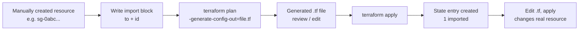

# Session 7 - Remote State Management

HashiCorp Certified Terraform Associate (KPLabs / Zeal Vora) - detailed study notes
Lectures 131-142 | Repo folder: `Section 5 - Remote State Management/`

---

## Session overview

Until now the course ran Terraform from a single laptop: `main.tf`, `variables.tf` and the `terraform.tfstate` file all lived in one local folder. That is fine for learning, but in a real organisation several engineers collaborate on the same infrastructure. This session answers the question: **how do you make Terraform safe and usable for a team?**

The session builds the answer in layers:

| Layer | Problem it solves | Lectures |
|---|---|---|
| Git for the code | Laptop failure, no sharing, no history of changes | 131 |
| Keep state OUT of Git | State holds plaintext secrets; `.terraform/` is huge | 132, 133 |
| Remote backend | Where does state live if not on a laptop / in Git? | 134, 136 |
| State locking | Two people applying at once corrupt state | 135 |
| `terraform state` commands | Safely edit state without hand-editing the JSON | 137 |
| `terraform_remote_state` data source | One team reads another team's outputs | 138, 139 |
| `import` blocks | Bring manually-created resources under Terraform (and auto-generate code) | 140, 141 |
| `removed` blocks | Stop managing a resource WITHOUT destroying it, declaratively | 142 |

The big picture the instructor draws (lecture 134):

```
  Terraform CODE (.tf files)                 Terraform STATE (terraform.tfstate)
  -----------------------------              -----------------------------------
  -> central Git repo                        -> central REMOTE BACKEND (S3, Consul,
     (GitHub / Bitbucket ...)                   azurerm, GCS, Kubernetes ...)
  -> history, review, CI/CD                  -> encrypted, access-controlled, lockable
  -> NO state file, NO .terraform/           -> NOT in Git
```

**Lecture numbers:** all 12 lectures (131 through 142) are present; none are missing. Lectures 131, 132, 133, 140 are conceptual/demo lectures ("practical in next video"); 139 and 141 are the full practicals for 138 and 140.

---

## Table of contents

1. [Lecture-to-repo-file mapping](#lecture-to-repo-file-mapping)
2. [131. Git for Team Collaboration](#131-git-for-team-collaboration)
3. [132. Security Risks of Storing the Terraform State File in Git](#132-security-risks-of-storing-the-terraform-state-file-in-git)
4. [133. Terraform and .gitignore](#133-terraform-and-gitignore)
5. [134. Terraform Backend](#134-terraform-backend)
6. [135. State Locking](#135-state-locking)
7. [136. S3 Backend](#136-s3-backend)
8. [137. Terraform State Management](#137-terraform-state-management)
9. [138. Cross-Project Collaboration using the Remote State Data Source](#138-cross-project-collaboration-using-the-remote-state-data-source)
10. [139. Remote State Data Source Practical](#139-remote-state-data-source-practical)
11. [140. Overview of Terraform Import](#140-overview-of-terraform-import)
12. [141. Terraform Import Practical](#141-terraform-import-practical)
13. [142. Removed Blocks](#142-removed-blocks)
14. [Extra repo material not covered by a lecture](#extra-repo-material-not-covered-by-a-lecture)
15. [Command / syntax cheat-sheet](#command--syntax-cheat-sheet)
16. [Key takeaways](#key-takeaways)
17. [Quick revision Q&A](#quick-revision-qa)
18. [Glossary](#glossary)

---

## Lecture-to-repo-file mapping

Repo root: `Section 5 - Remote State Management/` (the repo `Readme.md` is a "video-document mapper" for 8 of the 12 lectures).

| Lecture | Title | Repo file(s) | Notes |
|---|---|---|---|
| 131 | Git for Team Collaboration | `team-collaboration.md` | `main.tf`, `variables.tf`, `terraform.tfvars` of the demo security group |
| 132 | Security Risks of Storing State in Git | `risks-state-file-git.md` | RDS `db.tf` with hardcoded password, then `file()` variant |
| 133 | Terraform and .gitignore | (none) | Pure Git demo with empty `.txt` files; the Terraform `.gitignore` template is shown in the GitHub UI |
| 134 | Terraform Backend | `backend.md` | `sg.tf` and explicit `backend "local"` |
| 135 | State Locking | `state-locking.md`, `sleep.tf` | `time_sleep` resource (md says `100s`, `sleep.tf` says `300s`) |
| 136 | S3 Backend | `s3-backend.md` | `backend.tf` with `use_lockfile` |
| 137 | Terraform State Management | `state-management.md` | S3 backend + IAM user + SG + ingress rules; all `terraform state` sub-commands |
| 138 | Cross-Project Collaboration using Remote State Data Source | `remote-state-data-source.md` | Concept + demo (networking team vs security team) |
| 139 | Remote State Data Source Practical | `remote-state-data-source.md` | Step-by-step build of `eip.tf`, `backend.tf`, `sg.tf`, `data.tf` |
| 140 | Overview of Terraform Import | `tf-import.md` | Demo `import.tf` |
| 141 | Terraform Import Practical | `tf-import.md` | Same file; hands-on from scratch |
| 142 | Removed Blocks | (none in repo) | Transcript only; code reconstructed below from the lecture |
| (none) | - | `remote-backend/` (`backend.tf`, `eip.tf`, `providers.tf`) | Older sample; no matching lecture in this session |
| (none) | - | `terraform-multistate/ec2/`, `terraform-multistate/eip/` | Older (0.11-style) cross-state sample; no matching lecture here |
| (none) | - | `demofile.md` | Module "Git sources" snippet - belongs to the Modules section, not this one |
| - | - | `Readme.md` | Index of lecture to document links |

The two lecture-142 code snippets are not in the repo (the instructor says "you'll be getting the code in GitHub" but no `removed` file exists in this clone), so they are written out from the transcript and the official block syntax shown on screen.

---

## 131. Git for Team Collaboration

### Why a local-only workflow is risky

Up to now everything lived on one laptop. The lecture lists three disadvantages:

1. **Loss of code AND state** - if the laptop or its disk fails, you lose both the Terraform code and the "most important" file, the state.
2. **Collaboration is hard** - in large environments (thousands of servers) a group of people manages infrastructure. If files are only on your laptop, other members cannot read or update them.
3. **No visible versioning** - if you edit something and break things, and only notice 2-3 days later, there is no history to roll back to.

### The Git-based approach

All Terraform code (`main.tf`, `variables.tf`, `terraform.tfvars`, ...) goes into a central Git repository (GitHub, Bitbucket, etc.). All DevOps team members who manage infrastructure get access.

```
LOCAL ONLY                              GIT-BASED
-----------                             ---------
 Laptop                                  Alice's laptop --\
  |- main.tf                                                 \
  |- variables.tf                          Bob's laptop  -----> [ Central Git repo ] 
  |- terraform.tfvars                                          /    history, review,
  |- terraform.tfstate  <- lost if                 CI/CD  ----/     approvals, CI/CD
        disk dies
```

**Benefits of Git** (as listed on the slide):

| Benefit | Meaning |
|---|---|
| Centralised access | Every team member can fetch the code |
| Full version history and change tracking | See what changed, and which team member changed it |
| Code review / approval workflows | Pull-request style review before changes are applied |
| CI/CD integration | Automated validation and `terraform plan` |

Rule stated by the instructor: after editing Terraform files and changing infrastructure, **always commit the latest changes** so every team member works from the latest version. Otherwise someone using an old copy of the variables/Terraform files will modify infrastructure based on out-of-date code.

### Demo files (from `team-collaboration.md`)

A tiny project in `/tmp/terraform` on the instructor's machine. The security group name comes from a variable whose value is in `terraform.tfvars`.

`main.tf`
```hcl
resource "aws_security_group" "allow_tls" {
  name        = var.sg_name
  description = "Managed from Terraform"
}
```
- `aws_security_group.allow_tls` - a firewall in AWS.
- `name = var.sg_name` - the name is not hardcoded; it comes from an input variable.
- `description` - the text that is later edited in the Git demo.

`variables.tf`
```hcl
variable "sg_name" {}
```
Declares the input variable (no type/default, so a value must be supplied).

`terraform.tfvars`
```hcl
sg_name = "kplabs-firewall"
```
Supplies the value automatically (Terraform auto-loads `terraform.tfvars`).

### Demo walkthrough

1. In the local folder run `terraform apply -auto-approve`. The security group is created and `terraform.tfstate` appears next to the `.tf` files - everything is only on this computer.
2. Explain: if the disk fails, all of it is gone; and teammates cannot access it.
3. On GitHub, create a repo (here `tmp-terraform`, empty). Use "upload files" (GUI used only for simplicity - **ideally use the CLI**), pick the folder contents, commit with message "committed Terraform files".
4. Now the files are safe in Git even if the laptop dies.
5. Edit `description` from `Managed from Terraform` to `managed from TF` and commit. The commit **history** shows the old and new value and who changed it - useful for tracing breaking changes.

(The instructor also points at the course's own Git repo as an example: team collaboration - everyone can fetch the code; versioning - e.g. commit "update firewall.md" shows what was removed and added.)

### Gotcha introduced at the end: do NOT commit everything

In the GUI demo the instructor uploaded *everything*, including `terraform.tfstate` and the `.terraform` folder, and then flags this as a mistake:

- `.terraform/` is **very large** - in the demo, over **800 MB** with just the single AWS provider. Anyone can regenerate it with `terraform init`, so committing it is pointless.
- `terraform.tfstate` should "ideally" not be committed either (reasons in lectures 132 and 133).

### Exam tips

- Terraform code belongs in version control; the state file does not.
- Git gives you history/change tracking, review workflows and CI/CD hooks.
- The `.terraform` directory is re-creatable via `terraform init` - never commit it.

---

## 132. Security Risks of Storing the Terraform State File in Git

### Core idea

The state file can contain **secrets in plain text** - passwords, tokens, etc. Committing it to Git means everyone with read access to the repo can read them. The lecture is careful: it is not a risk in 100% of cases, but it is a risk whenever sensitive values are in state - and this can change in 6-12 months when you add new kinds of infrastructure.

Typical ways exposure happens:

- Repository is public, shared more widely than intended, or compromised.
- Repo permissions are granted far beyond what is necessary (e.g. an intern or new hire gets read access and now sees the production DB password).
- A laptop that has the repo cloned is compromised.

### Demo 1 - hardcoded password (`risks-state-file-git.md`, part 1)

```hcl
resource "aws_db_instance" "default" {
  allocated_storage    = 10
  db_name              = "mydb"
  engine               = "mysql"
  engine_version       = "8.0"
  instance_class       = "db.t3.micro"
  username             = "foo"
  password             = "<hardcoded-password-here>"   # repo uses a literal demo password
  parameter_group_name = "default.mysql8.0"
  skip_final_snapshot  = true
}
```

| Argument | Meaning |
|---|---|
| `allocated_storage = 10` | 10 GB of storage |
| `db_name` | Initial database name |
| `engine = "mysql"`, `engine_version = "8.0"` | DB engine and version |
| `instance_class = "db.t3.micro"` | Size of the DB instance |
| `username`, `password` | Master credentials - the password is what ends up in state |
| `parameter_group_name` | Default MySQL 8.0 parameter group |
| `skip_final_snapshot = true` | Do not take a snapshot on destroy (convenient for demos) |

Commands:
```bash
terraform init
terraform apply -auto-approve      # RDS creation took ~4 minutes in the demo (can be 5-10)
# open terraform.tfstate and scroll: username and password are visible in plain text
terraform destroy -auto-approve    # also ~4 minutes
```
The instructor warns RDS may incur charges - you need not repeat the demo; it is for understanding.

### Demo 2 - "smart" workaround with the `file()` function (still leaks)

Idea: keep the password out of the `.tf` file by reading it from a text file outside the project.

1. Create `outside-folder/pass.txt` containing the password.
2. Change `db.tf`:
```hcl
resource "aws_db_instance" "default" {
  allocated_storage    = 10
  db_name              = "mydb"
  engine               = "mysql"
  engine_version       = "8.0"
  instance_class       = "db.t3.micro"
  username             = "foo"
  password             = file("outside-folder/pass.txt")
  parameter_group_name = "default.mysql8.0"
  skip_final_snapshot  = true
}
```
- `file(path)` reads the file contents at plan/apply time.
- Instructor hit a small syntax error first (path must be in double quotes) and fixed it.
3. `terraform plan` shows the password as `(sensitive value)` - but that only hides it **in CLI output**.
4. `terraform apply -auto-approve`, then inspect `terraform.tfstate`: **the password is still there in plain text.**
5. `terraform destroy -auto-approve`.

### Key lesson

> Even if you do not hardcode the value in the configuration (e.g. you fetch it with `file()` or from elsewhere), **the resolved value is still written to the state file.** `(sensitive)` only masks CLI display, not the state.

Therefore: keep state out of Git, store it in a secured, encrypted remote backend with tight access (next lectures).

### Exam tips

- State can contain secrets in plaintext, regardless of how the secret was supplied (literal, variable, `file()`).
- `sensitive = true` hides values in plan/apply output only; it does not encrypt them in state. (extra context: this is a classic exam statement.)
- Solution direction: remote backend with encryption + access control, not Git.

---

## 133. Terraform and .gitignore

> The instructor notes this lecture is slightly off-topic - it teaches Git (`.gitignore`) - but it is needed for the Terraform repo hygiene discussed in 131-132.

### Files/folders that should NOT be committed

| Item | Why |
|---|---|
| `.terraform/` folder | Contains downloaded provider plugins and child modules; can be huge; re-created by `terraform init` |
| `*.tfvars` (e.g. `terraform.tfvars`) | Often holds sensitive information. Not mandatory - "depends on the requirement"; if it holds nothing sensitive you can commit it |
| `terraform.tfstate`, `terraform.tfstate.backup` (`*.tfstate.*`) | May contain secrets |
| `crash.log` | When Terraform crashes the debug log is written to `crash.log` |
| State lock info file (transcript: "terraform...log.info"; actual name `.terraform.tfstate.lock.info`) | Created while state is being written and removed automatically after apply, so rarely present anyway |
| Saved plan files | If you save a plan to a file, do not commit it |

In the demo folder (the RDS project from 132) the instructor points out `.terraform/`, `terraform.tfstate`, `terraform.tfstate.backup` and the lock info file as items not to commit. (The transcript has a slip - "It is an important file and it should be committed" about the log/lock file; context makes clear the intended meaning is **should not**.)

### What you SHOULD commit

1. All your Terraform code files (`*.tf`).
2. The **dependency lock file** `.terraform.lock.hcl` (the transcript calls it the "Terraform dependency log file") - "very important, always commit it".
3. The `.gitignore` file itself.
4. (Optional) a `README` describing the code, input variables and outputs - useful for newcomers.

### What `.gitignore` is

A text file in the repo root telling Git which files/folders/patterns to ignore. Entries are applied at `git add` / `git commit`, protecting against accidental commits of secrets.

### Demo (two repos, `tmp-tf-01` vs `tmp-tf-02`)

Three empty files are used: `01.txt`, `02.txt`, `secrets.txt`. Goal: commit `01.txt` and `02.txt` but not `secrets.txt`.

```bash
git clone <repo-1-url>
git clone <repo-2-url>
# copy 01.txt 02.txt secrets.txt into BOTH folders
```

Repo 1 - no `.gitignore`:
```bash
cd tmp-tf-01
git add .          # (instructor: "git add all")
git commit -m "first commit"
git push
# GitHub: all THREE files committed, including secrets.txt  <-- the problem
```

Repo 2 - with `.gitignore`:
```bash
cd tmp-tf-02
echo "secrets.txt" > .gitignore       # file content: secrets.txt
git add .
git commit -m "first commit"
git push
# GitHub: only 01.txt, 02.txt (and .gitignore) - secrets.txt is NOT listed
```

### Ready-made Terraform template

When creating a repo on GitHub you can choose "Add .gitignore" and pick the **Terraform** template (Bitbucket may differ slightly). The generated file ignores (as shown in the lecture): `.terraform`, `*.tfstate`, `*.tfstate.*` (wildcard targeting `terraform.tfstate.backup`), crash logs, `*.tfvars`, and the lock-info file. You may add or remove entries to suit organisational needs.

For reference, the standard GitHub Terraform template looks like this (extra context - reproduced from general knowledge, not from the transcript):

```gitignore
# Local .terraform directories
**/.terraform/*

# .tfstate files
*.tfstate
*.tfstate.*

# Crash log files
crash.log
crash.*.log

# Exclude all .tfvars files, which are likely to contain sensitive data
*.tfvars
*.tfvars.json

# Ignore override files
override.tf
override.tf.json
*_override.tf
*_override.tf.json

# CLI configuration files
.terraformrc
terraform.rc
```
Note this template does **not** ignore `.terraform.lock.hcl`, which is why the lock file gets committed.

### Exam tips

- `.terraform.lock.hcl` = provider version lock; commit it. Do not confuse with the state lock file (see 135).
- `.gitignore` only affects files not yet tracked; it does not remove already-committed files (extra context).
- `*.tfvars` is ignored by the template because it often contains secrets - but not a hard rule.

---

## 134. Terraform Backend

### Definition

A **backend** determines **where Terraform stores its state file** (and, for some backends, how operations run and whether locking is available).

### Default: the local backend

If you do not specify a backend, Terraform uses the **local backend** and writes `terraform.tfstate` in the **same project folder**.

Demo base file (`backend.md`):
```hcl
resource "aws_security_group" "prod" {
  name = "production-sg"
}
```
Run `terraform apply -auto-approve` (after init): the SG is created and a `terraform.tfstate` file appears in the project folder (`KPLABS Terraform`).

### The problem with local state

```
  Alice's laptop                         Bob's laptop
  sg.tf + terraform.tfstate              (needs BOTH sg.tf AND terraform.tfstate
                                          before he can add arguments/resources)
```
Local state hinders team collaboration; and the state may hold sensitive data, so it must not go into Git ("a big no-no from the security point of view").

### Recommended production architecture

```
 .tf files  ---------------------->  Central Git repo (GitHub/Bitbucket/...)
 terraform.tfstate  ------------->  Central REMOTE BACKEND (S3, Consul, ...) - can be encrypted
```

### Supported backends

Terraform supports many backends; local is just one. The lecture names: **Consul, S3 (used "quite extensively"), azurerm (Azure), GCS (Google Cloud), Kubernetes**, and "so on". The configuration syntax is different for each backend (see docs "backend configuration"). Which one an organisation picks depends on its cloud provider.

### Explicit local backend configuration

You can declare the local backend explicitly and set options such as `path`, e.g. to put the state in a different folder or give it a different name.

```hcl
terraform {
  backend "local" {
    path = "prod.tfstate"
  }
}
```
- `terraform { ... }` - the settings block.
- `backend "local"` - choose backend type by name (label).
- `path` - file name/location of the state file. Here `prod.tfstate` instead of `terraform.tfstate`; it could also be a path in another folder.

Best practice: put it in a separate file named **`backend.tf`**, not in `sg.tf` (works either way technically, but a dedicated file makes it discoverable among 40-50 files).

### Demo walkthrough

1. `terraform destroy` the existing SG; delete the old `terraform.tfstate`.
2. Create `backend.tf` with the block above.
3. Because a backend was (explicitly) configured, run **`terraform init`** first.
4. `terraform apply -auto-approve`.
5. Result: the project folder now contains **`prod.tfstate`** (not `terraform.tfstate`).

### Authentication to remote backends

Accessing a remote state service needs credentials. E.g. with the S3 backend, Terraform needs credentials that can read/write the S3 bucket - otherwise S3 refuses to store or fetch the state. Terraform uses those credentials to push and pull state.

### Locking support varies

Some backends are just a "plain remote disk"; others also support **state locking**. Read each backend's documentation before choosing - e.g. the Consul page states it supports state locking. (More in 135.)

### Comparison - local vs remote backend

| Aspect | Local backend (default) | Remote backend (S3, Consul, GCS, azurerm ...) |
|---|---|---|
| State location | `terraform.tfstate` in project folder (or custom `path`) | Central service |
| Team collaboration | Poor - state must be copied around | Good - everybody uses the same state |
| Risk if laptop dies | State lost | State safe on remote service |
| Encryption / access control | Whatever your disk offers | Provided by backend (e.g. S3 encryption, IAM) |
| State locking | Local lock info file | Depends on backend |
| Credentials needed | No | Yes (access to the backend) |
| Typical production use | No | Yes |

### Exam tips

- Default backend = local; state in the working directory as `terraform.tfstate`.
- `backend` is configured inside a `terraform { }` block; the backend type is the block label.
- After adding/changing a backend, run `terraform init`.
- Not every backend supports locking - check the docs.
- (extra context) Backend blocks cannot reference variables/locals; HashiCorp lists the `remote`/`cloud` integrations (HCP Terraform) among backends too.

---

## 135. State Locking

### The problem: concurrent writes

If Alice and Bob run `terraform apply` on the same project at the same time, both processes try to modify the same state file. Concurrent changes -> **high chance of corruption and inconsistency**. We want only **one write process at a time**.

Analogy from the lecture: you cannot talk to two people on the phone on different topics simultaneously - one call at a time.

### What state locking is

A mechanism that prevents multiple operations from making concurrent changes to the state. While Terraform is modifying the state it **locks** it; anyone else who tries gets an error immediately.

### Locking flow

1. Before any **write** operation, Terraform tries to **acquire the lock**.
2. If acquired, the write operation proceeds (`apply`, `destroy`, ...); other processes are blocked.
3. When the write completes, Terraform **releases the lock**, so others can acquire it.

```
 User            Terraform                 Backend (state file)
  | terraform apply  |                            |
  |----------------->| 1. request state lock ---->|
  |                  |<--- lock acquired ---------|
  |                  | 2. read/modify state  ---->|   (anyone else now gets
  |                  |    (apply / destroy)       |    "Error acquiring the state lock")
  |                  | 3. state updated      ---->|
  |                  | 4. release lock       ---->|
  |<-- done ---------|                            |
        (now Bob can run apply/plan/destroy)
```

Implementation depends on the backend. With the **local backend**, Terraform uses a lock file in the working directory: **`terraform.tfstate.lock.info`** (the transcript's name; the actual file is hidden-dot-prefixed - `.terraform.tfstate.lock.info`, extra context). It is **automatically removed** when the write finishes.

Typical error when locked:
```
Error: Error acquiring the state lock

Error message: The process cannot access the file because another process
has locked a portion of the file.
```
(The Windows-flavoured message is what the instructor showed; message text varies by OS/backend.)

### Demo (`state-locking.md` + `sleep.tf`)

The base resource - `time_sleep` makes Terraform "wait" so the lock is held for a long time:
```hcl
resource "time_sleep" "wait_100_seconds" {
  create_duration = "100s"
}
```
- `time_sleep` (from the `hashicorp/time` provider) - a resource that just waits.
- `create_duration = "100s"` - wait 100 seconds on create, so `apply` runs for 100 s.
- Note: the lecture uses 100 s; the repo's standalone `sleep.tf` uses `wait_300_seconds` / `"300s"` (a longer variant). Either works.

Commands:
```bash
terraform init
terraform apply -auto-approve          # terminal 1 (holds the lock)
terraform plan                         # terminal 2, while apply is still running
```

Observations (step by step):
1. The folder initially has `.terraform/`, `sleep.tf` and `.terraform.lock.hcl`.
2. Warning from the instructor: **`.terraform.lock.hcl` is NOT the state lock.** It only pins provider versions and has nothing to do with state locking.
3. During `apply` a new file **`terraform.tfstate.lock.info`** appears. It contains a lock ID and **who** acquired the lock (the OS user, `zealv` in the demo) - handy with multiple users.
4. After ~100 s the apply finishes and the lock file disappears automatically.
5. Re-run: delete `terraform.tfstate`, `terraform apply -auto-approve` again; lock file reappears.
6. In another tab run `terraform plan` -> **immediate error**: *Error acquiring the state lock - The state file could not be read - ...another process has locked a portion of the file.*
7. Once the apply completes and the lock file is gone, `terraform plan` works without error.

### Choosing a backend: check locking support

For production organisations, **verify that the backend supports state locking**. Docs examples in the lecture: **Consul** ("This backend supports state locking") and **S3** (also supports locking).

### Two different "lock" files - do not confuse

| File | Purpose | Commit to Git? |
|---|---|---|
| `.terraform.lock.hcl` | Locks **provider versions/checksums** (dependency lock file) | Yes |
| `terraform.tfstate.lock.info` (local backend) | Temporary **state lock** while writing state | No (auto-removed) |

### Exam tips

- Locking applies to operations that can write state (`apply`, `destroy`, ...). Even `plan` fails while the state is locked by another running operation, as seen in the demo.
- Locks are acquired automatically; released automatically on completion.
- Local backend locks with a file; other backends use their own mechanism (Consul sessions, S3 lock object, etc.).
- (extra context) If a run crashes and leaves a stale lock, `terraform force-unlock <LOCK_ID>` releases it; `-lock=false` disables locking (dangerous); `-lock-timeout=<duration>` makes Terraform wait for the lock. None of these were shown in the lecture.

---

## 136. S3 Backend

### What it does

The S3 backend stores the state file in a specific **S3 bucket** instead of the project folder. This lecture is the worked example of "how you add a backend" - any other backend follows the same pattern.

### Backend block anatomy

The `terraform` block is always the same; the **backend name** (label) and the **configuration inside** change per backend.

```hcl
terraform {
  backend "local" {          # <- backend type
    path = "prod.tfstate"    # <- local-specific settings
  }
}
```
```hcl
terraform {
  backend "s3" {             # <- different type
    bucket = "..."           # <- S3-specific settings
    key    = "..."
    region = "..."
  }
}
```

### Files (`s3-backend.md`)

Base file `sg.tf`:
```hcl
resource "aws_security_group" "prod" {
  name = "production-sg"
}
```

`backend.tf` (note in repo: **change the S3 bucket name**):
```hcl
terraform {
  backend "s3" {
    bucket = "kplabs-demo-bucket-007"
    key    = "production.tfstate"
    region = "us-east-1"
    use_lockfile = "true"
  }
}
```

| Argument | Meaning |
|---|---|
| `bucket` | Name of the S3 bucket that will hold the state. Must already exist; bucket names are **globally unique across all AWS accounts**, so pick your own (lecture example `kplabs-demo-bucket-007`) |
| `key` | Object path/name inside the bucket. If the bucket has sub-folders, include the path (e.g. `network/terraform.tfstate`). Here `production.tfstate` goes in the bucket root |
| `region` | Region where the bucket lives (`us-east-1`) |
| `use_lockfile` | Enables S3-native state locking via a lock file. Default `false`. The repo writes it as the string `"true"`; a boolean `true` is the conventional form |

Docs hint: if an argument like `use_lockfile` is missing in your docs version, read the "state locking" section of the S3 backend page - it lists the options available (the instructor shows that `use_lockfile` = "whether to use a lockfile for locking the state file; default false").

(extra context: S3-native locking via `use_lockfile` is the newer mechanism; older versions used a **DynamoDB table** via `dynamodb_table`, which you can still see in the old `terraform-multistate/ec2/backend.tf` in the repo. `use_lockfile` needs a recent Terraform release - 1.10+.)

### Walkthrough

1. In the AWS console: **S3 -> Create bucket**, unique name, note the region.
2. Create `backend.tf` as above (the same block would work in `sg.tf` but a dedicated `backend.tf` is the production convention).
3. Run `terraform init` - it **initialises the backend** (required whenever a backend is added/changed).
4. Run `terraform apply -auto-approve` - the SG is created.
5. Observe: there is **no `terraform.tfstate`** in the project folder (check VS Code and file explorer).
6. Refresh the bucket in the S3 console - **`production.tfstate`** is there.

### Same flow for other backends

For Kubernetes, azurerm, GCS, etc.: backend name changes, the settings inside change, but the workflow (write block, `terraform init`, `apply`, state appears remotely) is the same.

### Exam tips

- `terraform init` is required after configuring or changing a backend.
- S3 backend minimum arguments: `bucket`, `key`, `region`.
- The state is no longer local once the S3 backend is in use.
- Credentials with S3 access are required (see 134). Never hardcode them in the backend block - see the warning in [Extra repo material](#extra-repo-material-not-covered-by-a-lecture).
- (extra context) Enable bucket versioning and encryption for state buckets; `encrypt = true` is a backend argument.

---

## 137. Terraform State Management

### Why this lecture

As usage grows you will need to modify state sometimes. Editing the JSON by hand is dangerous - mistakes can **corrupt** the state. HashiCorp provides the **`terraform state`** sub-commands for advanced state management so you never need to open the file.

Two questions the lecture answers:
1. What is the alternative to hand-editing? -> `terraform state ...` commands.
2. When would you need to modify state? -> removing resources from management, renaming/moving addresses, switching providers, inspecting values, etc.

Sub-commands covered: `list`, `show`, `pull`, `rm`, `mv`, `replace-provider`.
(The transcript auto-captions garbled some names: "state pool" = `pull`; "state env"/"MM" = `mv`; "RM" is `rm`.)

### Demo setup (`state-management.md`)

```hcl
terraform {
  backend "s3" {
    bucket = "kplabs-terraform-backends"
    key    = "demo.tfstate"
    region = "us-east-1"
  }
}

resource "aws_iam_user" "dev" {
  name = "kplabs-user-01"
}

resource "aws_security_group" "prod" {
  name = "terraform-firewalls"
}
```
- S3 backend - state in bucket `kplabs-terraform-backends` (yours must be unique, e.g. a new bucket such as `kplabs-sample-bucket-demo-001`), key `demo.tfstate`.
- `aws_iam_user.dev` - an IAM user.
- `aws_security_group.prod` - a firewall.

`terraform init` (if not done), then `terraform apply -auto-approve`. Both resources are created; no local `terraform.tfstate` exists; the S3 bucket holds `demo.tfstate`.

### 1) `terraform state list`

Lists every resource address in the state. Handy on projects with hundreds of resources instead of reading configs.

```bash
terraform state list
```
Expected output:
```
aws_iam_user.dev
aws_security_group.prod
```

### 2) `terraform state show <address>`

Shows all recorded attributes of a **single** resource (ARN, description, ID, owner ID, VPC ID ...). Faster and safer than opening the state file, or clicking through the EC2 console to find a security group ID.

```bash
terraform state show aws_security_group.prod
```
Output: an attribute listing (arn, description, id, name, owner_id, vpc_id, ...).

### 3) `terraform state pull`

Downloads the current state from the remote backend and prints it to **stdout**. Alternative to logging in to S3 and downloading the file manually each time somebody else modifies it.

```bash
terraform state pull
```
Output: the whole state JSON. (extra context: `terraform state push` is the counterpart that uploads a state; not demonstrated.)

### 4) `terraform state rm <address>`

**Removes an item from the state** (it is then no longer managed). The real infrastructure is **not** destroyed.

Use case from the lecture: a resource was edited manually so many times that reconciling config and reality is impractical; you decide you no longer want Terraform to manage it - but you also do not want Terraform to destroy it.

Extra code used (rules attached to the SG, `vpc_security_group_ingress_rule`):
```hcl
resource "aws_vpc_security_group_ingress_rule" "example" {
  security_group_id = aws_security_group.prod.id

  cidr_ipv4   = "10.0.0.0/8"
  from_port   = 80
  ip_protocol = "tcp"
  to_port     = 80
}

resource "aws_vpc_security_group_ingress_rule" "example2" {
  security_group_id = aws_security_group.prod.id

  cidr_ipv4   = "10.0.0.0/8"
  from_port   = 80
  ip_protocol = "tcp"
  to_port     = 80
}
```
In the video the second rule used port 22 ("add one more rule for port 22 ... make sure you have a different local name"); the repo file shows both with port 80. Either way they are two rule resources with different local names.

**Walkthrough**

1. `terraform plan` -> two inbound rules to add. `terraform apply -auto-approve` -> rules created (visible in the EC2 console on SG `terraform-firewalls`).
2. Manually edit a rule in the console (e.g. open the CIDR to everyone, add a description).
3. `terraform plan` -> two changes: Terraform wants to revert the manual edit (remove the `0.0.0.0/0`... and re-add `10.0.0.0/8`). It is small here, but in real life a resource may be edited 20-30 times.
4. Two options: reconcile config with reality, or stop managing it.
5. **Naive approach fails**: if you simply delete the resource blocks from the `.tf` file (or the whole SG), `terraform plan` shows it will **destroy** the resource in AWS - not what you want.
6. Correct approach: remove from state first.
   - Bring the resource blocks back in the file.
   - From another terminal tab: `terraform state pull` to see the current state - it contains the SG and both ingress rules.
   - Run:
```bash
terraform state rm aws_security_group.prod
terraform state rm aws_vpc_security_group_ingress_rule.example
terraform state rm aws_vpc_security_group_ingress_rule.example2
```
   - Each prints "Removed ...".
7. `terraform plan` now shows **3 resources to create** - because state no longer knows them, the config blocks look like brand-new resources. (If you applied, you would get duplicates - do not.)
8. Now it is safe to **delete those blocks from the `.tf` file**. `terraform plan` -> **No changes**.
9. `terraform state pull` -> only the IAM user remains under `resources`.

```
 BEFORE state rm              state rm                 AFTER (and config blocks deleted)
 config: SG + 2 rules   ->    state: SG + 2 rules  ->  config: (none)       real AWS: SG + 2 rules still exist
 state : SG + 2 rules         state: (removed)         state : (none)       plan: No changes
```

### 5) `terraform state mv <source> <destination>`

Moves an item to a **different address** in state (rename, or move into/out of modules).

Problem: change `aws_iam_user.dev` -> `aws_iam_user.prod` in the config. `terraform plan` wants to **destroy and recreate** the user (new address = new resource). For something like a server, that loses data.

Solution:
```bash
terraform state mv aws_iam_user.dev aws_iam_user.prod
```
Then rename the resource block to `prod` in the `.tf` file. `terraform plan` -> **No changes**. (The lecture shows `state pull` then `plan`; the final `plan` says no changes, as expected.)

Order matters: move in state first, then rename in config (or both before the next plan/apply).

### 6) `terraform state replace-provider <from> <to>`

Replaces the **provider** recorded for resources in state. In the state file each resource has a `provider` entry such as `provider["registry.terraform.io/hashicorp/aws"]`. Use when an organisation publishes its own (custom/forked) provider and wants resources re-attributed to it.

```bash
terraform state replace-provider hashicorp/aws kplabs.in/internal/aws
```
- First argument: current provider address (`hashicorp/aws`).
- Second: new provider address (`kplabs.in/internal/aws` - fictional).

Flow in the demo: Terraform shows the current provider, the new provider address and the affected resources, then asks for confirmation -> type `yes` -> "Successfully replaced provider for 1 resource(s)".
- `terraform state pull` now shows the new provider string.
- Because that provider does not really exist, `terraform plan` fails with **"Failed to load plugin schemas"**.
- Revert for safety: `terraform state replace-provider kplabs.in/internal/aws hashicorp/aws` -> `yes` -> `terraform plan` works again.
- The instructor takes a `terraform state pull` backup beforehand: "if you mess this up your project might not work".

### Summary table

| Command | Purpose | Changes state? | Touches real infra? |
|---|---|---|---|
| `terraform state list` | List resource addresses | No | No |
| `terraform state show ADDR` | Attributes of one resource | No | No |
| `terraform state pull` | Print remote/local state to stdout | No | No |
| `terraform state rm ADDR` | Stop managing a resource | Yes (removes entry) | No (not destroyed) |
| `terraform state mv SRC DST` | Rename/move address | Yes | No |
| `terraform state replace-provider FROM TO` | Change provider recorded in state | Yes (prompts) | No |

### Gotchas

- Never hand-edit the state; people open it "just to look" and modify it accidentally.
- `state rm` leaves the real resource running; if its config block is still present, the next plan wants to **create** it again.
- Deleting config for a managed resource = Terraform will **destroy** it. Remove from state first (or use a `removed` block - lecture 142).
- Take a `state pull` backup before risky state surgery.

### Exam tips

- Know all sub-commands and their purpose: `list`, `show`, `mv`, `pull`, `push`, `rm`, `replace-provider`.
- `terraform state rm` = "forget" a resource without destroying it.
- `terraform state mv` = rename without destroy/recreate.
- `terraform state show` takes the resource address (e.g. `aws_security_group.prod`), `list` takes none.
- `terraform state pull` works with remote backends and prints to stdout.

---

## 138. Cross-Project Collaboration using the Remote State Data Source

### The challenge

In medium/large organisations several teams manage different parts of infrastructure with Terraform, each with its own project and state. Example from the lecture:

- **Networking team** manages public IP addresses (Elastic IPs). Their state is stored remotely in an S3 bucket, and their code defines **output values** listing the IPs.
- **Security team** manages firewall rules. They need to whitelist all the IPs created by the networking team.

```
 Networking team project                         Security team project
 -----------------------                         ---------------------
 eip.tf   -> creates EIP                         sg.tf -> security group rule
 output "eip_addr"                                        cidr = <networking EIP>/32
 backend: S3 (eip.tfstate)  <--- reads outputs --- data "terraform_remote_state"
```

Requirements of the security team's code:
1. Connect to the S3 bucket where the networking team's state lives (needs access to it).
2. Fetch the IP addresses from the **output values** in that state.
3. Use them in firewall rules.

The manual way (copy the IP out of `eip.tfstate` and paste into the SG rule) is not recommended - when the EIP changes you must repeat it. The right way is the **`terraform_remote_state` data source**, which automatically connects to a remote state and reads its outputs. It works for the same team or a different team; it is not limited to IPs/firewalls - any dependency on another project's output.

### Demo shown (both folders pre-built)

Networking-team folder:
- `eip.tf` - creates an `aws_eip` and an `output` for the address.
- `backend.tf` - S3 backend, bucket `kplabs-team-networking-bucket`, key `eip.tfstate`.
- `terraform plan` -> "No changes" (already applied).
- In S3, `eip.tfstate` contains the EIP resource in `us-east-1` and, under `outputs`, `eip_addr` with the IP (ending `255.36` in the demo - matches the console).

Security-team folder:
- `sg.tf` creates the SG and rule. A `terraform plan` shows it has automatically picked up the networking team's IP ending `255.36` (the instructor intentionally does not show the code in this lecture).

**Proof it is not hardcoded** - in the networking folder:
```bash
terraform destroy -auto-approve     # EIP destroyed
terraform apply  -auto-approve      # new EIP created, new IP (starts 34.193...)
```
Then in the security folder `terraform plan` shows the **new** IP - it was re-read from the other team's remote state.

### Exam tips

- The `terraform_remote_state` data source reads **output values** from another configuration's state.
- Two steps: define the data source (backend type + config pointing at the state), then reference `data.terraform_remote_state.<name>.outputs.<output_name>`.
- Reader needs read access to the backend (e.g. S3 bucket).
- (extra context) Only **root-module outputs** of the other configuration are exposed; if you need a value, the other team must output it. Also note the data source needs access to the entire state, which can contain secrets - a design caveat.

---

## 139. Remote State Data Source Practical

### Workflow

1. Create two folders: `networking-team` and `security-team` (inside the `kplabs-terraform` folder).
2. Networking: a `.tf` that creates an Elastic IP, stores state in S3, and has an output.
3. Security: create an SG + inbound rule, then use the remote state data source to fetch the EIP and whitelist it.

### Step A - Networking team

`eip.tf`
```hcl
resource "aws_eip" "lb" {
  domain = "vpc"
}

output "eip_addr" {
  value = aws_eip.lb.public_ip
}
```
- `aws_eip.lb` - an Elastic IP (public IP) in the VPC (`domain = "vpc"`).
- `output "eip_addr"` - exposes the allocated IP; **this is what the other team reads**.

Create an S3 bucket (instructor: `kplabs-networking-bucket-demo`; bucket names must be globally unique - choose your own).

`backend.tf` (repo template has `bucket = ""` to fill in):
```hcl
terraform {
  backend "s3" {
    bucket = ""                 # <- your bucket name
    key    = "eip.tfstate"
    region = "us-east-1"
  }
}
```
- The bucket must be in `us-east-1` for this `region` value; `key = "eip.tfstate"` places the file in the root of the bucket.

Commands (in `networking-team`):
```bash
terraform init
terraform plan
terraform apply -auto-approve
```
Result: EIP created and the output prints the IP (`44.195.111.26` in the demo). `eip.tfstate` appears in the bucket; its `outputs` section holds `eip_addr`. Verify via **EC2 -> Elastic IPs**.

### Step B - Security team base code

`sg.tf` (initial version, hardcoded CIDR):
```hcl
resource "aws_security_group" "allow_tls" {
  name = "allow_tls"
}

resource "aws_vpc_security_group_ingress_rule" "allow_tls_ipv4" {
  security_group_id = aws_security_group.allow_tls.id
  cidr_ipv4         = "172.31.20.30/32"
  from_port         = 443
  ip_protocol       = "tcp"
  to_port           = 443
}
```
- Creates SG `allow_tls` and one inbound rule on TCP/443 for a fixed `/32` CIDR. Goal: replace the hardcoded CIDR with the networking team's EIP.

### Step C - Define the remote state data source

`data.tf`
```hcl
data "terraform_remote_state" "vpc" {
  backend = "s3"

  config = {
    bucket = "kplabs-networking-bucket-demo"
    key    = "eip.tfstate"
    region = "us-east-1"
  }
}
```

| Part | Meaning |
|---|---|
| `data "terraform_remote_state" "vpc"` | Built-in data source; local name `vpc` |
| `backend = "s3"` | Which backend type holds the other state (S3, Consul, ...) |
| `config = { ... }` | The same settings you would use in a `backend "s3"` block - the instructor copied bucket/key/region from the networking team's `backend.tf` (and removed an extra closing brace) |

Documentation (data source page) shows a generic example (not S3-specific), which the instructor adapts: change `backend` to `s3`, and `config` to the bucket/key/region.

### Step D - Reference the output

Final `sg.tf` (repo "Final Code for Security Team SG.TF"):
```hcl
resource "aws_security_group" "allow_tls" {
  name = "allow_tls"
}

resource "aws_vpc_security_group_ingress_rule" "allow_tls_ipv4" {
  security_group_id = aws_security_group.allow_tls.id
  cidr_ipv4         = "${data.terraform_remote_state.vpc.outputs.eip_addr}/32"
  from_port         = 443
  ip_protocol       = "tcp"
  to_port           = 443
}
```
- Reference pattern: `data.terraform_remote_state.<local_name>.outputs.<output_name>` -> `data.terraform_remote_state.vpc.outputs.eip_addr`.
- Wrapped in `"${...}/32"` string interpolation because AWS expects a CIDR (a single IP needs `/32`).

### Step E - Run in `security-team`

```bash
terraform init
terraform validate       # no mistakes
terraform plan
```
The plan shows `cidr_ipv4 = "44.195.111.26/32"` (the value read from the remote state) - "same as this one" (the EIP created by the networking team). The lecture ends at `plan` (no apply).

### Data flow

```
 networking-team                         S3 bucket                       security-team
 terraform apply  --writes state-->  eip.tfstate {outputs.eip_addr}  <--reads--  terraform plan/apply
                                                                           data.terraform_remote_state.vpc.outputs.eip_addr
                                                                           -> cidr_ipv4 = "<ip>/32"
```

### Gotchas

- Outputs must be defined in the producing project; otherwise nothing to read.
- If the producing team destroys and re-applies, IPs change; the consumer sees the new value on its next plan.
- The producer's backend bucket/key/region must match exactly what the consumer's `config` says.
- Bucket names in the repo are the instructor's; use your own.

### Exam tips

- `data "terraform_remote_state"` + `.outputs.<name>`.
- It reads state from a backend; it does not require the producer's code.
- Remember `backend` + `config` arguments.

---

## 140. Overview of Terraform Import

### The business problem

Many organisations have **thousands of resources created manually over years**. They adopt IaC like Terraform and want existing resources brought under Terraform so future changes are made via Terraform only. This is what **import** is for.

### Old way vs new way

| | Old import (older Terraform) | New import (Terraform 1.5+) |
|---|---|---|
| What it creates | Only the **state** entry for the resource | State **and** the configuration (`.tf` code) |
| Who writes the resource block | You, from scratch (`ec2.tf`, `s3.tf` ...) | Terraform generates it |
| Pain at scale | Thousands of resource blocks to hand-write; made orgs "reluctant" to adopt Terraform | Drastically less time |

```
 OLD:  manual resources --import--> terraform.tfstate     (you write every resource block by hand)

 NEW:  manual resources --import block + plan -generate-config-out--> generated .tf  
                        --apply-->                                     terraform.tfstate
```

HashiCorp added this in a recent release; the lecture is re-recorded because of the change ("the entire community was waiting for it for many years").

### Demo (concept preview)

A security group `...929b` was created manually in the console with 3 inbound rules (HTTPS, HTTP, port 21, each with specific CIDRs/descriptions) and 1 outbound rule.

`import.tf` (repo `tf-import.md`; the SG ID in the repo is a demo value - use your own)
```hcl
provider "aws" {
  region = "us-east-1"
}

import {
  to = aws_security_group.mysg
  id = "sg-xxxxxxxxxxxxxxxxx"      # ID of the manually created security group
}
```
- `import` block - declares "bring this existing object into Terraform".
- `to` - the **resource address** that the code/state will be attached to.
- `id` - the real-world ID of the existing resource (for security groups, `sg-...`).

Generate the code:
```bash
terraform plan -generate-config-out=mysg.tf
```
- `-generate-config-out=<file>` - Terraform writes the generated resource configuration into the named file. A new file `mysg.tf` appears containing `resource "aws_security_group" "mysg" { ... }` with all `ingress`/`egress` blocks reproduced (3 inbound, 1 outbound).
- At this point **only code** exists; state is not created yet.

Create state:
```bash
terraform apply
```
Output: `1 imported`. `terraform.tfstate` now exists with the imported resource.

Prove it is managed: add a description (e.g. "managed via Terraform") on the rule for port 21 (which had none) in `mysg.tf`, `terraform apply -auto-approve`, refresh the console -> description appears. The SG is now managed entirely by Terraform.

### Important points

- Automatic **code generation for imports** needs **Terraform 1.5 or newer**. Check with `terraform version`; anything above 1.5 is fine. Older versions: download the latest binary from the HashiCorp site.
- Not available in older versions.

### Exam tips

- Import = bring existing infrastructure under Terraform management.
- Terraform 1.5+: `import` block + `terraform plan -generate-config-out=FILE`.
- Import writes to the state; generated config is a starting point to review (extra context: generated code can be verbose/need cleanup).

---

## 141. Terraform Import Practical

### Step 1 - Create the resource manually

In the AWS console (EC2, N. Virginia in the demo; any region works):

- Security group name `manually-created-sg`, description `manual`.
- Inbound rules:
  | Port | Source | Description |
  |---|---|---|
  | 80 | `0.0.0.0/0` | allow HTTP from internet |
  | 443 | `0.0.0.0/0` | allow HTTPS from internet |
  | 22 | a specific private CIDR (spoken as `170.31.0.0/16`; 172.31.0.0/16 is probably intended) | allow from private network |
- Default outbound rule. => 3 inbound, 1 outbound.
- Copy the **security group ID**.

### Step 2 - Import block

Documentation: the `import` block takes `to` (resource address) and `id` (real object ID); the resource body is generated by Terraform. Address example in docs: `aws_instance.example`.

`import.tf`:
```hcl
provider "aws" {
  region = "us-east-1"        # must match the region of the manual resource (e.g. ap-south-1 for Mumbai)
}

import {
  to = aws_security_group.mysg
  id = "sg-xxxxxxxxxxxxxxxxx"  # your SG ID
}
```
- `to = aws_security_group.mysg` - resource type `aws_security_group` (from the AWS provider docs), local name `mysg` chosen by you. This is all that is required - the contents of the block are generated.
- Keep the folder minimal: only `import.tf` (plus `.terraform` if you have run `init`).

### Step 3 - Generate config

```bash
terraform plan -generate-config-out=mysg.tf
```
- First attempt produced an error; the instructor fixed it by removing a small part of the block he had typed (the transcript does not say which part, but the final `import` block only contains `to` and `id`). Re-run the same command -> it succeeds.
- Result: new file **`mysg.tf`** with `resource "aws_security_group" "mysg"` containing `egress` and three `ingress` blocks (HTTP 80, HTTPS 443, SSH 22).
- State is still **not** created (it is just a plan).

### Step 4 - Apply to import into state

```bash
terraform apply -auto-approve
```
- Output: `1 resources imported`; `terraform.tfstate` appears.

### Step 5 - Manage via Terraform

Edit `mysg.tf`: for port 80 change the CIDR from `0.0.0.0/0` to `10.77.0.0/16` (just an example). Then:
```bash
terraform apply -auto-approve
```
Refresh the console: port 80 now shows `10.77.0.0/16`. The resource is fully managed by Terraform.

### Import flow



### Gotchas

- Provider `region` must match the region of the resource, otherwise Terraform cannot find the ID.
- Choose a unique `to` address; it becomes the resource name in code.
- The `-generate-config-out` file must be a new file (extra context: Terraform refuses to overwrite an existing file).
- Plan alone creates the config but not the state - **apply** is what imports into state.
- Review the generated code; it can include read-only/computed attributes that sometimes need pruning (extra context).

### Exam tips

- Import block arguments: `to` (address) and `id` (real-world ID).
- Flag: `-generate-config-out=<path>`, used with `terraform plan`.
- Terraform 1.5+ only.
- Importing does not create the resource - it adopts it.

---

## 142. Removed Blocks

### The scenario

Terraform manages several resources (S3 bucket, VMs, Lambda functions, ...). Later, one EC2 instance is handed to another team that does not use Terraform and manages it manually. You want to **break the link between state and that instance** while leaving the instance running and leaving the other resources in the same folder untouched.

### The old workflow

1. Delete (or comment out) the resource block in config.
2. Run `terraform state rm <address>` to remove it from state. Terraform then no longer knows it ever created the instance.

Disadvantages:
- **Imperative** - a manual command, not recorded in the Git code. Later it is hard to tell who ran what and when.
- Hard to automate safely in **CI/CD** pipelines. (Slide: "terraform state rm is generally risky and integration with CI/CD in old is difficult".)

### The new way: `removed` block

Declare your intent in code. Terraform plans a "forget" action and removes the object from state on apply.

Syntax (from the lecture/documentation):
```hcl
removed {
  from = local_file.foo

  lifecycle {
    destroy = false
  }
}
```

| Part | Meaning |
|---|---|
| `removed { }` | Top-level block - "this resource is no longer in my configuration" |
| `from` | Resource address that used to exist (here `local_file.foo`) |
| `lifecycle { destroy = false }` | Remove from state **but do not destroy** the real object. (`destroy = true` would destroy it) |

You must also remove or comment out the original `resource` block (step 1); the `removed` block is step 2. This "turns the imperative `terraform state rm` into a declarative config block".

### Demo (transcript; `demo.tf`)

A very simple resource:
```hcl
resource "local_file" "foo" {
  filename = "kplabs.txt"
  content  = "Hello from KPLabs!"
}
```
- `local_file` (provider `hashicorp/local`) creates a file `kplabs.txt` in the project folder with the given content. (Exact block reconstructed from the lecture description: file `kplabs.txt`, content "Hello from KPLabs!" and resource address `local_file.foo`.)

Walkthrough:
1. `terraform init` (so providers are available), `terraform plan` -> 1 to add, no `kplabs.txt` yet.
2. `terraform apply -auto-approve` -> `kplabs.txt` created; `cat` shows `Hello from KPLabs!`; the state file has the entry.
3. Now you want to stop managing it. **Commenting out** the resource (the instructor prefers commenting over deleting) and running `terraform plan` shows it will **destroy** the file - not wanted.
4. Add the `removed` block (with `from = local_file.foo`, `destroy = false`) and keep the resource block commented/deleted.
5. `terraform plan` states clearly that **`local_file.foo` will no longer be managed by Terraform, but will not be destroyed**.
6. `terraform apply -auto-approve` -> completes; the state file no longer references `kplabs.txt`; the file itself still exists.

Workflow recap:
```
 plan:  Terraform sees removed block with destroy=false -> plans a "forget" action
 apply: object removed from state; the real resource (EC2, local file, ...) is untouched
```

### Comparison

| | `terraform state rm` (old) | `removed` block (new) |
|---|---|---|
| Style | Imperative CLI command | Declarative config in code |
| Recorded in Git | No | Yes (reviewable, auditable) |
| CI/CD friendliness | Poor / risky | Good |
| Preview with `plan` | No dry-run of the action itself | Yes - plan shows "will no longer be managed" |
| Resource destroyed? | No | Only if `destroy = true`; with `false`, no |

(extra context: `removed` blocks require Terraform 1.7+.)

### Gotchas

- If you delete the resource block but add no `removed` block, plan wants to **destroy** it.
- `destroy = false` is the key line; without it behaviour is different (destroy).
- Leave the `removed` block in config until it has been applied everywhere (all workspaces/state copies).

### Exam tips

- `removed` block = declarative alternative to `terraform state rm`.
- `lifecycle { destroy = false }` -> forget but do not destroy.
- Remember the three "state-editing" approaches: `terraform state rm` (CLI), `removed` block (declarative), `import` (the opposite direction - add to state).

---

## Extra repo material not covered by a lecture

These folders exist in the repo but are not discussed in the transcripts of lectures 131-142. They are older examples of the same ideas.

### `remote-backend/`

`backend.tf`
```hcl
terraform {
  backend "s3" {
    bucket = "kplabs-terraform-backend"
    key    = "network/terraform.tfstate"
    region = "us-east-1"
  }
}
```
`eip.tf`
```hcl
resource "aws_eip" "lb" {
  domain = "vpc"
}
```
`providers.tf`
```hcl
provider "aws" {
  region = "us-west-2"
}
```
Shows a state key in a "folder" (`network/terraform.tfstate`). Note the mismatch: the bucket region (`us-east-1`) differs from the provider's region (`us-west-2`) - allowed, because the backend region only relates to where the state bucket lives while the provider region is where resources are created.

### `terraform-multistate/` (older, pre-0.12 syntax)

- `ec2/backend.tf` - S3 backend `kplabs-remote-backend` / key `ec2demo.tfstate` / region `us-west-1`, with **`dynamodb_table = "s3-state-lock"`** (the legacy DynamoDB-based locking that `use_lockfile` replaces) and **static `access_key`/`secret_key` hardcoded in the file**.
  - **Do not copy that pattern.** Credentials in backend config are also stored in `.terraform/` and plan files; use environment variables, shared credentials/profile or an IAM role instead. (The repo file contains literal keys - they are intentionally not reproduced in these notes; treat any such keys as compromised.)
- `ec2/ec2.tf` - `aws_instance.myec2` (AMI, `t2.micro`, a key pair, tag block) and `output "ec2ip"` (value: the instance **id** despite the name).
- `ec2/providers.tf` - provider region `us-west-1`.
- `eip/data_get.tf` - an older example of the remote-state data source:
```hcl
data "terraform_remote_state" "myec2" {
  backend = "s3"
  config {                       # 0.11 syntax; modern syntax is "config = { ... }"
    bucket = "kplabs-remote-backend"
    key    = "ec2demo.tfstate"
    region = "us-west-1"
  }
}
```
- `eip/eip.tf` - `aws_eip.myeip` with `instance = "${data.terraform_remote_state.myec2.ec2ip}"` - reads the EC2 output via the data source and attaches the EIP (note: old syntax omits `.outputs.`; current syntax is `data.terraform_remote_state.myec2.outputs.ec2ip`).
- `eip/providers.tf` - region `us-west-1`.

This sample is a second illustration of 138/139 (EC2 team exports an output; EIP team consumes it).

### `demofile.md`

Module `source` examples (generic Git repo, a branch with `?ref=development`, GitHub shorthand) and `terraform init`. This belongs to the Modules section, not this session.

---

## Command / syntax cheat-sheet

### `terraform state` sub-commands

```bash
terraform state list                         # list all resource addresses in state
terraform state list aws_iam_user.dev        # (extra context) optional address filter
terraform state show aws_security_group.prod # attributes of one resource
terraform state pull                         # print current state (from backend) to stdout
terraform state pull > backup.tfstate        # (extra context) quick backup before surgery
terraform state push FILE                    # (extra context) upload a state file to the backend
terraform state rm  ADDRESS                  # remove from state, do NOT destroy
terraform state mv  SOURCE DESTINATION       # change address (rename/move) w/o recreate
terraform state replace-provider FROM TO     # e.g. hashicorp/aws kplabs.in/internal/aws (prompts to confirm)
```

### Import

```hcl
import {
  to = aws_security_group.mysg     # address in your config
  id = "sg-xxxxxxxxxxxxxxxxx"       # real-world resource ID
}
```
```bash
terraform plan  -generate-config-out=mysg.tf   # generate resource code (Terraform 1.5+)
terraform apply -auto-approve                  # actually import into state
terraform version                              # check you are on >= 1.5
# (extra context) legacy CLI form: terraform import aws_security_group.mysg sg-xxxxxxxx
```

### Removed block

```hcl
removed {
  from = local_file.foo
  lifecycle {
    destroy = false          # forget, do not destroy
  }
}
```

### Backends

```hcl
# Explicit local backend
terraform {
  backend "local" {
    path = "prod.tfstate"
  }
}

# S3 backend with native locking
terraform {
  backend "s3" {
    bucket       = "<unique-bucket-name>"
    key          = "path/to/terraform.tfstate"
    region       = "us-east-1"
    use_lockfile = true
  }
}
```
```bash
terraform init        # required after adding/changing a backend
```
(extra context: `terraform init -migrate-state` moves existing state to a new backend; `-reconfigure` ignores previous config; `-backend-config=...` supplies partial configuration so secrets/ids are not hardcoded.)

### Remote state data source

```hcl
data "terraform_remote_state" "vpc" {
  backend = "s3"
  config = {
    bucket = "<bucket>"
    key    = "eip.tfstate"
    region = "us-east-1"
  }
}

# usage
cidr_ipv4 = "${data.terraform_remote_state.vpc.outputs.eip_addr}/32"
```

### Locking

| Item | Notes |
|---|---|
| Local backend lock file | `terraform.tfstate.lock.info` (actual: `.terraform.tfstate.lock.info`), auto-deleted |
| S3 | `use_lockfile = true` (older: `dynamodb_table`) |
| Error text | "Error acquiring the state lock" |
| (extra context) | `terraform force-unlock <ID>`, `-lock=false`, `-lock-timeout=30s` |
| NOT the same thing | `.terraform.lock.hcl` = provider dependency lock |

### What to commit to Git

| Commit | Do NOT commit |
|---|---|
| `*.tf`, `.terraform.lock.hcl`, `.gitignore`, README | `.terraform/`, `*.tfstate`, `*.tfstate.backup`, `crash.log`, saved plans, lock-info file, `*.tfvars` if sensitive |

---

## Key takeaways

1. Keep Terraform **code in Git**; keep **state in a remote backend** - never in Git.
2. State may hold **plaintext secrets** even when you pulled them from `file()`/variables; `(sensitive value)` in the CLI is cosmetic.
3. `.gitignore` (the GitHub "Terraform" template) prevents accidents. Commit `.terraform.lock.hcl`; do not commit `.terraform/`.
4. A **backend** decides where state is stored; the default is **local** (`terraform.tfstate` in the project folder). Many backends exist (S3, Consul, azurerm, GCS, Kubernetes, ...), each with its own config.
5. Backends need credentials and may or may not support **locking** - check before choosing one.
6. **State locking** ensures one writer at a time to avoid corruption; Terraform acquires and releases locks automatically.
7. **S3 backend**: `bucket`, `key`, `region`, optional `use_lockfile`; run `terraform init` after configuring.
8. Never hand-edit state; use **`terraform state list/show/pull/rm/mv/replace-provider`**.
9. `state rm` = forget without destroying; `state mv` = rename without recreating.
10. The **`terraform_remote_state`** data source lets one project read **outputs** from another project's remote state (cross-team dependencies).
11. **Import** (1.5+): `import` block (`to`, `id`) + `terraform plan -generate-config-out=file.tf` + `terraform apply` generates both code and state for existing resources.
12. **`removed` block** with `lifecycle { destroy = false }` is the declarative, Git-auditable replacement for `terraform state rm`.

---

## Quick revision Q&A

**1. What are the three drawbacks of keeping Terraform files only on a laptop?**
Risk of losing code and state if the disk fails; teammates cannot access or update the code; no visible version history to roll back changes.

**2. Why should the state file not be committed to Git?**
It can contain secrets (passwords, tokens) in plain text; anyone with repo access, a compromised repo or a compromised cloned laptop can read them. Also, large/regenerable folders like `.terraform` should not be committed.

**3. If I load a DB password with `file("outside-folder/pass.txt")`, is it kept out of state?**
No. The resolved value is still stored in the state in plaintext; the plan only shows it as a sensitive value.

**4. Which Terraform files should always be committed and which should not?**
Commit: `*.tf` code, `.terraform.lock.hcl`, `.gitignore`, optional README. Do not commit: `.terraform/`, `terraform.tfstate`/`.backup`, `crash.log`, saved plan files, the state lock info file, and `*.tfvars` when it holds sensitive data.

**5. What is a backend and what is the default?**
A backend determines where Terraform stores the state. The default is the local backend, which writes `terraform.tfstate` in the project folder.

**6. How do you configure an explicit local backend with a custom file name?**
`terraform { backend "local" { path = "prod.tfstate" } }` (ideally in `backend.tf`), then `terraform init`.

**7. What is state locking and why is it needed?**
It blocks concurrent write operations on the state so two users running `apply` simultaneously cannot corrupt it. Terraform acquires the lock before a write and releases it afterwards; others get "Error acquiring the state lock".

**8. Is `.terraform.lock.hcl` the state lock?**
No. It locks provider versions (dependency lock file) and should be committed; the state lock is a temporary file/mechanism used while writing state.

**9. Which arguments does the S3 backend need and how do you enable locking?**
`bucket`, `key`, `region` (plus credentials); enable native locking with `use_lockfile = true` (default false). Bucket names are globally unique. Run `terraform init` afterwards.

**10. What does `terraform state rm` do and when would you use it?**
It removes a resource from state without destroying it - e.g. when a resource has been modified manually too often or another team takes over. Afterwards you can delete its config block and plan shows no changes.

**11. How do you rename a resource in config without destroying and recreating it?**
Run `terraform state mv old_address new_address`, then rename the resource block; plan shows no changes.

**12. What does `terraform state replace-provider` do?**
It changes the provider recorded in the state for resources, e.g. `hashicorp/aws` to a custom provider address; Terraform asks for confirmation, and a wrong/non-existent provider breaks plan ("Failed to load plugin schemas").

**13. How can the security team use the networking team's EIP automatically?**
Use `data "terraform_remote_state"` with `backend = "s3"` and a `config` block (bucket/key/region) pointing to the networking team's state, then reference `data.terraform_remote_state.<name>.outputs.eip_addr`; the networking project must expose it as an `output`.

**14. What changed in Terraform's import in version 1.5?**
Import used to create only state; now an `import` block (`to`, `id`) plus `terraform plan -generate-config-out=<file>` generates the resource configuration, and `terraform apply` creates the state.

**15. Which block replaces `terraform state rm` declaratively, and which setting stops destruction?**
The `removed` block with `from = <address>` and `lifecycle { destroy = false }`.

---

## Glossary

| Term | Definition |
|---|---|
| Backend | Setting that determines where Terraform stores its state (and whether it supports locking), e.g. local, S3, Consul, azurerm, GCS, Kubernetes |
| Local backend | Default backend; stores `terraform.tfstate` in the working directory (path customisable) |
| Remote backend | Any backend that stores state outside the local disk, usable by a team |
| State file (`terraform.tfstate`) | JSON record mapping configuration to real resources, including attribute values (may contain secrets) |
| State locking | Mechanism that lets only one operation write state at a time |
| Lock info file | `terraform.tfstate.lock.info` - temporary file used by the local backend, holds lock ID and user |
| Dependency lock file | `.terraform.lock.hcl` - records provider versions/checksums; commit it |
| `.terraform/` | Directory created by `terraform init` holding provider plugins and modules; never commit |
| `.gitignore` | Git file listing paths/patterns that Git should not track |
| `use_lockfile` | S3 backend option enabling native state locking (default false) |
| `key` (S3 backend) | Path/name of the state object inside the bucket |
| `terraform state` | Command group for inspecting/modifying state safely (`list`, `show`, `pull`, `push`, `rm`, `mv`, `replace-provider`) |
| Resource address | Identifier like `aws_security_group.prod` used by state commands, import `to`, `removed` `from` |
| `terraform_remote_state` | Data source reading **output values** from another configuration's state |
| Output value | `output` block exposing values from a configuration; the interface other projects read |
| Import block | `import { to = ..., id = ... }` - adopts an existing resource into Terraform (1.5+) |
| `-generate-config-out` | Flag on `terraform plan` that writes generated resource config for import blocks to a file |
| Removed block | `removed { from = ...; lifecycle { destroy = false } }` - drop a resource from state without destroying it |
| Forget (action) | What Terraform plans for a `removed` block with `destroy = false`: remove from state only |
| `time_sleep` | Resource from the `time` provider that waits for a duration; used to hold the lock open in the demo |
| `terraform state rm` | Imperative command removing a resource from state without destroying it |
| `replace-provider` | State sub-command changing the provider address stored for resources |
