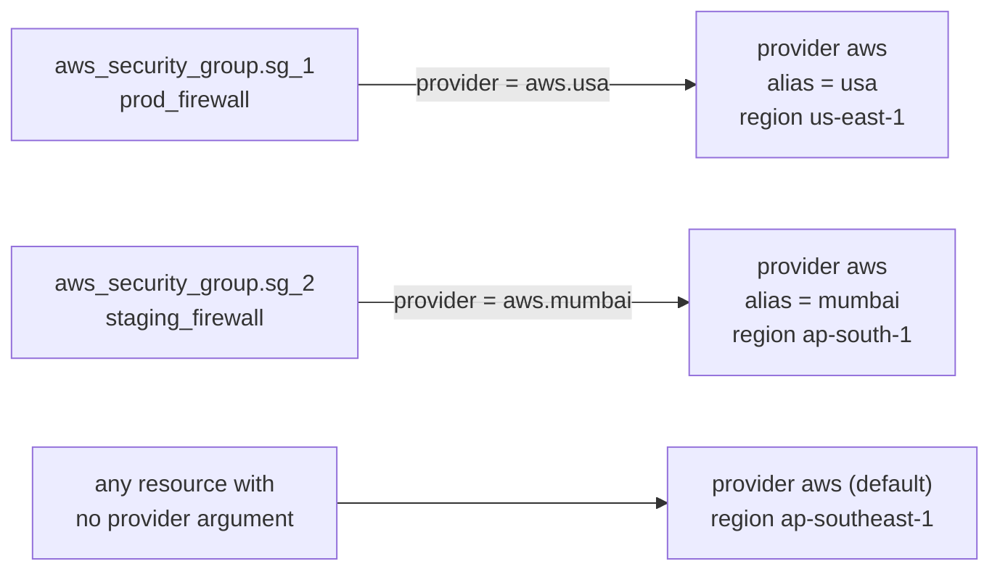
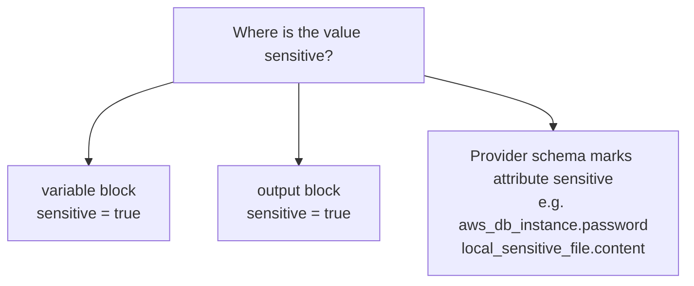
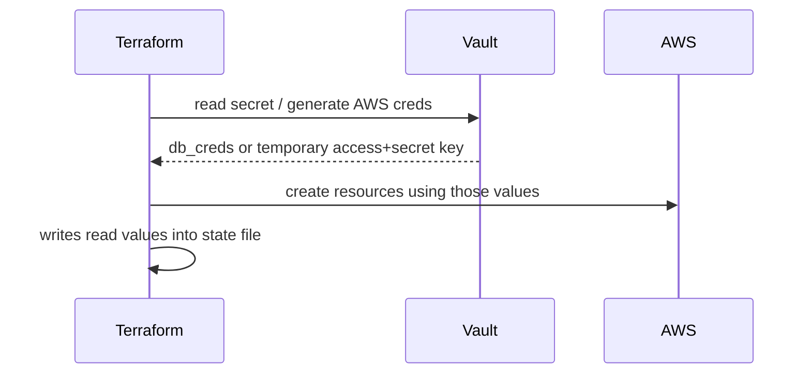
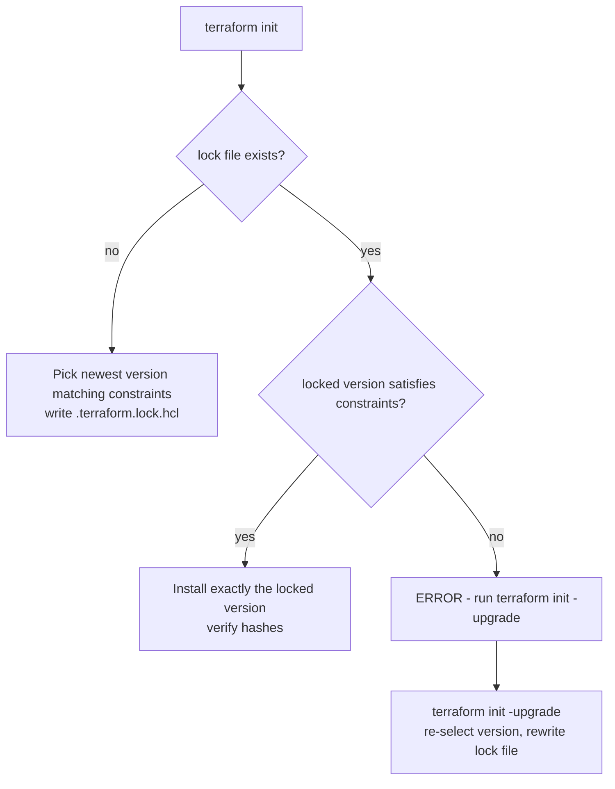
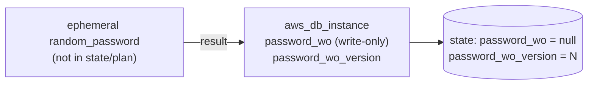

# Session 8 - Security Primer

HashiCorp Certified Terraform Associate (Zeal Vora / KPLabs) - detailed study notes

Sources: lecture transcripts 143, 144, 146, 147, 148, 149 and the course repo folder `Section 6 - Security Primer/`.

> **Missing lecture number: 145.** The transcript for lecture 145 is not in the `session8/` folder. From the repo's `Readme.md` video-document mapper, item 3 is "Security Challenges in Committing TFState to GIT" (`tfstate-git.md`). That file sits between "Sensitive Parameter" and "Terraform and Vault Integration", so it almost certainly belongs to lecture 145. This is an inference: no transcript confirms it. It is covered briefly in an appendix at the end of the lecture sections, based on the repo file alone.

---

## Session overview

This session covers the "Security Primer" domain. The lectures are:

| # | Topic | One-line summary |
|---|-------|------------------|
| 143 | Multiple Provider Configuration | Use the `alias` meta-argument to define several configurations of the same provider (e.g. different regions) and pick one per resource with `provider = aws.<alias>`. |
| 144 | Sensitive Parameter | `sensitive = true` hides values in CLI output and logs. It does **not** protect the state file. |
| 145 | (transcript absent) | Repo file `tfstate-git.md`: risks of committing state/secrets to Git. |
| 146 | Overview of HashiCorp Vault | Secrets management, dynamic secrets, encryption-as-a-service. |
| 147 | Terraform and Vault Integration | The `vault` provider reads secrets with `vault_generic_secret`. Secrets read this way end up in state. |
| 148 | Dependency Lock File | `.terraform.lock.hcl` pins provider versions and checksums; `terraform init -upgrade` changes them. |
| 149 | Ephemeral Values and Write-Only Arguments | `ephemeral` blocks and `*_wo` arguments keep secrets out of state and plan files (Terraform 1.11+). |

The recurring theme is how to keep secrets from leaking:

```
Level 1  sensitive = true          -> hidden from CLI / logs only (state still has plaintext)
Level 2  Vault / Secrets Manager   -> secrets stored and issued centrally (but a read secret lands in state)
Level 3  ephemeral + write-only    -> value never persisted to state or plan
Always   protect the state file    -> encrypt, restrict access, never commit it to Git
```

---

## Table of contents

1. [Lecture-to-repo-file mapping](#lecture-to-repo-file-mapping)
2. [143. Multiple Provider Configuration](#143-multiple-provider-configuration)
3. [144. Sensitive Parameter](#144-sensitive-parameter)
4. [145. (absent) Security Challenges in Committing TFState to Git - repo file only](#145-absent-security-challenges-in-committing-tfstate-to-git---repo-file-only)
5. [146. Overview of HashiCorp Vault](#146-overview-of-hashicorp-vault)
6. [147. Terraform and Vault Integration](#147-terraform-and-vault-integration)
7. [148. Dependency Lock File](#148-dependency-lock-file)
8. [149. Ephemeral Values and Write-Only Arguments](#149-ephemeral-values-and-write-only-arguments)
9. [Command / syntax cheat-sheet](#command--syntax-cheat-sheet)
10. [Key takeaways](#key-takeaways)
11. [Quick revision Q&A](#quick-revision-qa)
12. [Glossary](#glossary)

---

## Lecture-to-repo-file mapping

Repo folder: `Section 6 - Security Primer/`

| Lecture | Transcript | Repo file(s) | Notes |
|---------|-----------|--------------|-------|
| 143 | Multiple Provider Configuration | `multi-provider.md` (Base Code + Final Code) | Instructor refers to the file as `multi-provider-config.tf` |
| 143 (extra, not in Readme) | - | `multiple-providers.md` | EIP example with a second provider using `alias = "aws02"` and a named `profile`. Not in the Readme mapper, not discussed in the transcript. |
| 144 | Sensitive Parameter - NEW | `sensitive.md` | Base code, variable, sensitive variable, `local_sensitive_file`, output, RDS block |
| 145 | **absent** | `tfstate-git.md` | Inferred from the Readme order |
| 146 | Overview of HashiCorp Vault | none (UI demo only) | |
| 147 | Terraform and Vault Integration | `vault.tf` | |
| 148 | Dependency Lock File | `dependency-lock.tf` | Instructor used `demo.tf` locally |
| 149 | Ephemeral Values and Write-Only Arguments | `ephemeral-write-only.md` | Base Code and Final Code |
| (not in Readme) | - | `credentials.md` | Simple `aws_eip` plus `provider "aws"` with region, and an AWS CLI install link. This belongs to the earlier credentials discussion, not to the session 8 transcripts. |
| - | - | `Readme.md` | Video-Document mapper (6 entries) |

---

## 143. Multiple Provider Configuration

### 1. The problem

A single `.tf` file may hold several resources that must live in **different regions**.

```
                 one .tf file
        +------------------------------+
        |  aws_instance      (EC2)     |  ---> should go to Singapore (ap-southeast-1)
        |  aws_security_group (firewall)|  ---> should go to Mumbai    (ap-south-1)
        +------------------------------+
```

By default, every resource of a given provider uses the one default provider configuration. Wherever the region comes from (the `provider` block, environment variables, the AWS config file), all resources land in that one region.

### 2. The solution: `alias` meta-argument

`alias` lets you define **any number of alternate configurations** of the same provider. The alias is a "code name" you use to reference that specific provider block.



Two steps are always needed:

1. **Define** extra provider blocks with an `alias`.
2. **Associate** each resource with a block using `provider = <type>.<alias>`.

### 3. Final code (repo: `multi-provider.md`, "Final Code")

```hcl
provider "aws" {
    region = "ap-southeast-1"
}

provider "aws" {
    alias  = "mumbai"
    region = "ap-south-1"
}

provider "aws" {
    alias  = "usa"
    region = "us-east-1"
}

resource "aws_security_group" "sg_1" {
  name        = "prod_firewall"
  provider    = aws.usa
}

resource "aws_security_group" "sg_2" {
  name        = "staging_firewall"
  provider    = aws.mumbai
}
```

Line by line:

| Element | Meaning |
|---------|---------|
| `provider "aws" { region = "ap-southeast-1" }` | The **default** configuration (no alias). Used by any `aws_*` resource that has no `provider` argument. This is Singapore. |
| `alias = "mumbai"` | Names this extra AWS config. The name is arbitrary ("you can give any name"). |
| `alias = "usa"`, `region = "us-east-1"` | Second extra config, N. Virginia. |
| `provider = aws.usa` | Meta-argument on a resource. The format is `<provider type>.<alias>`, with **no quotes**. |
| `sg_1` / `sg_2` | Local names. They must be **unique per resource type**. See the first gotcha below. |

### 4. Demo walkthrough (as done in the lecture)

**Step 1 - Base setup, one region.** The file had a default `provider "aws"` (ap-southeast-1) and two security groups, `prod_firewall` and `staging_firewall`.

**Step 2 - `terraform validate` fails.**

```
Error: Duplicate resource "aws_security_group" configuration
```

Cause: both resources had the same local name (`allow_tls`). The repo's "Base Code" shows exactly this: two `aws_security_group "allow_tls"` blocks. Fix: rename to `sg_1` and `sg_2`. Validate then passes.

**Step 3 - Apply, verify, destroy.**

```bash
terraform validate
terraform apply -auto-approve
# console: both SGs appear in Singapore (ap-southeast-1)
terraform destroy -auto-approve
```

**Step 4 - Try a second `provider "aws"` block without an alias.** The instructor added a block with `region = "ap-south-1"`. Result:

```
Error: Duplicate provider configuration
```

Two un-aliased provider blocks of the same type are not allowed. The error message says to use `alias`.

**Step 5 - Add aliases only.** Add `alias = "mumbai"` and a new block `alias = "usa"` / `region = "us-east-1"`. `terraform validate` now passes. If you apply at this point, **both security groups still go to ap-southeast-1**. Defining aliased providers does nothing for a resource until it references one.

**Step 6 - Associate resources.** Add `provider = aws.usa` to `prod_firewall` and `provider = aws.mumbai` to `staging_firewall`. Then:

```bash
terraform destroy -auto-approve   # clean up previous run first
terraform validate
terraform apply -auto-approve
```

**Expected result:**

| Resource | Region it lands in |
|----------|-------------------|
| `staging_firewall` (`sg_2`) | Mumbai (ap-south-1) |
| `prod_firewall` (`sg_1`) | N. Virginia (us-east-1) |

### 5. Extra repo example: `multiple-providers.md` (not covered in the transcript)

```hcl
# eip.tf
resource "aws_eip" "myeip" {
  vpc = "true"
}

resource "aws_eip" "myeip01" {
  domain = "vpc"
  provider = "aws.aws02"
}
```

```hcl
# providers.tf
provider "aws" {
  region     =  "us-west-1"
}

provider "aws" {
  alias      =  "aws02"
  region     =  "ap-south-1"
  profile    =  "account02"
}
```

The repo comments say "1st EIP -- one region, 2nd EIP -- second region". The new idea here is that an alias can point at a **different credentials profile** (`profile = "account02"`), so an alias can select a different account as well as a different region. (Extra context: in current Terraform the reference is written unquoted, `provider = aws.aws02`. The quoted string form in the repo is the legacy style and gives a warning or error in modern versions.) Also (extra context): `vpc = "true"` is the older EIP argument, and `domain = "vpc"` replaces it in newer AWS provider versions.

### 6. Gotchas

- Two `provider` blocks of the same type with no `alias` give `Duplicate provider configuration`.
- A resource with no `provider` argument uses the **default (un-aliased)** configuration, even when aliased blocks exist.
- Local names must be unique per resource type (`Duplicate resource ... configuration`).
- The alias name is free-form. It does not have to be the region name.
- (Extra context) Child modules can receive aliased providers through the `providers = { aws = aws.usa }` argument in a `module` block. This was not covered in the lecture.

### Exam tips

- `alias` is a **meta-argument on `provider` blocks** that allows multiple configurations of the same provider.
- Reference syntax is `provider = <PROVIDER>.<ALIAS>` (for example `aws.usa`).
- The instructor says that from the exam angle you should know at a high level what `alias` allows. Typical use: multi-region (or multi-account) deployments from one configuration.
- The un-aliased block is the default. Resources use it when they don't name a provider.

---

## 144. Sensitive Parameter

### 1. Why it matters

`terraform plan` and `apply` print resource attributes in the CLI output, and they can also appear in logs. With a `local_file` resource, the plan shows the file content in plain text:

```
content = "supersecretpassw0rd"
```

In production you must not leak sensitive data through the CLI or logs.

### 2. Demo progression (repo: `sensitive.md`)

**A. Base code - value is shown**

```hcl
resource "local_file" "foo" {
  content  = "supersecretpassw0rd"
  filename = "password.txt"
}
```

`terraform plan` shows `content = "supersecretpassw0rd"`.

**B. Hiding it behind a variable does NOT help**

```hcl
variable "password" {
  default = "supersecretpassw0rd"
}
resource "local_file" "foo" {
  content  = var.password
  filename = "password.txt"
}
```

People assume that because the literal isn't in the resource, it won't show. But Terraform evaluates `var.password`, so the plan still prints the plain-text value.

**C. Mark the variable `sensitive`**

```hcl
variable "password" {
  default = "supersecretpassw0rd"
  sensitive = "true"
}
resource "local_file" "foo" {
  content  = var.password
  filename = "password.txt"
}
```

Plan shows `content = (sensitive value)`. (The repo writes `"true"` as a string. The lecture says `sensitive = true`. The boolean form is the documented one.)

**D. Use a purpose-built resource type: `local_sensitive_file`**

```hcl
resource "local_sensitive_file" "foo" {
  content  = "supersecretpassw0rd"
  filename = "password.txt"
}
```

Without setting `sensitive` anywhere, `content` is shown as `(sensitive value)`. The provider schema marks the attribute sensitive. The `local_file` docs note: "If the file content is sensitive, use the `local_sensitive_file` resource instead". Not every resource type has a sensitive twin, so read the docs.

**E. Referencing a sensitive value in an `output` fails unless the output is also sensitive**

```hcl
resource "local_sensitive_file" "foo" {
  content  = "supersecretpassw0rd"
  filename = "password.txt"
}

output "pass" {
  value = local_sensitive_file.foo.content
}
```

`terraform plan` shows the content as sensitive, but **the operation fails with an error** because the output would expose a sensitive value. (The transcript wrote `local.sensitive_file.foo.content`. That is a transcription slip. The correct address is `local_sensitive_file.foo.content`.)

Fix: mark the output sensitive.

```hcl
output "pass" {
  value     = local_sensitive_file.foo.content
  sensitive = true
}
```

Then `terraform apply` succeeds and prints:

```
Outputs:

pass = <sensitive>
```

`password.txt` is created in the working directory and contains the real password.

**F. The state file still has the value**

Why keep an output at all if it's hidden? The answer is **state**. Other Terraform projects or teams can read your `terraform.tfstate` outputs section (this is how `terraform_remote_state` style sharing works) and fetch the value. In the lecture, opening `terraform.tfstate` shows the `outputs` section containing `supersecretpassw0rd` in plain text.

> **Key rule:** `sensitive` protects the **CLI output and logs**. It does **not** encrypt or redact anything in the state file. The state file becomes the weak point and must itself be protected (covered in a separate video).

### 3. Provider-level automatic redaction (RDS example)

Mature providers (the AWS provider) mark some attributes sensitive themselves, such as database passwords. Repo "RDS Code Block":

```hcl
resource "aws_db_instance" "default" {
  allocated_storage    = 10
  db_name              = "mydb"
  engine               = "mysql"
  engine_version       = "8.0"
  instance_class       = "db.t3.micro"
  username             = "foo"
  password             = "foobarbaz"
  parameter_group_name = "default.mysql8.0"
  skip_final_snapshot  = true
}
```

After `terraform init`, `terraform plan` shows:

```
username = "foo"
password = (sensitive value)
```

The password is redacted without any `sensitive` setting. The username is shown. To hide the username too, use a sensitive variable (live demo; not in the repo file):

```hcl
variable "db_user" {
  default   = "admin"
  sensitive = true
}

# inside the aws_db_instance resource:
username = var.db_user
```

Now the plan shows `username = (sensitive value)`. What counts as sensitive depends on the organisation.

### 4. Where `sensitive` can be set



### 5. Comparison

| Technique | Hidden in plan/apply output | Hidden in logs | Hidden in state file |
|-----------|:---:|:---:|:---:|
| Plain value in resource | no | no | no |
| `var.x` (not sensitive) | no | no | no |
| `variable { sensitive = true }` | yes | yes (CLI/log redaction) | **no** |
| `local_sensitive_file` / provider-marked attribute | yes | yes | **no** |
| `output { sensitive = true }` | yes | yes | **no** (outputs section holds plain text) |

### 6. Gotchas

- `sensitive = true` is cosmetic for CLI and logs. State and the plan file still hold the real value.
- An output that references a sensitive value must be `sensitive = true`, otherwise plan/apply errors.
- Moving a literal into a variable gains nothing unless the variable is `sensitive`.
- Not every resource has a `*_sensitive_*` variant. Check the provider docs.
- Even after `sensitive`, anyone with access to the state file (or `terraform output -json`, extra context) can read the value.

### Exam tips

- The purpose of `sensitive` is to keep values out of CLI output and logs. It does not remove them from state.
- Outputs that include sensitive values need `sensitive = true`.
- State files contain secrets in plain text, so protect them (remote backend with encryption, restricted access, never in Git).

---

## 145. (absent) Security Challenges in Committing TFState to Git - repo file only

No transcript was provided. The following comes only from `tfstate-git.md`, the third item in the Readme mapper. Treat the lecture content itself as unknown.

```hcl
# RDS Configuration File
provider "aws" {
  region  = "us-east-1"
  access_key = "YOUR-KEY"
  secret_key = "YOUR-KEY"


resource "aws_db_instance" "default" {
  allocated_storage    = 5
  storage_type         = "gp2"
  engine               = "mysql"
  engine_version       = "5.7"
  instance_class       = "db.t2.micro"
  name                 = "mydb"
  username             = "foo"
  password             = file("../rds_pass.txt")
  parameter_group_name = "default.mysql5.7"
  skip_final_snapshot = "true"
}
```

`rds_pass.txt` (store this file outside the folder of `rds.tf`) holds the DB password. In the repo it contains a sample password. Never copy real credentials into notes or Git.

Observations (the file as shipped):

- Hardcoded `access_key` / `secret_key` in the provider block is an anti-pattern (use placeholders, environment variables, profiles, or Vault).
- `password = file("../rds_pass.txt")` keeps the password out of the `.tf` file, but the value is still evaluated and **written into `terraform.tfstate`**. If the state is committed to Git, the secret is exposed. This is consistent with the theme of lectures 144 and 149.
- The `provider "aws"` block in the repo is missing its closing `}` (a typo in the source file).
- (Extra context) The common guidance is to add `*.tfstate`, `*.tfstate.*`, and `.terraform/` to `.gitignore`, and to use a remote backend with encryption and access control.

---

## 146. Overview of HashiCorp Vault

### 1. What Vault is

HashiCorp Vault lets organisations **securely store secrets** (tokens, passwords, certificates) with proper **access management** around them.

Typical secrets: database passwords, AWS access/secret keys, API tokens, encryption keys.

The problem Vault solves: many users keep secrets in a notepad. This is one of the main reasons organisations adopt Vault in production.

### 2. Dynamic secrets

Vault can **generate credentials on demand** and make them expire, so they are rotated automatically.

Instructor's example: developers requesting access to a developer database. Vault issued a username and password valid for **24 hours**. The next day the developer requests new credentials. Regularly rotated credentials reduce the chance of a database breach or data leak.

Demo in the Vault GUI:

| Engine / use case | What happens in the demo |
|-------------------|--------------------------|
| **AWS secrets engine** | Developer clicks **Generate** and Vault returns an access key and secret key for local testing. After a configured time Vault deletes them. |
| **Database secrets engine** | Developer requests credentials and Vault returns a username and password. **Lease duration was 1 hour.** After that they are removed. The developer regenerates them or **renews** the lease. |
| **Linux/SSH** | Vault supplies a key and username to log in to a Linux instance. |

```
Developer --request--> Vault --generates--> temporary credentials (lease: 1h / 24h)
                         |                          |
                         +-- revokes/removes <------+  when the lease expires (or renew)
```

### 3. Other Vault features mentioned

- **Encryption as a service.** The Vault UI can encrypt plain text and decrypt it later. An application can call Vault instead of building its own encrypt/decrypt logic.
- **Hashing** and **random data generation**.
- **GUI.** Vault started as a CLI-only tool, which made learning hard. HashiCorp added a GUI that helps with learning and with managing things securely.

### 4. Benefit at scale

With 200-300 developers all needing database credentials, the database administrator would spend a lot of time generating credentials by hand. With Vault integrated with the backends, Vault does it. The access management work is taken over by Vault.

Vault features are covered in more depth in later videos. The course also has a dedicated Vault course for the Vault Associate certification.

### Exam tips

- Vault = secrets management + dynamic secrets + encryption as a service.
- Dynamic secrets have a lease (TTL) and are automatically revoked or rotated.
- Vault is about secure storage with access control, as opposed to storing secrets in text files or in code.

---

## 147. Terraform and Vault Integration

### 1. Concept

Terraform has hundreds of providers. The **Vault provider** lets Terraform **read from, write to, and configure** Vault.

Use case: a secret `db_creds` in Vault holds a database username and password. You want Terraform to build (or connect to) a database using those credentials, so you inject the secret into Terraform.

### 2. Code (repo: `vault.tf`)

```hcl
provider "vault" {
  address = "http://127.0.0.1:8200"
}

data "vault_generic_secret" "demo" {
  path = "secret/db_creds"
}

output "vault_secrets" {
  value = data.vault_generic_secret.demo.data_json
  sensitive = "true"
}
```

| Block | Explanation |
|-------|-------------|
| `provider "vault"` | Configures the Vault provider. `address` is where Vault runs (here a local dev address, port 8200). Authentication (for example a token) is also needed; the lecture did not show it (extra context). |
| `data "vault_generic_secret" "demo"` | A **data source** that reads a generic secret. `path` is the secret path, `secret/db_creds`. |
| `output "vault_secrets"` | Verifies the data was fetched. `data_json` is a JSON string of the secret's key/value pairs. |
| `sensitive = "true"` | Hides the output in the CLI. |

### 3. Demo walkthrough

1. In the Vault UI, under the `secret` engine, create a secret named `db_creds` with data such as `username = admin` and a sample password (the lecture used a trivial demo value).
2. Terraform: `terraform init` (installs the vault provider).
3. `terraform apply` first fails with an error like:

```
no secret found at secret/db-creds
```

   The typo: the path used a hyphen (`db-creds`) while the secret is `db_creds`. Fix the path to `secret/db_creds` and re-run.

4. After the apply, the CLI output is hidden because of `sensitive`:

```
Outputs:

vault_secrets = <sensitive>
```

5. Open `terraform.tfstate`. The `outputs` section has `vault_secrets` with the secret's values (the demo's admin credentials) in **plain text**.

Practical use: when creating a new database (such as RDS), take the username and password from Vault so the database is built with those credentials.

### 4. Vault AWS secrets engine + Terraform

Vault's AWS engine can generate IAM user credentials (access key + secret key). Terraform can be told to use those keys to perform operations on AWS. **No hard-coding of access and secret keys in Terraform is required.** Terraform fetches the latest keys and acts on AWS. (Only described at a high level in the lecture.)



### 5. THE exam point

> Interacting with Vault from Terraform causes any secrets you **read and write** to be **persisted in the Terraform state file**. Reading a secret from Vault and passing it to another service means the secret becomes part of state. You must secure the state file so the secrets are not exposed.

Even with `sensitive = true` on an output, the value still sits in state. (Ephemeral resources and write-only arguments in lecture 149 are the newer way to avoid this where supported. Check provider support.)

### Exam tips

- The Vault provider allows Terraform to read, write, and configure Vault.
- Secrets handled through Vault in Terraform are **stored in state**. Protect the state.
- `vault_generic_secret` is the data source used in the lecture.
- Vault as a source avoids hard-coding credentials in `.tf` files.
- Setting up Vault from scratch is out of scope for this exam.

---

## 148. Dependency Lock File

### 1. Background: provider and Terraform release cycles are independent

Terraform core and each provider plugin are released separately. Terraform may stay at 1.2 while the AWS provider goes through versions 1, 2, 3, and so on.

The risk:

```
Day 0   You write code with Terraform 1.2 + AWS provider v1, test everything, commit to Git.
Week 4  AWS provider v2 released.
Week 8  AWS provider v3 released.
Month 2 A colleague clones your repo and runs `terraform init`.
        -> downloads v3 (latest allowed). Code may break:
           a bug in the plugin, or new behaviour that needs small code changes.
```

Check the plugin's GitHub issues page when this happens.

### 2. First control: version constraints

In `required_providers` you can use a range or an exact version. Example from the repo (`dependency-lock.tf`):

```hcl
terraform {
  required_providers {
    aws = {
      source  = "hashicorp/aws"
      version = "4.60"
    }
  }
}

# Configure the AWS Provider
provider "aws" {
  region = "us-east-1"
}

resource "aws_instance" "web" {
  ami           = ami-123
  instance_type = "t2.micro"
}
```

Notes on this file:

- `source = "hashicorp/aws"` is the provider's registry address.
- `version = "4.60"` is an **exact** version constraint (the slide in the lecture first showed a range such as `~> 4.0` giving possible installs of 4.5, 4.6, and so on; the instructor said the lock showed constraint "4.0" and version `4.62.0`).
- The repo has `ami = ami-123` **without quotes**. This is invalid HCL. It should be `"ami-123"` (the file is only a teaching example).

### 3. Second control: `.terraform.lock.hcl`

After `terraform init` selects a version, Terraform records it in the **dependency lock file**, `.terraform.lock.hcl`, in the working directory (the transcript spells it "terraform dot lock dot hcl").

A lock file contains (conceptual shape, with placeholder checksums):

```hcl
# This file is maintained automatically by "terraform init".
# Manual edits may be lost in future updates.

provider "registry.terraform.io/hashicorp/aws" {
  version     = "4.62.0"
  constraints = "~> 4.0"
  hashes = [
    "h1:<checksum-placeholder-1>",
    "zh:<checksum-placeholder-2>",
    "zh:<checksum-placeholder-3>",
  ]
}
```

| Field | Meaning |
|-------|---------|
| `version` | The **exact version actually selected** at init (the lecture showed `4.62.0`). |
| `constraints` | The version constraint from your configuration at that time. |
| `hashes` | Checksums for the provider package, covering the platforms it supports, so the exact provider is verified on later installs. |

With the lock file in place (and committed alongside the code), a new developer who runs `terraform init` gets **the locked version** (4.62.0). Newer releases (4.7, 4.8, 4.9 and so on) that also match the constraint are **not** picked up.

### 4. Demo walkthrough

1. A folder holds one `demo.tf` with a provider version range. `terraform init`:
   - finds the best version matching the constraint (the instructor saw 4.62.0; "you may see a newer one"),
   - installs it,
   - creates `.terraform.lock.hcl` listing constraints, version `4.62.0`, and hashes.
2. Later, you decide to go back to **4.60** (assume 4.62 has an issue). Change `required_providers` to 4.60 and run:

```bash
terraform init
```

   Result: **error**, because the lock file says 4.62.0 and does not match the new constraint.

3. Use the upgrade flag. HashiCorp recommends `-upgrade` when you need a version different from the lock:

```bash
terraform init -upgrade
```

   This time 4.60 is installed and the lock file is updated to match.



### 5. Checksums

The first time a provider is installed, Terraform pre-populates the `hashes` with checksums that are covered by the provider developer's **cryptographic signature**. They cover the different platforms the version supports. If the downloaded plugin does not match the checksums (a mismatch with the signature), **initialization fails**. This ensures the exact intended version and package is installed.

### 6. Important limitations and notes

- The dependency lock file tracks **only provider dependencies**.
- It does **not** remember versions for **remote modules**. Terraform always selects the **newest** available module version that satisfies the constraints.
- (Extra context) Commit `.terraform.lock.hcl` to version control. Do not hand-edit it.

### 7. Constraints vs lock file

| Aspect | `version` constraint (in `.tf`) | `.terraform.lock.hcl` |
|--------|-------------------------------|-----------------------|
| Who writes it | You | Terraform (`init`) |
| Expresses | Acceptable range or exact version | The exact selected version plus hashes |
| Applies to | Providers (and modules) | **Providers only** |
| Changed by | Editing `.tf` | `terraform init -upgrade` |

### Exam tips

- File name: `.terraform.lock.hcl`, created by `terraform init` in the working directory.
- It locks **provider** versions (not remote modules).
- It stores the selected version, the constraints, and checksums (hashes).
- If the config no longer matches the lock, `terraform init` errors. Use `terraform init -upgrade`.
- Commit it to VCS so the whole team uses the same provider version.
- Providers and Terraform core have independent release cycles.

---

## 149. Ephemeral Values and Write-Only Arguments

### 1. The challenge

For a database you need a password. Organisations add `sensitive = true`, but that hides the value only in CLI output. **The actual value is still stored in plain text in `terraform.tfstate`.** If the state leaks, the attacker reads API keys, DB passwords, and so on.

### 2. Base demo (secret stored in state) - repo "Base Code"

```hcl
resource "random_password" "db_password" {
  length           = 16
  override_special = "!#$%&*()-_=+[]{}<>:?"
}

resource "aws_db_instance" "default" {
  allocated_storage    = 10
  db_name              = "mydb"
  engine               = "mysql"
  engine_version       = "8.0"
  instance_class       = "db.t3.micro"
  username             = "foo"
  password          = random_password.db_password.result
  skip_final_snapshot  = true
}

output "db_password" {
  value = random_password.db_password.result
  sensitive = true
}
```

```bash
terraform apply -auto-approve

terraform destroy -auto-approve
```

| Block | Purpose |
|-------|---------|
| `random_password` resource | Generates a 16-character password. `override_special` sets the allowed special characters. |
| `aws_db_instance` | MySQL 8.0 RDS instance on `db.t3.micro` with 10 GB. `password` is fed from the random resource. `skip_final_snapshot = true` avoids a snapshot on destroy. |
| `output "db_password"` | Prints the password. `sensitive = true` means the CLI shows `<sensitive>`. |

Result: the CLI shows `db_password = <sensitive>`, but in `terraform.tfstate`:

- the `outputs` section has the password in **plain text**, and
- the `random_password` resource's `result` attribute **also** holds it in plain text. Even without the output block, the generated password is in state.

RDS creation took about 5 minutes (5m02s in the demo). Destroy afterwards.

### 3. Part 1: `ephemeral` blocks

An `ephemeral` block defines a **temporary** resource.

- Ephemeral resources have a unique lifecycle.
- **Terraform does not store ephemeral resource information in state or plan files.**
- The syntax change is tiny: replace the `resource` keyword with `ephemeral`.

```hcl
# before (persisted)
resource  "random_password" "db_password" { ... }

# after (temporary)
ephemeral "random_password" "db_password" { ... }
```

Demo: the DB resource was commented out, the `random_password` changed to `ephemeral`. `terraform plan` said no changes to infrastructure. `terraform apply -auto-approve` completed and **nothing appeared in the state file**. When changed back to `resource`, `apply` put the password in state again.

In the Registry docs, the same name appears twice: the normal resource (`random_password`) and the ephemeral resource (`ephemeral random_password`). Check which ones a provider supports.

### 4. Ephemeral values cannot go to normal outputs

Trying `value = ephemeral.random_password.db_password.result` in the output block, with `sensitive = true`, makes `terraform plan` fail:

```
Error: Output value is not declared as returning an ephemeral value
  ... cannot be set to a result derived from an ephemeral value.
```

This is by design. Persisting an ephemeral value to state would defeat the purpose, so Terraform blocks it. (Extra context: outputs of child modules can be marked `ephemeral = true`. This was not covered in the lecture.)

### 5. Part 2: write-only arguments

**Write-only arguments** let you securely pass temporary values to Terraform-managed resources during the operation **without persisting them to state or plan files**.

Flow: an ephemeral resource produces a value, and a write-only argument on a normal resource consumes it.



Documentation note quoted in the lecture: for `aws_db_instance`, the write-only argument `password_wo` is available **in place of `password`**. Write-only arguments are supported in **Terraform 1.11.0 or later**.

Step-by-step from the demo:

1. Replace `password` with `password_wo` and point it at `ephemeral.random_password.db_password.result`.
2. `terraform plan` complains about a missing required argument: **`password_wo_version`**.
3. Add `password_wo_version = 1`. Plan now works.
4. The plan wanted to destroy the earlier `random_password` resource because it was still in state. So the instructor destroyed everything to start from empty state, then re-planned: **1 to add** (only the DB instance).
5. `terraform apply -auto-approve` ran about 5m12s. In the plan only one resource is shown, but at apply time Terraform also **opens (loads) the ephemeral resource** to produce the password. This should not confuse you.
6. Inspect `terraform.tfstate`: the password appears nowhere. `password_wo` is **`null`**. "Terraform has no idea what the password is."

### 6. Why a `_version` argument exists

Because write-only values are not stored, Terraform **cannot tell whether the value changed** and cannot produce a plan diff for them. So providers pair `*_wo` with a `*_wo_version` argument. Terraform **does** store the version in state and can see it change.

```
password_wo          : invisible to Terraform (never stored, no diff)
password_wo_version  : stored in state, drives change detection

To rotate: bump password_wo_version (1 -> 2 -> 3 ...)
  => Terraform sees a change => re-reads the ephemeral value (new random password)
  => new value is written to the DB
```

### 7. Final code (repo: `ephemeral-write-only.md`, "Final Code Used in Video")

```hcl
ephemeral "random_password" "db_password" {
  length           = 16
  override_special = "!#$%&*()-_=+[]{}<>:?"
}


resource "aws_db_instance" "default" {
  allocated_storage    = 10
  db_name              = "mydb"
  engine               = "mysql"
  engine_version       = "8.0"
  instance_class       = "db.t3.micro"
  username             = "foo"
  password_wo          = ephemeral.random_password.db_password.result
  password_wo_version  = 3
  skip_final_snapshot  = true
}

resource "aws_secretsmanager_secret" "db_password" {
  name = "db_pass"
}

resource "aws_secretsmanager_secret_version" "db_password" {
  secret_id                = aws_secretsmanager_secret.db_password.id
  secret_string_wo         = ephemeral.random_password.db_password.result
  secret_string_wo_version = 3
}

ephemeral "aws_secretsmanager_secret_version" "db_password" {
  secret_id = aws_secretsmanager_secret_version.db_password.secret_id
}
```

```bash
terraform apply -auto-approve

terraform destory -auto-approve   # repo typo; the correct command is "terraform destroy"
```

| Block / argument | Role |
|------------------|------|
| `ephemeral "random_password"` | Generates the password. Never written to state or plan. |
| `password_wo` | Write-only argument on `aws_db_instance`. Receives the ephemeral value. Stored as `null`. |
| `password_wo_version` | Change trigger. Bumped (1 to 3 in the demo) to push a new password. Stored in state. |
| `aws_secretsmanager_secret` (`name = "db_pass"`) | A secret container in AWS Secrets Manager. |
| `aws_secretsmanager_secret_version` with `secret_string_wo` / `secret_string_wo_version` | Stores the **same** generated password in Secrets Manager using a write-only argument, so it is not in state. |
| `ephemeral "aws_secretsmanager_secret_version"` | An ephemeral way to read a secret version back. It is in the repo's final code but **was not explained in the transcript**. Use it to read the stored secret without persisting it. |

### 8. Secrets Manager demo ("for completeness - not part of the exam")

Since the password is nowhere in state, how do you connect to the database? The instructor stored it in **AWS Secrets Manager** (secrets are encrypted at rest using KMS).

Walkthrough:

1. Add the Secrets Manager resources and increment the version (1 to 3; "you can also do two").
2. `terraform apply -auto-approve`. The RDS resource is modified (new password) and the secret is updated.
3. In the AWS console, Secrets Manager, open secret `db_pass`, then **Retrieve secret value**: the plaintext is shown. Retrieval requires IAM permissions. A user without access to Secrets Manager cannot read it.
4. Bumping the version again (3 to 4) generates a new random password, updates the DB, and stores the new value in Secrets Manager. That is the complete lifecycle.

**Clean up** (the instructor stresses this to avoid charges): destroy all resources.

### 9. Rules to remember

| Point | Detail |
|-------|--------|
| Version | Write-only arguments need **Terraform 1.11 or later**. |
| Provider support | The resource must support write-only arguments. **Not all do.** Implementation of write-only and version arguments is **provider-specific**, so check the Registry. The AWS provider supports it for a specific set of resources, such as the database. |
| Input values | Write-only arguments accept **both ephemeral and non-ephemeral** values. |
| State | Write-only arguments are **not stored** in state or plan files. |
| Change detection | Terraform cannot detect or diff a changed write-only value. Providers add a `*_version` argument that Terraform does store. Increment it to trigger an update. |
| Outputs | An ephemeral value cannot be assigned to a regular output. |
| Plan vs apply | The ephemeral resource is opened during apply even when the plan summary shows only one resource to add. |

### 10. Sensitive vs ephemeral vs write-only

| Feature | What it is | Hidden in CLI | Stored in state | Stored in plan |
|---------|-----------|:---:|:---:|:---:|
| `sensitive = true` | Flag on variable/output (or provider-marked attribute) | yes | **yes (plain text)** | yes |
| `ephemeral` block | A temporary resource that produces values | n/a | **no** | **no** |
| Write-only argument (`*_wo`) | A resource argument that accepts a value but never persists it | yes | **no** (`null`) | **no** |
| `*_wo_version` | Companion argument to trigger updates of a write-only value | no | yes (version number only) | yes |

(The last column for `sensitive` follows from the lecture's statement that sensitive data remains in the state and plan. The instructor states explicitly for state; for plan, treat as extra context.)

### 11. Gotchas

- `sensitive = true` still leaves plaintext in state. Ephemeral plus write-only solves that, but only where the provider supports it.
- A normal `random_password` **resource** persists its `result` in state even with no output block.
- You cannot output an ephemeral value in a normal output (plan errors).
- `password_wo` alone is not enough. `password_wo_version` is required (plan errors with a missing required argument).
- Changing the password source without bumping `*_wo_version` will not be seen by Terraform, because it cannot diff write-only values.
- Switching from a `resource` to an `ephemeral` for an existing state makes Terraform plan to destroy the old resource.
- You need a way to retrieve the password for connecting to the DB (Secrets Manager or another secret store).
- Databases take about 5 minutes to create and destroy. Clean up to avoid charges.

### Exam tips

- `ephemeral` blocks are not saved in state or plan files.
- Write-only arguments (usually suffixed `_wo`) need Terraform **1.11+** and a supporting provider resource.
- To change a write-only value, **increment the version argument**.
- `sensitive = true` does not keep values out of state.
- Write-only arguments can take ephemeral and non-ephemeral values.

---

## Command / syntax cheat-sheet

```bash
# Validation and apply
terraform validate
terraform plan
terraform apply -auto-approve
terraform destroy -auto-approve

# Providers and lock file
terraform init               # installs providers, creates/uses .terraform.lock.hcl
terraform init -upgrade      # re-selects provider versions, rewrites the lock file
```

```hcl
# --- Multiple providers (143) ---
provider "aws" { region = "ap-southeast-1" }                  # default
provider "aws" { alias = "mumbai" region = "ap-south-1" }     # aliased (one attribute per line in real code)
resource "aws_security_group" "sg_2" {
  name     = "staging_firewall"
  provider = aws.mumbai                                       # <type>.<alias>, unquoted
}

# --- Sensitive (144) ---
variable "password" {
  default   = "..."
  sensitive = true
}
output "pass" {
  value     = local_sensitive_file.foo.content
  sensitive = true
}
resource "local_sensitive_file" "foo" { content = "..." filename = "password.txt" }

# --- Vault (147) ---
provider "vault" { address = "http://127.0.0.1:8200" }
data "vault_generic_secret" "demo" { path = "secret/db_creds" }
# data.vault_generic_secret.demo.data_json

# --- Dependency lock (148) ---
terraform {
  required_providers {
    aws = { source = "hashicorp/aws" version = "4.60" }
  }
}

# --- Ephemeral + write-only (149) ---
ephemeral "random_password" "db_password" { length = 16 }
resource "aws_db_instance" "default" {
  password_wo         = ephemeral.random_password.db_password.result
  password_wo_version = 1        # bump to rotate
}
```

(In real HCL, put each argument on its own line. They are shown on one line above only to save space.)

Quick reference table:

| Need | Use |
|------|-----|
| Same provider, multiple regions/accounts | `alias` + `provider = type.alias` |
| Hide value in CLI/logs | `sensitive = true` / `local_sensitive_file` |
| Protect secrets in state | Encrypt and restrict the state, or ephemeral + write-only |
| Pull secrets from a vault | `provider "vault"` + `vault_generic_secret` |
| Pin provider versions | `required_providers` + `.terraform.lock.hcl` |
| Change locked provider version | `terraform init -upgrade` |
| Rotate write-only value | Increment `*_wo_version` |

---

## Key takeaways

1. `alias` allows multiple configurations of one provider. Resources opt in with `provider = aws.<alias>`. Otherwise they use the default (un-aliased) provider.
2. Two un-aliased provider blocks of the same type give `Duplicate provider configuration`. Two same-named resources of the same type give `Duplicate resource ... configuration`.
3. `sensitive = true` masks values in CLI output and logs. **State still contains plaintext.**
4. Outputs that reference sensitive values must themselves be `sensitive = true`, otherwise Terraform errors.
5. Some providers/resources mark attributes sensitive on their own (RDS `password`, `local_sensitive_file.content`).
6. Vault stores secrets with access control and issues dynamic secrets with leases (24 h, 1 h in the demos).
7. The Vault provider lets Terraform read, write and configure Vault. Secrets read or written this way are **persisted in the state file**, so secure the state.
8. `.terraform.lock.hcl` records the exact provider version and checksums chosen at `init`. It is **provider-only** (remote modules are not locked).
9. If the configured constraint no longer matches the lock file, `terraform init` errors. Use `terraform init -upgrade`.
10. `ephemeral` blocks and write-only arguments (`*_wo`, Terraform 1.11+) keep values out of state and plan files. Bump the `*_wo_version` to push a new value.
11. Ephemeral values cannot be stored in normal outputs. Support for write-only arguments is provider-specific.
12. You still need a place to keep the secret so you can use it (Secrets Manager, Vault).

---

## Quick revision Q&A

**1. Which meta-argument lets you define several configurations of the same provider?**
`alias`, on the `provider` block.

**2. How does a resource choose an aliased provider?**
With `provider = <type>.<alias>`, for example `provider = aws.usa`, unquoted.

**3. If you define aliased providers but a resource has no `provider` argument, where does it deploy?**
In the default (un-aliased) provider configuration. In the demo, both security groups went to ap-southeast-1.

**4. What error appears if you define two `provider "aws"` blocks without an alias?**
`Duplicate provider configuration`.

**5. What does `sensitive = true` protect?**
The CLI output and logs (shown as `(sensitive value)` or `<sensitive>`).

**6. Does `sensitive = true` hide the value in `terraform.tfstate`?**
No. The state file still contains the plain-text value, so the state must be protected.

**7. What happens if an output references a sensitive value and the output is not marked sensitive?**
Terraform raises an error. Add `sensitive = true` to the output.

**8. Name a resource type that is sensitive by default and why it exists.**
`local_sensitive_file` (instead of `local_file`). Its `content` is marked sensitive automatically. Similarly, AWS `aws_db_instance.password` is redacted by the provider.

**9. What is dynamic secrets in Vault?**
Vault generates credentials on demand (database users, AWS keys, SSH credentials) with a lease, then revokes or expires them (24 h and 1 h examples). They can be renewed.

**10. Which provider and data source did the lecture use to read a Vault secret?**
The `vault` provider with `data "vault_generic_secret"`, using `path = "secret/db_creds"`.

**11. What is the exam-relevant security note about Terraform and Vault?**
Secrets read from or written to Vault by Terraform are persisted in the state file, so the state file must be secured.

**12. What is the name of the dependency lock file, and when is it created?**
`.terraform.lock.hcl`, created (and used) by `terraform init`.

**13. What does the lock file contain?**
The provider, the selected exact version, the version constraints, and checksums (hashes) for supported platforms.

**14. You changed the provider version constraint to a version different from the locked one. What happens on `terraform init`, and how do you fix it?**
`init` fails because the config does not match the lock. Run `terraform init -upgrade`.

**15. Does the lock file track remote module versions?**
No. Only providers. Modules get the newest version matching the constraint.

**16. What is different about an `ephemeral` block?**
Terraform does not store the ephemeral resource's data in the state or plan files.

**17. What is a write-only argument and what version of Terraform is required?**
An argument (such as `password_wo`) that accepts a value for the operation without saving it to state or plan. Needs Terraform 1.11.0 or later and a provider resource that supports it.

**18. Why is there a `password_wo_version` argument, and how do you rotate the password?**
Terraform cannot see or diff write-only values, but it stores the version number. Increment `password_wo_version` to trigger an update.

---

## Glossary

| Term | Meaning |
|------|---------|
| **Alias** | Name given to an additional configuration of a provider; referenced as `<type>.<alias>`. |
| **Provider block (default)** | A `provider` block without `alias`. Used by resources that don't name a provider. |
| **Meta-argument** | An argument available on many block types, such as `provider`, `alias`, `count`, `depends_on`. |
| **Sensitive value** | A value Terraform masks in CLI output and logs. Not removed from state. |
| **`local_sensitive_file`** | Resource from the `local` provider that writes a file and treats its content as sensitive. |
| **HashiCorp Vault** | Secrets management tool offering secure storage, access control, dynamic secrets and encryption as a service. |
| **Dynamic secret** | A credential generated on demand by Vault with a limited lease. |
| **Lease** | The time period during which a Vault-issued secret is valid. It can be renewed. |
| **Secrets engine** | A Vault component that stores or generates secrets (for example the AWS or database engines). |
| **`vault_generic_secret`** | Data source in the Vault provider that reads a secret at a given path. |
| **`data_json`** | Attribute holding a secret's key/value data as a JSON string. |
| **Dependency lock file** | `.terraform.lock.hcl`, which records the selected provider versions and hashes. |
| **Version constraint** | Rule in `required_providers` (or modules) describing acceptable versions. |
| **`terraform init -upgrade`** | Re-selects the newest provider versions allowed by constraints and updates the lock file. |
| **Hash / checksum** | Values in the lock file used to verify the integrity of the downloaded provider package. |
| **Ephemeral resource** | Temporary resource declared with an `ephemeral` block. Not saved in state or plan. |
| **Write-only argument** | Resource argument (usually `*_wo`) that can receive a value but is never persisted. Terraform 1.11+. |
| **`*_wo_version`** | Companion argument that Terraform stores, used to trigger updates of a write-only value. |
| **AWS Secrets Manager** | AWS service that stores secrets encrypted with KMS. Used in the demo to keep the generated DB password. |
| **KMS** | AWS Key Management Service, which encrypts secrets at rest in Secrets Manager. |
| **State file** | `terraform.tfstate`, Terraform's record of managed infrastructure. May contain secrets in plain text. |
