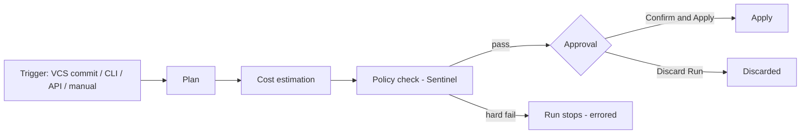
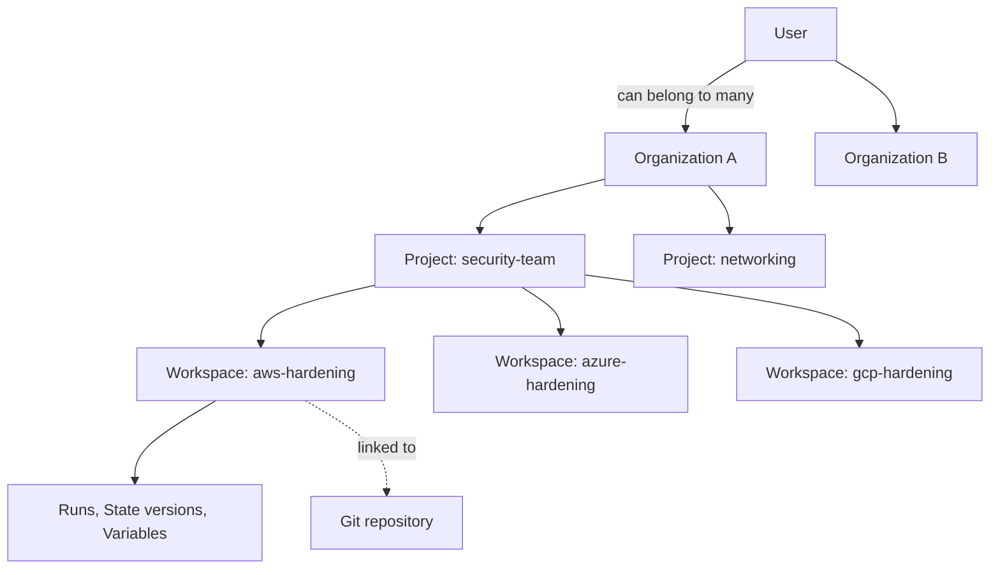
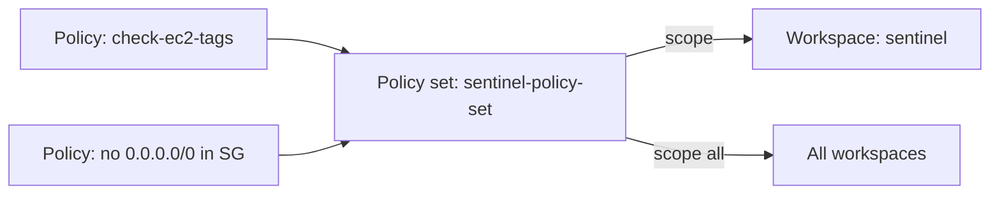
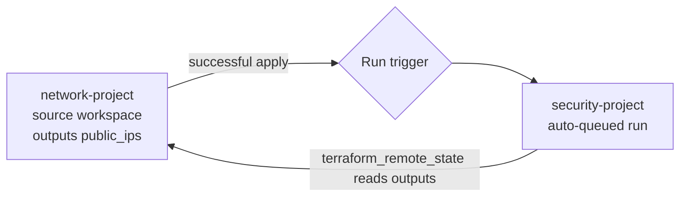

# Session 9 - HCP Terraform (Terraform Cloud) and Terraform Enterprise Capabilities

> HashiCorp Certified: Terraform Associate - study notes
> Source: Zeal Vora / KPLabs course, lectures 150-166, plus the course repo folder `Section 7 - Terraform Cloud & Enterprise Capabilities`.
> Conventions used in these notes:
> - **(as stated in the lecture)** marks pricing, plan names, limits and UI details that the instructor quoted at recording time. They change often, so verify them against the current HashiCorp / IBM pages before relying on them.
> - **(extra context)** marks widely known material that is not in the transcript or repo.
> - **(reconstructed)** marks code the instructor only showed on screen or described. It was not in the repo, so it has been rebuilt from his description.
> - All credentials in examples are placeholders.

---

## Session overview

So far in the course, Terraform has been run entirely from the CLI (`terraform plan`, `apply`, `destroy`) on a laptop. This session introduces the **GUI / SaaS alternative**: **HCP Terraform** (formerly **Terraform Cloud**), and its self-hosted sibling **Terraform Enterprise**.

What the session covers:

| Theme | Lectures |
|---|---|
| What HCP Terraform is, naming, benefits, pricing and plans | 150, 151 |
| Account, organization, project, workspace structure | 152, 153, 154 |
| Workflows: VCS-driven (155) and CLI-driven (156, 157) | 155, 156, 157 |
| Governance: Sentinel policy as code | 158 |
| Self-hosted Terraform Enterprise and air-gapped installs | 159 |
| Private registry for modules and providers | 160 |
| Teams and permissions | 161, 162 |
| Health assessments: drift detection and continuous validation | 163 |
| Run triggers, with a `terraform_remote_state` revision | 164 |
| Migrating local state to HCP Terraform | 165 |
| Choosing the Terraform version per workspace | 166 |

**Naming note (stated in lecture 150).** Terraform Cloud is now **HCP Terraform**, where HCP stands for HashiCorp Cloud Platform. Because HashiCorp has been acquired by IBM, you will also see "IBM HashiCorp Cloud Platform" and "HashiCorp, an IBM company". The transcripts sometimes render "HCP" as "ACP" or "HDP" because of speech-to-text errors. Old blogs and articles saying "Terraform Cloud" mean the same product.

**Lecture numbers.** All 17 lectures from 150 to 166 are present, with no gaps.

---

## Table of contents

1. [Lecture to repo-file mapping](#lecture--repo-file-mapping)
2. [150. Overview of HashiCorp Cloud Platform for Terraform](#150-overview-of-hashicorp-cloud-platform-for-terraform)
3. [151. HashiCorp Cloud Platform - Pricing](#151-hashicorp-cloud-platform---pricing)
4. [152. Creating a New HCP Terraform Account](#152-creating-a-new-hcp-terraform-account)
5. [153. Base Structure of HashiCorp Cloud Platform for Terraform](#153-base-structure-of-hashicorp-cloud-platform-for-terraform)
6. [154. HCP Terraform Practical - Creating Organization and Workspaces](#154-hcp-terraform-practical---creating-organization-and-workspaces)
7. [155. HCP Terraform - Core Practical](#155-hcp-terraform---core-practical)
8. [156. The CLI-driven Run Workflow in HCP](#156-the-cli-driven-run-workflow-in-hcp)
9. [157. The CLI-driven Run Workflow - Practical](#157-the-cli-driven-run-workflow---practical)
10. [158. Overview of Sentinel](#158-overview-of-sentinel)
11. [159. Air Gapped Environments](#159-air-gapped-environments)
12. [160. HCP Terraform Private Registry](#160-hcp-terraform-private-registry)
13. [161. HCP Terraform - Teams](#161-hcp-terraform---teams)
14. [162. HCP Terraform - Manage Permissions](#162-hcp-terraform---manage-permissions)
15. [163. HCP Terraform - Health Assessments](#163-hcp-terraform---health-assessments)
16. [164. HCP Terraform - Run Triggers](#164-hcp-terraform---run-triggers)
17. [165. Migrate State to HCP Terraform](#165-migrate-state-to-hcp-terraform)
18. [166. HCP Terraform - Choosing Version](#166-hcp-terraform---choosing-version)
19. [Command cheat-sheet](#command-cheat-sheet)
20. [Key takeaways](#key-takeaways)
21. [Quick revision Q&A](#quick-revision-qa)
22. [Glossary](#glossary)

---

## Lecture to repo-file mapping

Repo folder: `Section 7 - Terraform Cloud & Enterprise Capabilities/`. Its `Readme.md` is a "Video-Document Mapper" with only 3 entries: *HCP Terraform - Core Practical* -> `terraform-cloud.md`, *Overview of Sentinel* -> `sentinel.md`, *Implementing Remote Backend Operations* -> `remote-backend.md`.

| Lecture | Title | Repo file | Notes |
|---|---|---|---|
| 150 | Overview of HCP for Terraform | none | UI-driven demo of an existing org (network project, demo EC2 workspace) |
| 151 | HCP - Pricing | none | Pricing page and comparison table, conceptual |
| 152 | Creating a New HCP Terraform Account | none | Sign-up walkthrough |
| 153 | Base Structure of HCP for Terraform | none | Org, workspace, project concepts shown in the UI |
| 154 | Creating Organization and Workspaces | none | UI-only |
| 155 | HCP Terraform - Core Practical | `terraform-cloud.md` | `ec2.tf` and the 3 AWS environment variables |
| 156 | CLI-driven Run Workflow in HCP | `remote-backend.md` (closest match) | The lecture shows a `cloud` block with a security group resource. The repo's `remote-backend.tf` is the same idea, with workspace `remote-operation` |
| 157 | CLI-driven Run Workflow - Practical | `remote-backend.md` (cloud block and CLI commands) | The `time_sleep` example file is not in the repo |
| 158 | Overview of Sentinel | `sentinel.md` | Sentinel policy and the EC2 example with tags |
| 159 | Air Gapped Environments | none | Conceptual, with diagrams |
| 160 | Private Registry | none | UI demo; module source URL shown on screen only |
| 161 | Teams | none | UI |
| 162 | Manage Permissions | none | Theoretical, with screenshots |
| 163 | Health Assessments | none | Conceptual; a `check` block is shown on a slide |
| 164 | Run Triggers | none | The `terraform_remote_state` code is shown on slides and screen, not in the repo |
| 165 | Migrate State to HCP Terraform | none | Uses a `random_string` resource; cloud block shown in UI |
| 166 | Choosing Version | none | UI |

---

## 150. Overview of HashiCorp Cloud Platform for Terraform

### 1. Why HCP Terraform exists

- Up to this point, almost every practical used the **CLI**. The instructor stresses that the CLI approach is the one to master. Most organizations use it day to day.
- For the exam you must also know the **alternative GUI-based approach**, provided by **HCP Terraform**.
- HCP Terraform is most useful in **larger environments with many people collaborating**. Teams can run plan and apply from the GUI, and the CLI is optional.
- Official summary given in the lecture: HCP Terraform **manages runs in a consistent and reliable environment**, with access control, a **private registry** for sharing modules, **policy controls**, and more.

### 2. HashiCorp Cloud Platform (HCP) vs HCP Terraform

- **HCP** is the umbrella platform. HashiCorp has several products (Terraform, Vault, Boundary, Consul, Nomad), and each is available on HCP and **billed separately**. Newer naming brands them "IBM HCP ...".
- This course only cares about **Terraform** and its features.

### 3. The run pipeline

A run in HCP Terraform passes through stages, which you see in the run page:

```
 Trigger        Plan         Cost estimation     Policy check       Apply
(VCS/CLI/API) -> terraform plan -> projected $ -> Sentinel policies -> confirm & apply
                                                  (pass / fail)       (manual or auto)
```



### 4. Demo walkthrough: what the instructor showed

**Workspaces list.** The demo organization had workspaces such as `network-project`, `security-project`, `demo-ec2`. Each shows a run status. One was deliberately left in **errored** state to show failure.

**Inside a workspace (network-project)** the instructor showed:

1. **Terraform version** in use and a **list of runs** (e.g. "43 minutes ago", "a day ago"). Every run is recorded no matter who triggered it.
2. **Run history is retained.** On a laptop CLI, plan and apply output is **not saved by default**, so after a few days you cannot see what it looked like. HCP Terraform keeps the plan output, apply output, **who triggered the run and who approved the apply**.
3. **State file stored by the platform.** In the state tab you can open the latest (and older) state versions and see what changed.
4. **Variables tab.** You can create Terraform variables and **environment variables** (for example AWS access keys, DB passwords) in the workspace and mark them **sensitive**. This keeps secrets out of `.tf` files, which is much more secure in large organizations.
5. **Version control.** The workspace is connected to a GitHub repository (`network-project`) that holds `main.tf`. The VCS trigger can be **branch-based**, **tag-based**, and so on.
6. **Workflow demo.** The instructor edited a value in GitHub (added `9999`) and committed. HCP Terraform detects the commit and starts a run with *git* as the source. (In the demo he triggered it manually, but it can be automated.) The run showed:
   - Plan finished: "1 to change".
   - **Cost estimation** finished: **$0.00 per month**.
   - **Policy checks passed**.
   - Apply pending: choose **Confirm & Apply** or **Discard run**. He confirmed, the run was queued, then applied.

**The `demo-ec2` workspace (the failure case)** is connected to a repo with a simple `ec2.tf` that creates an EC2 instance of type `t2.small`:

| Stage | Result |
|---|---|
| Plan | Shows what will be created |
| Cost estimation | The `my EC2` instance costs a certain amount per hour, about **$17 per month** if run 24x7 (as stated in the lecture) |
| Sentinel policy | **Failed.** The policy is "EC2 must have tags", and the resource had no tags |

His point is that the security team can write any rule. For example, "if the instance type is `t2.small` (about $17/month), fail the run, and force `t2.micro`, which is free tier". Developers who launch oversized instances are caught at the cost-estimation stage.

**Workspace Settings tab** showed: locking, notifications, **access** (add teams and permissions per workspace), and **version control** (change the repository or provider, such as GitHub). When any connected repository is updated, HCP Terraform can run plan, cost estimation and Sentinel checks automatically. A team member can then run apply manually. The exact workflow varies by organization.

### 5. CLI vs HCP Terraform (summary)

| Aspect | Local CLI | HCP Terraform |
|---|---|---|
| Interface | Terminal | Web UI (plus CLI/API) |
| Plan/apply history | Not saved by default | Saved per run, with who triggered and approved |
| State | Local `terraform.tfstate` by default | Stored and versioned by the platform |
| Secrets | Shell env, `.tfvars`, prompts | Sensitive workspace variables |
| Collaboration | Ad hoc | Teams, permissions, approvals |
| Policy and cost checks | None | Sentinel policies, cost estimation (paid tiers) |
| Where the code lives | Local folder | VCS repo (or local folder in CLI-driven mode) |

### Exam tips (150)
- HCP Terraform = formerly Terraform Cloud. Same product.
- Run stages: **plan -> cost estimation -> policy check -> apply**.
- HCP Terraform stores run history, state, variables, and can enforce policy.
- Sensitive values such as AWS keys belong in workspace variables (marked sensitive), not in `.tf` files.

---

## 151. HashiCorp Cloud Platform - Pricing

*(All plan names, prices and feature placement below are as stated in the lecture, and they change frequently.)*

### 1. Is it free?

HCP Terraform is **not entirely free**. Depending on usage and required features, there are several plans. The naming changed after IBM acquired HashiCorp. Billing is **per month and per resource** (the instructor calls this out as an important point).

### 2. Plans (as stated in the lecture)

| Plan | Position |
|---|---|
| **Essentials** | Fewest features. The instructor's demo account is on this, billed pay as you go |
| **Standard** | More features |
| **Premium** | Most expensive, most features |
| **Terraform Enterprise** | Self-managed product. Premium support and customization such as **air-gap installation** |

### 3. Payment models (as stated in the lecture)

| Model | Description |
|---|---|
| **Pay as you go** | On-demand, usage-based billing with **no long-term commitment**. You get starter **credits** to try features, which makes testing easy |
| **Flex** | Single-year or multi-year plans with preferred pricing |
| **Enterprise self-managed** | Fully customizable, for maximum control |

With pay as you go, the more resources you manage the more you pay. Other HashiCorp products have different pricing. For example, Vault is priced per cluster per hour (the instructor quoted **$0.62 per cluster per hour**).

### 4. Feature comparison highlights

The pricing page has a comparison table with sub-tabs: visibility and optimization, policy and security, governance/risk/compliance, integrations and API. The exam may ask which features are in which plan. The instructor's simplified table:

| Feature | Essentials | Standard | Premium | Enterprise |
|---|---|---|---|---|
| Audit logging / audit trail | No | Yes | Yes | Yes |
| Drift detection | No | Yes | Yes | Yes |
| Continuous validation | No | Yes | Yes | Yes |
| Policy as code (Sentinel) | No | Yes | Yes | Yes |
| Air-gap installation | No | No | No | **Yes** |

The "No" for Essentials on audit logging, drift detection and continuous validation is stated explicitly in 151 and 163. The other cells reflect the lecture's general statement that these features need Standard, Premium or Enterprise. Check the live pricing page for details.

Other related statements:
- Lecture 153: **team management** and giving teams access to groups of workspaces via **projects** need the **Standard** edition, not the free tier.
- Lecture 163: health assessments are available in **Standard and Premium** (and Enterprise, per the pricing page).
- Lecture 154: the **free plan** has a **resource limit of 500** (as stated in the lecture).
- Lecture 158: Sentinel is a **paid feature**. A trial of the "**Team & Governance**" plan enables policies, policy sets and cost estimation.

### Exam tips (151)
- Pricing is per resource, per month. Billing is at the **organization** level (lecture 153).
- **Air-gapped installation = Terraform Enterprise only.**
- Audit logging, drift detection, and continuous validation are **not** in the lowest tier.
- Don't memorize dollar values. Know the **direction**: higher tier means more governance features.

---

## 152. Creating a New HCP Terraform Account

Conceptual and UI only, with no code. Steps shown:

1. Search "HCP Terraform". The hosted service is at **`app.terraform.io`**.
2. Choose **Create a free account**.
3. Enter a **username**, an **email address** (the username must differ from the email), and a **password**, then **Create account**.
   - Instructor's trick: use a `+` alias in the email (e.g. `name+tag@example.com`) to create a fresh account without using a new mailbox. *(Whether plus-addressing works depends on the mail provider, as extra context.)*
4. A **verification email** is sent. Click the link to confirm the address.
5. HCP Terraform then asks you to **create your first organization** (done in lecture 154).

### Exam tips (152)
- Hosted service URL: `app.terraform.io`.
- A free account is enough for most practicals in this session. Sentinel, policies, teams and health assessments need a paid or trial plan.

---

## 153. Base Structure of HashiCorp Cloud Platform for Terraform

### 1. The hierarchy

```
Account / User
  |
  +-- Organization  (billing, teams, users, private registry live here)
        |
        +-- Project  (group of workspaces; used for ownership and access)
              |
              +-- Workspace  (code link + variables + state + runs)
                     |
                     +-- Run  (plan -> cost -> policy -> apply)
```



### 2. Organization

- A **shared space for one or more teams to collaborate on workspaces**.
- You can have **multiple organizations**. Examples in the lecture: `kplabs-org`, `xyz-company-org`.
- At sign-up the first thing it asks for is the organization name.
- **Billing is managed at the organization level.** Each organization can have its own plan. One user can belong to **multiple organizations**.

### 3. Workspace

- On your laptop you have a **folder** (e.g. `kplabs-terraform`) holding `.tf` files, variable definitions, and so on. In HCP Terraform the equivalent is a **workspace**: a set of related things needed for one project to run.
- One folder corresponds to one workspace. A different project gets a different workspace.
- **Code does not get uploaded file by file.** In the VCS workflow you **link the workspace to a Git repository**, and the workspace fetches the files from there, then runs plan, apply, destroy.
- Supported VCS providers: **GitHub, GitLab, Bitbucket, Azure DevOps**.
- Workspace tabs include **State**, **Variables**, **Settings** (Version Control, etc.).

### 4. Workspace vs local directory (comparison from HashiCorp docs, shown in the lecture)

| Component | Local CLI (directory) | HCP Terraform (workspace) |
|---|---|---|
| Terraform configuration | On disk in the folder | In a linked **VCS repository** (or uploaded by CLI) |
| Variable values | `.tfvars` files, env vars, CLI flags | Stored **in the workspace** |
| State | `terraform.tfstate` in the same folder | Stored and managed by HCP Terraform, per workspace |
| Credentials and secrets | Shell environment or prompts | Stored as **sensitive variables** |

### 5. Project

- Projects let you **organize workspaces into groups**. Example: a `security-team` project containing `aws-hardening`, `azure-hardening` and `gcp-hardening` workspaces.
- Each workspace belongs to one project.
- Benefits:
  - Reflects ownership structure (teams) in larger organizations.
  - With the **Standard** edition (not free tier) you can **give teams access to a group of workspaces via a project**.
- **Team management** is a feature of higher tiers and is essential for large organizations. If you work alone or on a few projects, you do not need that complexity.

### Exam tips (153)
- Hierarchy: **Organization > Project > Workspace**.
- **Billing is per organization.**
- A **workspace** in HCP Terraform is closer to a **directory** than to a CLI workspace (extra context: they are different concepts despite the shared name).
- A workspace links to **VCS** (GitHub, GitLab, Bitbucket, Azure DevOps) to fetch code.
- State, variables and credentials all live inside the workspace.

---

## 154. HCP Terraform Practical - Creating Organization and Workspaces

UI walkthrough:

1. After sign-up, **create the organization**, e.g. `example-kplabs-org` (name is yours to choose).
2. The new organization shows menus for **Projects, Workspaces, Registry** and **Settings**. A **Default Project** exists automatically.
3. **Create a project**, e.g. `Terraform Learning`. (The instructor notes the UI occasionally glitches, and a page refresh fixes it.)
4. **Create a workspace**. When created from the top-level Workspaces tab, you choose which **project** it belongs to (`Terraform Learning`).
5. Three workflow choices are shown when creating a workspace:
   - **Version control workflow** (used in lecture 155)
   - **CLI-driven workflow** (lectures 156-157)
   - **API-driven workflow**
6. **Registry** menu: larger enterprises have their own modules and providers. HCP Terraform provides a **private registry** so you do not have to build one (lecture 160).
7. **Settings**: general settings, **plan and billing** (free plan shows a **resource limit of 500**, as stated in the lecture), **users** (invite team members), and other options.

### Workflow comparison (introduced here, expanded in 155-157)

| Workflow | Where the code lives | Where runs execute | Typical use |
|---|---|---|---|
| **Version control (VCS)** | Git repository linked to the workspace | HCP Terraform | Most common in organizations; traceability and transparency |
| **CLI-driven** | Local working directory | HCP Terraform (remote operation), triggered from the local CLI | You do not want to commit to Git but want remote runs, state and variables |
| **API-driven** | Anywhere; uploaded via API (extra context: configuration versions via the HCP Terraform API) | HCP Terraform | Custom automation and integrations |

### Exam tips (154)
- Know the three workflows: **VCS, CLI, API**.
- Workspaces live inside projects; the free plan caps resources at 500 (as stated, may change).

---

## 155. HCP Terraform - Core Practical

**Repo mapping:** `terraform-cloud.md`.

### 1. Repo content

```hcl
# ec2.tf   (placed in the GitHub repository)
resource "aws_instance" "myec2" {
    ami = "ami-00c39f71452c08778"
    instance_type = "t2.micro"
}
```

Environment variables to add in the HCP Terraform workspace:

```text
AWS_ACCESS_KEY_ID
AWS_SECRET_ACCESS_KEY
AWS_REGION
```

(The repo's documentation reference is the AWS provider docs at `registry.terraform.io/providers/hashicorp/aws/latest/docs`, which lists these environment variable names.)

> Gotcha: the AMI ID is **region-specific**. The instructor deploys to **us-east-1**, so use an AMI valid in the region you choose.

### 2. Goal

See the whole **VCS-driven workflow** end to end: a workspace linked to a GitHub repo fetches the code, uses its own variables and credentials and state, and runs plan and apply remotely.

### 3. Step-by-step walkthrough

1. **Create a GitHub repository.** Example name: `kplabs-terraform-learning` (public, for simplicity). Sign up for GitHub if you have no account.
2. **Add `ec2.tf`** to the repository (the EC2 code above, in `us-east-1`) and **commit**.
3. In HCP Terraform, open the organization and **create a workspace** inside the `Terraform Learning` project.
4. Choose the **Version Control workflow**, then the provider **GitHub** (`github.com`). Authorize if prompted, and click confirm if it asks.
5. **Pick the repository.** If the repo is not listed, paste its full name in the form `<github-user>/<repo-name>` and press enter. Optionally add a description. Advanced options are ignored here. Click **Create**.
6. **Configure the AWS credentials.** HCP Terraform runs on its own infrastructure, so it needs credentials to deploy into your AWS account. The AWS provider documentation lists ways to supply them:
   - In code (**not good practice**).
   - **Environment variables** (the **better option**, used here).
7. Create a dedicated IAM user for the demo (the instructor used the name `HCP-Terraform` with the `AdministratorAccess` policy for simplicity, which is not least-privilege), and generate an access key and secret key.
8. In the workspace **Variables tab -> Add variable -> Environment variable**:

   | Key | Value | Sensitive |
   |---|---|---|
   | `AWS_ACCESS_KEY_ID` | `<your-access-key-id>` | marked sensitive |
   | `AWS_SECRET_ACCESS_KEY` | `<your-secret-access-key>` | marked sensitive |
   | `AWS_REGION` | `us-east-1` | no |

   *(Never paste real keys into notes or Git. The UI hides sensitive values after saving.)*
9. Open the workspace and **start a new run** (**New run -> Start**, or "Start new plan").
10. Watch the stages:
    - **Fetch** the code from the repo (the run shows `ec2.tf`).
    - **Plan** runs. The plan output shows `instance_type = t2.micro`, the AMI, and so on.
    - **Apply** waits for **confirmation**.
11. Click **Confirm & Apply** to create the resource, or **Discard Run** to throw it away. The instructor discarded it ("apply not required") since the goal was only to understand the workflow.

### 4. Flow diagram

```
 GitHub repo  --(commit / manual New Run)-->  HCP Terraform workspace
 (ec2.tf)                                      |  uses workspace variables
                                               |  (AWS_* env vars, sensitive)
                                               v
                                          Plan  -->  [Confirm & Apply | Discard Run]
                                               |
                                               v
                                    AWS (us-east-1) resources
                                    + state stored in workspace
```

### Exam tips (155)
- Credentials for cloud providers go into the workspace as **environment variables, marked sensitive**.
- A VCS workspace pulls code from Git. You do not upload files.
- After plan you can **Confirm & Apply** or **Discard Run**.
- **Sensitive** variables are write-only in the UI: they are hidden after saving.

---

## 156. The CLI-driven Run Workflow in HCP

**Repo mapping:** closest match is `remote-backend.md`. It is the "Implementing Remote Backend Operations" document, whose `remote-backend.tf` links a local folder to a workspace called `remote-operation`.

### 1. Why a CLI-driven workflow?

When you create a workspace you choose among **VCS**, **CLI-driven**, **API-driven**. The UI description says CLI-driven is "best for those comfortable with Terraform CLI", and VCS is "best for those that need **traceability and transparency**". Most organizations use the VCS workflow.

**Problem:** with the VCS workflow you must commit to a Git repo. What if you do not want to commit but still want the **operation to run remotely** in HCP Terraform? **Answer: the CLI-driven workflow.**

In the CLI-driven workflow:

- The **working directory stays on your laptop** and is **linked to an HCP Terraform workspace**.
- You run `terraform plan` / `apply` / `destroy` in your local terminal.
- The **execution happens remotely** in HCP Terraform. Output is **streamed back** to your terminal.
- You do not manually upload `.tf` files. Terraform CLI uploads the configuration content automatically.

```
   Local laptop                         HCP Terraform
 +--------------------+  link via   +---------------------------+
 | working directory  |  cloud {}   | Workspace "remote-op..."  |
 |   *.tf files       | ----------> |  - runs plan/apply        |
 |   terraform plan   |  (stream    |  - stores state           |
 +--------------------+   output)   |  - holds env variables    |
                                    +---------------------------+
```

### 2. Linking: the `cloud` block

Shown on screen in `cli-workflow.tf` (security group resource plus the cloud block). The repo's version of the block (`remote-backend.tf`) is:

```hcl
terraform {
  cloud {
    organization = "mykplabs-org"

    workspaces {
      name = "remote-operation"
    }
  }
}
```

- `organization` = the HCP Terraform organization that owns the workspace.
- `workspaces { name = ... }` = the workspace to link to. **This is what "linking" means.**

The lecture's resource (reconstructed, an `aws_security_group` named `allow_tls`):

```hcl
# (reconstructed) the lecture mentions a security group "allow_tls"
resource "aws_security_group" "allow_tls" {
  name        = "allow_tls"
  description = "Allow TLS inbound traffic"
}
```

Repo `iam.tf` for the same demo (note that it hardcodes credentials in the provider block, which the lecture elsewhere calls bad practice, so use placeholders only):

```hcl
provider "aws" {
  region     = "us-west-2"
  access_key = "YOUR-ACCESS-KEY"
  secret_key = "YOUR-SECRET-KEY"
}

resource "aws_iam_user" "lb" {
  name = "loadbalancer"
  path = "/system/"
}
```

### 3. Demo walkthrough (workspace `remote-operation`)

1. A local folder `kplabs-terraform` contains `cli-workflow.tf` with the `cloud` block and the security group.
2. Run **`terraform plan`**. The output header says the run is in HCP Terraform, and it prints a **run URL**.
3. **Proof that it runs remotely: the Terraform version.** The streamed output showed Terraform **1.9.7** (a message offered an upgrade), while the laptop has **1.9.1** (`terraform version`). The versions differ, so the plan ran in HCP Terraform.
4. **First run errored.** Cause: **provider credentials**. The AWS keys were fine on the laptop, but **not configured in the workspace**. This is the key lesson: remote runs use **workspace variables**, not your laptop's environment.
5. Fix: update `AWS_ACCESS_KEY_ID` / `AWS_SECRET_ACCESS_KEY` in the workspace variables (the instructor regenerated keys for the demo and clicked **Save variable**).
6. Rerun **`terraform plan`**. It succeeds ("security group is being planned to create"). Open the printed **run URL** in a browser to see the same run in the UI (the plan named after `allow_tls`).
7. **`terraform apply -auto-approve`** gives a separate run URL. Check the variable `AWS_REGION = us-east-1`, then confirm in the AWS console (N. Virginia, Security Groups) that `allow_tls` appears.
8. **`terraform destroy -auto-approve`** also runs remotely, and the security group is removed.

### 4. VCS vs CLI-driven summary

| Aspect | VCS-driven | CLI-driven |
|---|---|---|
| Trigger | Git commit/PR/tag (or manual New Run) | `terraform plan/apply` in local terminal |
| Code location | Git repo | Local directory |
| Execution | Remote (HCP Terraform) | **Remote (HCP Terraform)**, streamed to local terminal |
| Needs Git commit | Yes | No |
| Variables/credentials | Workspace | **Workspace** (local env is not used for remote runs) |
| State | Workspace | Workspace |

### Gotchas (156)
- A remote run **does not use your laptop's AWS credentials**. It fails with provider auth errors until the workspace has the variables.
- The version in the streamed output (remote) vs `terraform version` (local) can differ. Use that to tell where a run executes.
- `terraform apply`/`destroy` in the CLI-driven workflow also create **run records** you can view in the UI.

### Exam tips (156)
- CLI-driven workflow: **local files, remote execution**. Linked through the `cloud` block (or the older `remote` backend).
- Three workflows: **VCS, CLI, API**.

---

## 157. The CLI-driven Run Workflow - Practical

**Repo mapping:** commands and `cloud` block in `remote-backend.md`. The `time_sleep` example file used here is **not** in the repo.

### 1. The four-step process

| Step | Action |
|---|---|
| 1 | Set up the **cloud integration**: add the `cloud` block with the **organization** and **workspace** |
| 2 | Run **`terraform login`** to authenticate and obtain an API token |
| 3 | Run **`terraform init`** to initialize |
| 4 | Run **`terraform plan` / `apply`** from the local CLI (the run executes in HCP Terraform) |

### 2. Test resource: `time_sleep`

The demo file `cli-workflow.tf` uses a `time_sleep` resource that simply waits 10 seconds on apply (reconstructed, as the instructor described it):

```hcl
# (reconstructed)
resource "time_sleep" "wait_10_seconds" {
  create_duration = "10s"
}
```

The instructor first ran it locally (`terraform init`, `terraform apply -auto-approve`) to see that it works, then removed the earlier local files to keep the directory clean.

### 3. Walkthrough

1. **Create the workspace.** In HCP Terraform select the project and choose the **CLI-driven workflow**; name it `cli-driven-workflow`. HCP Terraform then displays **example code** (the `cloud` block with your organization and workspace pre-filled). Copy it into a `.tf` file in the local directory.

   ```hcl
   terraform {
     cloud {
       organization = "<your-org>"

       workspaces {
         name = "cli-driven-workflow"
       }
     }
   }
   ```

2. **`terraform login`.**

   ```bash
   terraform login
   ```

   - It warns that the token will be **stored in plain text** at a path it prints (extra context: `~/.terraform.d/credentials.tfrc.json` on Linux/macOS). Type `yes`.
   - A browser page opens at the HCP Terraform **token-generation** page. (The instructor copied the link into a different browser logged in to his practical account.)
   - **Generate token** (optionally set an **expiration**, e.g. 1 hour for the demo), copy it, and paste it into the terminal. **The pasted token is not echoed**, which is normal.
   - Success output: *"Retrieved token for user ..."* and a "Welcome to HCP Terraform!" message. (Never share or commit this token.)
3. **`terraform init`** now says it is **initializing HCP Terraform**.

   ```bash
   terraform init
   ```

4. **`terraform plan`** states clearly that it is running in HCP Terraform and shows the **run link**. In the workspace's Runs page you see a run **triggered via the CLI**, with the same `time_sleep` plan that you saw in the terminal.
5. **Verify remote execution** again by comparing versions: remote **1.9.7** vs local **1.9.1**.

### 4. Command summary (from the repo's `remote-backend.md`)

```bash
terraform login
terraform init
terraform plan
terraform apply -auto-approve
terraform destroy -auto-approve
```

### Exam tips (157)
- Order to memorize: **cloud block -> terraform login -> terraform init -> plan/apply**.
- `terraform login` generates and stores an **API token** (stored in plain text in a local credentials file).
- The `cloud` block needs at least an `organization` and a `workspaces` block (extra context: with `name` for a single workspace, or `tags` for multiple).
- When a workspace is created with the CLI-driven workflow, the UI hands you the starter code.

---

## 158. Overview of Sentinel

**Repo mapping:** `sentinel.md`.

### 1. What Sentinel is

- **Policy-as-code framework** integrated with **HashiCorp Enterprise products**.
- It lets you add **logic-based policy decisions**. Depending on the logic, a Terraform **apply can run or be blocked**.
- Structure:

```
Policy  ("block EC2 without tags")
   |  attached to
   v
Policy set
   |  associated with (scope: all workspaces OR specific workspaces)
   v
HCP Terraform workspace(s)
```



- The Terraform documentation hosts **example policies** per platform. Examples named in the lecture: **disallow `0.0.0.0/0` CIDR in security groups**, **mandatory tags on taggable AWS resources**.
- **Sentinel policies are a paid feature.** On the free plan you cannot use them.

### 2. Repo content: the policy

```sh
import "tfplan"

main = rule {
  all tfplan.resources.aws_instance as _, instances {
    all instances as _, r {
      (length(r.applied.tags) else 0) > 0
    }
  }
}
```

How to read it:

| Line | Meaning |
|---|---|
| `import "tfplan"` | Imports the plan data (the planned state of the run) so the policy can inspect it |
| `main = rule { ... }` | `main` is the entry-point rule. The policy passes only if it evaluates to true |
| `all tfplan.resources.aws_instance as _, instances` | Iterate over every `aws_instance` resource definition in the plan |
| `all instances as _, r` | Iterate over each instance of that resource |
| `(length(r.applied.tags) else 0) > 0` | The planned `tags` must have length greater than 0. `else 0` supplies 0 if tags are missing. So **no tags = fail** |

*(Extra context: `tfplan` is the legacy v1 import. Newer HashiCorp docs use `tfplan/v2`. Use whichever version the course material or current docs match.)*

The same file's `ec2` code to test with:

```hcl
provider "aws" {
  region     = "us-west-2"
}

resource "aws_instance" "myec2" {
   ami = "ami-082b5a644766e0e6f"
   instance_type = "t2.micro"

   tags = {
    Name = "HelloWorld"
  }
}
```

Note: in the demo the EC2 first ran with **no tags** (so the policy fails), then the **`tags` block was added** (so it passes). The repo shows the fixed version with tags.

### 3. Enforcement modes

| Mode | Behavior |
|---|---|
| **hard mandatory** | Failure **blocks the run and cannot be overridden** |
| **soft mandatory** | Failure blocks the run, but an authorized user **can override** |
| **advisory** | **Logging only**. A failure does not block the run |

### 4. Demo walkthrough

1. **New workspace** (VCS workflow, GitHub, the same repository as before). Name: `sentinel`.
2. **Plan and billing:** the free plan does not show policy features. The instructor started a **trial** of the **Team and Governance** plan (as stated in the lecture). After refresh, new menu items appear: **Cost estimation, Policies, Policy sets**.
3. **Create a policy set:** connection type **No VCS**, name `sentinel-policy-set`. **Scope of policies:** either all workspaces, or specific workspaces. Choose the workspace `sentinel` and click **Add workspace**.
4. **Create a policy:** name `check-ec2-tags`; paste the policy code; **enforcement mode = hard mandatory**; attach it to `sentinel-policy-set`; **Create policy**.
5. **Set variables in the `sentinel` workspace:** the AWS access key and secret key (secret marked sensitive), plus the region, as in lecture 155.
6. **Start a new run.** With the paid plan you see two extra stages:
   - **Cost estimation:** finished, about **8.3 USD per month** for a `t2.micro` (as stated in the lecture).
   - **Policy check:** **hard failed**, because the EC2 instance has no tags. **Apply cannot run and cannot be overridden.**
7. **Fix the code.** In GitHub, edit `ec2.tf` and add a `tags = { Name = "HelloWorld" }` block, then commit. HCP Terraform automatically starts a new run (VCS-triggered).
8. This time **the policy check passes** and the **Confirm & Apply** option is offered.
9. **Cleanup:** workspace **Settings -> Destruction and Deletion -> Delete from HCP Terraform**; type the workspace name (`sentinel`) to confirm.

### 5. Limits of Sentinel (instructor's guidance)

- Sentinel only checks resources **created through Terraform**. If someone **manually creates an EC2 instance** in the AWS console, Sentinel does not block it.
- For production you need policy checks at **two levels**: at the IaC level (Sentinel) **and** at the cloud level (for example **AWS Config** rules on running resources).
- Instructor's personal note: in organizations he has worked with that use Terraform heavily, he has **not seen Sentinel (or HCP Terraform / Enterprise) widely used**. Even the free Terraform version runs production-grade environments at scale. (Opinion, not exam content.)

### Exam tips (158)
- Sentinel = **policy as code**; **paid** tier feature; runs **after plan (and cost estimation) and before apply**.
- Policy -> **policy set** -> **workspaces**.
- Three enforcement levels: **advisory, soft mandatory, hard mandatory**.
- Sentinel cannot catch resources created outside Terraform.
- (Extra context: the exam also knows **OPA (Open Policy Agent)** as another supported policy framework in HCP Terraform. It is not discussed in this lecture.)

---

## 159. Air Gapped Environments

### 1. What is an air gap?

An **air gap** is a **network security measure** that physically isolates a secure computer network from unsecured networks, i.e. the public internet.

```
 Normal environment                     Air-gapped environment

 [Server] [Server] [Server]             [Server] [Server] [Server]
     \       |       /                      \       |       /
      [Internet gateway] <--> Internet       [Internal router]   (no gateway,
                                              no path to Internet or other
                                              unsecured networks)
```

### 2. Where air-gapped systems are used

- **Military** and **government** networks.
- **Financial systems** such as **stock exchanges**.
- **Industrial control systems**, for example **oil and gas fields**.

Challenges of no internet: how to download **OS patches, antivirus and IPS updates**. These networks are critical, so the risk of internet exposure is judged too high.

### 3. Terraform Enterprise and air gaps

- **Terraform Enterprise** (self-managed) can be installed in **two ways**:
  1. **Online** installation: internet connectivity, straightforward.
  2. **Air-gapped** installation: everything must be **prepared offline**. The installer asks you to **provide a path or upload the air-gap bundle**.
- Exam-relevant: **an air-gapped install is possible with Terraform Enterprise**, and you should know **where air-gapped environments are used**.
- From lecture 151: **air-gap installation is not available in the HCP-managed plans** (Essentials, Standard, Premium). It is an Enterprise capability.

### Exam tips (159)
- Air gap = **no internet / physically isolated**. Terraform Enterprise supports **air-gapped install** using an **offline bundle**.
- Typical air-gap users: military, government, financial, ICS (oil/gas).

---

## 160. HCP Terraform Private Registry

### 1. Revision: the public registry

On `registry.terraform.io` you can browse providers and modules. For a module you see multiple **versions**, the **source code** (comes from GitHub), README with inputs, outputs, dependencies and resources, **download counts** (this week, this month), and **provisioning instructions** (copy-paste snippet).

### 2. Private registry

- Enterprises will not publish all their modules and providers on the public registry. They want them **private**, usable only by workspaces within their organization.
- The **HCP Terraform private registry** works like the public registry and helps you **share Terraform providers and modules across your organization**.
- You do not need to build your own registry, because it is part of HCP Terraform. It is reachable from the **Registry** menu, where you see **Modules** and **Providers**.

### 3. Demo: a private module

The demo organization has a module called `private-module`, shown with a **private** badge ("only available in this registry"). The module is a very simple one that **generates a random pet name**, with inputs for **word count** and **separator**.

What the module page shows (auto-generated from the code): README and usage instructions, inputs, outputs, dependencies, resources, versions (e.g. 1.0.3), **source** (the GitHub repository), and **download metrics** (week, month, year, all time).

### 4. Using a private module

The **usage instruction** on the module page gives the exact source URL to copy. Consumers specify the **private registry source URL**, the **version**, and any variables:

```hcl
# (reconstructed; the exact source string is shown in the registry's usage instructions)
module "private_module" {
  source  = "app.terraform.io/<your-org>/private-module/<provider>"
  version = "1.0.3"

  word_count = 4     # the demo used a count of four
}
```

*(Extra context: private registry sources have the form `<HOSTNAME>/<ORGANIZATION>/<MODULE NAME>/<PROVIDER>`, and the host is `app.terraform.io` for HCP Terraform. Always copy the exact string from the registry's usage panel.)*

In the demo, a workspace named `module-consumer` is linked to a Git repo that calls this module. Its last run **applied** and the output was a name of four words (the instructor's example output: "perfectly gorgeous swift ..."). Only the **source URL** needs to be correct. Otherwise this is the same as using a public module.

### 5. Private module outside HCP Terraform

If you paste the same module block into a local folder and run `terraform init` with **no credentials**, you get an **"unauthorized"** error. To use a private module from the CLI you must **configure an API token** (for example via `terraform login`).

```bash
terraform init   # -> Error: unauthorized (no API token configured)
```

### 6. Publishing a new version

- The module is linked to a GitHub repo (`demo-module`). The instructor changed an output (renamed `from id` to `name`) and committed.
- For the module in the registry, you **publish a new version** (the latest was **1.0.3**, so he published **1.0.4**). It shows "new version pending", then after a refresh version **1.0.4** is available.
- **Publishing a new module:** connect a **Git provider**, choose the **repository**, and select the **publishing type** (**tag-based** or **branch-based**). In the demo, the module's publishing type was **branch based**.

### Exam tips (160)
- **Private registry** = share **modules and providers** privately across the organization, part of HCP Terraform.
- Calling a private module: use the **private registry source URL** (copy it from the usage instructions), plus `version`.
- Outside HCP Terraform you need an **API token** (`terraform login`), or `init` fails as **unauthorized**.
- Modules are published from **Git** (tag-based or branch-based). A new version = a new release or tag (extra context) published to the registry.

---

## 161. HCP Terraform - Teams

### 1. Inviting users

- HCP Terraform is designed so the **whole team can collaborate** on multiple projects.
- **Settings -> Users** (or Teams): **invite a user** by **email address**, and choose the **team** to add them to.
- The invitee receives an **email invitation** ("you have been invited by X to join <organization> on HCP Terraform") and accepts it.

### 2. Teams

- **Teams** are **groups of HCP Terraform users** within an organization.
- You can have multiple teams, each with a different composition based on requirements.
- In the demo organization the `owners` team had **32 members**.
- **By default every organization has an `owners` team**, the default team, with the **highest access**.
- With a free plan you effectively only have the owners team. **Creating additional teams requires a higher plan** (as stated in the lecture).

```
Organization
  |-- Team: owners   (default, full access)
  |-- Team: developers   (higher plan)
  |-- Team: security     (higher plan)
          \--> each team has users, and is granted permissions on projects/workspaces
```

### Exam tips (161)
- The **owners** team is the default team, with the **highest** privileges.
- Teams are groups of users in an organization. Multiple teams need a **higher-tier plan**.

---

## 162. HCP Terraform - Manage Permissions

The instructor notes this lecture is **theoretical**. Some features are paid, so you cannot try them without paying. Still, the exam has questions on them.

### 1. Principle: avoid the owners team

The **owners team has all permissions** in the organization. When inviting a new user, **do not add them to the owners team** unless they need that level of access. Instead, create teams such as **developers** and **security**, and invite users into those.

### 2. Creating a team and its organization-level permissions

When creating a team you can configure:

| Area | What you can set |
|---|---|
| **Project-level permissions** | Access across projects |
| **Workspace-level permissions** | Access across workspaces |
| **Policies** | Permission to manage policies |
| **Private registry** | Permission to manage the registry |

Inviting a new user lets you choose the team (on a higher-tier plan), so they join it automatically when they accept.

### 3. Workspace-level team access

In **workspace settings -> Team access -> Add team**, choose the team and the permission level. Example: workspace `dev-webapp`, team `developers`.

**Permission levels:** **Read, Plan, Write, Admin, Custom.**

| Level | Meaning (extra context, per HashiCorp docs) |
|---|---|
| **Read** | View runs, state outputs, variables (non-sensitive), configuration |
| **Plan** | Read, plus queue plans (speculative or real) but not apply |
| **Write** | Plan, plus apply runs, lock/unlock, manage variables and state versions |
| **Admin** | Write, plus workspace settings, team access, VCS settings, deletion |
| **Custom** | Pick individual permissions |

**Custom** permission granularity shown in the lecture:

| Permission | Options |
|---|---|
| **Runs** | e.g. **read, plan, and apply** |
| **Variables** | **No access, read, read and write** |
| **State** | **No access, read outputs only, read, read and write** |
| Other controls | **Sentinel mocks**, **run tasks**, and so on |

### 4. Diagram

```
User --member of--> Team --granted on--> Project / Workspace
                       (Read | Plan | Write | Admin | Custom)
                       Custom -> runs / variables / state / sentinel mocks / run tasks
```

### Exam tips (162)
- **Owners** = all permissions. Put people in the **least-privileged team** they need.
- Workspace permission levels: **Read, Plan, Write, Admin, Custom**.
- State access: **none, read outputs only, read, read-write** (the "outputs only" is the basis for safer cross-workspace sharing).
- Team access is workspace-scoped or **project-scoped** (project-wide access on higher tiers).

---

## 163. HCP Terraform - Health Assessments

*(Paid: available in Standard and Premium editions, as stated in the lecture. You cannot test it on the free tier.)*

### 1. What are health assessments?

HCP Terraform can perform **automatic health assessments in a workspace**. The aim is to check whether **real infrastructure matches** what your Terraform configuration requires. There are **two types**:

| Evaluation | Question it answers |
|---|---|
| **Drift detection** | Does the real-world infrastructure still match the Terraform configuration? |
| **Continuous validation** | Do **custom conditions** in the workspace configuration **continue to pass after** Terraform provisions the resources? |

### 2. Drift detection

- **Configuration drift** is one of the most common problems in larger enterprises.
- Typical cause: someone **manually changes infrastructure**. Example: a security group was built with five inbound rules via Terraform, and someone later **adds a sixth rule by hand** in the console to fix a connectivity issue. The change is **not in the Terraform config**.
- Drift detection **detects** that difference.

### 3. Continuous validation

- Checks that **conditions you define keep holding after provisioning**. The slide example checks an **HTTPS certificate** and the **website response**.
- The logic is **the same as the Terraform `check` block**, which is available even in the **free Terraform CLI**. Reconstructed example (from the slide: a `data "http"` source and a status code of 200):

```hcl
# (reconstructed)
check "website_health" {
  data "http" "kplabs" {
    url = "https://kplabs.in"
  }

  assert {
    condition     = data.http.kplabs.status_code == 200
    error_message = "KPLABS returned an unhealthy status code"
  }
}
```

- Without HCP Terraform you could script it, for example with **cron** every two to three minutes, and alert on failure.
- The benefit of HCP Terraform is a **UI** for creating and viewing assessments.

### 4. Pricing page note

On the pricing page under "visibility and optimization", **audit logging, drift detection and continuous validation are not in Essentials**. Upgrade to **Standard, Premium or Enterprise**.

### 5. Instructor's practical remark

Many organizations **without HCP Terraform** achieve drift detection themselves: scheduled `terraform plan` runs that flag unexpected planned changes (for example after manual console changes), plus check blocks, plus a cron script integrated with Slack. The exam tests **what drift detection and continuous validation are**.

### Exam tips (163)
- Health assessments = **drift detection + continuous validation**.
- Drift: real infrastructure **differs from config** (often manual changes).
- Continuous validation: **custom conditions** (`check` blocks, in practice) still pass after provisioning.
- Both need a **paid** tier (Standard or above).

---

## 164. HCP Terraform - Run Triggers

**Prerequisite:** you must understand the **`terraform_remote_state` data source** (covered earlier in the course). Run triggers were added to address one of its challenges.

### 1. Revision: `terraform_remote_state` scenario

- **Networking team** manages the organization's **public IP addresses**. In the `public-ip` project it stores them in **output values**, and the state lives in an **S3 bucket**.
- **Security team** has a `firewall-rules` project that must **whitelist** those IPs. Instead of hardcoding IPs, they use the `terraform_remote_state` data source to read the networking team's output values.

S3-backed form (shown on the revision slide; reconstructed in outline):

```hcl
# (reconstructed) Security team project, S3 remote state
data "terraform_remote_state" "eip" {
  backend = "s3"
  config = {
    bucket = "<bucket-name>"
    key    = "network/eip.tfstate"   # the name of the state file, if not terraform.tfstate
    region = "us-east-1"
  }
}

# then used as: data.terraform_remote_state.eip.outputs.<output_name>
```

### 2. The problem

The infrastructure is decoupled, but the **process is manual**. If the networking team adds a new public IP:

- The security team does not know unless told (Slack/email) or sitting next to them.
- Until the security team runs `terraform apply`, the new IP **is not whitelisted** (it stays blocked).

We want: **as soon as the networking project changes, the security project runs automatically**, with no need for communication.

### 3. The solution: Run triggers

If you need to **update a workspace every time a source workspace changes**, use **run triggers**.

```
 network-project  --(apply completes)-->  runs automatically queued in
 (source workspace)                       security-project (downstream workspace)
```



On the **network-project** page: "Runs will automatically be queued in the following workspace: security-project."

### 4. Demo walkthrough

**Setup (both in organization `org-kplabs`):**

`network-project` `main.tf`: a **list of IP addresses**, plus an **output** that publishes that list as `public_ips` (reconstructed):

```hcl
# (reconstructed) network-project/main.tf
locals {
  public_ips = ["8.8.8.8", "1.1.1.1"]
}

output "public_ips" {
  value = local.public_ips
}
```

`security-project` `main.tf`: a `terraform_remote_state` data source using the **remote backend** (HCP Terraform workspace) and an output that re-publishes the value (reconstructed):

```hcl
# (reconstructed) security-project/main.tf
data "terraform_remote_state" "network" {
  backend = "remote"

  config = {
    organization = "org-kplabs"
    workspaces = {
      name = "network-project"
    }
  }
}

output "network_public_ips" {
  value = data.terraform_remote_state.network.outputs.public_ips
}
```

**Steps:**

1. Both workspaces show outputs `8.8.8.8` and `1.1.1.1`. (Security-project shows `network_public_ips` with the same values.)
2. Edit `network-project`'s `main.tf` in GitHub: add a third IP, `2.2.2.2`, and **commit**.
3. A new run starts in `network-project`. Review the plan and **Confirm & Apply** (comment "Added new Public IP").
4. After the apply finishes, the output list includes `2.2.2.2`.
5. Refresh `security-project`: a run appears: **"workspace network-project triggered a run ... via run trigger"**. Click **see details**: plan and apply completed.
6. The security-project's state outputs (`network_public_ips`) now include `2.2.2.2`.

### 5. The two configuration requirements

| # | Where | Setting |
|---|---|---|
| 1 | **Source workspace** (`network-project`) -> Settings -> **Remote state sharing** | Choose whether to share state with the **entire organization** or **only specific approved workspaces** (here: `security-project`). The `terraform_remote_state` data source **relies on state sharing** to read workspace outputs |
| 2 | **Downstream workspace** (`security-project`) -> Settings -> **Run triggers** | Add the **connected (source) workspace** (`network-project`). The demo also showed an **auto-apply** stage. You can disconnect a trigger to stop automatic runs |

### 6. Recommended in production: `tfe_outputs` data source

HashiCorp recommends the **`tfe_outputs`** data source (provider `tfe`) in HCP Terraform / Terraform Enterprise instead of `terraform_remote_state`. Reconstructed usage (the lecture refers to `tfe_outputs.foo.values.bar`):

```hcl
# (reconstructed)
data "tfe_outputs" "foo" {
  organization = "org-kplabs"
  workspace    = "network-project"
}

# usage:
#   data.tfe_outputs.foo.values.bar
```

**Why it is better:** it is considered **more secure**, because it **does not require full access to the workspace state**, only to the outputs. For plain (non-HCP) Terraform, use the standard `terraform_remote_state`.

### Gotchas (164)
- **Remote state sharing** must be enabled on the source workspace, or the data source fails (extra context: usually a permission error).
- A run trigger starts a run in the downstream workspace after the **source workspace apply finishes**. The downstream workspace must have its configuration in place.
- Downstream runs can be configured with **auto-apply**, or wait for approval.

### Exam tips (164)
- Run triggers: **"update workspace B whenever workspace A changes"**; they solve the manual hand-off problem of `terraform_remote_state`.
- Two setup items: **remote state sharing** (source) and **run trigger connection** (downstream).
- **`tfe_outputs`** is the more secure, production-recommended way (outputs only) in HCP Terraform / TFE.

---

## 165. Migrate State to HCP Terraform

### 1. Why store state in HCP Terraform?

- It gives **secure remote state storage**, which also eases **collaboration**. (Other remote backends such as S3 or Consul also allow this.)
- On top of that, HCP Terraform:
  - **Retains historical state versions**, so you can analyze how infrastructure changed over time (even a year back).
  - Lets you **roll back** to a state version (as stated in the lecture).
  - Keeps state **secured** at rest.

Demo in the UI: `network-project` -> **States** tab. Each run produced a state version. The latest has outputs `8.8.8.8, 1.1.1.1, 2.2.2.2`, while an earlier one has only `8.8.8.8, 1.1.1.1`. This shows when the third IP was added.

You can store state in HCP Terraform **even if you run via the CLI** and do not use the VCS or other features.

### 2. The migration process

| Step | Action |
|---|---|
| 1 | Add the **`cloud` block** with `organization` and `workspaces` (state is workspace-specific, so say which workspace) |
| 2 | Run **`terraform login`** to authenticate |
| 3 | Run **`terraform init`**. Terraform asks whether to **migrate the existing state** to the HCP Terraform workspace. Answer `yes` |

```hcl
terraform {
  cloud {
    organization = "<your-org>"

    workspaces {
      name = "test-workspace"
    }
  }
}
```

If the **Terraform version** on your laptop differs from the one in the HCP Terraform workspace, `init` can fail. If you are sure it will not affect your code, use:

```bash
terraform init -ignore-remote-version
```

### 3. Practical walkthrough

1. **Start with local state.** A simple `random_string` resource with `length = 16` (reconstructed):

   ```hcl
   # (reconstructed)
   resource "random_string" "demo" {
     length = 16
   }
   ```

   Run `terraform init` and `terraform apply -auto-approve`. A local **`terraform.tfstate`** is created containing the `result`.
2. **Create a workspace** in HCP Terraform (Default Project): **CLI-driven workflow**, name `test-workspace`. Copy the example `cloud` block into the config (organization + workspace).
3. **`terraform login`**: type `yes`, **Generate token**, paste it, press enter. Output: *Welcome to HCP Terraform!*
4. **`terraform init`**: error:

   ```text
   Error: ... local Terraform version 1.10.1 does not meet the version requirement
   for the remote workspace, which is 1.14.0 ...
   ```

   (The numbers are as quoted in the transcript. He also noted the workspace's Terraform version showing as 1.14.2. The point is the **mismatch**.) Options: change the **workspace Terraform version** (lecture 166), or add `-ignore-remote-version` (only if you are 100% sure nothing will break).
5. **`terraform init -ignore-remote-version`**: Terraform says that, as part of migrating to HCP Terraform, it can **optionally copy the current workspace state**, and asks **"Should Terraform migrate your existing state?"** Type `yes`. Initialization succeeds.
6. **Verify:** in the workspace's **State** tab a new state version appears with the `random_string` `result`.
7. **Afterwards:** the local `terraform.tfstate` is now **empty**, and a **`terraform.tfstate.backup`** exists.

### 4. Important pointers

- **Always back up** your existing `terraform.tfstate` **before migrating** (state is the most important artifact). Ideally keep **one extra backup** beyond `terraform.tfstate.backup`.
- In **automated/CI-CD** environments where no human can type `yes`, use:

  ```bash
  terraform init -migrate-state
  ```

  (Called out explicitly as **important for the exam**.) *(Extra context: `-force-copy` additionally suppresses the confirmation prompt. The lecture only names `-migrate-state`.)*

### Exam tips (165)
- Migration steps: **add `cloud` block -> `terraform login` -> `terraform init`** (answer `yes` to migrate).
- `-migrate-state` = migrate state non-interactively (CI/CD); `-ignore-remote-version` = bypass the remote Terraform version check.
- HCP Terraform keeps **historical state versions**; you can **view and roll back**.
- Back up local state first. After migration, the local state file is emptied.

---

## 166. HCP Terraform - Choosing Version

### Concepts

- A common misconception is that HCP Terraform **always uses the latest** Terraform version. It does not.
- **Each workspace has an assigned Terraform version** used for **all remote operations** in that workspace.
- Different workspaces in the same organization can use **different versions**.
- Useful for **legacy code** that only works on an older version: pin that workspace to an older version, and use a newer one for other workspaces.

### Walkthrough

1. Open a workspace (e.g. `network-project`) -> **Settings -> General**, scroll to **Terraform Version**.
2. The default option is the **latest** version, but you can pick a specific version from the list. The list goes back a long way (the instructor mentioned versions as old as **0.8.8**).
3. For **production**, **do not use "latest"**. Use a **version your code has been tested against**.

### Link to earlier lectures

- In lectures 156/157, the **remote version (1.9.7)** differed from the **local version (1.9.1)**, proving remote execution.
- In lecture 165, a version mismatch caused `init` to fail. The fix was either aligning the workspace version or using `-ignore-remote-version`.

### Exam tips (166)
- **Terraform version is set per workspace** and is not necessarily the latest.
- Pin the version for production. Use older versions for legacy configs.

---

## Command cheat-sheet

```bash
# Authenticate the CLI to HCP Terraform (generates/stores an API token)
terraform login

# Initialize; with a cloud block this links the directory to the HCP workspace
terraform init

# If local and workspace Terraform versions differ (use only if sure)
terraform init -ignore-remote-version

# Migrate existing local state to HCP Terraform without prompts (CI/CD)
terraform init -migrate-state

# Remote operations, run in HCP Terraform and streamed to the terminal
terraform plan
terraform apply -auto-approve
terraform destroy -auto-approve

# Compare local version vs remote (the one in streamed output)
terraform version
```

Key configuration snippets:

```hcl
# Link directory <-> HCP Terraform workspace (CLI-driven / state migration)
terraform {
  cloud {
    organization = "<org-name>"
    workspaces {
      name = "<workspace-name>"
    }
  }
}

# Calling a private registry module (copy the exact source from the registry)
module "private_module" {
  source  = "app.terraform.io/<org>/<module>/<provider>"
  version = "1.0.4"
}

# Secure cross-workspace output reading (outputs only)
data "tfe_outputs" "foo" {
  organization = "<org>"
  workspace    = "<source-workspace>"
}
```

Environment variables to set in the workspace for AWS:

```text
AWS_ACCESS_KEY_ID        (sensitive)
AWS_SECRET_ACCESS_KEY    (sensitive)
AWS_REGION
```

### Comparison table: the three workflows

| | VCS-driven | CLI-driven | API-driven |
|---|---|---|---|
| Code from | Git repository | Local directory | Uploaded through the API |
| Trigger | Commit, PR, tag, manual run | CLI commands | API calls |
| Best for | Traceability, teams | CLI users who do not want to commit to Git | Custom automation |
| Execution | HCP Terraform | HCP Terraform | HCP Terraform |

### Plan and feature quick table (as stated in the lectures)

| Capability | Where it appears |
|---|---|
| Workspaces, VCS runs, remote state, variables, private registry | Free tier (500 resource limit as stated, 154) |
| Sentinel policy, cost estimation, policy sets | Paid (trial of Team and Governance, 158) |
| Teams (more than owners), projects access by team | Standard and above (153, 161) |
| Audit logging, drift detection, continuous validation | Standard, Premium, Enterprise (151, 163) |
| Air-gapped installation | Terraform Enterprise only (151, 159) |

---

## Key takeaways

1. **HCP Terraform = Terraform Cloud** (renamed). It adds a GUI, collaboration, remote runs, state storage, policy and cost features on top of the CLI.
2. Structure: **Organization (billing) > Project > Workspace**. A workspace is the HCP equivalent of a **working directory**, bundling code link, variables, state and credentials.
3. Three workflows: **VCS**, **CLI-driven**, **API-driven**. In VCS mode code comes from Git. In CLI-driven mode it comes from the local folder, but **execution is remote** in both.
4. Remote runs use **workspace variables** for credentials (mark them **sensitive**), not your laptop's environment.
5. CLI-driven setup: **`cloud` block -> `terraform login` -> `terraform init` -> `plan/apply`**.
6. Run stages: **plan -> cost estimation -> policy check -> apply** (confirm or discard).
7. **Sentinel** is policy-as-code (paid). It uses policies, **policy sets** and workspace scope, with **advisory / soft mandatory / hard mandatory** enforcement. It cannot see resources created outside Terraform.
8. **Terraform Enterprise** is the self-managed product and the only one with **air-gapped installation**.
9. The **private registry** shares modules and providers inside an organization. Use the private source URL with a version. Outside HCP you need an **API token**.
10. **Owners** team = all permissions, so avoid putting people there. Workspace permissions: **Read, Plan, Write, Admin, Custom**.
11. **Health assessments** = **drift detection** and **continuous validation** (paid tiers).
12. **Run triggers** chain workspaces (A applies -> B runs). They need **remote state sharing** and a **run trigger connection**. **`tfe_outputs`** is the more secure data source.
13. **State migration:** add the `cloud` block, run `terraform login`, then `terraform init`. Use `-migrate-state` for automation and `-ignore-remote-version` for mismatched versions. Back up state first.
14. **Terraform version is per workspace**. It is not always the latest, so pin it in production.
15. Pricing and plan details are volatile. Know the **concepts and relative tiers**, not exact prices.

---

## Quick revision Q&A

**Q1. What is the relationship between HCP Terraform and Terraform Cloud?**
They are the same product. Terraform Cloud was renamed HCP Terraform (HCP = HashiCorp Cloud Platform).

**Q2. What is the URL of the hosted HCP Terraform service?**
`app.terraform.io`.

**Q3. What are the stages of a run in HCP Terraform?**
Plan, cost estimation, policy check (Sentinel), then apply (after confirmation, or discard).

**Q4. What is the organizational hierarchy in HCP Terraform?**
Organization contains projects, and projects contain workspaces. Billing is at the organization level.

**Q5. How does an HCP Terraform workspace differ from a local directory?**
A workspace holds its own configuration source (VCS repo), variable values, state, and credentials/secrets (sensitive variables), whereas a directory holds these on disk, in `.tfvars`/the shell, and in a local `terraform.tfstate`.

**Q6. Name the three workspace workflows.**
Version control (VCS), CLI-driven and API-driven.

**Q7. What is the CLI-driven workflow for, and where does execution happen?**
It lets you keep code locally and run the CLI commands there, while the run executes remotely in HCP Terraform with output streamed back. It is useful when you do not want to commit to Git.

**Q8. Give the four steps to set up the CLI-driven workflow.**
Add the `cloud` block (organization and workspace), run `terraform login`, run `terraform init`, then run `terraform plan/apply`.

**Q9. Why did a remote plan fail with provider credential errors even though your laptop has AWS keys?**
Remote runs use the workspace's variables, not the local environment. The keys must be added as (sensitive) environment variables in the workspace.

**Q10. How can you tell a plan is running remotely?**
The output says it runs in HCP Terraform and shows a run URL. The Terraform version in the output (e.g. 1.9.7) can differ from your local `terraform version` (e.g. 1.9.1).

**Q11. What is Sentinel, and what are its enforcement levels?**
A policy-as-code framework for HashiCorp Enterprise products, used to allow or block applies. Levels: advisory (log only), soft mandatory (can be overridden), hard mandatory (cannot be overridden).

**Q12. How do Sentinel policies get applied to workspaces?**
Policies are added to policy sets. A policy set is scoped to all workspaces or selected ones.

**Q13. What can Sentinel not do?**
It cannot prevent resources created manually, outside Terraform (for example in the AWS console). You need cloud-level controls such as AWS Config for that.

**Q14. Which Terraform product supports air-gapped installation, and what does it need?**
Terraform Enterprise (self-managed). An offline air-gap bundle must be provided at install time.

**Q15. What is the private registry and how do you use a private module?**
A registry inside HCP Terraform for sharing modules and providers across the organization. Use the private registry source URL (from the module's usage instructions) plus the `version`. Outside HCP Terraform you need an API token, or `init` returns unauthorized.

**Q16. Which team exists by default and why avoid adding users to it?**
The `owners` team has the highest permissions. Add users to least-privileged teams instead.

**Q17. What are the workspace permission levels?**
Read, Plan, Write, Admin and Custom. Custom lets you set run, variable (none/read/read-write) and state (none/outputs-only/read/read-write) permissions, plus Sentinel mocks and run tasks.

**Q18. What are health assessments?**
Drift detection (does real infrastructure still match the configuration?) and continuous validation (do custom conditions, like `check` blocks, still pass after provisioning?). They need Standard or higher.

**Q19. What problem do run triggers solve, and what must be configured?**
They remove the manual hand-off with `terraform_remote_state`. When a source workspace applies, a run is automatically queued in the downstream workspace. Configure **remote state sharing** on the source workspace and a **run trigger** (connected workspace) on the downstream workspace.

**Q20. Which data source does HashiCorp recommend over `terraform_remote_state` inside HCP Terraform, and why?**
`tfe_outputs`. It reads outputs only and does not need full access to the workspace state, so it is more secure.

**Q21. How do you migrate local state to HCP Terraform, and what flag helps in CI/CD?**
Add the `cloud` block, run `terraform login`, then `terraform init` and answer `yes`. For automation use `terraform init -migrate-state`. If versions mismatch and you are sure it is safe, use `-ignore-remote-version`. Back up state first.

**Q22. Does HCP Terraform always use the latest Terraform version?**
No. Each workspace has its own assigned Terraform version, which you can pin (older or newer) in workspace settings.

---

## Glossary

| Term | Meaning |
|---|---|
| **HCP (HashiCorp Cloud Platform)** | HashiCorp's managed-services platform (now "IBM HCP") hosting products such as Terraform, Vault, Consul, Nomad, Boundary |
| **HCP Terraform** | Hosted Terraform service (formerly Terraform Cloud), at `app.terraform.io` |
| **Terraform Enterprise** | Self-managed, private installation of the platform. Supports air-gapped installs and premium support |
| **Organization** | Top-level shared space for teams and workspaces. Billing is managed here |
| **Project** | Grouping of workspaces, used for ownership and access control |
| **Workspace** | Unit that holds Terraform configuration source, variables, state, credentials and run history |
| **Run** | One plan/apply cycle in a workspace, with stages: plan, cost estimation, policy check, apply |
| **VCS-driven workflow** | Workspace linked to Git (GitHub, GitLab, Bitbucket, Azure DevOps). Commits trigger runs |
| **CLI-driven workflow** | Local directory linked to a workspace via a `cloud` block. Commands run locally and execute remotely |
| **API-driven workflow** | Runs triggered and managed through the HCP Terraform API |
| **`cloud` block** | `terraform { cloud { organization, workspaces } }`: connects a configuration to HCP Terraform |
| **`terraform login`** | CLI command that obtains and stores an HCP Terraform API token |
| **API token** | Credential used by the CLI/API to authenticate to HCP Terraform (stored in plain text locally) |
| **Sensitive variable** | Workspace variable whose value is hidden after saving. Used for secrets |
| **Environment variable (workspace)** | Variable injected into the run environment, e.g. `AWS_ACCESS_KEY_ID` |
| **Cost estimation** | Run stage showing projected monthly cost of the planned resources (paid tiers) |
| **Sentinel** | HashiCorp policy-as-code framework used to allow or block runs |
| **Policy / policy set** | A rule written in Sentinel; a policy set is a group of policies attached to workspaces |
| **Enforcement mode** | advisory (log only), soft mandatory (overridable), hard mandatory (not overridable) |
| **Air gap** | Physical or network isolation from the internet and unsecured networks |
| **Air-gap bundle** | Offline package used to install Terraform Enterprise without internet |
| **Private registry** | HCP Terraform's private store of modules and providers for an organization |
| **Team** | Group of users in an organization with a set of permissions |
| **Owners team** | Default team with all permissions in an organization |
| **Permission levels** | Read, Plan, Write, Admin, Custom (workspace level) |
| **Health assessment** | Automatic workspace evaluation: drift detection and continuous validation |
| **Drift detection** | Detecting differences between real infrastructure and Terraform configuration/state |
| **Continuous validation** | Ongoing checks that custom conditions (e.g. `check` blocks) still hold after provisioning |
| **Run trigger** | Setting that automatically queues a run in one workspace after another (source) workspace applies |
| **Remote state sharing** | Workspace setting controlling which workspaces may read its state outputs |
| **`terraform_remote_state`** | Data source that reads output values from another configuration's state |
| **`tfe_outputs`** | `tfe` provider data source that reads another workspace's outputs, more securely |
| **State migration** | Moving a local `terraform.tfstate` into an HCP Terraform workspace via `terraform init` |
| **`-migrate-state`** | `terraform init` flag to migrate state non-interactively |
| **`-ignore-remote-version`** | `terraform init` flag that ignores a Terraform version mismatch with the remote workspace |
